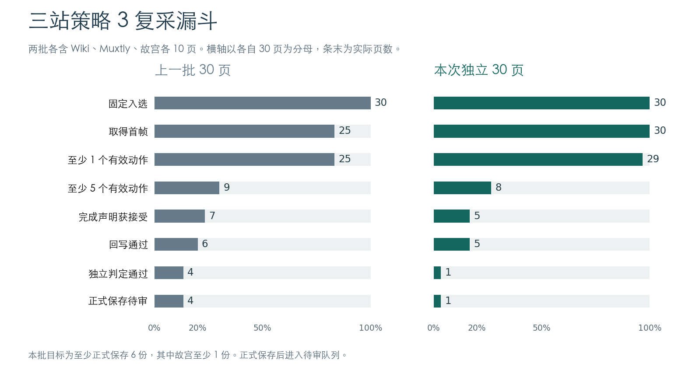

# 三站策略 3 独立 30 页验证

2026-11-20，Wiki、Muxtly、故宫各 10 页全部结算。**正式保存待审 1/30（3.3%），距 6 份目标差 5 份。故宫 0/10，距该站目标差 1 份。** 上一批单独计数为 4/30（13.3%），其中故宫 1 份。本批保存率低 10.0 个百分点，两批页面不同。唯一保存样本为 Muxtly 的 `S000001_sample_000278`。5 个有效动作完成收入 10000、成本 7000 的利润率计算，末帧显示净利 3,000.00 和利润率 30.00%。保存收据、注册库、候选结果与独立判定一致。QC 和人工审核均未运行。[逐页对账与原件位置](accounting.json)

## 漏斗

| 站点 | 固定页 | 首帧及决策 | 至少 1 步 | 至少 5 步 | 完成声明获接受 | 回写通过 | 独立判定通过 | 正式保存 |
|---|---:|---:|---:|---:|---:|---:|---:|---:|
| Wiki | 10 | 10 | 10 | 2 | 1 | 1 | 0 | 0 |
| Muxtly | 10 | 10 | 10 | 5 | 4 | 4 | 1 | 1 |
| 故宫 | 10 | 10 | 9 | 1 | 0 | 0 | 0 | 0 |
| **合计** | **30** | **30** | **29** | **8** | **5** | **5** | **1** | **1** |

- **最早的大量流失发生在第 1 至第 5 步。** 29 页取得有效动作，其中 21 页停在 1 至 4 步。另 1 页在首次动作之前结束。合计 22 个不足 5 步的页面中，10 页短流程、7 页反复被驳回、3 页工具协议失败、2 页收到模型服务 HTTP 400。全部计入分母。
- **故宫 10 页全部取得首帧，仅 1 页走到 5 步。** 6 页以连续驳回结束，2 页短流程，2 页工具协议失败。39 次当前帧引文驳回涉及 10 个不同的页面画面，其中 30 次涉及上一动作的可见结果，20 次涉及当前条件，两类可重叠。日志里出现了滚动后仍引用旧章节、把页面标题写成当前正文的情况。唯一达到 5 步的尝试漏填完成状态，模型的字段修正回复未满足单次工具调用格式，该页结束。
- **达到 5 步的 8 页中，5 页完成回写，4 页被独立判定否决。** Muxtly 的二维码、农历换算和折扣工具都得到了所需结果，但轨迹中出现输入值尚未就绪就计算、选择尺寸早于指令规定顺序、点击错误输入框等问题。Wiki 的电影页面确认了观影人次，任务中还要求的票房金额没有找到，并出现回滚重读。操作规划应先核对输入值与顺序；阅读规划应从可见入口选一个能查实的终点。五个进入独立判定的页面中，四个取得否定结论，一个通过。[各页判定理由](accounting.json)

## 运行和既有补修的实测表现

19:55:43 按原名单顺序固定每站最前面的 10 个未领取候选。候选身份和生产者记录的实际落地地址与原 150 页、上一批 30 页均零重叠。首次复核因归档路径类型错误停在领取前，修正后复用同一名单。19:56:03 启动正式策略 3 消费者，实测峰值 20，约 12 分 45 秒完成执行。20 个进程均退出 0，原生报告完整性 PASS。运行使用 `816701a`，本批没有补位或重复领取。[固定名单](selection.json) · [独立性核对](cohort-check.json) · [运行进度](timeline.json)

上一版的空值提示出现在 Muxtly 7 页的 34 次决策请求中，10 页都至少有一次请求显示已填值。上一版的缺状态修正实际触发 4 次，3 次由模型只补上状态并通过工具校验，1 次响应格式仍然无效。协议修正成功的页面仍要通过动作、完成事实和独立判定。[请求与补修记录](observations.json)

消费者共派发 244 次模型 HTTP，226 次成功、16 次响应无效、2 次 HTTP 400，新增 UNKNOWN 为 0。已知输入 892,359、输出 52,678 token，另两笔无用量，整批费用未知。231 次决策各用 1 张图，7 次回写各用 2 张，6 次判定阶段 HTTP 各用 3 张。5 个页面各有一份独立判定，额外一笔 HTTP 用于纠正同一判定作业的无效协议响应。1,143 个历史 claim、859 个历史 attempt、消费者 47 条和生产者 21 条历史未决记录的受保护字段均无差异。同期另有 2 条新生产者请求，归属其他作业，本批消费者用量独立核算。[逐账核对](accounting.json)

## 收尾后的工程修复

1. **故宫的正文引文。** 规划消息现在分别说明页面标题和当前视口正文各自能证明的字段，并在首次决策就给出本视口可直接核验的短原文。对 39 条真实驳回记录重放，39 条都能从对应原帧提供通过现行校验的片段。同一帧的多次驳回分别计数。实际任务是否能沿这些线索继续，仍需靠真实决策验证。[归档重放](post-run-verification.json)
2. **Muxtly 的参数与顺序。** 工具协议要求选择下拉项时同时提供控件与完整选项，输入时提供控件与文本。规划器展示捕获的可用选项并提示核对实值后计算。5 页上共 11 条漏填选项、另 1 条漏填输入文本的旧决策均能在新协议层拦住。11 条下拉决策都能显示目标控件的实际选项。未选中的标签只用于操作。[归档重放](post-run-verification.json)
3. **重复的描述超长。** 3 个真实决策分别连续两次超出条件、动作依据或上一动作结果的长度限制。现在沿用现有的一次修正机会，请模型只重写超长描述，保留已经选定的动作及参数。隔离本地 Chrome 通过了描述字段修正、保存与导出，以及原有完成状态修正链。[验证记录](post-run-verification.json) · [复现驱动](verify_description.py)
4. **消费者账本写锁。** 本批记录 38 次 SQLite 瞬时写锁重试，均未触发停派。源码和只读查询计划确认，新会话在写事务内检查探针后的余额错误及历史失败时会扫描模型请求表。已在消费者既有启动准备中为两条查询建立部分索引。5,301 笔原账的临时副本上，余额检查从 18.956 秒降至 0.000017 秒，历史失败读取从 1.328 秒降至 0.003442 秒，完整结果相同。该对照只测两条查询，具体每次锁竞争的持锁进程仍未知。[查询计划与耗时](ledger-verification.json)

收尾补修完成后只进行了离线回放、核心测试与本地浏览器验证。这些结果没有新增正式保存。独立批次的最终保存率为 3.3%。[完整验证范围](post-run-verification.json)
