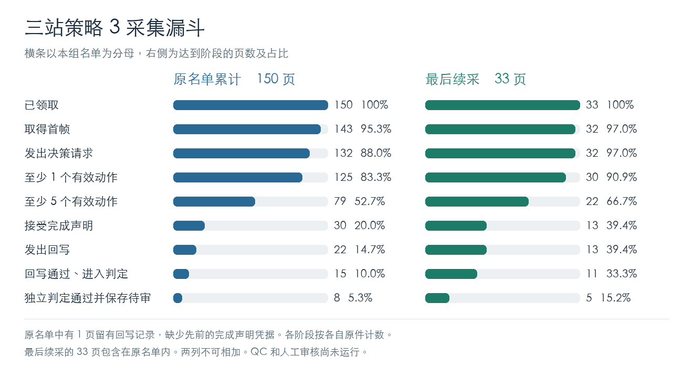

# 策略 3 三站采后复盘与工程修复

Wiki、Muxtly、故宫各 50 页的原名单已全部领取，记录 142 次正式尝试。8 份通过策略 3 独立判定，取得正式保存收据并写回候选，保存待审率为 **8/150（5.3%）**。最后续采的 33 页贡献了其中 5 份。QC 和人工审核均未运行，客户验收状态为 UNKNOWN。本次修复只读取生产原账，未新增真实请求或领取。[原批终态](../stepwise-three-sites-150-20261118/run-05-final.json) · [同账复算](verification.json)

| 原名单 | 领取 | 首帧 | 发出决策 | ≥1 步 | ≥5 步 | 接受完成 | 发出回写 | 回写通过并进入判定 | 判定通过并保存待审 |
|---|---:|---:|---:|---:|---:|---:|---:|---:|---:|
| 中文 Wiki | 50 | 45 | 42 | 42 | 30 | 11 | 9 | 7 | 3（6%） |
| Muxtly | 50 | 49 | 45 | 41 | 25 | 10 | 8 | 5 | 5（10%） |
| 故宫 | 50 | 49 | 45 | 42 | 24 | 9 | 5 | 3 | 0（0%） |
| 合计 | 150 | 143 | 132 | 125 | 79 | 30 | 22 | 15 | 8（5.3%） |

79 页达到五步，只有 30 页得到可接受的完成声明。其余 49 页构成最大的阶段损失。15 页进入独立判定，8 页通过，8 份保存收据均核验通过。在最后 33 页中，阶段集合逐级包含。累计口径下有 1 个历史 Wiki 页留下回写记录但缺少完成声明凭据，各阶段按原件分别计数。另行停止的独立名单单独记账。[逐页核账与判定记录](../stepwise-three-sites-150-20261118/remainder-accounting.json)

## 已修复的工程问题

| 实际问题 | 修改与验证 |
|---|---|
| 6 页反复照抄长标题，产生 30 次字段超长回复 | 当前帧有可用标题时，宿主取连续短原文生成不超过 30 字的交付页名。缺少可用标题时沿用模型必填。每轮留存原始参数、宿主页名和采纳结果。30 条原始答复在对应原帧上的新版工具协议全部通过。 |
| 被拒动作污染上下文 | 9 轮在焦点、编号、缺参数或重复动作检查被拒时已改写目标或笔记。现将上下文更新推迟到绑定与画面复验通过之后。被拒轮保留原始提议，上一实际动作的观察留给下一条合法决策回填。后续提示可读到实际观察。 |
| 当前帧引文误判与反复纠错 | 当前文字按可见片段分别匹配，阻断跨标签拼字、不可见控件名及用标签页标题证明末帧业务结果。提示提供未经人工省略号改写的短原文。同一视图同一动作的引文错误连续三次即收口。19 页的 171 次历史驳回中，已有的选中项接线可证实 24 次，其余 147 次用当前帧仍无法支持。 |
| 全选带了真实焦点的编号却被拒 | 全选同时携带编号时核对本帧唯一焦点，复验时核对同一控件，派发和交付保留平台实际按键。35 条历史快捷键驳回中，28 条现在可绑定并复验，其中 12 条受益于本次焦点编号修复。缺按键及把多次退格拼成一次操作等 7 条继续拒绝。 |
| 回写超长、独立判定缺字段时反馈不完整 | 最后 33 页还出现 2 次按键数组超限、4 次回写字段超长、2 次判定缺字段，后两次属于同一页。网关现在返回具体字段、长度上限和实际长度，连续两条无效响应时记录阶段、请求编号与错误字段。回写提示给出明确字数，判定要求完整的三个布尔值和两个步骤数组。正式保存仍需全部业务条件通过。 |
| 预留后同步清单、启动 attempt 或绑定入口时中断，可能遗留活跃记录 | 取消时先等已启动的本地写入结束，再由原所有者依数据库中的实际状态结算。未启动记 abandoned，已启动记 rejected 并记录中断或锁错误。真实 SQLite 测试覆盖三个取消窗口、绑定写锁及错误凭据。租约失效时保留本地诊断，由原账继续隔离。 |
| 20 进程定时续租争抢 SQLite 写锁 | 候选和父模型作业每轮仍校验归属，剩余租期进入续租窗口才写入。隔离候选 WAL、模型账 DELETE 与生产模式一致。20 个真实子进程各轮询 3 次，健康租约下两库分别从 60 写降为 0 写，进入续租窗口时各写 20 次。20 个进程正常退出，撤销的候选、作业及父作业均阻止继续。 |
| 导航证据不足、失租与报告重读 | 一次 Wiki 入口访问得到 HTTP 200，取首帧时地址已变，已有 HTTP 链不能证明该落地。实时采集按页面导航拒绝并保留端点和首帧证据，离线读取篡改的链仍报错。用户停止、失租与模型结果未知分别留证。原生报告复用同一次注册库读取，继续逐份核验保存文件，整份 150 页报告从 203.184 秒降至 28.016 秒，所有输出字段一致。 |

证据可由原模型请求编号、原帧和原生报告回查。30 条标题回放和 28 条快捷键回放统计的是历史回复在确定性校验处的结果。生产样本数仍为 8。[真实原帧回放](replay.json) · [验证与关键日志摘要](verification.json)

## 怎样提高合格保存率

1. **Muxtly 优先解决算完却没能结束。** 最后 33 页中，该站 9 页达到五步，3 页提交可接受的完成声明，这 3 页全部保存。让规划器围绕一组明确的输入与单位完成计算，输入后核对原值是否被替换，数值和单位在当前视口得到验证后及时结束。衡量“达到五步后接受完成”的比例，同时观察已输入参数却反复编辑、耗尽预算的页数。
2. **Wiki 优先减少取得答案后的重复动作。** 最后 6 页进入独立判定，2 页保存。有一页被判目标已完成、证据充分，但第 7–12 步冗余，第 9 步还存在错配。后续规划应以已确认的原文和缺失事实选择下一节。最终答案已在视口且有效步数达标时直接完成。衡量独立判定标记冗余或错配的页数，并保留实际步骤。
3. **故宫优先选能通过真实导航证明的具体目标。** 最后 10 页中 4 页达到五步，2 页进入独立判定，均未保存。一页在详情与看图间往返，第 2–6 步被判冗余。另一页目标模糊且未完成。适合的目标例如从展览或藏品条目定位一件具体作品，再在详情核实其年代、材质或展期。浅页缺少可延伸事实时如实收短流程。分别记录五步达成率、目标具体性和冗余判定。
4. **把末帧证据和质量分母保留下来。** 续采中 22 页达到五步，9 页在完成声明前流失，分别为 4 页声明不可行、3 页探索预算耗尽、1 页连续驳回、1 页模型响应未知。13 页进入回写，2 页引用末帧无法支持的文字。11 页进入独立判定，5 页收到有效否定，另 1 页缺少完整协议回复。优先跟踪这三个流失点。后续获得新样本及审核结果后，同时报告“真实保存待审数 / 入选页数”“QC 通过数 / 实际审核数”和审核覆盖率。[续采明细与分站判断](../stepwise-three-sites-150-20261118/remainder-analysis.md)

## 验证范围与历史缺口

最终版经过 6 条本地 Chrome 与正常消费者 CLI 链，146 项检查通过，6 份保存、6 份导出读回。表单链使用 35 字标题和原始全选参数 `["Ctrl+A"]` 及焦点编号，截图对应控件的选择区间为 0–3，覆盖值由 100 变为 50，末帧显示“计算结果：50”。另以真实 SQLite 事务注入中断、写锁及撤销归属。核心用例在既有方法中补断言，维护方法数未增加。[验证摘要](verification.json) · [浏览器复验驱动](local_browser.py) · [准备阶段故障复现](verify_preparation.py) · [并发续租复现](verify_renewal.py)

历史仍有 3 次预留、2 次运行中记录缺少终态，累计原生报告完整性为 FAILED。原件能证明这些窗口存在，也能复现中断后的遗留路径，无法逐条确定旧进程退出的具体指令或历史 SQLite 的持锁进程。入口超时、提供方拒绝、结果未知以及独立判定的业务否定保留各自处置。本次未重领已尝试页面、重发未知请求、修改生产账或运行 QC。修复对真实保存率的影响尚待后续独立的新批次验证。[原账终态](../stepwise-three-sites-150-20261118/run-05-ledger-check.json)
