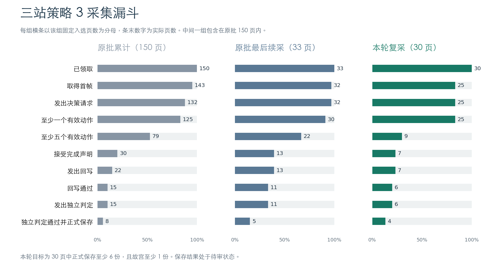

# 三站策略 3 复采与保存率复盘

2026-11-20，Wiki、Muxtly、故宫各 10 页全部结算。正式保存待审 **4/30（13.3%）**，距 6 份目标差 2 份。故宫 **1/10**，达到该站至少一份的目标。最终原生报告完整性 PASS，30 个候选各领取一次，26 个失败、4 个成功。两个运行段均观测到 20 个真实消费者进程，全部退出。[固定名单](selection.json) · [启动记录](startup.json) · [逐页对账](accounting.json)

## 漏斗

| 站点 | 固定页 | 首帧及首次决策 | 至少 1 步 | 至少 5 步 | 完成声明获接受 | 回写通过并进入独立判定 | 正式保存 |
|---|---:|---:|---:|---:|---:|---:|---:|
| Wiki | 10 | 7 | 7 | 3 | 3 | 2 | 0 |
| Muxtly | 10 | 8 | 8 | 5 | 3 | 3 | 3 |
| 故宫 | 10 | 10 | 10 | 1 | 1 | 1 | 1 |
| **合计** | **30** | **25** | **25** | **9** | **7** | **6** | **4** |

上一批累计 8/150（5.3%），最后续采 5/33（15.2%）。本轮比原批累计高 8.0 个百分点，比最后续采低 1.8 个百分点。页面不同，且本批分两段运行。一次 30 页结果尚不足以证明稳定达到 20%。[历史漏斗](../stepwise-three-sites-150-20261118/remainder-accounting.json)

- **25 页取得首个有效动作，16 页止于第 5 步前。** 其中 9 页短流程、6 页连续驳回、1 页终态工具协议错误。故宫 10 页均进入决策，9 页在此流失。短公告、简介和首屏已给出答案的词条容易设成一到三步即可完成的任务。后续应从首帧真实入口选择需要查找与核对的具体问题，在同一主题里定位一个有直接证据的终点。没有额外事实可查时保留短流程。
- **9 页达到 5 步，4 页最终保存。** 两个 Muxtly 尝试分别在 11、12 个有效动作后因连续驳回或声明不可行收尾。Wiki 一页在回写中把计算公式改写成引文，与末帧不能逐字匹配。另两份 Wiki 轨迹收到独立否定。一份回访已经核实的获奖章节，另一份只在目录看到四类贷款，任务却要求核实各类正文。阅读规划应先确认未解决的问题，再决定是否翻页；回写直接复制末帧最短充分证据。
- **5 页流失于入口。** Wiki 和 Muxtly 各有 2 次连接关闭。另 1 个 Wiki 页面请求和响应均为 `/wiki/World`，浏览器最终停在“世界”词条，只观察到 1 个文档响应，原始 HTTP 链无法证明该地址变化。此次保留了首帧和两端的真实地址。[逐页原因与运行事件](accounting.json)

## 故宫保存样本

`S000265_sample_000067` 来自《故宫博物院亮相2026中国文化旅游产业博览会》。5 个有效滚动动作沿正文依次读到展台、文创甜品和非遗展示，末帧有对应内容。首次回写引用了已离开视口的文章标题；同一轨迹的第二次回写通过。独立判定三项均为真，冗余和错配步骤均为空，注册库、候选结果和保存收据指向同一样本。其余三份正式保存来自 Muxtly。4 份均待审，QC 和人工审核均未运行。[样本与原件目录](accounting.json)

## 运行与修复

1. 从另一份原先已固定的名单中，按各站原始顺序取前 10 个从未领取的候选。领取前复核了生产者证据、实际落地和唯一性。所有 30 页始终计入分母。策略 3 普通决策使用 1 图，正式账本对新作业授权两图回写、最多三图独立判定。[选择驱动](run.py) · [实际容量](startup.json)
2. 首段使用 `b0df635`。在故宫公告的历史截图与归档网页中复现了文字漏采。标题旁的装饰图位于内边距中，宿主原先把整个标题剔除。修复后本地 Chrome 读回了栏目标题和公告链接；当装饰真实覆盖正文时仍然拒绝引用。规划器现在识别同一详情打开后立即返回的循环，保留新任务所需的跨页访问。首段领取 23 页、保存 4 份。因主动暂停新领取，首段原生报告记录固定 30 页尚缺 7 页，所有已领尝试均已结算。[故宫原页复现](replay.json) · [首段账](segment-01.json)
3. 首段另有 11 条共享消费者账本的写锁重试。只读查询计划证实，消费者在写事务内执行了一次仅供生产者使用的请求表扫描，另一次作业计数也不参与消费者决策。修复把两项查询放回真正使用结果的分支。隔离 SQL 跟踪验证消费者零次、生产者仍执行两个检查，原有未决预留仍阻断重新派发。具体持锁者未确定。[修复核验](segment-02-verification.json)
4. 第二段使用 `6bf605d`，只新增领取余下 7 页。工具协议明确要求模型在结束时选择成功或不可行，引文驳回附本帧可直接核验的原文片段。首段 12 次漏填状态的真实响应可在协议层识别；30 次引文驳回均能从当帧获得合法片段。第二段实际新增保存 0 份，写锁重试 0 条，只有 7 个新候选可执行。最终累计完整性 PASS。[分段进度](timeline.json) · [累计原账](accounting.json)
5. 本批收尾后，又从 Roth IRA 计算器定位到一个输入错误的来源。首屏 4 个可见数值框都为空，模型却围绕“默认参数”反复滚动。控件列表现显示已证实的实际输入值或空值。故宫另一页连续两次回复 `complete` 都漏掉状态；网关现在复用既有的一次字段修正，在原动作上只补模型明确填写的错误字段，保留原回复和修正记录。最终核心 49 项及 2 个子检查通过；6 条正常本地消费者链 146/146，另有真实本地 Chrome 的缺状态修正链 25/25，均读回保存与导出。两项末次补修仅有离线结果。[补修验证](after-run-verification.json) · [缺字段重现驱动](verify_terminal.py)

正式消费者共发出 298 次模型 HTTP，291 次成功、7 次响应无效，新增 UNKNOWN 为 0。已知输入 1,082,682、输出 64,834 token，费用未知。逐行核对之前的 1,113 个 claim、834 个 attempt 以及消费者 47 条、生产者 21 条未决请求，受保护字段无差异，既有未决作业上新增请求为 0。[完整账与模型用量](accounting.json)
