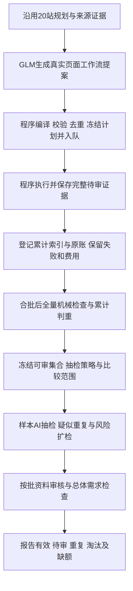

# WebCollect统一优化方案

2026年10月29日。目标是把当前需要逐站编写工作流、逐条运行完整QC的小样本流程，改造成可恢复的批量生产流程，以真实有效产量、整体重复度、质量覆盖、成本和耗时判断扩量条件。

后续分工统一为：**GLM规划 → 程序采集 → 全量机械检查与累计判重 → 样本AI抽检 → 按批资料审核。**优先修复工程误拒绝和重复审核，再接通通用规划与批次编排。hao123递归发现暂不实施，采集期动态模型纠错不列为本轮前置。

本方案汇总本次对话及项目已有记录中的决定，更新此前[效率规划](采集修复与效率优化规划-20261029.md)的后续优化方向，尤其纠正“零像素差是客户硬性要求”的解释。[问题清单](本轮采集问题与统一修复清单-20261029.md)继续保留各次原始失败和修复追踪。本次只整理方案，不修改代码、运行配置、冻结任务或原账，也不启动主线程任务。

## 已确定的范围和质量要求

| 项目 | 后续安排 |
| --- | --- |
| 来源范围 | 沿用已有20站规划及原站点池，以整体应用识别站点。规划是可复用资产，不能当作20站均有可执行产能 |
| 任务长度 | 新任务优先自然完成的5至8个必要动作，达到5步即可；现有5至10步校验保持，必要的9至10步低优先选择。wait和complete不计有效步数 |
| 任务差异 | 目标、必要路径、页面状态和结果判定应有实质差异；换参数、关键词、裁切或无关操作不增加独立产量 |
| 页面归属 | 当前每个实际任务页面最多一条有效轨迹的规则保持；URI或查询参数不同不能直接当作新任务页 |
| 采集方式 | 普通新任务单次真实执行，保存动作前原始PNG、同步树、动作和可见终态；不新增完整演练或独立准入的强制前置 |
| 审核重点 | 全量检查证据和累计重复，AI重点承担规划、抽检和总体语义判断；不默认每条反复进行全套AI审核 |
| 历史和恢复 | 沿用原链、编号、尝试、失败、费用及审核记录。修复形成新版本和新证据，不删除旧失败、不回收编号、不重发UNKNOWN |
| 原运行边界 | 主线程此前的同站双功能首关与本轮最多40次正式尝试作为原约束保留，已消耗尝试不重置；本方案不扩额度或构成侧会话恢复授权 |

中文界面比例、真实操作、可核验终态、原图真实性、字段与动作合同、四路重复规则及正式总体类目限制继续适用。像素稳定性与跨样本判重是两个问题：优化前者不改变后者。

## 当前能力和生产缺口

| 环节 | 当前已有 | 尚需完成 |
| --- | --- | --- |
| 来源和站点规划 | 20站草案、来源探测、资格及共享池读写模块 | 区分候选、资格、可执行任务和实际合格容量；修复来源多图协议及失败归因 |
| GLM轨迹规划 | 受限的表单model入口；显式工作流编译器 | 将真实页面证据交给GLM生成通用工作流，经校验、去重后进入持久队列，减少每个新功能对Codex手写工作流的依赖 |
| 程序采集 | 冻结计划、真实动作、原图树、结果及失败保存；本轮model:null | 修复正常加载前进误判、动作前/终态重新取证和过严像素门禁；当前没有自动模型纠错入口 |
| 机械与累计QC | 格式、证据、四路判重及累计集合模块 | 批次编排、保存与索引恢复的一致性，以及后续大规模全局索引 |
| 样本AI审核 | 可配置比例、冻结抽检、视觉/语义审核 | 当前单条入口写死AI100%，需接通真实合批及明确的风险扩检规则 |
| 资料审核 | 对包内说明、标注、统计、来源和审核覆盖进行一致性审查 | 从单条重复审包改为按实际批次审资料，复用绑定仍有效的已有结果 |

上述“已有”表示代码模块或已有单次证据，不等于批量生产验收完成。本方案不以旧文档中的运行快照报告当前实时产量。

## 生产流程和AI职责

来源阶段已有的资格模型检查单独计量。规划模型输出只是一份待校验的提案；采集成功只到`collected_pending_review`；抽检、批次接纳、逐条已审、发布和客户验收分别记录。

GLM负责理解页面、提出任务、判断必要步骤及可见完成条件。程序负责动作、证据、编号、预算、幂等、门禁和确定性检查。Codex负责开发程序、修复协议及分析新异常，目标是退出每个新功能必须人工编写工作流的常规路径。

## 可复用的站点规划和任务队列

20站规划继续使用，逐步补充每站的整体应用身份、真实功能页、任务族、中文与可见能力证据、最近核验时间、停止原因，以及规划数、入队数、采集数、QC有效数。容量先以观察到的任务为线索，再由执行和累计QC逐步证实，不给每站预填固定产量。

每个候选任务应保存任务目标、实际初始状态、必要动作、子目标、可见结果断言、页面/控件锚点、来源证据摘要、规划器与提示版本、预计步数及历史差异线索。重复规划先查原任务和原作业账；草稿、已派发、待审、失败及关闭原因保持可区分。

GLM入口优先复用`task_generation.py`和`workflow_proposal.compile_workflow`，扩展现有受限表单Schema。不能只切换`--generator=model`就宣称完成通用规划。模型使用实际控件和原始证据引用，程序核验控件、动作空间、证据有效性和结果判据，不接受虚构坐标、控件或成功结论。

必要步数按实际初值和未完成目标决定。默认值已经满足目标时不反复修改；点击、全选、输入按真实执行记录，不拆分凑步、不删掉必要滚动。自然不足5步的任务不进入本轮生产队列。对同一参数模板大量改数值，不能形成新的有效供给。

计划及数据可以后续继续使用，但复用有层次：业务目标和功能地图可长期保留；执行计划使用前核对当前页面与实现绑定；已采数据在原件、规则和比较范围仍适用时复用审核。网站更新不删除旧数据，也不能把旧计划未经核验直接重放。

## 采集正确性和稳定性优化

### 正常加载前进和有界重新取证

随机数失败已确认来自`interactive→complete`，原图像素未变。满足字体、图片、关键状态及所有其他检查时，应接受正常单向就绪前进；`loading`、导航、关键控件变化及结果变化继续拒绝。

动作派发前遇到可恢复的同步/稳定性错误，可以在尚未执行动作时重新捕获完整图树、重算坐标与命中，并保留被拒候选。终态修复现有异常文案匹配失效，接通最多3轮、总12秒的已有重新取证边界。使用结构化错误类别，不再依赖某一版中文字符串。

重新取证不重放已完成业务动作，不拼接中断轨迹，不在动作执行后补图冒充动作前证据。来源捕获失败同样保存当次比较帧、树及差异；没有原始比较证据的历史原因继续为UNKNOWN。

### 像素规则按真实质量需求重新设计

客户要求真实动作前截图、同步界面树、清晰控件和正确操作，未要求所有比较帧零像素差。当前实现仅允许有完整证明的非交互装饰图片区域变化，其余区域任何像素变化都拒绝，属于更严格的工程实现。

维基文库本次原始证据显示：原/live/final状态完全一致，资源就绪，唯一变化是顶部搜索按钮右边缘`(773,22)`一点颜色从RGB`(131,136,141)`变为`(146,151,155)`；当前操作目标在下方输入框，目标、值和命中均未变化。这足以说明“1像素变化”不能单独证明轨迹不合格；具体浏览器绘制机制仍未确认。

新规则先采用有界重新取证，再验证有证据支持的局部微小绘制容差。目标位置、文字和数值、输入焦点、选中/禁用状态、遮挡、结果及断言等关键变化仍须拒绝；不采用整页相似度高就放行，也不凭这次1像素或上次9像素直接指定通用阈值。可接受区域、幅度及面积必须通过正反例验证，并保存差异位置、幅度、涉及元素、判定理由和规则版本。

原始PNG完整保存，不裁切、不覆盖、不涂抹。调整的是判定规则，不是图片内容。新规则仅用于适用的新取证和新执行，旧失败不改签。本例登记为C18，与C03/C11/C12一并治理。

验收需同时包含微小边框绘制变化，以及一字符/数字改变、复选框或按钮状态变化、目标移动、遮挡出现等危险反例，避免“像素少”成为无条件放行依据。暂时无法证明变化无关时，保留待诊断或失败状态。

证据：[维基文库当次比较帧与状态](../results/pilot1000-20261028-r01/multisite20-20261029-r01/wikisource-directory-r04/capture/evidence/S000006_sample_000001/capture_failure.json)。需求依据：[总则](../request/web操作采集需求/需求书-Web浏览器自动化操作轨迹数据集.md#1-用途与总则)、[格式](../request/web操作采集需求/需求书-Web浏览器自动化操作轨迹数据集.md#4-格式)、[验收](../request/web操作采集需求/需求书-Web浏览器自动化操作轨迹数据集.md#7-验收)。

### 失败分类和原账恢复

| 责任 | 处理原则 |
| --- | --- |
| 模型鉴权或服务故障 | 按原通道阻断和诊断，保留请求状态及费用；不把401直接判为网站不可用 |
| 本地配置或协议缺陷 | 记录工程问题，访问前检查配置；来源多图映射、采集器误判与接口错误分别归因 |
| 站点或真实任务失败 | 保留实际原因并按整体应用累计，真正达到既有停站条件继续停止 |
| 责任不明或用量不明 | 保留UNKNOWN，先查原账与证据，不换作业重发或补记零费用 |

Muxtly等历史误计不直接清零。拟通过追加式复核收据绑定原执行ID、证据、原归因和新判断，展示原始计数与复核计数；机制验收及后继合法决策前，原停站事实保持。整站止损不通过换页、参数、目录或重启绕过。

BeJSON来源接口按页面ID组织全部证据图，返回每页一条结构化结论并声明覆盖的图像ID。校验页面唯一、图像归属和帧覆盖；不截断返回数组或丢弃第二张图来通过。模型成功与本地协议校验失败分别入账，成功请求费用不能丢失。

保存原件、登记累计索引和共享池状态同步须可恢复。复用已有回写模块，针对保存后中断、重复恢复和索引缺失补齐验收；恢复只补缺失状态，不重采成功数据、不重复审核有效原件。

## 批量QC和资料审核

### 批次形成和触发

采集阶段保留即时的结构、坐标、同步和必要重复拦截，只保存待审候选。后置QC按显式批次触发，避免每保存一条就默认发起三类模型审核。

建议试点以最多10条真实保存候选形成一个小批次；达到该数、原正式尝试额度耗尽、任务队列结束或出现停止条件时，交接实际已有候选。工程/鉴权故障导致无法审核时仍保留待审，不因强行凑批继续派发。批次数与触发条件是新编排参数草案，不修改现有冻结策略。

先固定原始候选清单与来源账，运行全量机械和累计判重，保留被淘汰对象及分母；再为可审集合冻结成员、原件摘要、比较总体和抽检种子。审核开始后成员变化形成后继版本，不能在同一冻结集合里悄悄替换。恢复同一批次先查已有作业与收据，不重发成功或UNKNOWN请求。

主线程原同站双功能首关仍按其原独立累计QC要求处理，已有AI100%收据不改；该首关例外不推广为后续逐条审核惯例。

### 全量检查和样本AI抽检

全量机械覆盖格式、图树/标注引用、动作与坐标合同、编号、原账来源、完整终态证据，以及四路累计判重和总体分布核算。机械检查不能证明全部视觉语义正确，四路判重也不能替代实质差异判断。

抽检参数建议以**基础随机20%**为试点起点，对新功能流程、新规划器或稳定性规则版本、异常恢复及疑似语义重复增加明确的风险覆盖。新流程首条建议全帧AI审核；不是每个新参数都重新算新流程。风险入选与随机入选取并集并报告实际覆盖，不宣称实际比例始终等于20%。具体比例和扩检规则须随新批次策略冻结，当前仍未生效。

当前20站试点可能以首次验证的功能为主，风险覆盖后的实际AI比例可能接近100%；不能承诺本轮仅审核20%。这一阶段优先兑现合批资料审核、避免重复派发及减少返工的收益，后续只对已有充分证据支持的流程降低基础覆盖，不以重复参数轨迹制造“成熟样本”。

不能只修改单条入口百分比：分母1时20%向上取整仍是1；按站点分层也会使小组实际比例升高。现有模块主要支持按批次或站点抽样，按工作流/风险覆盖需要显式编排和相应验证，不能当作已有开关。

AI对入选轨迹检查原帧与动作对齐、终态、文字和隐私等，对同质任务簇、疑似重复对及随机样本判断实质差异。相同流程不能因多次出结果就永久免检。发现问题后扩检受影响流程或批次；FAIL/UNKNOWN按适用门禁转实际复核或人工待审，不自动放行。没有真人结论时保持待审。

未入选保留`NOT_SELECTED`，按显式抽检契约报告批次接纳，不标成“逐条AI通过”。现有单条终审计数与未来批次策略接纳必须分列；实现和澄清记录应一致，不能把原要求逐条终审的旧任务静默改为抽检。某条或某对按适用规则仍需实质差异裁决时，必须完成对应裁决。

抽检通过率是入选总体的结果，不能直接称为全集逐条实测合格率。新流程风险样本与随机样本分开统计；小样本全部通过也不能证明大规模低缺陷率。

### 按批资料审核和结果复用

资料审核检查README、标注与真值、metadata、站点清单、动作/字段说明、来源说明，以及数量、分布、淘汰原因和审核覆盖是否一致。它不是文字润色，也不替代原帧审核或证明法律事实。

批次机械生成并校验数量、哈希、字段和统计，AI重点检查说明与事实间的语义矛盾。共享不变资料按内容ID与原绑定复用，逐字精确重复内容不反复全量发送；批次新增统计、来源和覆盖变化按影响审核，不能遗漏或截断关键信息。已有模型/提示/规则及比较范围不适用的结果不能照搬。

当前每批资料政策仍覆盖整批文件；“样本抽20%”不等于“只审20%的资料”。资料审核不再按每条样本重复生成同一套共享说明和模型作业。

## 耗时和成本优化

日期样本的已有测量显示，采集入口约29.43秒，其中浏览器采集约15.04秒；QC约103.36秒，其中视觉26.39秒、差异16.30秒、资料57.86秒。这是单条运行证据，不是当前生产速度或任意规模批次的固定耗时。

| 优化方向 | 主要收益 | 验证重点 |
| --- | --- | --- |
| 修复加载、像素与协议误拒绝 | 减少整条失败和重复准备 | 正确任务不被误拒，危险变化不漏检，原失败保留 |
| GLM工作流队列 | 减少逐功能会话编写和等待 | 可编译率、去重后入队率、规划成本、真实执行成功率 |
| 合批后抽检及资料审核 | 分摊共享开销，减少重复请求 | 实际入选数、请求数、缺陷发现、待审数及单有效条成本 |
| 幂等保存、索引和审核复用 | 减少中断重跑和重复计费 | 各中断点恢复后只补状态，原件与费用完整 |
| 必要的5至8步及按状态等待 | 减少无关动作和固定等待 | 原始动作完整，等待有界，未加载/遮挡不被豁免 |

各阶段分别记录来源、规划、页面加载、capture、动作前重验、动作、等待、保存/交接、机械QC、AI抽检、差异和资料审核的自然耗时。嵌套阶段不能相加，并发任务执行秒数不能当墙钟时间。

模型账分来源、规划、样本审核、实质差异、资料及诊断记录请求、输入/输出/cache/reasoning、失败和UNKNOWN。Codex会话成本与项目API费用分开；平台未提供的费用保持UNKNOWN。报告总成本与每个有效样本的成本，包含失败、准备和共享开销分摊；有效数为0时均值未定义。

不以缩图、删除图树检查或忽略失败降低成本，也不预先承诺提速倍数。局部验证通过后，再用同口径真实批次比较优化前后结果。

测量依据：[日期采集](../verify_results/multisite20-20261029-r01/hybrid-resume-r02/lddgo-date-r04-collect.json)、[日期QC](../verify_results/multisite20-20261029-r01/hybrid-resume-r02/lddgo-date-r04-qc.json)、[浏览器阶段](../results/pilot1000-20261028-r01/multisite20-20261029-r01/lddgo-date-r04/capture/metering/phases.jsonl)。

## 实施次序和验收交付

| 阶段 | 对应问题与模块 | 应交付的结果 |
| --- | --- | --- |
| 第一阶段 正确性修复 | C01/C02/C03/C04/C11/C12/C16/C18；来源pipeline、browser、collect、失败账 | 结构化责任与协议、当次失败原件、正常就绪前进、有界重新取证及有依据的新像素规则；危险反例保持拒绝 |
| 第二阶段 GLM规划与恢复 | C05/C06/C07/C08/C13/C17；task_generation、workflow_proposal、current_chain、既有池回写 | 真实证据提案、编译与必要步数排序、幂等待采队列，以及保存/索引/池同步中断恢复 |
| 第三阶段 批次QC | C14/C15；qc_handoff、delivery_sampling、delivery_pipeline、reviews | 可配置合批触发、冻结集合、随机与风险覆盖、按批资料审核及有效审核复用，保留首关例外 |
| 第四阶段 测量与报告 | C09/C10及计量模块 | 阶段化耗时和费用、失败责任、累计重复与质量覆盖报告，分别报告已完成和未验证范围 |
| 第五阶段 扩量工程 | 经前述批次验证后的全局索引、调度和存储 | 容量调查、增量累计去重、受控并发与跨机恢复；不在本次文档任务中启动 |

按直接阻断项和受影响调用链实施，复用现有模块，不将整仓重构或历史全量审计增加为前置。每项修复运行选定离线正反例，绑定实际源码并保留新旧测试记录；公共契约变更或失败再扩大范围。离线PASS不计真实产量。

主线程后继真实验证沿用原20站和原账，先核对已消耗尝试、停止状态及首关收据，再在其仍有效的授权范围内执行。40次是正式尝试上限，不是合格数或模型请求数；工程修复不把已消耗尝试归零。停止或预算耗尽时，审核已有完整候选并如实报告缺额。

## 每批统一报告

| 指标 | 统计口径 |
| --- | --- |
| 供给 | 整体应用数、合格来源页、规划提案数、可编译数、去重后可入队数；观察容量与执行证实容量分列 |
| 正式尝试和采集 | A为正式尝试，S为完整保存候选，采集成功率S/A；来源探测与工程预检不混入A |
| 重复 | N为明确累计比较总体，D为去重后认定的重复样本数，报告D/N；另列四路候选对及重叠，不把候选对数当重复样本数；未决单列 |
| 质量 | 分别列机械通过、样本AI实际入选/通过/失败/未知、随机与风险结果、逐条终审、按批策略接纳和待审数量 |
| 合格率和有效产量 | 逐条终审合格率与批次接纳率使用各自明确分母；生产有效数/正式尝试数作为产出率，不能用抽检通过率替代 |
| 成本和耗时 | 实际已知费用、UNKNOWN、模型请求/用量、失败返工、端到端墙钟及每有效条成本；积累足够样本再给中位数和高分位 |
| 最终状态 | 本轮新增、累计有效、待审、重复、淘汰、人工已审、发布、客户验收及目标缺额分别报告 |

“生成了结果就基本通过QC”可能同时受到采集器前置过滤和样本量小的影响，不能据此取消视觉语义检查。后续应同时观察合格样本质量和被拒样本误杀，保留淘汰原因供复核。

## 扩到20万条的条件

20站规划和已有数据均可延续使用，但20站不等于20万条任务供给。按当前实际任务页唯一及实质差异规则，需要证明足够多可独立计数的任务容量；不能靠平均每站扩写一万个参数变体满足规模。

| 条件 | 必须取得的证据 |
| --- | --- |
| 可执行供给 | 按应用/功能页/任务族统计经编译、执行和累计QC证实的容量，维持类目分布；不足时再选择新的合规发现方式，当前不引入hao123 |
| 自动规划和执行 | 新功能能由GLM提案经程序校验入队，常规任务不依赖逐条会话改代码；失败和停止可恢复且不重复执行 |
| 质量和差异 | 全量机械、四路累计去重、实质差异覆盖与抽检契约均可执行，未决不会被算合格；证明低误拒和低漏检 |
| 去重规模 | 20万条全配对约200亿对，不把小批次穷举耗时线性外推；建设增量指纹及候选检索索引，并对照小集合穷举验证不漏掉规则命中 |
| 资源与并发 | 实测每条原图/树/审核/失败版本的存储占用与保留策略；按站点访问约束扩大并发，验证原账、全局去重与分片恢复 |
| 模型和费用 | 可靠通道、鉴权阻断、限速及完整用量账；按真实批次验证规划和QC吞吐及单有效条成本 |
| 交付 | 正式有效集合、跨包检查、20个各1万条ZIP及其附件一致，满足真实人工/客户验收要求；实验PASS不能代替正式交付 |

后续以实测有效产出率`y=有效新增数/正式尝试数`估算剩余正式尝试`ceil((200000-Q0)/y)`，其中Q0是同一有效规则下已可计数的累计量；y为0或尚不稳定时不出工期承诺。预计工期使用实测端到端每日有效产量，预算使用包含失败和共享开销的每有效条成本，并单列尚未计量项。

先用原40次上限内的后继结果回答“误拒是否降低、GLM能否供给、批次QC节省多少、实际有效产出率多少”。达到20万条需要的进一步站点、时间、费用和机器数，随后按这些实际数据评估，不由本方案预填。
