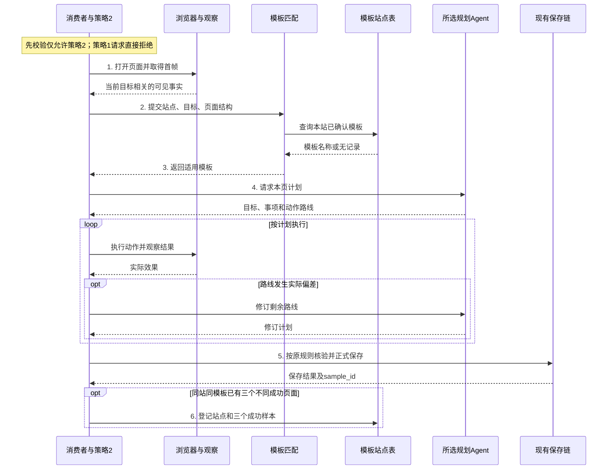
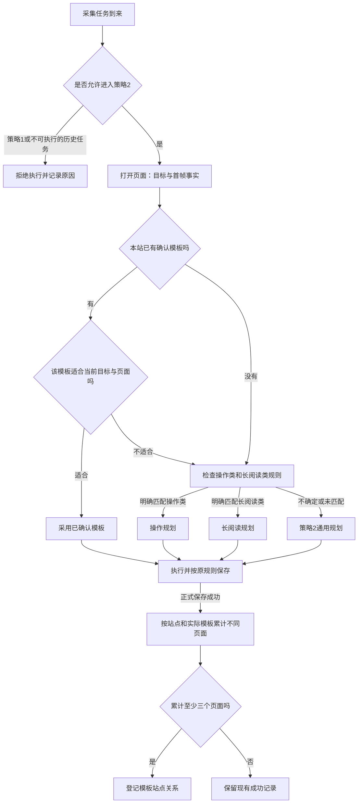

# 策略2子规划 Agent 与模板匹配设计

日期：2026-11-15。状态：设计已按用户反馈简化，并补充模板独立研发边界，尚未实施。

目标是在策略2中按页面任务选择操作类、长阅读类或通用规划，并把已经实际成功的站点记录下来，方便后续优先使用合适模板。工程优先快速完成交付，复用现有执行与保存链。

本方案取消此前提出的模板定义SHA、配置快照、额外身份绑定、模板版本及专用重放校验。模板使用固定名称，成功情况使用现有站点、页面和样本记录。原采集链已有的保存与证据检查直接复用，不为模板再建设一套。

**全工程执行约束：策略1完全冻结、禁止执行。** 保留策略1历史代码和数据，不继续研发其业务逻辑；所有新采集默认并且只能进入策略2。普通、直接调用、批量、实验、恢复及异常回退等入口均不得派发策略1；显式指定`react`、旧策略1别名或读取到策略1任务时，在启动浏览器、请求模型及执行采集动作前明确拒绝。新任务缺省策略为`screenshot_plan`；历史任务缺失策略标记时不能借新默认值静默改成策略2后重跑。历史记录可只读解析，原账不改。策略2失败按现有规则结算，不能降级到策略1；`generic`始终是策略2内部模板。

这项约束需要修改实际默认值和执行入口，不能仅在本轮命令显式指定策略2。目前仍是设计要求，尚未完成产品禁用。

## 1 三个规划模板

| 模板名称 | 首批适配对象 | 负责的规划方法 |
| --- | --- | --- |
| `operation` 操作类 | Muxtly计算与转换页面 | 明确输入和选项，执行业务操作，核对实际输出与最终展示 |
| `long_reading` 长阅读类 | Wiki词条与文档 | 明确阅读对象和范围，选择章节、滚动或正文链接，累计正文证据 |
| `generic` 通用类 | 未匹配或混合任务 | 根据当前目标与页面自主规划 |

三个模板分别维护自己的策略2规划与决策代码。为尽快交付，直接从当前策略2复制所需实现，再分别修改；允许重复代码，不为复用再抽象一层。模板间不共享提示词、模型工具schema、输出解析或会话决策循环。现有浏览器底层、模型调用、正式保存和验收底线继续复用，具体边界见下一节。

有指定目标时继承原目标；没有指定目标时，由选中的Agent依据页面提出具体目标。首轮仍需自然满足至少五个必要动作，不能通过重复输入或滚动凑步。模板复用规划方法，具体参数、控件和路线都根据本次页面确定。

操作类关注输入是否正确、提交是否实际生效、结果是否属于本次操作。长阅读类关注文章对象、章节范围、正文覆盖和阅读位置，目录只用于定位，不当作正文答案。正文、表格、输入及结果均继续使用现有引用和完成核验规则。

### 1.1 最快交付的隔离方式：复制后各自维护

用户预期是：Muxtly操作模板与Wiki阅读模板可以同时、分别修改代码，不必修改对方。采用独立代码目录，取消“同一个模块内放三份指导文字、共用一个决策实现”的安排。

建议目录如下，名称可以贴合现有工程，但边界必须保持：

```text
webcollect/
  screenshot_planners.py          # 只做模板匹配与静态分派
  screenshot_templates/
    operation/                   # Muxtly起步的独立操作模板
    long_reading/                # Wiki起步的独立阅读模板
    generic/                     # 当前策略2行为的独立通用模板
```

每个模板包直接复制当前策略2所需的规划、会话与适配代码，独立维护：

- 目标选择、首轮与修订提示词、业务示例和本模板参数。
- 模型可见的工具定义/schema、响应正规化和解析。
- 首轮规划、继续、修订、补证据、完成请求及无进展处理等决策逻辑。
- 面向规划的控件/正文投影、语义目标绑定和动作计划适配等需要按模板调优的代码。

优先以现有`screenshot_plan.py`、`screenshot_session.py`及实际用到的观察/动作适配实现为复制起点。只改必要的导入和接线，不先重写算法。三个包互不import，不继承另一个模板，也不从generic取得共享提示词或业务函数。原文件中仍被公共底座使用的代码保留，不能把对通用模板的日常修改继续写回这些公共文件。

公共部分只保留以下现有能力，本轮不新建公共模板工具层：

| 公共部分 | 明确职责 | 模板日常修改边界 |
| --- | --- | --- |
| 入口路由与站点登记 | 策略1禁用、首帧匹配、固定名称分派、template_sites登记、每站保存计数和停止新领取 | 不放模板业务实现；修改匹配规则会改变页面归属，应验证两类匹配 |
| 浏览器与原始事实底座 | 浏览器生命周期、真实点击/输入/截图、原始捕获、导航许可及实际效果记账 | 模板调用现有原子能力，不能改写事实；模板自己的规划与动作适配放本包 |
| 模型调用底座 | ModelGateway、HTTP、凭据使用、用量、时限及UNKNOWN处理 | 各模板传自己的prompt、tools及请求参数，不修改全局配置或其他会话状态 |
| 正式保存与验收底线 | 原目标与有效动作等现有保存条件、合同/证据核验、RuntimeStore、候选回写、导出和日志落盘 | 不因模板差异降低保存条件，不另造账本；模板输出转换为现有宿主内部格式 |

这不是“整个工程零公共代码”：正式保存与证据底线仍然共同生效。隔离承诺限定为模板业务代码独立修改；公共底座或匹配规则若要改变，必须作为公共改动说明并验证两条受影响链。日常模板研发不触碰这些公共部分。

特别处理当前实际耦合：`collection_contract.first_plan_admission()`反向引用`screenshot_plan`的schema，`session_core`、`result_execution`也有直接引用策略2实现的入口。不能只复制文件仍从另一模板拿工具或业务函数。模板wire校验使用本包定义，输出进入现有内部格式；确需由底座调用模板函数时，传入当前选中的实现或增加局部薄分派即可，不建设插件框架。保存/派生读回同样使用实际`template_name`对应的适配，不能默认为generic或策略1。

每个attempt独立持有模板实现、目标、计划、反馈及请求配置；同进程后续任务也重新建立这些状态。返回新请求对象，不原地修改公共字典、模块全局变量或其他会话；日志上下文随任务重置。站点成功记录仍按`application_id + template_name`分别统计。模板名记录到现有会话、原记录和结果中用于实际分派，不增加SHA、版本或新身份协议。

支持两个开发者同时修改各自模板目录。这里不包含运行中热更新：真实采集轮启动后仍不得修改该轮使用的源码。

## 2 网页到来后的处理顺序

1. 消费者先确认任务只允许策略2，再打开Table2入口，完成现有入口检查并取得首帧；策略1请求在打开页面前拒绝。
2. 策略2读取目标、主业务区控件和正文，查询本站已登记的模板。
3. 已登记模板适合当前页面时优先使用；否则按操作类、长阅读类规则匹配，不能明确匹配则使用通用规划。
4. 选中的Agent生成计划，策略2按现有合同检查、逐步执行并观察结果；发生实际偏差时修订剩余路线。
5. 目标完成后走现有正式保存链。记录本次模板名称，并累计该站的不同成功页面。
6. 同站同模板累计三个不同页面真实保存后，写入模板站点表。

模板匹配使用已有观察，不额外请求模型。同一次attempt保持选定模板，跨页后由它继续处理原目标。



## 3 模板匹配规则

核心依据是“目标想得到什么”和“页面主业务区提供什么”。站点登记提供优先选择，不代表该站所有页面都适用。

| 模板 | 明确适用的情况 | 不能单独作为匹配理由 |
| --- | --- | --- |
| 操作类 | 目标是计算、转换或查询结果；主区有相关输入、选项和业务操作入口 | 导航搜索框、文章里的数字、只有计算器标题 |
| 长阅读类 | 目标是阅读或查证内容；能识别文章及正文、章节或续读结构，也包括已知的文章搜索入口 | 只有目录文字、广告长文、仅按字符数判断 |
| 通用类 | 目标混合、已有模板覆盖不了、页面依据不足或无法明确区分 | 不把通用规划本身记为失败 |

目标为空时，先按页面确定适合的任务方向，再由Agent提出具体目标。目标明确时，最终交付要求优先于中间动作：搜索后阅读章节属于阅读方向，输入条件后核对结果表格属于操作方向。

Muxtly和Wiki是首批适配案例，未取得三个实际成功页面前不预填已确认站点表。它们和新站一样，可以先通过页面结构匹配使用模板，正常积累成功结果。



例如，Muxtly计算表单匹配操作类，Muxtly说明文章仍需检查阅读规则；新站计算器可以直接复用操作类。Wiki词条中的站点搜索框不会改变其阅读任务类型。两个已确认模板都可能适用时，仍根据本页目标和结构选择，不能明确区分则走通用。

## 4 一张简单的模板站点表

在现有工程的候选SQLite库中增加 `template_sites`。每行表示“某个模板已在某个站点完成至少三个不同页面的真实保存”。

| 字段 | 内容 |
| --- | --- |
| `template_name` | 固定模板名称，如operation或long_reading |
| `application_id` | 复用现有站点ID |
| `site_url` | 站点入口URL，便于查看 |
| `sample_ids` | 三个成功样本ID，使用简单JSON列表 |
| `confirmed_at` | 登记时间 |

以 `template_name + application_id` 唯一，重复回写只更新同一行。表中不需要另存状态、定义摘要、版本、证据副本或不断同步的成功计数；存在这一行就表示已达到三页。

计数规则直接采用用户要求：**同一站点、同一模板名称，至少三个不同页面真实正式保存。**

- 不同页面按已有URL规则去重，同页换目标或重复执行只算一个；一次任务访问多个页面仍只算本条入口页面。
- 使用实际执行的模板名称，不能把通用规划的成功事后归给操作或阅读模板。
- 只计正式真实采集的成功结果，测试夹具和仅生成中间文件不计。
- 不要求连续三个成功，不附加成功率、导出、QC或人工审核门槛。审核状态继续独立记录。

前一、两个成功保存在现有结果记录中，不再增加待确认表。查询只针对当前站点和模板，达到三页后登记三个样本ID即可。通用模板的成功也按实际名称记录，但通用仍是最后兜底，不抢占明确匹配的操作或阅读模板。

模板提示词直接修改当前实现，同名模板的成功记录继续保留，不因修改文案自动新建版本、清空计数或重跑历史任务。真正遇到某个站点不再适用，再处理那条站点关系。

## 5 本轮工程改动

直接复制现有策略2的模板业务实现，保留现有公共底座，完成必要分派。主要接入位置为：

| 位置 | 修改内容 |
| --- | --- |
| [collection_strategy.py](../projects/code/webcollect/collection_strategy.py)及实际采集入口 | 新任务默认策略2，拒绝策略1派发，删除执行路径上的策略1回退；保留历史只读识别 |
| 新 `screenshot_planners.py` | 简单匹配与静态分派，只加载并使用实际选中模板 |
| 新 `screenshot_templates/{operation,long_reading,generic}/` | 分别复制并维护规划/会话、prompt/tool/schema、解析及模板专用观察与动作适配 |
| [collect_runtime.py](../projects/code/webcollect/collect_runtime.py)及实际派生/回读入口 | 取得首帧后绑定选中的模板实现，会话与结果适配全程保持一致 |
| [candidate_consumer.py](../projects/code/webcollect/candidate_consumer.py) | 读取本站确认模板；正式保存后，在现有结果record中记录实际template_name，统计本站成功页并登记关系 |
| [candidate_pool.py](../projects/site-planner/site_planner/candidate_pool.py) | 初始化template_sites表，复用现有数据库连接与事务 |

会话保存`template_name`与当前模板实现引用，首轮及后续决策均调用这个实现。使用现有请求、日志、原记录和结果字段，不增加task/spec双写、配置快照或专用身份协议。模板包的工具输出须与本包解析同步调整，再转换为现有宿主内部格式。

成功计数复用已有正式保存结果及 `verified_saved()` 的返回值，通过candidate_id、application_id和sample_id关联。模板模块不再重复读取和核验整套文件。保存失败不计数，登记可在现有候选结果回写事务内完成。

[collection_contract.py](../projects/code/webcollect/collection_contract.py)、[collection_evidence.py](../projects/code/webcollect/collection_evidence.py)及原导航许可继续负责共同的合同、证据与许可底线，模板包负责各自规划和决策。只解除本轮确认的反向业务依赖，不扩大为全仓重构。现有 `task_families` 固定为navigation-reading，不能拿它直接分流；旧模板实验依赖策略1，其采集入口必须一并禁用，不能借实验或兼容分支绕过策略1禁令。

当前源码中的`DEFAULT_STRATEGY`、消费者CLI默认值、`session_core`新任务构造、`task_generation`和`collect_runtime`的策略1分支都需要检查；`select()`之外的直接Session调用、批量启动器和旧实验入口也要沿实际调用链收口。复用一个简单的执行校验，接到能绕过统一分派的入口；只改必要默认值和分派，不建设新的策略注册或版本体系。

## 6 实施与验证范围

集中实现后做一次相关集成，覆盖操作、阅读、通用三条链，以及三个成功页面登记、同页不重复计数和并发重复回写。正常链直接经过现有Session、正式保存与候选结果回写；失败后只修复和复验相关链路，不把模板改造扩大成全仓治理。

隔离必须有实际检查：分别替换操作、阅读模板的专用指导或请求构造，确认另一个模板在相同输入下的请求正文、工具schema和本地适配结果不变；两个会话交错运行及同一worker连续换模板时，目标、计划、反馈、日志归属和成功计数不串用；核对模板包之间无相互导入。用直接字段断言，不做整仓SHA或新快照体系。该检查证明代码和状态隔离，不承诺真实模型输出逐字一致。公共底座改变时两条相关链都验证，单模板变化只运行对应链及必要隔离检查。

同时验证新任务未指定策略时进入策略2，显式策略1及旧别名均在浏览器和模型调用前被拒绝，直接调用与旧实验入口无法绕过；历史缺标记任务不被静默迁移，策略2失败不会回退策略1。用受影响用例和必要的调用拦截确认策略1派发次数为零，不运行策略1业务采集做对照。

后续真实采集按明确的运行范围执行，自然积累三页成功即可进入站点表。不把此前建议的16条AB对照设为交付前置；只有需要比较收益时再安排。模板站点登记只表示已有真实保存经验，QC、人工审核和发布仍各自报告。

本轮仅更新设计和接手说明，未修改产品实现、数据库或运行配置，也未启动测试和采集。
