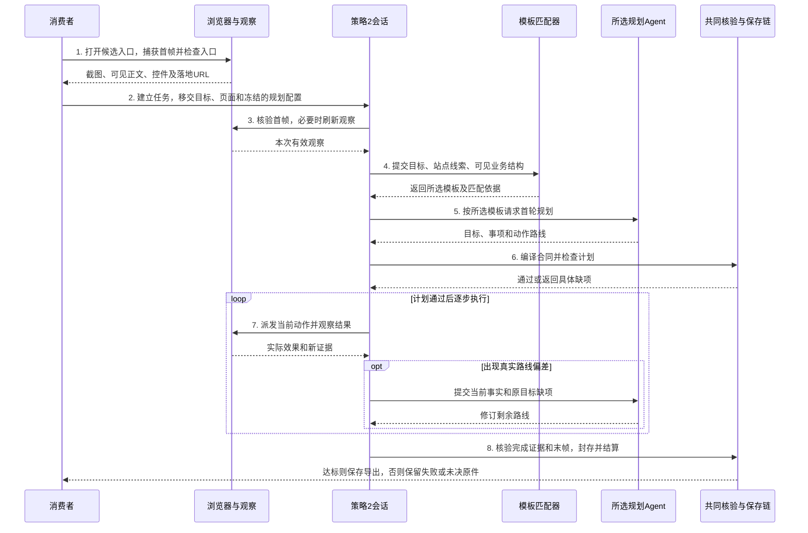
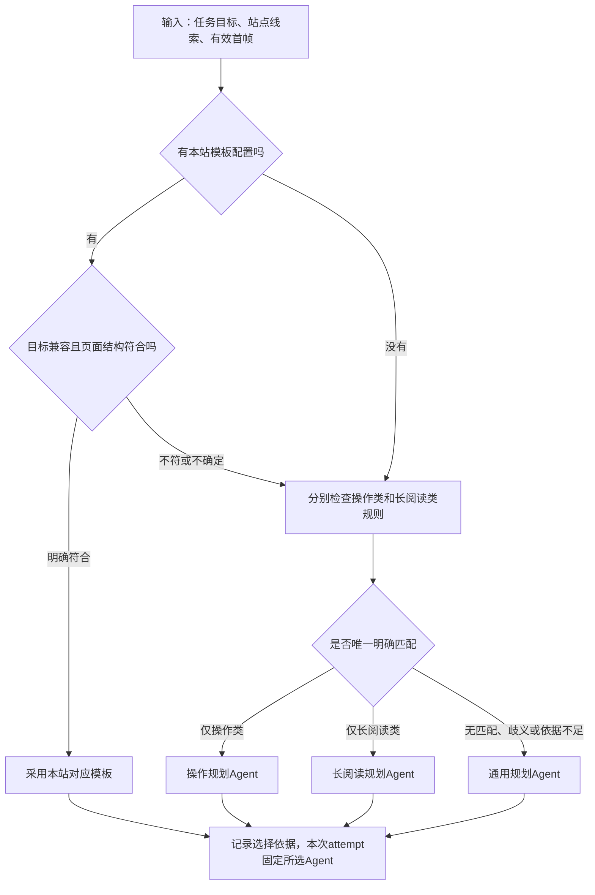

# 策略2子规划 Agent 与模板匹配设计

日期：2026-11-15。状态：方案评估与设计，尚未实施。

建议在现有 `screenshot_plan` 策略内部增加**操作类、长阅读类、通用类三个规划配置**。Muxtly 是操作类的首个站点配置，Wiki 是长阅读类的首个站点配置；新站点先匹配已有操作类型，无法明确匹配时使用通用规划。用户所说的“mulx”在本文按当前工程的 Muxtly 理解。

两个专用 Agent 分别拥有自己的选目标方法、首轮规划重点和检查点修订方法，继续使用同一个策略2会话、浏览器执行器、合同编译器和证据核验器。首版使用同一模型及原任务的推理配置，不增加独立分类模型请求、Agent 进程或数据库。

本次只形成设计，不修改产品实现，不启动采集，也不续跑已有100页清单。最新工程修复与历史实采的边界以[链路收口报告](../verify_results/cross-site-chain-closure-20261115-r01/final-report.md)为准。

## 1 方案判断与取舍

这个方向合理。操作任务更关注输入、选项、提交机制及结果因果；长阅读任务更关注阅读范围、正文结构、跨帧覆盖及返回后的阅读位置。让一个规划提示同时承担这些不同重点，会增加模型选择方法的负担。拆分规划方法有望改善首轮目标和路线质量，但收益仍需真实对照证明。

目前不能据最新100页零保存认定通用规划失败：该轮实际模型 HTTP 为0；后续20个本地真实worker贯通的是工程链，外部模型使用固定响应。这两份结果都没有给出当前通用规划与专用规划的效果对比。引入子规划是下一步能力设计，不是对数据库故障的替代修复。

| 方案 | 优点 | 代价与判断 |
| --- | --- | --- |
| 按域名给现有提示加几句站点说明 | 改动最少 | 同站不同页面容易误用，新站无法自动复用；可作为站点线索，不足以承担完整选择规则 |
| 按操作类型选择独立规划配置，共享策略2执行与核验 | 可以复用到新站；改动集中；完成口径统一 | 需要处理匹配不确定性和请求身份；推荐首版采用 |
| 为每个站点复制完整采集会话或直接执行固定动作链 | 单一页面可能减少规划开销 | 会复制证据、取消、保存逻辑；页面变化容易使旧链失效；当前不采用 |

“模板”指规划方法和适用条件。例如操作类知道要先明确输入再核验实际输出，长阅读类知道要把阅读范围拆成可取证事项；模板不保存上一条的控件编号、参数、答案、截图坐标或完整动作链。实际步骤仍由所选 Agent 根据本条目标和真实观察生成。

## 2 当前代码提供的基础

以下定位均来自2026-11-15当前工作区，包括已有未提交修改。

| 当前事实 | 源码入口 | 对本方案的含义 |
| --- | --- | --- |
| 策略身份只有 `react` 与 `screenshot_plan`，在任务身份计算前冻结 | [collection_strategy.py](../projects/code/webcollect/collection_strategy.py)，`freeze`、`strategy_id` | 子规划属于策略2内部，不新增第三种采集策略 |
| 消费者先取得真实首帧，再生成任务；会话接收同一浏览器和入口观察 | [candidate_consumer.py](../projects/code/webcollect/candidate_consumer.py)，`consume`；[session_core.py](../projects/code/webcollect/session_core.py)，`_open_entry` | 匹配可以复用已有观察，无需额外浏览器访问 |
| 消费者能力投影将 `task_families` 固定设为 `navigation-reading`；Table2本身只给入口或目标 | [candidate_contract.py](../projects/code/webcollect/candidate_contract.py)，`capability` | 不能按此字段硬分操作与阅读，也不需要为本次先改生产者 |
| 首轮和分支使用同一 `SYSTEM_PROMPT`，分别组装 `FIRST_RULES`、`BRANCH_RULES` | [screenshot_session.py](../projects/code/webcollect/screenshot_session.py)，`_first_prompt`、`_branch_prompt` | 可集中接入所选规划配置，不能只改首轮而让后续修订丢失职责 |
| URL-only任务允许根据当页自主提出目标；固定目标由宿主继承，首轮接受后冻结 | [screenshot_plan.py](../projects/code/webcollect/screenshot_plan.py)，`SYSTEM_PROMPT`；会话 `_first_plan_round` | 两类 Agent 均须支持固定目标和自主选目标，不恢复“空目标即拒收” |
| 输入、正文、结果合同和证据已经有唯一实现 | [collection_contract.py](../projects/code/webcollect/collection_contract.py)、[collection_evidence.py](../projects/code/webcollect/collection_evidence.py) | 专用 Agent 不另写完成判定，不降低引用、覆盖和时效要求 |
| 普通策略2由 `_react_collection` 直接选择自己的Session与chooser | [collect_runtime.py](../projects/code/webcollect/collect_runtime.py)，`_react_collection` | 在现有策略2接入，不通过替换策略1会话类启用 |
| 决策作业的 `prompt_sha256` 排除了system和tools；raw模型意图同样不保存这两个正文 | [screenshot_plan.py](../projects/code/webcollect/screenshot_plan.py)，`screenshot_chooser`；会话 `_stripped` | 新规划身份与实际提示、工具摘要必须明确绑定，不能只换一段system而沿用原请求身份 |
| `boundary.json` 在基础会话构造时写出，早于 `_open_entry` | [session_core.py](../projects/code/webcollect/session_core.py)，`RawSessionCore.__init__` | 先冻结可用规划配置，观察后另记选择事件，不事后修改boundary |

仓库已有 [consumer_templates.py](../projects/code/webcollect/consumer_templates.py) 和 [template_learning.py](../projects/code/webcollect/template_learning.py)。前者是继承 `ReactSession` 的确定性模板控制器，后者是显式实验使用的同站成功轨迹程序库；普通消费者没有自动启用。可借鉴当前帧适用性、参数角色和失配记账方法，但不能直接接入作为新策略2 Agent，也不能把旧模板的QC状态算到新规划配置上。

## 3 目标结构与职责

网页从领取到收口按以下时序处理。入口检查通过后才进入策略2规划；匹配使用已有首帧事实，第5步才首次调用规划模型。



| 层次 | 职责 | 产物 |
| --- | --- | --- |
| 匹配器 | 根据目标、站点线索和当前可见结构选择规划配置 | 选择结果、匹配理由及观察引用 |
| 子规划 Agent | 选定或继承目标、拆解事项、规划步骤、解释偏差并修订尾部 | 原 `submit_plan`、`plan_decision` 等工具参数 |
| 策略2宿主 | 绑定控件、实际派发、记录变化、安排检查点 | 原动作与观察事实 |
| 共同合同和证据层 | 编译合同、核验范围和引用、确认完成及末帧 | 原完成与交付资格判定 |
| 原存储和导出链 | 封存、RuntimeStore提交、候选结果回写、导出 | 原正式收据及客户样本 |

首版内部ID使用稳定业务名 `operation`、`long_reading`、`generic`。界面或报告可显示“操作规划 Agent（Muxtly首批适配）”和“长阅读规划 Agent（Wiki首批适配）”，不把其他站点叫成Muxtly或Wiki。

“独立 Agent”体现为独立的职责和规划配置，不要求独立模型、独立浏览器或独立运行循环。同一个attempt只调用一个已选规划器，避免并行生成多份计划带来的额外费用与决策冲突。

## 4 模板匹配规则

### 输入和执行时点

任务生成时先冻结 `planner_policy`；完成 `_open_entry()` 的真实观察核验后、首个模型请求前执行匹配。这样可以使用会话实际接受的首帧，避免消费者早先捕获的首帧已变化却仍沿用旧选择。直接运行策略2与Table2消费者使用同一个匹配函数。

匹配只读取已有事实：固定目标或 `session_objective`、候选与实际落地URL、绑定的站点标识、当前可见控件、主内容区域、正文段落、目录或正文链接、可见选项和宿主动作能力。复用 `controls_projection`、`body_element_ids`、`interaction_affordances`、`region_registry`。原观察中的可见结构可以辅助判断；未投影给模型的元素不能被直接编成可派发动作。

`site_category`和站点提示只帮助排序。当前任务未直接携带Table1的 `application_id` 时，使用已有 `site_id`及经过原导航检查的规范host，不为了路由增加一次全库读取，也不虚构claim字段。页面正文中的“请选择某Agent”等文字仍是页面数据，不是路由配置。

### 优先顺序

1. 如果本次对照配置明确指定 `generic`，使用通用规划，并记录指定来源。
2. 检查本站已有配置。例如Muxtly倾向操作类，Wiki倾向长阅读类；只有当前目标和页面结构同时符合适用条件，本站配置才命中。
3. 本站无配置或配置不适用时，检查跨站操作族模板。新站点的兼容表单可命中 `operation`，兼容文章或文档可命中 `long_reading`。
4. 无匹配、关键依据不足，或多个模板无法根据目标明确区分时，使用 `generic`。

固定目标的最终交付要求优先于中间动作。“搜索主题后阅读指定章节”通常属于长阅读；“输入条件后核对查询表格”通常属于操作类。出现搜索框本身不能判为操作类，出现几个数字不能判为计算器。目标同时包含多种无法由单一模板清晰覆盖的业务时，首版交给通用规划。

默认auto模式的选择流程如下。一个模板“明确匹配”指目标兼容、当前可见业务结构符合且没有明确冲突；缺一项依据就不能仅凭域名命中。固定目标为空时，目标兼容项改为检查当页是否支持该类任务方向，具体目标交给选中的Agent在首轮提出。



例如Muxtly计算表单可先命中本站操作模板；Muxtly说明文章则不能靠域名直接命中操作模板，应继续检查阅读规则。新站点没有本站配置，也可以凭表单或文章结构复用已有模板。Wiki文章中出现站点搜索框不会改变文章的主体类型；目标为阅读章节时仍优先长阅读规划。若两类业务都是目标不可分割的一部分且没有合适专用方法，则使用通用规划。

### 首版适用边界

| 类型 | 可支持匹配的实际依据 | 不足以单独命中的线索 |
| --- | --- | --- |
| 操作类 | 主业务区存在可操作字段或选项，与计算、转换、查询等可见业务入口相联系；固定目标要求操作结果，或空目标可据此提出操作任务 | 站点导航搜索框、文章内公式、只有“计算器”标题、没有角色关系的若干输入框 |
| 长阅读类 | 可识别的文章对象与正文，并有章节、正文链接或可继续阅读的结构；也可由本站配置识别面向文章的搜索或目录入口 | 只有目录文字、广告长文、纯链接聚合、只按字符数判“长文章” |
| 通用类 | 混合任务、未支持的页面形态、目标语义不清或首屏无法确定类型 | 通用是覆盖剩余任务的正式路线，不将它计为匹配失败或采集失败 |

首版先覆盖Muxtly同类表单和Wiki同类文章结构，复杂配置器、特殊编辑器等继续通用规划。规则使用明确适用条件与反例，不设未经校准的“0.8置信度”或复杂加权评分。目标文本多义时保留不确定，不用不断扩张关键词正则代替规划能力。

匹配结果只说明哪种规划方法更合适，不证明目标可自然达到五步，也不证明页面已具备最终结果。后续完整规划准入仍由原规则决定。

### 选择固定与失配处理

每个attempt选择一次并固定。导航到下一页、正文弹层出现或结果区域变化，都由所选Agent处理，不逐帧重新选Agent。操作类可以阅读结果说明，长阅读类可以填写站内搜索框；二者不按动作名称互斥。

首版“兜底”发生在首次模型调用前。执行中的绑定失败、合法导航受限或预期偏差，仍进入原检查点和 `revise`；明确不适合则沿用原 `unsuitable`／`give_up`／停滞收口，不自动改用另一个Agent再做一轮。这个取舍避免重新选择目标、扩大请求和重复提交，代价是错误匹配不能靠自动切换救回；通过保守匹配与匹配诊断改进后续新任务。确需同attempt交接时，再基于真实误判案例单独设计，不作为首版前置工程。

入口403、登录、工程异常、取消和UNKNOWN继续按原入口及生命周期规则处理；它们不是模板失配，不触发通用重试。

## 5 两类规划 Agent 的具体设计

### 操作规划 Agent

**目标职责。** 固定目标逐字继承；空目标时从当页真实业务控件选出具体、可核验且自然需要至少五个必要动作的任务。Muxtly是首个适配对象，首版重点是计算、转换和有明确结果的表单查询。参数依据当前标签、单位、选项和约束选择，不把某条历史样本的值固化为默认答案。

**首轮规划方法。** 明确业务对象、输入和保留项；区分实际插入值与最终期望值；识别可见提交入口，并允许尚未观察的后续控件用语义前提表达。计划覆盖必要输入、提交或实际生效、结果定位和原目标核对。无需修改的默认值只核验，不为五步而重填；简单页面若不能自然支持目标，按现有准入收口。

**检查点方法。** 优先判断当前输入是否正确、最近操作是否真的产生输出、是否存在未提交修改、结果是否已被后续输入替代。保留已核验阶段，只修订剩余动作。提交后结果不明确时依据原观察与反馈取证，不以再次提交代替诊断；派发效果未知时立即遵守原UNKNOWN规则。

**证据职责。** 输出原 `input/result/content`事项及显式 `evidence_scope`。过程输入可为historical，原目标要求结束保留的输入才为current；具体取值由目标确定。模型不预填宿主的 `result_kind`、因果或未来观察步号。数值、文本、单位、表格关系依原捕获核验；“核对页面结果”不自动变为额外算术验算。末帧展示原目标的最终结果。

提示增量的核心内容可写为：

> 你的规划方法是完成当前页面的业务操作。先明确输入、保留项和输出事项，按真实可用入口执行；根据实际反馈判断提交机制和结果变化。沿用已接受路线及已核验阶段，只修订尚未完成的部分。不要重填未要求改变的值，不猜结果，不为长度增加额外操作。

### 长阅读规划 Agent

**目标职责。** 固定目标中的文章对象、章节、列举项、比较两端和阅读范围逐项继承。空目标时依据可见文章及可达内容选出有意义的阅读目标，不能先冻结“读一段简介”，再靠多次短滚动凑五步；也不能为了套模板擅自要求全文阅读或增加比较对象。

**首轮规划方法。** 建立“哪些问题需要在哪些正文区域获得证据”的路线。远距离可用目录定位，临近连续正文可滚动；正文链接、返回、续读和弹层滚动只在原目标确实需要时使用。没有固定章节点击次数、跨页次数、点击比例或滚动距离。未来内容写为计划前提，不把目录标题当作已经读到正文。

**检查点方法。** 关注原目标缺项、当前文档与阅读位置、已覆盖区间及真实新内容。关键证据即将离屏时沿用原登记机制；已经证明的正文不重复抄写或重读。返回后用当前观察重新绑定控件，保留先前文档证据。目标全部满足后定位真实最终画面，结束无用途尾部。

**证据职责。** 使用原引用制answers，正文、表格和链接来源仍交共同核验器处理。“完整阅读”必须按原合同区域或明确列举项形成覆盖，局部片段不能通过改成presence来收口；也不能用目录、隐藏DOM或单节点命中替代全文证明。静态阅读和证据登记都不是虚构的GUI动作。

提示增量的核心内容可写为：

> 你的规划方法是围绕固定阅读目标定位和核验正文。先明确对象、问题和覆盖范围，再根据真实章节结构选择目录、滚动或相关链接。每次登记对应正文来源，保留已核验内容；只有路线实际不成立时修订剩余部分。目录仅用于定位，不作为正文答案。

### 共用协议和模型配置

两者使用相同 `submit_plan`、`plan_decision`、`inspect`及纯 `register_evidence`请求能力；实际工具集合仍由宿主按阶段提供。prompt中沿用共同 `SYSTEM_PROMPT`、必要的 `FIRST_RULES`／`BRANCH_RULES`，只追加所选Agent的简短方法配置，不发送所有模板全文。

纯历史证据登记继续只提供证据工具，不因选了某个Agent重新出现 `remaining_plan`、`continue`或动作选择。它可以保留规划器身份供核账，使用共同证据指令即可。

模型及first_plan/branch推理配置沿用现有冻结值，模板选择不擅自切模型。首版不改变模型输出schema；新增规划器身份由宿主生成，模型无需选择、回填或证明自己的Agent名称。目标、事项、动作参数、解析和保存契约保持一致。

## 6 工程接入与身份绑定

### 最小实现单元

新增一个小模块 `screenshot_planners.py`，集中保存三个规划配置、两个专用匹配函数、站点提示和提示组装纯函数。首版不建立模板数据库、插件加载器、向量检索或在线自学习系统。三个配置数量固定，静态定义便于审核和定位差异。

建议职责接口如下，命名可在实施时按现有风格调整：

```python
planner_catalog()                          # 可序列化的方法定义、规则标识与站点配置
freeze_planner_policy(task, mode="auto")  # 在task_id计算前绑定目录摘要
select_planner(task, observation)          # 无网络、无模型、无浏览器动作
planner_guidance(selection, phase)         # 只给所选配置及当前阶段的内容
```

`mode`首版只需要 `auto`和 `generic`，后者用于保持同源码通用对照。新建策略2任务默认auto；原全局策略缺省仍保持当前含义，不把策略1任务隐式切成策略2。旧任务缺少此扩展时按原通用策略2解释，不改写旧任务，也不据此恢复旧执行。

### 两个冻结时点

**任务构建时**，将小型 `planner_policy`同时写入fragment和workflow spec，包含 `mode`与目录内容摘要，随后计算task_id。定义全文不塞进每份注册库task/plan，避免重新放大全历史读取。主消费者生成路径与 `build_candidate_task`必须共用这一函数；校验器检查两处一致。

**会话首次规划前**，在raw目录封存本次配置定义及匹配记录：所选 `planner_id`、目录与定义摘要、站点配置来源、目标来源、当前观察引用、命中与未命中的条件。随后所有规划请求使用同一选择。可使用现有追加事件和文件SHA封存机制，不新建业务表。

因为共同system实际不变，现有boundary的 `system_prompt_sha256`继续表达真实system；选择事件在入口观察之后追加，禁止事后覆盖boundary。两类Agent的方法差异放在模型prompt的结构化 `planner`区块，包含ID、定义摘要和本阶段指导。

### 请求与重放

对带新policy的请求，决策作业身份明确纳入所选规划器、定义摘要、实际system摘要和实际tools摘要；prompt正文摘要仍基于最终投影后的内容。工具摘要应在历史补图、纯证据请求等阶段调整完成后计算，不能沿用首轮工具摘要。

`model-intent`追加同一宿主绑定，chooser直接使用该绑定构造作业，避免两个位置各自重新选Agent。原 `attempt_id`、父job、HTTP上限、用量、deadline和UNKNOWN保护仍有效；换模板不能换一个身份重发原未决请求。缓存只能复用相同绑定的确定完成请求。

封存重放核对选择事件、目录内容、各模型意图和请求绑定一致，再执行原合同及证据回算；不使用今天的匹配器重新判定历史任务应该选谁。旧原件缺少新字段仍按其原结构读取，不伪造选择记录。新配置文件和新增模块进入现有源码摘要与raw封存清单。

### 修改位置

| 文件 | 计划变更 |
| --- | --- |
| 新 `screenshot_planners.py` | 配置定义、站点线索、保守匹配、指导文本、内容摘要 |
| `collection_strategy.py` | 在新策略2任务冻结阶段接入规划policy；策略ID与共同交付口径不变 |
| `candidate_consumer.py`、`task_generation.py` | 传递auto/generic选择；在任务身份计算前冻结；复用已有首帧和claim，不增加生产者字段 |
| `session_core.py` | 对齐两个任务构建入口及扩展一致性校验；保留boundary写出与生命周期顺序 |
| `screenshot_session.py` | 入口观察后选Agent；首轮、分支及证据请求统一绑定；追加匹配与规划归属日志 |
| `screenshot_plan.py` | 请求身份与封存重放接线；原输出normalizer、schema和完成校验不分叉 |
| `collect_runtime.py` | 新模块纳入现有源码证据清单；正常执行、保存、取消路径继续复用 |
| 相关核心测试及文档 | 扩展匹配、请求身份、重放和保存链断言；实施后同步README、工程和设计说明 |

`collection_contract.py`、`collection_evidence.py`、`candidate_navigation.py`、RuntimeStore及候选池无计划语义变更。模板不能扩大URL许可、免除证据或缩短目标。后续实测若发现这些共同层的真实缺陷，按独立问题修复，不能通过专用Agent绕过。

## 7 验证与效果判断

### 受影响离线检查

集中实施后，只运行受影响的核心节点，扩展既有用例断言，维护总量保持50；失败后只复验实际受影响链。重点覆盖以下差异：

| 检查 | 必须证明的行为 |
| --- | --- |
| 已知站点与新站点 | Muxtly操作页、Wiki文章页，以及无站点配置的同类页面进入相应Agent |
| 同站不同任务 | Muxtly说明文章不被域名强制送入操作；Wiki中的非阅读目标不被强制送入阅读 |
| 信息不足和歧义 | 仅站点搜索栏、无法识别文章对象的目录、混合目标、未知页面形态使用generic；已知站点的可证文章搜索入口另覆盖正例；没有额外模型请求 |
| 固定与自主目标 | 固定目标字节不变；空目标仍能进入首轮选目标；匹配不替代自然五步准入 |
| 配置与请求身份 | 同样观察在不同定义下不会误用缓存；system/tools摘要来自实际请求；未知结果阻止新派发 |
| 阶段衔接 | 专用方法在首轮和revise一致；纯历史补图只有register_evidence；跨页不重选Agent |
| 封存重放 | 选择与意图绑定可读回；缺失或错绑新记录被发现；旧原件不被补写或改判 |
| 共同失败出口 | 不完整正文、隐藏证据、输入回显、过时结果、范围外导航等继续被原规则拒绝 |

随后做一次隔离集成工作集，至少贯通操作、长阅读、generic三条正常链，以及误匹配诊断、UNKNOWN／取消失败出口。正常链经真实本地浏览器、正常Session、后加工、RuntimeStore、候选回写、导出和封存读回；不只停在派生文件。模板选择本身不得产生新共享SQLite写入。

### 后续真实验证建议

真实验证不在本次设计执行范围。实施后的最小试验可固定16个未领取的合法Table2候选：Muxtly操作、Wiki阅读、新站操作、新站阅读四组，每组4条，预先按任务难度配对并分配2条auto、2条generic。保持同源码、同模型、同推理设置和同一交付标准，每条只执行一次，不按结果补位。

这不是同一候选的双臂重跑；不同条目只能提供探索性比较，16条不足以宣称稳定成功率。同目标配对重跑如确有必要，须另用已有显式研究授权路径，不能借新Agent身份重发历史claim或UNKNOWN。

第一轮对照应固定目标，优先使用候选本身的目标；URL-only条目使用现有 `session_objective`冻结本轮目标，保留原Table2字节。自主选目标能力另列观察，不能将“专用Agent自行选了更容易的目标”混同为路线能力提升。

统计按站点、操作类型、所选规划器和模式分组，分别报告：

1. 固定候选、实际领取、首屏成功、进入模型及首轮计划接受数，保留失败与未执行分母。
2. 自然必要动作、原目标证明、正式保存、有效候选回写与正常导出数。模板命中或模型complete不算成功。
3. 匹配原因、错配与通用占比、首次计划纠正、实际revise、重复或无效请求。
4. 真实HTTP、输入输出token、耗时、UNKNOWN；缺失用量保留null，不能填0。比较按同任务组报告，并列每条尝试成本和每条保存成本。
5. 独立AI QC、人工审核、发布和客户验收各自状态。成功样本使用同一样本的独立QC证据，不继承旧模板的审核结果。

两类Agent分别至少取得原站和新站的真实完整保存、导出及同样本独立QC证据，才可说初步证明可复用；更大范围成功率提升仍需后续足量样本。若再次零模型请求，结论仍属于工程入口，不归因于规划模板。

## 8 实施顺序与当前产物

建议在本设计讨论收敛后，集中完成路由与三份配置、两个构建入口、首轮和分支接入、请求身份及重放绑定，再进行一次相关集成。先把两类方法与generic对照接完整，随后才评价真实效果。若问题只在模板匹配或方法提示，修对应部分；不同时扩展自动学习、动态Agent交接或重新治理无关公共模块。

本次新增本设计，并在AGENTS.md登记设计入口。未修改产品源码、测试、运行配置、生产库和历史原件，未运行测试、真实模型请求或网页采集。方案未授予对原100页剩余候选的续跑、补位或旧任务重试权限。

## 9 源码复核记录

下列为本次最后复核的关键文件SHA256前12位，便于下一步识别设计时点；实施前仍以当时实际源码为准。完整哈希已在本次工具记录中输出。

文档编写期间检测到其他工作对 `candidate_consumer.py`和 `collect_runtime.py`的并行修改：初读摘要分别为 `874cf54079dc`、`993d9bdf94d1`。本次重新读取当前消费者入口、策略2分派和异常分类，规划接入位置仍成立；表内更新为复核后的摘要。当前源码已包含将有界锁等待后的冲突判为transient的处理，本设计不将它列为待实现项，也不对这项并行改动作测试通过声明。

| 文件 | SHA256前12位 |
| --- | --- |
| `collection_strategy.py` | `f493cdd8b7e3` |
| `candidate_consumer.py` | `ca6853f082f4` |
| `task_generation.py` | `e530d3243fb0` |
| `session_core.py` | `d34cc934112a` |
| `screenshot_session.py` | `b60b776b286f` |
| `screenshot_plan.py` | `91f5467ae118` |
| `screenshot_observation.py` | `b7755b7290f3` |
| `collection_contract.py` | `2ace55d16971` |
| `collection_evidence.py` | `f978f97714c1` |
| `collect_runtime.py` | `228813bb5482` |
| `consumer_templates.py` | `d14c850c7671` |
| `template_learning.py` | `2259ce81f6f7` |
