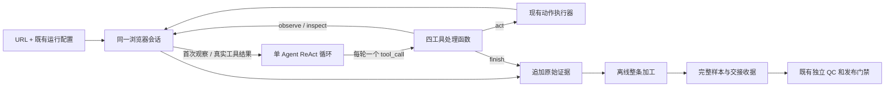

# 规划采集 Agent 改造计划与验收

日期：2026-10-31。状态：方案已确认方向，本文为待实施计划。本次只生成文档，不修改源码、不恢复真实采集或模型调用。

上游库存与消费适配按[生产者消费者职责拆分与轻量化计划](生产者消费者职责拆分与轻量化改造计划-20261031.md)衔接：新协议允许可信入口和可选建议，不把生产者猜测冻结为用户要求；旧候选仍保留原目标及领取绑定。该计划 C2 与本文 P0/P1 合流，C3 与本文 P2/P3 合流，不复制工具循环。直接 URL 入口可先完成本文工程改造，不要求先实现全部上游吞吐优化；新库存的联合验收另核对来源、领取及样本证据。两份计划均不自动恢复真实运行。

**最终验收标准：使用改造后的规划采集 Agent，在真实站点完成至少一次真实采集和整条加工，得到符合适用需求规范、实际通过独立 QC 的样本。** 代码实现与离线夹具通过是前置工程检查；没有这份真实样本及审核证据，不能宣布 Agent 改造验收完成。

源码定位基于 `2623ed4` 及当前工作区，包括尚未提交的候选消费、控制器、输入、账本和证据绑定修复。后续实施必须重新核对实际文件，不能只按 HEAD 或历史测试结论覆盖工作区。执行入口见[实施 prompt](规划采集Agent改造执行Prompt-20261031.md)。

## 1. 本轮决定

把现有控制器改造成同一浏览器会话中的工具循环：输入 URL，观察实际页面的 HTML/DOM、截图和控件状态，按需查询，执行下一步，保存完整原始执行；结束后再加工成交付样本。继续使用现有执行器、生产账、模型账和独立 QC。

| 项目 | 本轮确定的口径 |
| --- | --- |
| 输入 | 用户只需给 URL。需求、动作权限、预算、当前链与账本绑定由配置提供；业务目标可选。显式提供的目标保持绑定，只有 URL 时由 Agent 根据实际页面提出目标。 |
| 页面信息 | 以浏览器实际渲染的 HTML/DOM、当前截图、运行时控件属性综合判断；默认给必要摘要和 HTML 片段，详情通过工具获取。 |
| 规划方式 | 单 Agent、Tool + ReAct；每轮输出简短决策依据、可选工作目标更新和一个 tool_call，宿主执行后将真实结果交给下一轮。新路径不需要前置模型先生成/冻结一批目标或整条动作序列。 |
| 步数 | 交付样本满足“有效操作步数 ≥5，或 `short_flow: true` 且写明原因”。短流程累计比例仍不超过 2%。 |
| 停止条件 | 取消第 5–8 步强制结束和 8/10 步样本上限。达到可交付长度不自动停止；超过 10 步也不自动切段。运行仍受显式有限预算、无进展限制和原安全边界约束。 |
| 原始执行 | 如实保存连续执行、观察、实际动作、失败、结束原因及费用。原始记录是否保存，与能否生成合格交付样本分开。 |
| 后加工 | 本轮只做“一条完整原始执行 → 一个完整交付样本”，允许整个样本超过 10 步。标注失败后可以基于原件重新加工。 |
| 本轮不做 | 在线切段、自动 10→2×5、多产物候选池重构、共享切段边界豁免、切点优化、收益预测调度、多 Agent 或新服务平台。 |

这覆盖此前讨论中“必须大于 5 步”“主要按 5–8 步停止”“本轮实现 10 步切两段”的设定。这里取消的是产品步数上限，不是资源预算。不得据此修改旧冻结任务的预算、重签旧规则或恢复生产。

动作定义继续遵循[附件 B](../request/web操作采集需求/附件B-动作空间与坐标系.md)。静态阅读、工具查询、推理、`wait`、`complete` 不计有效操作；宏动作按真实发生的合法操作分别取证、计数。不为凑步数插入动作，也不另加“每步对唯一业务目标不可替代”“必须完成完整业务”“每站每页只能产一条”的门槛。原始需求的步数与短流程约束见[需求书](../request/web操作采集需求/需求书-Web浏览器自动化操作轨迹数据集.md)。

## 2. 当前代码与七个问题

### 2.1 首次观察、预检、正式采集不是同一个会话

`candidate_consumer.first_observation()` 自行创建并关闭浏览器上下文。随后 `task_generation.execute()` 调用 `preflight.preflight_plan()`，正式采集又在 `collect_runtime._collect_m4_locked()` 创建上下文，`collect.collect_one()` 再创建页面并导航。因此首次 HTML/截图与最终操作页面可能对应不同状态。

改造：为新协议设置一个会话所有者，从首次导航持续到原始执行关闭；预检使用现有 `preflight.inspect_page()` 检查已打开的页面，采集内核接收该页面。刷新观察可以发生，重复初始化和重新导航不应成为必经阶段。旧冻结任务保留原入口。

定位：[候选消费者](../projects/code/webcollect/candidate_consumer.py)、[任务执行](../projects/code/webcollect/task_generation.py)、[预检](../projects/code/webcollect/preflight.py)、[采集运行时](../projects/code/webcollect/collect_runtime.py)、[采集内核](../projects/code/webcollect/collect.py)。

### 2.2 一次尝试与完整交付样本绑定过紧

`runtime.py` 的 `m4_attempts` 在预留时绑定唯一 `sample_id`；`finish_attempt()` 只接受待审或拒绝，且已终结结果不能覆盖。`candidate_consumer.verified_saved()`、`qc_handoff._attempts()` 又要求完整保存收据和 `collected_pending_review`。这使“原始执行保存成功、标注待加工”没有独立位置。

改造：保留编号预留和原尝试事实，新增原始保存收据与最小加工记录，明确原始终态和交付结果两个层次。本轮仍最多形成一个有效交付样本；不为未来切段先重写候选池一对多关系。详见第 4.3 节。

定位：[生产账](../projects/code/webcollect/runtime.py)、[QC 交接](../projects/code/webcollect/qc_handoff.py)、[候选池结果约束](../projects/site-planner/site_planner/candidate_pool.py)。

### 2.3 目标、自然语言指令、动作范围混在一起

`candidate_contract.instruction()` 把结构化目标直接拼入中文指令，`validate_task_binding()` 比较整段指令完全相等。`agent_controller.compile_goal()` 又以初始 capability 限定动作集合。当前已能动态规划，问题不是“完全静态”，而是目标身份、表述和现场可执行能力仍有不必要的耦合。

改造：区分不可偷偷替换的 `requested_goal`、当前推进的 `working_goal` 和依据实际轨迹生成的中文 `task_instruction`。目标调整用现有事件日志记录，不建立目标版本平台。用户授权的动作边界和执行器支持范围固定；页面当前可操作性随观察更新。新协议可以对同一个结构化目标生成自然表述，旧候选的原绑定仍严格验证。

顺带修复已确认的协议不一致：`compile_step()` 对 `back` 和 `open_url` 一起要求 `page_id`，但决策 schema 只要求 `open_url` 提供该字段。返回动作应依据当前会话历史校验，不能凭空补一个页面 ID 过关。

定位：[候选契约](../projects/code/webcollect/candidate_contract.py)、[控制器](../projects/code/webcollect/agent_controller.py)、[规划 prompt](../projects/code/webcollect/workflow_planning.py)、[观察能力](../projects/code/webcollect/agent_observation.py)。

### 2.4 标注生成失败会终止采集

`collect_one()` 在继续派发下一步之前调用 `describe_change()` 和 `narrative_evidence()`，后者失败会抛出 `NARRATIVE_EVIDENCE_UNSUPPORTED`。原图即使已经存在，也不能独立形成可重新加工的完成记录。

改造：采集主循环负责动作、同步证据和实际效果事实；自然语言标注移到后加工。几何定位、执行前证据校验、越界判断等执行安全检查仍在现场。加工失败只留下加工失败记录，不把已保存原始执行改为站点操作失败；重加工不重新打开浏览器、不重放动作。

定位：[采集内核](../projects/code/webcollect/collect.py)、[标注与格式验证](../projects/code/webcollect/validate.py)。

### 2.5 观察去重、交付重复度和防重复入账混为一体

`FragmentController.accept_capture()` 对观察调用 `frame_guard`，命中截图冲突就终止，包含尚未形成交付样本的探索状态。`collect_runtime.py` 和 `RuntimeStore.finish_attempt()` 还有截图零命中硬门禁。QC 的 `duplicates.summarize()` 已计算 0.1% 指标，但明确同时保留更严格的 `strict_zero_hit_gate`；`engine.py`、`cumulative.py` 还会逐条或累计以任一路命中直接判失败。

改造分三层：同一作业、同一原始执行和同一有效产物的重复登记仍严格阻断；探索阶段截图相同只提供已走路径提示，不直接判整个站点不可采；交付重复度按显式有效集合和已约定的总体比例判断。保留四路检测事实，统一改变新协议的判定与计数，不能只改报表字段、却留着前置零命中门禁。

默认沿用当前实现中“涉及近重复的当前样本去重数 / 当前样本数”的口径；历史样本不稀释分母，累计范围也必须明确。相同原始数据重复提交不能用比例额度重复计产量。空集合、检查失败、未决检测不得按零重复通过。规则意义变化按受影响范围更新版本，旧报告与原 PASS/FAIL 不改签。本轮无切段，因此不引入共享边界例外。

定位：[采集去重](../projects/code/webcollect/collect_runtime.py)、[原子保存门禁](../projects/code/webcollect/runtime.py)、[四路指标](../projects/quality-inspector/quality_inspector/duplicates.py)、[样本与交付检查](../projects/quality-inspector/quality_inspector/engine.py)、[累计检查](../projects/quality-inspector/quality_inspector/cumulative.py)。

### 2.6 执行前状态变化被包装成模型执行失败

当前 `before_dispatch()` 先消费动作额度，之后 `collect_one()` 才调用 `verify_execution_state()`。执行前过期和真正派发后的错误都可能通过 `controller.result(error=str(e))` 包装为 `EXECUTION_FAILED`，再被 `classify_failure()` 归到 `model`。因此既损失根因，也可能把零派发误计成动作。

改造：保留结构化阶段、原始类型、派发事实和证据。明确区分 `pre_dispatch`、`dispatch`、`post_dispatch`；分别记录派发尝试、实际执行和有效操作数。已证明未派发的状态过期应刷新观察、清除旧决策并有限重规划；已派发后结果不明必须保留 `UNKNOWN`，不得自动补发。现场校验仍由原执行器负责。

定位：[执行前校验](../projects/code/webcollect/browser.py)、[控制器结果回传](../projects/code/webcollect/agent_controller.py)、[采集错误捕获](../projects/code/webcollect/collect.py)、[错误分类](../projects/code/webcollect/collect_runtime.py)。

### 2.7 规划上下文会携带大量历史 QC 图片

`agent_feedback.site_context()` 已压缩较早的规划记录，但仍遍历绑定 QC 数据集的全部样本图片，`model_chooser()` 将它们与当前图一起发送。工具形式本身不能解决这个问题，需要改变每轮输入的组织方式。

改造：默认只发送当前图、目标、当前轨迹摘要、相关失败摘要和最近必要工具结果。HTML、控件详情、历史图片和具体 QC 原因通过 `inspect` 查询，返回范围、遗漏标记及后续游标。完整原件继续保存。这里只缩减规划输入，独立 QC 仍须看到其所审样本要求的全部证据。

定位：[反馈上下文](../projects/code/webcollect/agent_feedback.py)、[决策请求](../projects/code/webcollect/agent_controller.py)、[初始规划请求](../projects/code/webcollect/workflow_planning.py)。

### 已有能力应直接复用

可信观察的 `PROVEN / UNAVAILABLE / INSUFFICIENT` 三态、目标改变后的重规划、同应用跨页与弹窗、数字输入的显式清空、同步截图/树证据、稳定派发图及原摘要迁移证明、当前轨迹记忆、真实片段末状态、父作业槽位、原 UNKNOWN 隔离与 HTTP 鉴权阻断，当前均有实现。不能把这些重新列成“从零开发”，也不能在新循环中绕过它们。

`validate.py`、QC `format_checks.py` 已支持“≥5 或短流程原因”，`profiles.py` 和 `cumulative.py` 已检查短流程比例。主要缺口在控制器的最小/最大动作限制、规划 prompt、保存流程和端到端一致性；不必重写已有格式校验。

还需对齐一个具体遗漏：QC `ai_worker.do_visual()` 的 prompt 仍只写至少五个实际动作，`compact_trajectory()` 没有传入 `short_flow`、原因及整条有效步数。新规则必须传到视觉审核，且不能要求每个审图分组各自满足五步。该模块已有按图片容量分组及连续性汇总能力，应复用；分组不会改变交付样本数量。详见[AI 审核 worker](../projects/quality-inspector/quality_inspector/ai_worker.py)。

## 3. 最小实现结构



三个契约是同一 Python 工程内的数据结构和函数，不拆服务。优先扩展 `agent_observation.py`、`agent_controller.py`、`collect.py`、`collect_runtime.py`。可以增加一个很薄的会话编排模块和一个后加工模块；不复制浏览器执行器、账本、QC 或状态机框架。后加工先做可单独重试的普通函数/命令，可在循环结束后同进程调用；无需新增异步队列和后台服务。

第一版工具调用可以继续走现有 ModelGateway 严格 JSON：模型返回工具名和参数，由本地白名单路由执行。Tool + ReAct 不要求同步改造所有 provider 的原生 `tool_calls` 协议，也不要求把完整思考过程写入账本。只保存决策摘要、工具参数、实际返回和证据引用。

必须向模型提供真实工具定义，并将实际执行结果回传循环。新协议要改变 `DECISION_SCHEMA`、`FragmentController.next()` 和上下文构造；URL-only 入口的工作目标在同一个循环中形成，`workflow_planning.propose()` 不再承担强制前置的独立模型目标规划。旧协议分支保留。精确字段、宿主循环与可直接落实的运行时 system prompt 统一定义在[执行 prompt 第六节](规划采集Agent改造执行Prompt-20261031.md#六必须实现的-react工具与-goal-规范)。

## 4. 三个契约

三个契约共用一个固定的采集 **GOAL**：从给定 URL 出发，在授权范围和预算内，综合 HTML/DOM、截图和真实控件状态，采集连续、合法、可验证的网页操作，保存原始执行供后续加工；优先满足“≥5 步，或 short_flow 并给原因”，不以完成整个业务为前提，不授予 QC 合格。

运行数据只需 `requested_goal` 和 `working_goal` 两个字段：前者是只读原业务要求/参数，URL-only 时为空；后者是当前页面上准备推进的简短方向，初始为空，由同一个 Agent 根据首次观察建立。未建立工作目标前可查询或说明原因结束，不能执行动作；工作目标可围绕原要求选择局部路径，依据新观察调整时记录原因，不改原要求、不清零预算或失败。后加工的 `task_instruction` 是轨迹说明，不增加运行目标。

每轮模型只返回 `decision_summary`、`goal_update`（可为 null）、一个 `tool_call`。目标更新与工具参数由宿主先校验；Observation、实际步数和费用只由真实工具/账本产生。原观察或工具反馈不足时继续查询，无需另设 goal-planner 或目标树。

### 4.1 页面观察

**输入：**当前会话及页面句柄、观察原因；首次入口带 URL，后续观察使用真实当前页面。局部查询可指定当前观察中的区域或控件。

**输出：**`observation_id`、页面身份/URL/标题、截图引用、HTML/DOM 引用、简短页面摘要、可交互控件摘要及真实属性、可用页面动作、完整性说明。控件引用必须属于该次观察；值、选中态、焦点、可见性不能只从静态 HTML 属性推断。

执行器在受控浏览器中读取渲染后的 HTML/DOM，复用现有同步取证和稳定性检查。默认上下文包含有用的 HTML 片段及当前截图；完整结构存放为可查询证据。若保存初始 HTTP 响应，应明确它与渲染后 DOM 的区别，不能把初始响应当作后续页面状态。

`inspect` 查询已绑定的观察材料；需要实时刷新时生成新 `observation_id`，不能把新 DOM 冒充旧图对应的状态。隐藏 DOM 可提供结构线索，不能成为“用户看到了该文案”的标注证据；iframe、shadow DOM、canvas 或截断区域如未覆盖，应明确返回未知/部分覆盖，不伪装完整。

**流转：**首次加载 → 观察就绪 → 按需查看详情/动作 → 新观察。导航、相关控件变化或执行前过期都会使旧动作绑定失效；查询旧观察不恢复它的执行资格。

### 4.2 Agent 工具

| 工具 | 输入 | 输出与边界 |
| --- | --- | --- |
| `observe` | `focus_control_id`，无局部目标时为 null；调用目的放在 decision_summary | 新观察 ID、当前图/摘要/引用；同一会话只读观察，不计操作步数。 |
| `inspect` | `kind`、`observation_id`、`target_id`、`query`、`offset`、`limit_chars` | 相关 HTML、控件事实、历史事件或 QC 摘要；文本范围、`next_offset`、截断/缺失说明及来源引用。不刷新当前页面，不将旧材料升级为新动作证据。 |
| `act` | `observation_id` 和一个 `step`，step 复用当前语义动作字段及逐动作参数约束 | 实际执行事实、结构化失败或新观察，以及分别更新的预算/操作计数。先校验观察和权限，再由原执行器派发一次。 |
| `finish` | `observation_id`、`stop_reason`、`summary`、`short_flow`、`short_flow_reason` | 原始执行收据和实际停止原因；不足 5 步也可仅关闭原件，不签发 QC 或业务完成结论，不调用在线切段。 |

本表是接口摘要；参数类型、必填/可空规则、ActionStep 字段、统一结果与错误结构以[执行 prompt 的工具定义](规划采集Agent改造执行Prompt-20261031.md#63-四个-tool-的精确定义)为准。`inspect` 只做固定类型读取及文字匹配，不新增通用检索系统。

`act` 每轮只选择一个当前可验证的动作。`set_value` 等复合指令可以沿用现有编译器，但展开后的每个实际操作必须分别取证、计数；中途页面变化时重验剩余操作，不能整组盲发。动作权限、执行器支持与当前观察能力取交集；尚未有可靠观察/执行适配的动作不能写成已支持。

错误结果至少保留 `phase`、原始错误类型/原因、`dispatched`、`action_executed`（可为未知）、证据和是否允许重新决策。明确零派发的过期状态可以重规划；无法确定是否执行、模型请求传输 UNKNOWN、原账 hold 等继续走现有核对机制。

**工作上下文：**固定需求/授权边界、目标、当前观察、已执行动作与进度摘要、最近相关失败、预算。原始历史落盘；过长历史通过有来源的摘要和索引压缩，保留覆盖区间，详情按需读。设置文本/图片上限和确定性的选择顺序，不能仅把所有历史换成“工具返回”再次全量塞入模型。

**流转：**观察 → 决策 → 查询或动作 → 观察/反馈 → 决策，直到主动结束、没有可行路径、资源用尽、无进展或原有停止条件命中。重复无收益查询也占预算并触发有界停止。配置保留有限动作/观察/决策/模型/时间预算，并预留结束取证与落盘额度；不能在额度耗尽后再隐式超支补调用。

### 4.3 原始执行与后加工

第三个契约调整为“完整原始执行结果”，不再要求运行中产出多个交付片段。

**原始执行输出：**执行/尝试身份、输入 URL 和原目标、协议/策略绑定、按序的观察与实际动作引用、派发和有效操作计数、实际终态与停止原因、错误和 UNKNOWN 事实、原模型/访问费用引用、文件摘要及原始保存收据。原图、树、HTML、动作参数和失败记录追加保存。

**后加工输入：**原始保存收据、显式加工版本和当前适用的交付规则。第一版加工完整连续区间，不删掉中间动作、不跨中断拼接、不自动选择切点。生成自然中文指令、逐步说明、最终状态和交付结构；Windows 快捷键表示用于交付，原执行参数保留。

**后加工输出：**完整样本、源执行及动作/观察映射、加工结果/失败、文件摘要和交付保存收据。无可信证据时如实失败，不补造截图或步骤。实现与离线测试不得调用真实标注模型；未来若加工使用模型，仍须经原 ModelGateway 与账本计费。

| 层次 | 状态流转 | 产量含义 |
| --- | --- | --- |
| 原始执行 | `recording → raw_saved`；失败/中断/结果不明保留各自终态及已写证据 | 只说明原始执行保存情况，不算完整待审样本。 |
| 加工 | `pending → processing → derived_saved / processing_failed` | 失败可追加新加工版本，不重跑浏览器，不改原始尝试终态。 |
| 交付登记 | 校验完整加工产物与收据后登记 `collected_pending_review` | 才能进入现有独立 QC。 |
| 审核与发布 | 现有程序检查、实际 AI 审核/批次接纳、发布、客户验收 | 各按自己的证据计数；原始保存或加工成功不授予后续状态。 |

实现保留 `m4_attempts.sample_id` 的预留机制，对新协议支持原始终态，并可靠地追加加工记录。优先扩展现有账本/文件收据；确需新增表时说明现有结构无法表达的具体事实。记录关联原 attempt、加工身份/版本、状态和收据；每个原始执行最多一个当前有效样本。新加工版本写新位置，经验证后才能选择为当前版本；旧文件和收据不覆盖，不建设通用版本管理系统。

不能把已终结 attempt 从 `raw_saved` 改写成另一终态，也不能把旧 `rejected` 改成成功。样本待审状态是加工结果的投影。通过必要的共享函数按协议验证完整交付结果，供 `qc_handoff`、`current_chain`、运行时审核/发布、候选消费恢复与站点池投影使用；避免各处继续硬查 `attempt.status == collected_pending_review`，也避免全局放松旧检查或重构整个持久化层。

新协议交接必须验证原始收据、加工来源映射、实际交付文件摘要、当前链与有效版本；旧协议仍验证原完整保存收据及字节一致性。候选仅有原始结果时保持占用/待加工，不记原 `succeeded`，不重新领取并重放采集。加工进程中断只核对加工记录和原件；浏览器中断轨迹不续接。

## 5. 实施顺序

以下阶段按依赖落地，每阶段完成对应局部验证后再进入下一阶段；P4 完成工程检查，并以一次真实采集—加工—独立 QC 闭环作为最终功能验收。七个问题均属本轮范围，切段能力不在验收中。

### P0：协议边界与执行事实

- 重新核对工作区、受影响调用链和现有测试，保留已修复能力。为新循环设显式协议分支，旧冻结任务继续原规则。
- 在原观察和动作返回结构上补齐 HTML/截图绑定、工具结果与分阶段错误；修复 `back` 契约不一致。
- 将派发尝试、真实动作、有效操作和查询/模型预算分开。先修复零派发过期不应成为模型执行失败的问题。

主要文件：`agent_observation.py`、`agent_controller.py`、`browser.py`、`collect.py`、`collect_runtime.py`。对应 A04、A06、A07 的接口、计数和错误事实检查。

### P1：同会话 URL 入口与工具循环

- 将会话生命周期提到首次观察之前，现有 URL/candidate 入口通过薄适配进入同一循环。URL-only 无需先伪造具体候选目标；已有候选继续绑定原目标/领取记录。
- 新路径使用已加载页面完成观察和预检，统一导航计费、页面归属、租约及执行前校验。首次访问前先核对原范围和预算；正式操作前保留正式尝试登记。
- 改造当前控制器的决策 schema、真实四工具处理函数和 ReAct 循环；按执行 prompt 第六节显式提供 GOAL、requested_goal、working_goal 和 tool 定义。同一循环建立/调整工作目标，能力随真实观察更新；移除新协议内所有 5–8/8/10 长度硬限制，预算由显式配置提供并相互匹配。
- 改造初始规划和每轮上下文构造，使用限定大小的 HTML/历史查询，不再自动携带整个 QC 数据集图片。

主要文件：`candidate_consumer.py`、`candidate_contract.py`、`workflow_planning.py`、`task_generation.py`、`preflight.py`、`agent_controller.py`、`agent_feedback.py`、`collect_runtime.py`。对应 A01–A06、A08、A12 的执行侧检查；整条加工和审核部分在后续阶段验证。

### P2：先落原始执行，再离线加工

- 从 `collect_one()` 拆出自然语言生成和交付格式组织，现场安全与真实性校验保留。每一步及时保存原件，不等最终文案完成才落证据。
- 增加原始关闭收据、最小加工记录与整条加工入口。明确正常关闭、无路径、预算结束和中断/未知的不同事实；中断或未知原件不自动晋升可交付结果。
- 打通生产账、当前链、候选恢复、站点池投影和 QC 交接的协议适配。原始保存占用不等于交付成功；加工失败不消耗网站真实操作失败次数。
- 加工只输出完整轨迹的一份样本，保留原动作顺序及来源映射。短流程在加工阶段按真实步数声明并接受后续比例检查。

主要文件：`collect.py`、`collect_runtime.py`、`runtime.py`、`qc_handoff.py`、`current_chain.py`、`candidate_consumer.py`、`site_pool_sync.py`，以及最小后加工模块。对应 A05、A09、A10、A13–A14 的保存、加工、计数和交接检查。

### P3：统一交付规则和重复度判定

- 复用已有短流程/格式检查，检查控制器、加工、采样、导出与 QC 是否残留上限或完整业务门槛。补齐 AI 审核 prompt 中的短流程例外和整条轨迹计数；审图分组不能自行按五步拒绝。长轨迹复用现有按容量审图及连续性汇总，证据/容量不足保持待审，不能删帧或自动扩预算。长度满足要求不代表其他检查自动通过。
- 将探索重复提示与交付总体指标分开，保留作业和原件重复入账阻断。审查 `task_generation` 的历史前置判断，区分真正相同任务重复派发与单张公共起始图命中。
- 一次贯通采集保存、运行时图片索引、QC 样本/总体/累计检查和最终交付门禁；四路命中事实照常输出，按新绑定策略判断 0.1%，不残留另一条零命中否决链。
- 对意义发生变化的格式/机械/语义规则分别更新相关版本和绑定，语义变化时更新 `semantic.py` 对应规则版本；只使受影响审核失效。保留原抽检升级、撤回和跨包有效集合机制。

主要文件：`agent_controller.py`、`collect_runtime.py`、`runtime.py`、`task_generation.py`、`validate.py`、`sampling_context.py`；QC 的 `format_checks.py`、`duplicates.py`、`engine.py`、`cumulative.py`、`profiles.py`、`ai_worker.py`、`semantic.py` 及受影响交付调用链。对应 A05、A08、A10、A11、A13–A15 的规则与审核检查。

### P4：工程检查与一次真实闭环验收

先以临时账本、假页面/工具和模拟模型检查 URL → 观察 → 操作 → 原始保存 → 加工 → QC 交接的完整夹具链。按阶段选择直接受影响测试；公共保存/审核契约变更时，说明原因后覆盖恢复、当前链、抽检与发布绑定。这些检查用于排除工程错误，不能替代真实验收。

随后在已有明确授权、原账和有限预算覆盖的范围内，用改造后的 Agent 完成真实浏览器操作、真实模型工具决策、原始保存、整条加工和独立 QC。至少一份新产生的实际样本满足第 6.1 节，才能报告本次 Agent 功能验收完成。已有覆盖该步骤的运行授权直接沿用，不重复确认；尚无覆盖范围或预算时，报告“工程检查完成，真实验收未完成”，不能以此宣布整个任务完成或擅自恢复生产。

真实失败应保留原始尝试、原因、UNKNOWN 和费用。按实际问题修复通用实现后，在剩余授权/预算内继续验证；涉及采集行为的修改需要修复后的真实执行证据，仅加工逻辑修复可以基于完整原件重加工、再对最终版本审查。不得人工补动作、补拍截图、拼接旧结果或手填审核 PASS。预算或原止损达到上限时保留未验收状态，不无限重试。

维护相关 README、工程说明、设计说明和执行文档。一次通过证明该真实场景的端到端功能，不据此宣称跨站成功率、成本优势或规模生产能力已经验证。

## 6. 验收矩阵

### 6.1 最终验收：一份真实、合规且通过 QC 的样本

| 检查项 | 实际通过所需证据 |
| --- | --- |
| 确实使用改造后的 Agent | 给定真实 URL 与正常运行配置；记录实际代码/工作区摘要、运行时 prompt、工具协议和模型版本。工作目标与下一步动作由新 ReAct 循环依据现场观察产生，不能用预写整条步骤或人工代操作替代。 |
| 完成真实采集与加工 | 同一会话中的原始 PNG、同步 DOM/界面树、HTML、实际动作与终态、工具调用结果、原始保存收据，以及程序加工后的完整样本和来源映射；全部绑定实际尝试、费用与当前链。 |
| 样本符合需求规范 | 按需求书第 7 节逐条检查，结合附件 A/B 和最新需求澄清：有效步数、字段/文件完整性、截图与树同步、坐标/控件真值、动作及参数、中文界面/标注、相邻变化、真实终态与 complete、隐私及当前重复度规则等，保留逐项结果。 |
| 独立 QC 实际通过 | 对这份最终交付版本运行既有独立 QC。本条实际纳入审查，所需程序检查和真实 AI 视觉/语义审核均有有效 PASS；按已绑定策略要求的其他门禁也必须有对应证据。报告绑定实际文件摘要和规则版本；采集 Agent 自评、模拟审核、NOT_SELECTED、待审或有未决必检项均不能代替通过。 |
| 结果可核对 | 提供 sample_id、完整样本路径、原始执行/加工收据、QC 报告与审核收据、需求符合性清单；保留总尝试、失败、费用和原未决记录，不能只展示最后成功样本而隐去前序事实。 |

本次选择能够自然形成至少 5 个有效操作的真实路径即可，不设置 8/10 步上限。短流程分支继续遵循“short_flow 并有原因”及累计 ≤2% 的原要求；不能为了首条通过改变计数分母或豁免比例。

需求核对以[需求书](../request/web操作采集需求/需求书-Web浏览器自动化操作轨迹数据集.md)、[附件 A](../request/web操作采集需求/附件A-字段说明.md)、[附件 B](../request/web操作采集需求/附件B-动作空间与坐标系.md)及[当前需求澄清](../request/需求澄清记录.md)为依据。已确认允许真实业务中间状态结束，不重新增加完整业务完成门槛；其他未修改要求不得降低。

验收范围明确为 Agent 的一次真实功能闭环。单条必检项必须通过；集合级指标按原绑定的实际有效集合核对并列出范围，不稀释分母或改变策略制造 PASS。总量、跨站/类目覆盖、整包发布及客户抽检等项目级要求分别报告，不能用一个样本宣称全部交付或客户验收已完成。

真实运行的具体 URL/允许范围、原链与账本、尝试及模型/费用预算（包含 QC）、停止条件应在执行前由已有授权与配置明确。本次仍是文档修订，不启动这些调用；后续已获授权的验收按原授权继续，不另加完整演练或独立准入前置。

### 6.2 前置工程检查：选定离线用例

| 编号 | 离线场景 | 必须满足的结果 |
| --- | --- | --- |
| A01 | 只给 URL；显式目标；无工作目标时请求 act；更新工作目标 | 同一个 ReAct 循环在观察后建立目标，无需前置目标模型；未建立不能 act；原结构化目标/参数只读，局部工作目标可变但不清账或越权；交付指令无需复制目标 JSON。 |
| A02 | 首次观察、局部预检、两次动作、导航和结束 | 使用同一浏览器上下文及连续页面状态；仅真实导航记访问，不为阶段衔接额外打开站点。 |
| A03 | 运行时值不同于静态属性；HTML 查询被截断；局部结构不可见 | 返回真实属性、当前截图绑定和部分覆盖标记；隐藏内容不能充当可见叙述。 |
| A04 | 四工具逐个路由、未知工具/参数、旧观察引用、back、复合输入 | 工具定义进入模型输入，实际处理函数和真实返回进入循环；每轮一个调用且动作只派发一次；非法参数或旧绑定不执行，未适配动作不能宣称支持；back 无虚构 page_id；复合操作逐个取证计数。 |
| A05 | 5 步结束及 12 步连续执行 | 5 步可结束但不强制结束；12 步不在第 8/10 步被产品规则打断，整条加工为一个样本，不自动变两条。 |
| A06 | 查询、静态阅读、wait、complete、重复补证和额度耗尽 | 不虚增有效步数；无进展循环有界；预算不足明确关闭并保留证据，不隐式追加模型额度。 |
| A07 | 绑定后、派发前状态改变；另一个用例派发后结果未知 | 前者真实派发数为零，刷新后可有限重规划且不记模型执行失败；后者保留 UNKNOWN，不自动重发。 |
| A08 | 历史含大量 QC 图片和 HTML；长样本超过单次审图容量 | 默认规划请求受文本/图片上限约束；详情可取回；独立 QC 保留全部要求证据及连续性，分组不增加样本数，容量不足明确待审。 |
| A09 | 已保存原始执行，标注失败后重新加工 | 原 PNG/树/HTML/动作/收据摘要不变；追加失败及新版本；浏览器和真实模型调用为零。 |
| A10 | 少于 5 步，无标记/空原因/有效原因；≥5 却标短流程 | 格式与模拟 AI 审核输入采用同一整条步数/短流程规则；不足步数无理由不能合规交付，原件仍保存；累计短流程比例 ≤2%。 |
| A11 | 相同初始图、同一原始结果重复登记、近重复比例边界 | 公共起点不终止探索；同一结果不重复计产量；低于/等于/高于 0.1% 判定一致，原始命中事实不抹去。 |
| A12 | inspect 返回详情后再 act；操作后页面变化；模型伪造工具结果 | 后续决策读取真实返回及新观察；只按当前一步派发，不继续预生成队列；模型不能提供权威 Observation；不以初始 HTML 或重开会话假装连续。 |
| A13 | 新旧保存协议、加工中断、候选重入、交付文件被修改 | 旧完整收据仍有效且不能绕过；新原始结果不能直接入 QC；加工恢复不重采；篡改摘要或来源映射被拒绝。 |
| A14 | 原始保存成功但加工失败、QC 待审或抽检未选中 | 原始执行、待审、实际 AI PASS、批次接纳、发布分别计数；不把 NOT_SELECTED 写成已看图或人工审核。 |
| A15 | QC 空集合/检测错误、历史样本参与比较、策略版本变化 | 未知不当零；分母与范围固定且不被历史样本稀释；旧审核不自动改签，新规则仅影响对应绑定。 |

A11 应同时覆盖保存入口、独立 QC、累计范围和最终交付调用链。小批量下即使只涉及一条近重复也可能超过 0.1%；不得通过改用配对数分母、加入历史无关样本或自动扩大批次制造 PASS。

现有测试优先从 `test_agent_loop`、`test_agent_review_fixes`、`test_candidate_consumption`、`test_single_execution_path`、`test_annotation_regressions`、`test_collect_runtime`、`test_qc_handoff`、`test_current_chain`、`test_unknown_collection_outcomes`、`test_three_layer_sampling_policy` 及 QC 的 `test_format`、`test_duplicates`、`test_cumulative` 中选择。新增用例围绕上述行为边界，不测试“字段与实现写得一样”即可。

实施时采用 [README 的选定离线验证器](../README.md#离线验证)。下面仅为阶段命令模板，本次文档任务没有执行：

```sh
PYTHONDONTWRITEBYTECODE=1 projects/code/.venv/bin/python -B \
  projects/code/scripts/verify_current_offline.py \
  --output verify_results/agent-redesign-offline-20261031-r01 \
  --module test_agent_loop \
  --module test_agent_review_fixes
git diff --check
```

根据实际改动替换模块列表和日期；输出目录必须全新。所选测试须先确认使用临时夹具、模拟外部 I/O，不访问凭据、旧生产原件或真实站点。验证器不是网络隔离器。只改文档时不运行这些代码测试。

## 7. 成本取舍与后续边界

第一版不以“超过 10 步”估算收益，也不实现智能成本打分器。当前页面已有明确、合法且便宜的后续操作时，可以继续；反复补证、无进展、跨站覆盖需求或预算接近结束时，关闭本次执行。达到 5 步只影响交付长度资格，不能替代这个决策。

本轮一条 12 步完整执行仍最多产生一个有效样本；不能在产量预测里提前算成两条。后续若要评估切段，必须以实际可独立表达、证据连续、通过相应 QC 的切分结果计数，再比较其加工和审核代价。

记录已有模型/访问账可提供的启动观察成本、追加动作成本、失败成本、加工与 QC 成本，以及实际有效产出。同站继续可能节省启动成本，跨站可能增加覆盖，两者在相同质量口径和资源预算下比较。合格数为零时单位合格成本保持未定义；未知费用不填零。候选数、规划数、原始记录数、待审数和实际接纳数不得混用。

未来自动切段、同次多产物和新的收益调度均另行设计。启用时再实现相应来源区间、独立说明、重叠边界、编号、QC 和候选结果映射；本轮只保留真实动作/观察索引，不预建这些能力。

## 8. 完成交付

实施 Agent 应交付：实际源码与文档改动、七个问题的逐项关闭证据、选定离线检查与失败记录、至少一份真实采集加工样本及其独立 QC PASS/需求符合性证据、旧协议兼容情况和未验证边界。报告分别给出尝试、原始保存、加工保存、待审、实际 QC 通过等事实。任何无法完成项须说明实际阻塞；没有真实通过结果时必须明确“真实验收未完成”，不能只以测试全绿结束为已完成。

原 `STOPPED_BY_USER` 边界、当前链 manifest/专库、不可回收编号、不可覆盖证据、UNKNOWN 核对、整站累计三次真实失败止损、模型账与生产账分工继续保留。本次验收标准修订不启动运行；后续真实验收按用户已授权范围推进。Agent 功能验收完成不自动授权批量生产、发布或授予客户验收结论。
