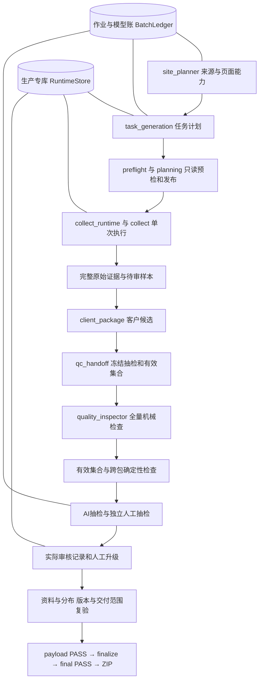
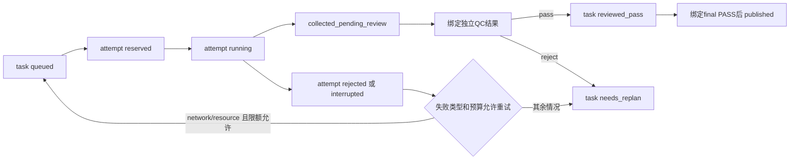

# WebCollect 设计说明

Table1 站点信息、Table2 原表与领取快照的兼容合同见[生产者双表与消费者兼容研发计划](生产者双表与消费者兼容研发计划-20261102.md)。新批分类由生产者负责；历史消费者的快照、原结果和原协议保持可读。

后续 Agent 契约设计见[Agent 优化与 39 条问题统一实施计划](Agent优化与39条问题统一实施计划-20261101.md)与[实施方案](消费者Agent整体研发与单条真实验收实施方案-20261101.md)：分类是来源元数据，缺失仍可消费和保存待审；导航页支持进入、返回及切换分支，路径许可与逐页应用／主机归属分别验证。统一有限动作与四工具、300 字符以内工作目标、完整原件与精简请求、token 统计和分层 QC。整体研发及单条真实采集保存已授权，完成状态以新会话证据为准；旧冻结协议、原账、25 次真实 GLM 派发和真实 QC UNKNOWN 保持原义。

新派发使用原账计量。单个 ReAct 会话的 GLM 调用以原 attempt 和实际 HTTP 派发为准。第 25 次仍可正常结束，后续调用在同一 SQLite 事务内拦截并留存停止原因。[额度限制清单](额度限制清单与取消说明-20261101.md)

历史生产者的隔离决定按工程、原作业账及冻结配置摘要追加到原事件表。显式隔离的选源请求保留原状态、预留和来源，新的独立选源须避开这些应用；未隔离的未决请求继续阻断。候选、GET、调用数、累计 token、总费用和总运行时长改为计量。消费者与独立 QC 各用自己的账本。

新工程可在原站点账登记入口 GET 的 URI 隔离授权。已结束的零模型只读访问用原作业、访问账和带摘要的收据共同定界。保留传输 UNKNOWN 及其计数，派发时另外计算匹配本 URI 的隔离和仍作用于整站的未决。

GLM 用量先按角色和原请求 ID 统计。一个发现请求选出多条实际 NEW 时，将输入和输出 token 分别做整数均摊，余数按原始行序分配。分摊随同一请求后续入池行更新，批次完成后稳定。零新增的调用和未结算请求单列，旧候选用原发布与请求记录关联。消费结果通过候选 ID、claim 和正式 attempt 关联，同一候选的重复尝试保留历史，保存、QC 及发布遵循各阶段原证据。[查询入口](工程说明.md#后台生产和逐候选用量)

在已授权的生产者连续生产中，提供方已回传用量但缺少合法工具调用时，保存原请求的 `invalid_response` 和零新增的批次结论，接着选择其他来源。恢复使用原请求 ID 复读该结论。未结算请求继续按各自的独立证据处理。

混合发现为已知应用的功能入口保存 `independent_function`，绑定页面自身的功能名、操作原文与来源文件。可复用同一应用父类，不同功能可有各自的入口候选和后续消费结果。对只改变语言、普通参数或数字记录编号的相同路由，以及已有证据中的同名功能，混合模式在发布前去重。交付样本的截图、步骤与结果仍须分别核验。

新候选工程将派发规则绑定到工程 manifest、生产注册库和共享候选池。候选只有一个有效领取者，同页不同任务可以分别占用自己的任务键。同站的确定失败持续记账，计数不触发停站。当前未决执行仍可暂停派发。消费者记录本工程工时，领取后发生真实资源故障的任务保留为待对账。R03 旧规则随原绑定保留。[门禁逐项审查](历史门禁审查与新工程切换-20261101.md) · [真实 ReAct 单站实测](消费者运行时恢复与单站实测计划-20261101.md)

整体应用父类、页面类型、净新增候选和浏览器首帧的拟议契约见[生产者与站点发现 Agent 优化方案](生产者与站点发现Agent优化方案-20261101.md)。

本机启动入口使用同一份 scope 将批次、候选池、当前链和原账传给各角色。每个角色独立运行，进程间的领取、保存和恢复仍由原 SQL 事务与收据决定。消费者的 `qc_policy` 将同一 claim/attempt 的待审样本交给独立 QC。已冻结的收据、抽样计划和有效集合可用于 QC 入队，实际审核结果由质检侧登记。[启动顺序与交接检查](工程说明.md#本机有界批次启动)

新生产批次在发布候选前核验公开入口的最终 HTTP 状态，模型建议和调用方明确目标共用这一规则。同批按实际请求 URL 绑定访问账与收据。HTTP 检查通过只产生可领取库存，正式浏览器会话仍需取得同步图树和页面身份。旧批次按原冻结收据复读，不能用没有入口检查的新行补写。

当前链的生产者、消费者和正式执行共用 manifest 声明的证据范围。生产者把 manifest 引用冻结到发现会话和批次配置，在派发前核验输出目录及显式来源，保存的原始引用可以直接随候选传到 ReAct。监视进程通过只读 SQL 连接导出调用、访问与失败记录，消费者的领取、心跳和模型派发由其自身进程负责。

2026-10-31 三路接线已实现：原 SQLite claim 事务冻结候选体、版本、来源和持有者，阶段条件推进选出唯一外部执行者。消费者先在自己的 BrowserContext/Page 导航入口一次，在原访问账保留请求身份与同步 PNG/树/收据，再用真实锚点构造页面身份并冻结计划；原 RuntimeStore 通过身份、并发和预算门禁后登记正式 attempt，把同页和首观察交给 ReAct。新尝试使用新上下文和对话；旧 V1/冻结任务保留原解释。V2 entry 的 requested_goal 为 null，target 保留调用方目标及参数；来源建议不拥有目标授权，调用方的 category_hint 也只留在冻结来源。

新决策协议 `webcollect-react-native-2` 每轮执行一个工具，工具参数经 JSON Schema 校验，结果按供应商的 `tool_call_id` 回填。原子动作、同步图树和前后可核验的界面变化决定有效步数。1–4 步且有实际结束依据时才标为短流程，零步或真实阻断不能记作普通成功。原会话继续使用冻结协议。

保存与池投影仍分开：只有原生产库的 `collected_pending_review`、同一 claim/attempt 的保存收据和样本/取证摘要均核验成功，才写唯一有效候选结果。保存后的回写中断用原收据补投影，不能重采或新增模型请求；UNKNOWN 即使遇到预算边界也必须保持未决。四工具使用原生 call ID 和实际宿主结果，多轮原图与不透明协议字段保留在受控历史中。离线联合夹具覆盖完整链和中断边界；实际独立 QC、正式有效集合接纳、发布和客户验收仍各自需要证据。

试跑可以对单条样本独立审查，小集合比例用于诊断。正式质量批次在 QC 有效集合上显式冻结 5,000 个当前 ID；本批及累计分别核验短流程、四路重复、站点类目和视口，其他轨迹维度统计分布。正式抽样审查和发布沿用原流程。

2026-10-31 新版候选契约规划见[生产者消费者职责拆分计划](生产者消费者职责拆分与轻量化改造计划-20261031.md)：入口可无具体目标，调用方明确要求只读绑定，生产者建议留在来源上下文，消费者观察后形成 `working_goal`。新旧协议显式分流，来源错误逐条留证；原 UNKNOWN/整站 hold、租约与生产占用持续生效。入口库存、明确目标、原始保存、加工样本与实际 QC 分开计数。本次未修改实现、历史契约或原账。

2026-10-31 生产者V2以每批原始回答及真实搜索资料为验收对象。程序生成ID、URL规范化和确定性去重不等于业务纠正；flat flags归位等修正不能计为“原始输出直接合格”。来源URL与正文引用的外站应用分开，候选的来源一致性/分类/参数/语义重复由单列AI来源核对记录；合格候选仍为待消费库存，不授予ready、采集或QC通过。批次身份可扩展，原账预算与UNKNOWN恢复边界不变。

2026-10-31 最新待实施契约见[规划采集 Agent 改造计划与验收](规划采集Agent改造计划与验收-20261031.md)：页面观察、四工具循环、完整原始执行结果。第三契约不再要求在线生成多个片段；原始保存与加工后的待审样本分别登记，旧尝试和审核收据保留原含义。交付步数 ≥5，或 short_flow 并给原因，短流程比例仍 ≤2%；本轮取消固定 5–8 步停止，不实现自动切段。Agent 功能验收以至少一份新 Agent 真实采集、加工、符合需求且独立 QC 实际通过的样本为准，原始保存、待审或离线 PASS 均不能替代。本文下方旧方案保留历史，本次只形成计划，未据此改代码或恢复生产。

2026-10-31 候选消费者的新规划保持原目标与全部参数绑定，使用 `candidate-fragment-ending-1` 分开记录业务意图和5–8步片段末状态。允许在业务中间结束，不能额外增加完整业务完成门槛或声称未执行条件已满足。数字输入不能读取选区位置时，显式全选、清空并观察空值后才允许输入；无效果检查继续生效。连续两次相同补证没有增加动作证据即停止。填有内容的输入框，其隐藏占位文字不能成为结果叙述的可见标签。派发图使用稳定证据路径；历史 samples→rejected 迁移只通过原收据、原摘要与同一图片的新位置校验，不改写历史原件。真实保存、独立QC、人工审核和发布仍分别记账。

2026-10-31 串行采集的fragment-decision可绑定原collection父作业并共用其并发槽位：父租约必须有效，同一父作业只允许一个活动子决策；独立作业仍受原并发上限限制，费用/请求/租约账不合并。领取阶段的零发送预算失败单列为本地错误，原真实误分类不改签成功。10次真实验证已停止，末次修复的真实验收尚未完成。

2026-10-30 [候选库存协议v1](共享站点池与自主发现.md#候选库存协议-v12026-10-30工程与离线验证)区分整体应用、业务种类、数据候选、消费尝试、正式sample和合格结果。候选身份以应用＋结构化目标/参数确定；类别/描述更新保留同ID及版本。原子租约领取发生在观察/规划前，过期进入待核实；原生产账及完整保存收据才能消费成功，QC状态单列，UNKNOWN不重发。旧ready/冻结/账本协议不静默迁移；本轮为工程与离线验证。

2026-10-30 新增[规划采集 agent 闭环](规划采集Agent闭环-20261030.md)：`agent-model` / `site_rolling --controlled` 使用可信三态观察、原执行/QC反馈及有预算的短计划控制循环；新片段协议直接采5–8实际有效动作，复用原账、采集和独立QC，成功仍仅待审。旧冻结协议与恢复门禁保留。本轮仅代码和离线验证，真实小批方案待范围明确后执行。

2026-10-30最新[QC策略](QC抽检与批次合格计数方案-20261030.md)将全量程序检查与AI抽检分开，默认随机10%、风险必审、普通问题扩至30%/100%。后续需分别表达程序结果、实际AI结果、批次接纳及发布/客户验收；NOT_SELECTED本身不合格，但在所属质量单元有效接纳且全局检查通过后可以计入1000/20万。实际AI审核与按批次接纳数量分别报告，相关问题可撤回并扣减。以上是待实施契约，不改变现有字段或旧收据含义。

2026-10-30今日1000与最终20万共用[同一程序规划](今日1000条与20万条量产程序规划-20261030.md)：站级上下文滚动产出动作计划，工程执行并记录原执行/片段，独立QC回写累计有效集合；采集与审核通过队列并行。日新增目标由启动时原账基线求差，不重复算旧结果。先直接5–8步片段、保持未来连续切段兼容；新规则尚未在本轮实施。

2026-10-30用户最新[轨迹定义](../request/轨迹采集口径补充-20261030.md)优先：5–8实际操作即可形成业务片段，不强制完整业务完成；同页多轮、参数任务与浏览可入候选，按总体重复指标判断；10动作切2段的共享边界单独统计。后续需区分原执行/业务目标/片段结束状态，建立一对多编号和QC来源绑定。本次只修订文档，[P0第11节](P0快速闭环实施计划-20261030.md#11-最新轨迹口径对齐2026-10-30未实施)尚未实施，旧协议、规则和审核保持其原历史含义。

2026-10-30讨论稿见[20万条快采方案](20万条快速采集量产方案-20261030.md)与[P0计划](P0快速闭环实施计划-20261030.md)。拟将业务条件和操作分开：已满足条件保留为前置断言，必要动作在冻结前归一化并报告有效步数；计划不足5步仍拒绝，不以失败或空任务推定整站无容量。按任务/小批冻结、复用既有单次采集和后置QC优先于新平台改造。本轮已按 P0-1 至 P0-3 实现上述最小合同：semantic-v3 的 `conditions` 保存业务目标，`steps` 仅放条件完成后必要点击；已满足条件保留执行前断言、计零步。原模型规格、逐条件初值/目标/动作/原因和最终步数随冻结任务保存，失败报告保留全部可确定问题。执行前初值或焦点不符即拒绝，不动态改动作。原生 select 仍按唯一观察标签执行；旧 semantic-v2、旧收据和真实失败不改写。本轮只作离线验证，不授予真实通过。

2026-10-30 网站规划修复与 GLM 交互新版见[实施与验收记录](网站规划与GLM交互修复-20261030.md)。原三站的 SOURCE_FAILED 和 UNKNOWN 保留；旧 C01–C18 关闭结论须结合本次后继修正读取。工程、真实验证和规模适用性分别报告。

共享池的采集状态是生产专库的投影，不能自行签发QC结论。基本发现schema保持 `webcollect-site-pool-2`；显式绑定生产scope时增量增加 `collection_sources/tasks/events`，原表、历史证据及失败账不改写。投影绑定原registry绝对路径、scope、任务版本和生产事件序号，事件历史追加保存，旧序号不能覆盖新状态。生产事务提交后尽力同步，未成功留下pending；派发和开始执行前必须补写成功，读取发现投影落后或源库不可用也禁止派发。两个独立库无法合成一次事务，故中断时保守阻断而不重跑。

页面防重沿用应用归属和保守路径身份：query、fragment、尾斜杠和已证实别名不能绕过占用；整体应用的其他功能路径仍独立可用。逻辑任务ID也防止跨scope/registry换页重复派发。在途、已保存待审、审核通过与发布保持占用；失败保留每次尝试、原因和QC报告，重试/新版本仍由原生产预算、任务身份和整站止损决定。已有采集跟踪的应用合并须先明确核对投影，不允许合并隐藏占用。共享池不设置整站completed，也不替代当前链有效集合与发布门禁。

同站不同功能页保持原整体应用身份和应用名；原始来源锚点仍分别绑定。HTTP401/403的原请求及UNKNOWN费用保留，作业账在新模型预留前阻断后续请求；已成功缓存读取不受影响。仅有只读观察的20站规划是可恢复草案，不授予ready、任务可执行性或生产容量。实际状态见[本轮执行说明](同站双功能与20站最小执行-20261029.md)。

单条验证支路保持“来源、任务、采集、QC”分别结算：`single_record`只编排现有模块，`generate --max-tasks`在登记任务前限制计划数量，不裁剪已生成计划，不修改生产campaign预算。QC使用实际保存的候选和冻结交接，不把QC_NOT_RUN或发现ready记为合格。见[今日单条真实闭环计划](今日单条真实闭环计划-20261029.md)。

资料审核v3区分导出时状态与独立payload审核状态。显式提供的样本审核和抽检策略须成对传入，经现有engine按当前原图/树/标注和语义规则重验；两份输入摘要进入资料任务身份并在调用前后核验。资料模型检查声明与已验证覆盖是否一致，不替代原帧视觉、选中/升级人工或最终发布门禁；缺失仍为UNKNOWN或待审。语义规则未变时保留原样本审核，补资料只重验资料。

共享站点池将应用、别名、页面、发现、判断和既有能力引用分层；双来源追加溯源，类目冲突保持UNKNOWN，冻结基线用于本轮新增判断。发现线索、可读站点、确认应用和ready能力分别统计；程序2只读接口不触发任务生成或采集。详见[共享站点池与自主发现](共享站点池与自主发现.md)。

## 2026-10-29一致性修复补充

显式工作流提案与历史观察准入入口分开。提案绑定只读原始页面证据、5–10个必要动作、子目标和终态判据，再进入普通单次采集；证据标签不等于动作成功，采集后的独立QC继续判断必要性、可见结果与实质差异。无支持策略或显式提案时返回 `UNSUPPORTED_WORKFLOW`，不靠修改类别/任务族标签补能力。

注册策略是候选差异线索，不能凭策略相同拒绝所有实际路径。生成阶段仍拒绝相同必要动作角色下的参数替换；实际目标、路径、页面状态、结果判定的差异在后置QC判断。任务页面唯一归属、四路全局机械去重、第五项语义比较及当前链隔离继续独立执行。

新终态滚动在同次执行中证明必要性，不能用于凑步数；已完全可见、内容错误、隐藏或超出一次滚动范围的结果均拒绝。旧任务携带的准入字段不能删掉以切换到新分支。

真实首条准备发现一处机械就绪误判：DOM已解析、视口字体/图片均已加载、相邻原图与树稳定，但后台资源使document保持interactive。采集就绪接受interactive/complete，两者都必须满足字体/视口图片就绪、相关状态与原图一致及动作前重验；loading仍拒绝。此修复不改变视觉/语义审核规则，不改签旧结论，不把旧诊断图升级为正式帧。

派发前拒绝证明属于失败原件：同步保留原始PNG、复核PNG、原/live/final树与两次stability结果，供重算具体差异。较晚故障截图与当次拒绝证明分别留存；缺少当次比较帧的旧失败仍保留UNKNOWN原因，不通过放宽像素阈值或补写证明改签。

凭据与作业身份分离：模型配置/请求身份只含环境变量名或文件路径，token由运行时解析进入Authorization头。GLM默认使用已授权的项目 `request/token`；新凭据来源不清空原账、重发UNKNOWN请求或改变生产授权范围。

正式全量发行可在累计集合profile显式声明 `release={kind: formal, version: ...}`：要求200000个有效样本、20包每包10000、总体分布执行，拒绝重复或被替代副本。实验profile声明 `kind: experiment` 和版本；局部机械/语义PASS不能据此宣称20万条正式发行或客户验收。未声明release的旧profile维持其原局部检查含义，不补签正式发行。

本文描述源码 `34afaaa`（2026-10-28）中的实现与边界；环境及函数导航见[工程说明](工程说明.md)。需求语义以[当前澄清](../request/需求澄清记录.md)、原需求书和附件为准，技术能力、真实产量和客户验收分别判断。

## 1. 设计目标与分层

工程的核心是把一条真实网页操作轨迹保存为可重验的数据，而后对**实际交付字节**做独立审核。来源可访问、任务能执行、采集保存成功、审核通过、正式发布并不是同一个状态。

三个程序通过文件契约和 Python 调用协作。QC 独立读取客户目录和审核记录，不把采集侧的“成功”标签当作合格证明；部分流水线与账本代码可复用，因此“独立”指检查责任与证据来源，不代表完全没有代码依赖。

## 2. 领域对象与身份

| 对象 | 用途与边界 |
| --- | --- |
| 来源 source | 种子、目录或搜索模板配置及返回内容；配置身份 hash 与抓取内容 hash 分开，保留来源及失败分母 |
| 整体应用 application | 当前试点的站点管理与止损单位；不同路径或 query 不自动成为新应用 |
| 页面/task page | 实际承载任务的内容或功能页；共享入口/中间页有明确角色；新片段协议允许同页不同路径候选，逐条检查5–8实际动作与重复度，不承诺单页固定产能 |
| capability | `webcollect-site-capability-1`；精确观察页、可用动作、库存、来源、证据、版本及有效期。`ready` 仅表示该能力范围可用于规划 |
| task | 稳定 task ID、task version、业务身份、必要操作与终态断言；参数替换不能自动创造独立任务 |
| publication | plan、能力、预检和源实现的冻结绑定；不分配样本号、不授予 QC PASS |
| campaign | 跨输出目录共用尝试、待审、分布、工时与存储计量，统一协调并发 |
| scope | 一个输出路径对应的运行范围，由 `runtime_scope(output)` 派生；换 scope 仍沿用 campaign 的计量 |
| attempt | 一次实际尝试、租约与 sample ID；预留、开始、结束分开，分母按实际执行计算 |
| sample | `Sxxxxxx_sample_xxxxxx` 和完整标注/图/树；分配后失败也不回收编号 |
| chain | manifest + 专库 + 允许结果根目录；限定本轮结果、审核和比较总体 |
| effective set | `qc-cumulative-set-1` 的显式包集合及内容摘要，可声明同 ID 版本替代关系；不依赖“最新目录”推断 |
| review / report | 审核记录给出证据绑定结论；QC报告重算格式、规则、总体与接受状态，两者不能互相伪造 |

旧编号表按 URI 存储站点，当前 `production_identity` 在其上增加整体应用、任务页与内容身份门禁，分片协议再固定 canonical 整站归属。因此不能简单把数据库 `sites` 行数当作有效站点产能。当前页面身份对 query 区分的内容、多 host 应用别名仍保守处理，不自动证明独立容量。

## 3. 当前链隔离与证据契约

[`current_chain.py`](../projects/code/webcollect/current_chain.py) 的 `initialize_chain()` 只为明确新建的空总体初始化：已有无标记 registry 或已有样本目录不能被静默接管、清空。manifest 冻结 chain ID、registry 和结果根目录；专库的 `current_chain_meta` 保存相同绑定。

`read_chain_history()` 从专库 `current_chain_results` 逐条核对 annotation 路径/摘要、sample ID 和真实 attempt，构造当前对照集合。它不回退历史正式包。`same_chain()` 只确认稳定归属，新增结果成员仍需实时核对，不能借稳定 chain ID 接纳任意文件。

通用证据引用为已有绝对路径和 SHA256，拒绝符号链接、消失文件、字节变更和越界来源。哈希证明绑定的文件未变，不证明截图内容正确、审核者真的看过图或请求真的得到厂商计费。

`qc_handoff.prepare_qc_inputs()` 另外要求每个候选对应专库中唯一 `collected_pending_review` attempt，保存收据、原始 evidence 与客户样本字节一致。观察 trace、手工样本或只同名的 sample ID 不能晋升。它冻结显式抽检计划、当前有效集合和待独立核实线索，不写生产账、不调用模型。

当前 handoff 对转换后标注的 lineage 仍采用严格字节一致限制；需要改标注、归一化或增量总体时，必须验证相应契约，不能仅凭同 ID 或来源路径推定可接纳。

## 4. 单次执行与图树同步

动作前帧和动作后帧分别进行图树同步。两帧之间由操作引起的变化用于解释动作效果。一次点击后，目标链接获得焦点即可据实记录该效果。若预期是在新页看到正文，还需把新页的实际观察绑定到该次操作。旁侧媒体变化可单列，参与有效步数判断的依据须与本步有关。[确认口径与实例](Agent优化与39条问题统一实施计划-20261101.md#操作引起的合法变化)

`task_generation.execute()` → `collect_m4()` → `collect_one()` 是普通任务的共享执行路径。只读预检采样页面、发布冻结计划后，每个计划动作在该 attempt 中执行一次；不再要求先执行完整演练再正式重放。旧准入路线仍会验证已经存在的收据。

每步围绕实际页面状态工作：观察可见控件与文字，捕获原始 PNG 和同步树，生成动作参数，在执行前重验状态、目标、坐标、焦点和命中条件，再记录实际动作与结果。叙述从已保存的可见事实生成，不能把规划目标或隐藏 DOM 文本写成已出现的终态。

`browser.stability_pair()` 同时核对加载完成、相关状态和完整原图像素。新稳态证明允许有证据支持的无关、非交互图片区域变化，但目标、标签、值、遮挡、结果及区域外像素必须满足约束；不裁剪、不修改保存原图。`full_dom_stable` 与 `related_dom_stable` 分开记录，不能把全状态变化伪称完整稳定。

当前区域外零像素差是工程策略，客户需求未规定任意1像素变化必须拒绝。后续拟按[统一优化方案](WebCollect统一优化方案-20261029.md)C18验证有界重新取证及局部微小绘制容差，关键文字、数值、目标、遮挡及结果继续保护。该方向尚未实现，不改写当前冻结规则、原图或历史失败。

完成步骤由 `capture_complete()` 重新获取完整证据并重验断言，不能拼接早期截图与新树。旧任务有效动作 5–10 步、新控制片段5–8步的门禁均排除 `wait` / `complete`；准备动作若实际执行也记录，不能插入无关操作凑数。自然太短、没有可核验可见终态或不支持的任务保留失败。

控制循环（controller v2）的三条数据契约补充：决策与其派发之间按动作相关目标投影（绑定 selector/索引/角色、element 角色、可读标签来源与文本、值/选中/焦点/选区状态）核对一致性，目标含义或结构变化即候选失效并要求新决策，仅目标自身已执行输入可解释的 placeholder↔值互换与状态变化放行，不恢复整页任意变化拒绝；每次决策 prompt 携带 `current_trajectory`（已执行动作、实际参数、`expected` 预期与 `observed` 实际观察分列、有界原件引用），与历史尝试 `feedback` 分开，模型输入不得用本地路径代替内容；决策请求失败按请求阶段分级记账——零预留本地预检错误与已结算明确失败均为终态 `failed`（后者另映射 `MODEL_FAULT`），仅发送后未决或无法证明是否发送维持 UNKNOWN hold 且禁止重发。

采集保存前执行生产端结构校验、capture audit 和精确截图冲突检查。成功写入 `saved_sample.json`，同时绑定样本全部文件和原始采集文件；最终 outcome 仍为 `collected_pending_review`。精确去重只是生产端提前拦截，独立 QC 继续执行四路去重和业务差异审核。

## 5. 两套账本与恢复

| 持久对象 | 负责什么 | 不负责什么 |
| --- | --- | --- |
| `BatchLedger` | 冻结运行配置、job 身份/租约、访问计数、模型请求预留/结算、缓存、用量和事件 | 不分配生产 sample ID，不证明合格 |
| `RuntimeStore` / production registry | 编号、campaign/scope/task/attempt、域间隔、生产租约、原样保存、审核/发布引用 | 不调用模型，不直接签署人工或客户验收 |
| `SiteFailureStore` | 整体应用的 probe/observation/formal 真实失败与UNKNOWN事实，按 execution ID 幂等累计 | 不重试请求、不凭空增加失败、不清零原账 |
| `SiteProgress` | 原生产账的逻辑站点目标、位置、最终 QC 接受与发布视图 | 不自行分配编号、不扩预算、不把 pending 变合格 |

`RuntimeStore` 在同一 SQLite 事务中完成 claim、attempt 身份和编号预留，带 worker ID、lease token、到期时间进行 fencing。旧进程失去租约后不能继续提交；已终结 attempt 不能改写成另一结果。

图中 task 和 attempt 分属不同表：审核/发布推进任务状态，原采集 attempt 继续保留其保存结果。不能看到一条旧 attempt 为 pending 就忽略它已有关联审核，也不能只看 task 标签而跳过原证据核查。

resume 核对 bootstrap 的原路径、计划、发布与实现身份，并逐字节验证已保存样本及 raw 文件；已完成样本被跳过。中断只保留失败轨迹，新尝试另分配 ID，不能拼接跨会话片段。重启沿用原活动账本和 UNKNOWN 对账。旧试点继续按原整站失败阈值派发，新工程按本代任务和站点事实判定。

## 6. 全量机械、AI与人工三层质检

第一层由 `quality_inspector.engine.inspect()` 独立检查格式、路径、图树、校验清单、分布、资料和四路去重，覆盖实际输入总体。第二、三层由 `delivery_sampling` 的冻结策略分别控制 AI 和人工覆盖，抽样单位是完整轨迹 slot。

计划绑定原始分母、比例、seed、batch/site 分层及 annotation/图/树字节。正比例向上取整；AI、人工可重叠，同一样本的升级与随机人工任务合并。策略必须显式输入；无 sampling plan 的 `check` 仍要求完整语义审核。

| 状态/分支 | 行为 |
| --- | --- |
| AI 被选中但尚未实际审核 | `AI_REQUIRED`；不能以人工记录冒充已执行 AI |
| AI 已有失败、非法回复、UNKNOWN或未决 | 验证原账/失败收据后转人工；保留原请求与费用，不自动重发 |
| 独立人工抽中或强制升级 | 导入实际人工逐帧与五项结论，缺失保持待审 |
| 有效人工 PASS 裁决已有 AI 分歧 | 按现有策略接受裁决，原 AI 失败不覆盖 |
| 人工 FAIL | `REPLACE_REQUIRED`；新采集、新 ID，继承原 slot 选择并强制人工复检 |
| 未抽中 | `NOT_SELECTED` / 策略准入；不能写成逐帧语义 PASS |

五项语义检查为 `visual_alignment`、`terminal_semantics`、`language`、`privacy`、`substantive_difference`。资料审核另按包执行。导入 JSON 验证记录来源、逐帧覆盖和证据字节，但不从技术上认证审核者身份或实际阅读；agent 不得代签人工。

`delivery_pipeline.prepare()` 绑定外层 receipt、模型账、策略、profile、有效集合与跨包报告；`run()` 执行队列；`status()` 重算状态并可发行收据/同步进度；`import-human()` 导入实际记录；`finalize()` 核验最新发行状态后调用封包逻辑。过程锁防止同一 pipeline 并发修改。

## 7. 审核复用与用量设计

`semantic.py` 为五项检查分别定义规则版本，审核身份绑定 sample ID、annotation 和全部引用图/树字节。`contract.fingerprint()` 保留完整源码摘要作工程追溯，但不再把无关实现 hash 当作所有语义结果的失效条件。

`semantic_runtime.py` 在**同一模型作业账内**按 kind、实际样本/资料、比较集合、model/mode/prompt 和相关规则查找已绑定结果，并用锁覆盖查找及派发。新 pipeline 可引用原结果，不代表跨所有数据库存在全局缓存。

| 变化 | 审核影响 |
| --- | --- |
| 只搬目录或改变封包外壳，样本字节及相关规则相同 | 可复用有效语义结果；机械/交付检查仍重算 |
| annotation 或任一被引用图/树改变 | 对应样本不再是同一审核对象，需要适用审核 |
| 单项语义含义/版本改变 | 仅相应项转待审，原记录保持不变 |
| 差异比较总体或近邻改变 | 第五项绑定改变，不能用旧局部结论替代 |
| 资料或支持证据改变 | 按资料审核 subject/prompt 重新判断适用范围 |
| 原同对象请求 running/failed/review_required 或UNKNOWN | 阻断再次派发，回查原请求；不能新建 alias 绕过 |

`ModelGateway` 在发送前做预算预留，返回后校验严格 JSON、schema、usage、模型及图像能力。缺失 cached usage 等不能默认为零；网络/费用未知保持原预留与 UNKNOWN。费用来自显式费率和厂商返回 usage，实际厂商扣费缺证据仍为 UNKNOWN；reasoning 若已包含 output 不重复累加。

模型双链路以显式 provider、端点和版本区分：原 `glm` 连接智谱；`ark` 连接火山方舟，优先 `glm-5-3-flash-260828`，备选按用户指令改为 `deepseek-v4-1-flash-economy-261017`。标准版 `deepseek-v4-1-flash-261017` 继续兼容既有冻结账本，不再作为备选示例默认值。每个冻结模型账仍只绑定一条通道和一个版本，不在异常处理中隐式更换模型。旧请求 UNKNOWN、401/403和未决审核须按原账处理，不能新建 Ark 作业冒充同一请求的安全重试；新的独立联通验证只证明对应协议可用。

共享YAML凭据须按厂商选择账户：Ark使用 `ark1`，智谱使用 `glm1`；任一所选账户缺失、重复或无效均停止，不借另一厂商的key继续。用户更新文件格式后，Ark也兼容不能按严格YAML解析的旧标签文件，但只读取显式顶层、唯一且完整的 `ark1` 条目，不借解析失败猜测其他字段。配置与请求身份仍不包含key值，凭据选择修复也不改写此前失败和费用UNKNOWN。

Ark 用 `max_completion_tokens` 统一约束思考与回答，原 PNG 经 data URL 发送；两模型的输出继续经本地 Schema 验证，版本不匹配的响应保留为失败。Ark GLM 使用公开固定费率；DeepSeek 示例以高峰费率作保守上限，空闲时段折扣、缓存存储与账户实际扣费另行核对。示例的一次请求预算和联通 PASS 不折算为真实任务、逐帧审核或新增合格产量。

## 8. 四路去重、版本与最终封包

四路实现位于 `duplicates.py`：跨样本精确图像 SHA、精确动作/目标/页面序列、首尾图 dHash、任务指令 SimHash。参数及规则进入合同/profile。任一路命中继续按机械近重复处理，语义 DISTINCT 不能豁免；检查失败的数量为 UNKNOWN，不能当成零命中。

`version_compare.py` 在显式有效集合中处理同 ID：相同内容副本只计一次；不同版本必须有明确 `supersedes` 关系和原因，不按目录时间选“最新”。不同 ID 仍执行四路及实质差异检查。`check-set` 的累计机械 PASS 不表示语义完成，仍不能单独放行。

正式顺序为：

1. 从原始采集生成事实、导出候选客户包，保留样本与包外 lineage。
2. 冻结有效集合，执行跨包确定性检查，形成内容绑定的报告。
3. 对实际候选执行 payload 检查，使用显式抽检计划及真实 AI/人工/资料记录。
4. `finalize-client` 核验 payload PASS、有效集合及跨包 PASS，在新目录附入报告摘要。
5. 对完整包执行 final 只读复验；`archive-client` 再核对 final PASS 和相同交付范围，生成 ZIP 和校验文件。

`delivery_scope.verify_delivery_scope()` 被封包、归档和 pipeline 等入口共享使用，重新核对有效集合、跨包报告、profile、合同、版本选择与实际 payload。禁止变更内容后沿用旧 PASS，禁止将被替代或部分包直接密封。ZIP 路线验证解压内容与源文件字节一致，不再派发 AI。

`delivery_status=PASS`、`release_ready=true` 是本地规则通过；`customer_acceptance` 继续单列 UNKNOWN，只有客户实际证据才能改变外部验收结论。小规模实验 profile 即使通过，也不能证明正式数量/总体分布已满足。

## 9. 并发、分片与尚存边界

本机 `site_scheduler` 调度已发布计划，多个 worker 共用生产 registry、资源计量、域间隔和精确截图提交冲突守卫。它不发现新站、不扩大额度、不授予 QC。

静态多 worker 协议见 [`batch_protocol.py`](../projects/code/webcollect/batch_protocol.py) 和[协议文档](../projects/code/docs/static-batch-protocol.md)：全局站点 ID、固定 owner/shard、证据绑定容量、失败/UNKNOWN事实搬运、最终 QC 结果冻结和合并。容量未知不默认每站 20 条；同 shard 不允许两台活跃执行者。

合并保留原四项视觉审核，但局部比较范围合并后，第五项全局实质差异可能转待审；`mechanical_unique_count` 与 `globally_qualified_count` 分开。缺片或全局未决不能直接开始补采；协议测试不证明已部署多机。

当前已知边界还包括：任务策略覆盖有限，网站可达/能力 ready 不代表真实任务容量；公开页面动态、加载、遮挡仍可能阻断采集；审核者身份与实际阅读不由 JSON 自证；新克隆无本机证据不能接续原生产。当前生产停止、真实首条闭环与大规模吞吐未获此源码改造验证，不以工程 PASS 替代这些结果。

2026-10-29工程实施增补：见[统一优化实施记录](统一优化实施记录-20261029.md)。新增通用模型规划与冻结队列、严格页面/多图协议、结构化重取证、版本化局部边框规则及显式批次QC准备；原single_record首关100%策略、旧FAIL、UNKNOWN、原账及停止事实保持。新增能力仅完成局部离线验证，真实链路及规模能力待新授权验证；历史规划快照不作为本次生产授权。

2026-10-29后续工程交付：[C01–C18关闭状态与验收](C01-C18关闭状态-20261029.md)。补齐跨目录原件合批、受影响流程扩检、保存/索引及合批中断恢复、原生离线绘制反例；用户已授权提交本地main后执行3站新批次，沿用原manifest与生产库。旧停站先据证据追加复核，仅经本次显式运营授权应用工程更正，不删除旧失败或重发UNKNOWN。工程关闭与真实验证状态分别记录。

2026-10-31react协议增补：决策协议对外以单一原生函数 `react_decision`（参数即 REACT_DECISION Schema）走提供方结构化输出，宿主仍按白名单四工具执行并只回真实观察；观察投影携带三值原因（如 INSUFFICIENT/MISSING_READABLE_LABEL_EVIDENCE），同控件同页面状态只允许一次定向探针。采集层新增"相邻 value 按钮文本"作为输入控件的渲染标签证据（rendered_adjacent_input_group_label，沿用原 paint/几何证明）。会话内导航销毁求值上下文时允许一次等待加载后的重观察（动作不重发）。页面身份验证对 react 任务以"冻结应用同源"接纳会话挣得页面；交付审核以 react 终态收据替代业务断言记录。短流程与精确截图去重维持原契约：短流程累计 ≤2% 由数据集级检查把关；同入口页首帧跨样本互斥，先交付样本占位且审核拒绝不释放——该交互在小批次下的适用性列为待裁决契约问题，未放宽。

## 生产者新发现批次与只读反馈（2026-11-01）

`entry-selection-2` 将发现模式、原方向顺序、按应用数量／目标配比调整后的方向顺序、工具和枚举版本、反馈摘要与来源排序冻结在原 runs／checkpoints 中，不增设服务或另一套请求账。新协议为 `entry-tools-2`；旧 V1、旧工具、冻结 V2、来源及 claim 原件保持原解释。应用／别名／合并按本批主机走索引点查，并验证触达的身份依据；旧发现器仍可冻结完整基线。

预筛结论与模型行结论分开：前者保留来源索引、原索引和原因，模型行保留原 request／response／raw index；只有原候选唯一键首次写入的行计 NEW。完成批次缓存原累计报告，本次派发另计；中断恢复优先原输入、归类与逐行收据。候选发布继续使用 SQLite 短事务和唯一约束，原 UNKNOWN 不重派。

分类是绑定整体应用、枚举版本和来源原文的 AI 判断，状态为 `EVIDENCE_BOUND_AI`、`UNKNOWN` 或 `CONFLICT`。新 `entry-tools-2` 批次用已核验来源 URL 绑定发布站身份，用 GLM 引用的同应用原文核验主营功能。第三方介绍页可以作为发布站的内容入口，其介绍的外站功能不能用于确定发布站父类。同应用复用分类时沿用有依据的主营引文，每条入口保留自己的 URL 身份。旧批按原冻结规则恢复，分类变化追加新来源与新判断。消费者只用有版本、有证据的应用归类占用父类配额。站点分布与交付有效样本比例分别统计。

反馈主指标由显式范围的不同 NEW 候选关联原 claim、观察作业、首次实际 visit 和同步首帧证明得到，不由 HTTP 200 或 claim 最终状态推断。可信取证与页面可用性分开，首帧成功率、可判定覆盖率及未评估原因同时输出。图树不同步、缺证、UNKNOWN、工时与类目未知分别保留；首帧后工时不抹去已验证首帧。反馈采用请求入口实际 hostname，保留子域和落地主机，生产 GET 与浏览器后续失败同时保留。

同主机×冻结页面类型连续两个不同候选的可归因失败只影响后继发现来源排序；成功及非站点证据不能凑成连续站点失败。当前未决执行先于排序处理。新工程的确定失败只记账，旧试点的三次停止仍由其原账决定。反馈与报告仅写新路径，原范围、观察证据和账本只读；工程通过与真实净新增／首帧增益分别验收。

## 批次收据目标与候选处置

批量消费者的候选处理上限和结果目标独立。结果目标绑定生产者批次的原 NEW 候选集合，保存从已提交尝试和完整原保存收据计数，合格另查原运行库的独立 QC 或重算批次接纳报告。相同 registry/sample 身份仅计一次；待审、独立审核合格、按批次接纳及发布分列。只读报告不修复投影，也不把模型自报 PASS 计入目标。当前是单机、领取前检查目标的语义，在途任务允许超过目标。

处置沿用 `candidate_events` 的追加记录，不迁移历史状态或新建独立账本。每条绑定原 candidate/claim、原执行位置、原因、阶段、证据与策略版本。`optimize/reprocess/abandon/reconcile/paused` 隔离普通领取；批末显式恢复验证原请求、访问、尝试、保存与质量状态后，以短事务将匹配项目置为 `recovery_ready`，同时绑定修复版本、原因及原候选集合。版本内重复启动幂等；领取仍使用现有短事务与唯一持有者索引。换版本、批次或进程都不能重发原 UNKNOWN。

首帧路由只使用明确不存在、无公开路径的登录或临时访问阻断证据，不依据页面元素数量、单轮选错工具或模型失败永久放弃站点。放弃针对候选和目标，同站其他目标独立。缺少已知控件探针时，ReAct 拒绝回执携带该控件的定向观察建议；保留原拒绝、观察身份及零动作增量，已有探针而缺标签时不重复提示。

原 requested_goal 冻结；工作目标选择当前可见且可核对的一个阶段。后加工的 `completion-evidence.json` 分开保存原意图、实际动作阶段、同步末帧证据、Agent 摘要和宿主停止原因。封存件只在隔离位置派生待审修订，绑定原保存与 raw 收据，原有效结果和原审核不变；本轮未提供自动替换或发布新版本的路径。[实现与临时两轮验收](批量消费与规划Agent优化执行计划-20261101.md#本轮离线实施记录2026-11-01)。

## 消费者 native-3 兼容边界（2026-11-02）

来源分类与执行结果分别表达：分类值为 `UNKNOWN` 且状态为 `pending` 时仍可领取、执行和保存待审；请求／动作的 UNKNOWN 继续阻断重派。来源证据、原目标、候选版本与独占领取不变。目标更新省略表示保持当前目标；首次动作仍需当前观察支持的工作目标。长度限制不作用于归档协议或原始 requested_goal 参数。

导航许可不代表应用归属相同。新冻结 `observed-navigation-2` 只接受公开 URL、当前观察链接或真实导航动作触发的落地，返回仍绑定真实历史及刷新观察。页面主机进入原始终态与加工完成证据。实际导航返回可保留在整条轨迹中；无效果、未决动作、状态缺口和滚动凑步不能删除后拼接。未支持的新标签操作明确终止并保留已派发事实。

对显式装饰、不可交互图片的旋转，只在其包围盒与所有文字、控件及保护区域分离时保存几何证明，保留图片树节点和原 PNG；不授予该图片动作或像素变化豁免。旋转目标、覆盖区域、加载未完成和不同步证据仍拒绝。导航文档未就绪仅等待并重观察，不重放动作。

定向观察的 `focused_region` 对应同一张原始 PNG 的控件区域。分组按钮的常规标签取证不足时，局部规则核对唯一组标题、组内唯一的按钮文字、实际命中、遮挡和文字绘制。原生数字框的全选效果只在同一个已聚焦输入框、原值未变、浏览器选区边界绑定该控件且全部数值从未选中变为选中时成立。替换非空数值前再核对原值、焦点和完整选区，成立时直接输入新值。后加工用原始前后状态复核。

账户身份、25 次真实派发计数、缓存和未决请求都归原账；新 token 报表不重解释历史金额，不因缺金额将完整 usage 判成未知。保存最多到待审；程序检查、样本 AI、资料审核、包级检查、终审、发布和客户验收分别保留证据。

派发前拒绝与派发后缺后帧分开：前者零动作，后者保留已经执行的动作并封存取证诊断，标记未决，不重放或跳过后拼接。原失败终态不能以重新加工覆盖。保存原始失败的宿主首因独立于后加工派生错误；只有确有完整证据的执行才进入正常加工路径。历史误标记录保持原字节，通过追加原件绑定的待对账处置防止重放。本轮真实保存验收未完成，详见[本轮研发与真实验收记录](../verify_results/consumer-agent-development-20261101-r01/研发与真实验收报告.md)。

## 站点决定与原消费协议

Table1 使用原 `applications.category` 加一对一扩展；分类修订追加 `application_decisions`，当前指针与父类在同一短事务更新。扩展独立安装，不给 `applications` 或 `data_candidates` 加列，原按位置 INSERT 继续可用。候选的版本、去重键、正文和来源原件不因站点补证而重写。

新批冻结站点决定 ID。发布事务同时检查当前决定 ID、原读取器可见的全部来源分类、GET 收据和候选唯一键；并发改判导致该行拒收，原判断留待复核。原消费者领取时仍仅冻结原 body 和 sources，不查询 Table1。回退停止新发布并保留扩展表、进度、在途 claim 和有效结果，不恢复旧编号或创建替代候选。

显式站点单独判类只接收第一方中文首页及其精确原文编号，不接收候选摘要作为主营依据。模型原响应与原文编号对应关系留在原角色账，UNKNOWN 不发布。调用方观测的 URI 清单不虚构选源模型请求；其零选源份额与真实站点分类份额分开核算。首页的原始 HTML、解码方式和搜索错误原响应均保留，恢复不覆盖原件或重发未决请求。

下一轮如何拆分站点证据与页面证据、设计目标和提交工具，见[站点挖掘 Agent 优化](生产者优化计划-20站200页复盘-20261102.md#二站点挖掘-agent-优化)。

生产者缺证隔离采用原候选失败状态和独立 `producer_classification` 事件，不造消费者 claim，不增加首帧失败和正式尝试。已领取、待对账和已保存记录不进入此路径。500 条应用容量由显式有效交付集合及应用别名快照核算，候选、待审和替代副本不另计名额。每 5000 条和累计集合继续分别检查类目不超过 20%、近重复涉及唯一样本不超过 0.1%、短流程不超过 2%。机械检查不能替代逐条 AI 审核、人工审核或发布证据。

## 第一方扩页和两阶段发现协议（2026-11-02）

新 `entry-tools-3` 将主营判定和页面选择分成两个独立阶段。站点阶段沿用 Table1 分类收据，`producer-site-classification-2` 将原文编号与具体首页引用绑定；原站点协议 1 和旧 entry-tools 批次均保持原义。页面阶段使用冻结的第一方链接清单，link_id 绑定首页、HTML 字节摘要及链接序号；提交只能引用本清单的 evidence_id 和原文，不能返回自造 URL 或跨站挪用编号。规则与模型决定均留下原件与逐条绑定，通用文字不能为覆盖率填页面类型。

Goal 要求有第一方证据、可直达、面向中文用户且有操作线索；Prompt 明确主营归站点、用途归页面，浏览与导航可入选；Tool 宿主负责原链接、语言提示、证据与最终发布门禁。首帧与采集资格仍由原消费者取得，不因 HTML 中文、页面类型或 GET 2xx 提前确认。`source.page_evidence`、`site_origin`、`page_origin`、`selection_method` 和 `ranking_reason` 是附加来源，不进入 V2 四字段正文，也不改变领取、租约、恢复或结果回写。来源中的分类仍采用原 `entry-selection-2` 结构，供冻结消费者原读取器使用。

候选供给排序先看当前类目供给与页面角色，再做站点轮转；只有同主机、同页面类型的持续可归因失败反馈才降低相应入口顺序，工时暂停继续单列。候选分布只是诊断，每 5,000 条和累计有效轨迹的类目 ≤20%、单应用累计最多 500 条仍由显式有效交付集合检查，不用待消费数量替代。

Unicode 编码限于实际 GET 传输，原始入口与路由身份保持不变。附加 `candidate_landings` 的唯一键包含应用、落地入口身份和显式目标；已结算原 GET 的索引可重建，但不重写原访问与候选。新入池与落地索引同属既有短事务，两个并发入口落到同一普通页时最多一个 NEW，不拼接或合并轨迹。搜索 1113 的通道暂停与各原请求 UNKNOWN 是不同事实，通道暂停不会结算、删除或重发原请求。

站点分类请求绑定原站点输入范围，模型页面选择请求绑定实际 NEW 行。分摊只对净新增，重复、拒收、零新增与缺 usage 单列；规则／调用方清单没有虚构模型 token。消费者 token 通过原 claim、attempt 和保存结果关联，首帧分母按候选 ID 计一次。新协议、HTML 链接、选择决定、反馈及报告使用 runs/checkpoints 和追加收据，未建立独立服务或改动原 Table2。

## 单条多步取证与结论分层（2026-11-02）

动作效果规则 v3 将单帧稳定性与动作前后变化分开：单帧可在有几何隔离证明时容纳旁侧媒体变化，动作计步仍需目标状态、真实导航或可绑定结果变化。侧栏刷新、观察、查询、派发前拒绝、wait 与 complete 的步数增量为 0。已派发但效果未决保留原动作，不能删去后拼接。框架重建时的目标绑定要求同一文档、唯一结构 selector／tag 和可见原标签，选中状态只能来自目标及其祖先。

后加工的弹窗标题、表格与末帧文字只来自原 PNG 对应同步树，不能用 Agent 的结束摘要补造结果。样本 AI、包级资料 AI、交付规模与分布、累计集合、人工与发布分别呈现；报告分层读取不写回生产状态。历史失败和封存原件保持原字节，修复复验走显式有限 recovery 和新 attempt。[本轮工程与真实证据](../verify_results/consumer-multistep-20261102-r01/联合实施与真实验收报告.md)。

此前曾将 ≥70% 中文字符比例作为首帧与后加工门槛；需求方随后确认“控件语言跟页面语言一致就行”，当前已移除该机械拦截。比例保留作诊断，一致性仍须基于完整原图独立审核，技术名词可保留英文，叙述标注保持简体中文。HTML 查询仅提供结构，不提升动作可用性；历史失败与原收据保持。

2026-11-02 用户更正为：题干是英文，或者答案以英文为主，满足任一条件即直接跳过。首帧路由从可见文本分别识别题干和答案，记录 `english_quiz_question` 或 `english_quiz_answers`，不以整页英文占比替代这两个条件；这一答题页选择不扩大为整站排除，也不改变历史尝试或审核；字符比例门槛另由需求方后续语言一致性澄清替代。

2026-11-02 用户另授权当前模型调用的传输超时最多追加重试 3 次，按 5／10／20 秒退避并服从原全局频率和会话上限。同一账号和相同输入的每次重试使用新请求 ID，原超时仍为 UNKNOWN；追加 `timeout_retry_of/root/number`，由原账事务核验身份、内容与次数。后续有效或可计量的格式错误响应只证明该次模型决策已获得答复，可继续原会话，不证明先前请求的费用已结清。无答复、授权错误或其他未决仍阻断；不自动重开已结束的历史会话，不重放浏览器动作。

此前 70% 语言机械检查使用同帧同步 DOM 文本中的汉字数／字母类字符数，英文技术名词逐字母计数，数字标点空白排除；该诊断不是 PNG 面积统计。按需求方后续确认，当前不再以该比例拒收，改由原图核对控件与页面语言一致性；历史失败仍按原规则和原收据保存。

消费者的派发前复查若得到可信但已变化的 PNG／同步树，会先追加保存成新观察并返回零派发，供 Agent 重新决策；不让旧观察和旧探针形成循环，也不自动执行原动作。`observe` 的字符串 `"null"` 保持拒绝，并返回使用 JSON null 的明确纠正提示。

原生候选的正文身份可在同一个浏览器文档、同一规范页面与标题下，以完整保留的原可见正文核对，容许后加载的导航／后续正文；跨文档和正文替换仍拒绝。收尾异常留下的过期 running attempt，只有原 raw 完整封存、动作效果已核清、该 attempt 模型请求全部成功结算且有原拒收及进程退出证据时，才可追加拒收关闭；UNKNOWN、活动租约和不可核验动作均阻断，不能转成保存成功。

2026-11-02 后继限定批次使用 `entry-tools-4`：同站最多继续读取四份目录，优先复用冻结的第一方文档；逐行校验并隔离错误行。模型选择合法页面类型与本行原文编号，宿主绑定 URI 和精确引文，操作证据允许空数组。可在来源中指定 `settled_selection_job_id`，只读取有 usage 的原响应，保留有效行并对错误行使用独立编号纠错请求；UNKNOWN 不进入此路径。新批次沿用原生产者会话和工程账本，旧协议冻结不变。`excluded_entry_identities` 随来源输入冻结，用于排除历史已入池及其落地身份；Table2 四字段和 Table1 主类入池门禁保持。实测证据与逐候选分账见 `verify_results/producer-continuation-20261102-real-r01/`，离线记录见 `verify_results/producer-continuation-20261102-r06/`；最终实际数量以本轮报告为准。

2026-11-02 本轮后继修正：编号工具的 `ops` 是可选证据，缺失安全解释为空数组，原 provider arguments 保留。已结算的整包协议错误可读取原响应逐行隔离，绝不重派 UNKNOWN。只读首帧在领取前检查原请求保护；成功后 `release_observation` 核验原观察作业、唯一已结算访问和同步图树收据，将 claim 追加为 observed、候选恢复 pending，正式消费者可新建独占 claim。未决观察仍按原规则隔离。历史未决主机/URI 仅作为负向派发约束，包含未入池入口，不能作为本轮页面或分类证据。

本轮限定实测及边界见 [结果报告](../verify_results/producer-continuation-20261102-real-r01/结果报告.md)：200 条净新增、16 站；31 条固定首帧样本，29 条可判定、21 条可信可用。37 项定向检查见 `../verify_results/producer-continuation-20261102-r12/summary.json`。保留 7 笔生产 GET UNKNOWN、1 笔 GLM UNKNOWN；早期回放误发 GET 的独立异常账也在报告中，不计离线 PASS 或生产 NEW。

2026-11-02 语言语义规则仅升级 `semantic.RULE_VERSIONS["language"]` 至 `page-control-language-consistency-and-chinese-narratives-2`，保持其他四项规则与全局 prompt 版本，旧审核仅语言项待复核，其他绑定一致的结论继续复用，原审核文件不改写。当前 Table2 新候选链的首帧、采集、后加工与 QC 准备检查均不再用 70% 字符比例拒收；英文答题页跳过选择独立保持。旧站点资格协议与其历史收据不迁移为新规则的合格证据，本轮未启动生产者或真实审核。
