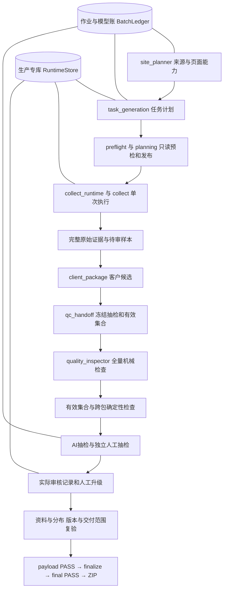
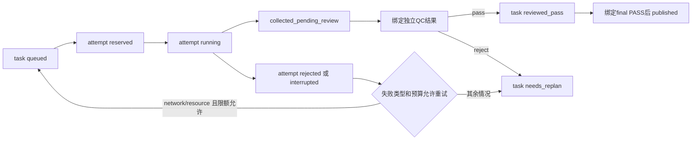

# WebCollect 设计说明

2026-11-11 无版本运行改造已按[方案](无版本运行改造清单与方案-20261111.md)与[执行 Prompt](无版本改造执行Prompt-20261111.md)集中实施到当前源码；实施状态、逐组完成度与残留见[改造清单实施结果](无版本运行改造清单与方案-20261111.md#2026-11-11-实施结果)。当前数据契约要点：

- 稳定业务名唯一拥有者是 `webcollect/plan_protocol.py`：`PLAN_PROTOCOL='conditional-plan'`、`ENDING_POLICY='goal-completion-ending'`（单一收尾：原目标 success + 有效步 ≥5 + 无累计上限）、策略 `react`/`screenshot_plan`、`REACT_PROTOCOL='react-native'`、`ACTION_STABILITY_PROTOCOL='action-scoped-evidence'` 等；工程内不再有按版本号选择实现的分派。
- 候选是唯一当前结构：消费者领取不再按协议筛选，candidate_id 与冻结快照承担身份；`VERSION2` 字面仅作为对象形状标记与去重盐保留。
- 任务身份 `task_key = sha256([campaign_id, task_id])`，无版本盐；m4_tasks 的列与 NOT NULL 保留，新任务写稳定值（如 task_version=`react-url`），历史行与既有外键不重算。
- `collection_strategy.strategy_result` 在会话结束时构造四件事（goal_status/end_reason/eligibility/save_status），正式提交或明确不保存后由 `finalize_strategy_result` 按 RuntimeStore 实际收据改写最终 save_status（`collected_pending_review`/`not_saved`/`save_failed`）；会话封存原件不改写。
- 交付资格唯一判定在 `closing_policy.completion_delivery_decision`：原目标完成（密封证据）、有效动作 ≥5 且非 short_flow；有效步 >10 的完整轨迹不再被拒绝。
- QC 只认显式输入集合：同 sample_id 相同内容只计一次，不同内容为显式选择错误，不按目录日期/mtime/序号自动挑选；无 supersedes 版本链、无 `--version-policy`、无逐规则 RULE_VERSIONS，语义检查使用 `visual_alignment` 等稳定名并按样本字节绑定。
- 状态机不变：`collected_pending_review → reviewed_pass → published` 及客户验收各自凭证据推进；UNKNOWN/硬截止/用户停止、claim 原子性与 fix_version/recovery_version 幂等、short_flow 工程化标记（1–4 短流程、≥5 普通、0 不成样本）、登录入口排除、403 规则和原始字节不可改写全部保留。
- 数据库：五库全量一致备份（含 WAL）在 `verify_results/noversion-switch-20261111-r01/`，`projects/code/scripts/switch_noversion_db_20261111.py` 已在工作副本验证（业务 ID、task_key、claim、费用逐项不变）；正式运行库未修改，当前结构保持兼容。

一次相关集成与真实 GLM 基线尚未运行；下文旧版本设计保留历史含义。

2026-11-10 采集双策略已按[设计](采集双策略设计-20261110.md)与[实施计划](采集双策略实施计划-20261110.md)落地为代码：策略是完整采集闭环的冻结身份（`webcollect-collection-banded-react-1` 缺省 / `webcollect-collection-screenshot-plan-2` 显式），随任务 fragment/spec 冻结、同 attempt 不切换；策略 2 的 submit_plan/plan_decision、等价整理、宿主校验与完成核验同属 `webcollect-screenshot-plan-2` 一个版本（prompt/schema/normalizer/validator/completion verifier 共用同一份定义），不触发策略 1 的 band/finish_when/谓词枚举门禁，也不伪造 HOST_PLAN_ENDPOINT。完成凭据：`AGENT_COMPLETE_VERIFIED` 结束须先经 `verify_completion` 逐项绑定真实观察/区域/因果（复用 result_execution 绑定与提交后同文档首现因果），离线 `validate_ending_marker` 同版回放；give_up/unsuitable/no_progress 只留 raw。四件事（goal_status / end_reason / save_eligibility / save_status）由 `collection_strategy.outcome_facts` 分开记录；统一资格仍收敛在 `completion_delivery_decision`（经 `save_eligibility` 引用），策略 2 完成标记在文件生成、RuntimeStore 提交与导出复用同一判定。延迟可见结果（提交后滚动才见）按"提交后同文档首次出现"确定性因果接受；计划游标与单步预期不再否决已证实目标。隔离集成见[执行记录](采集双策略实施与集成-20261110.md)；真实策略对比与独立 QC 未运行。

2026-11-10 [统一修复实施](统一方案集中实施与固定四条验证-20261110.md)将保存资格前移到所有新正式投影文件生成之前，并在RuntimeStore提交处复核同一判定；异常和短流程保留raw，不生成待审样本。新 `result_completion_protocol` 绑定Agent实际结果引用到原事项、原分支事件与原attempt，封存回算验证同一事实；旧任务不自动升级。首轮5–8仅偏好，实际路径无累计8/10步上限。相关集成已通过，四条真实验证按用户要求停止、无success/保存，不将夹具PASS计为生产或QC。

2026-11-10 最新 V6 保存契约已接入代码：原目标完成且实际有效步≥5、证据可信、无未决外部效果，才首次生成正式annotation并提交待审；异常/短流程只留原始证据。首轮至少5步并以5–8步自然路径为偏好，5–8不是资格上限，累计也不设最大步数；规划、完成、封存回算、标注及保存复用同一事实结论。历史协议与收据不改写。固定20条实跑在模型请求前被SIGTERM终止，未验证业务有效性，详见[执行记录](客户反馈更新实施与固定基线验证-20261110.md)；下文旧规则仅按历史版本解释。

2026-11-10 固定40条实测保留目标检查、结束状态、正式保存与交付的分层：出现目标检查VERIFIED但模型stop被记为no_path/controlled_exception的个案，未据此改标success；零效果不计步，也使两条反复重规划无法靠10有效步上限自行结束，最终由用户授权停止。证据与未验证边界见[本轮结果](消费者固定40条真实验证-20261110.md)，本轮未因此修改策略或源码。

2026-11-10 客户反馈续接：V13 首次标注将末帧描述与已核验原目标依据分开；结果证据属于较早观察时，只引用其真实原观察，不将它写成末帧绑定。此派生不改变成功判定。固定四条的候选已被另一轮领取，启动前拒绝并保留原账，不以换候选或借用其他批次结果完成验收。局部检查及真实验证缺口见[执行记录](客户反馈更新实施与固定基线验证-20261110.md)。

2026-11-10 后续澄清：本轮唯一目标是提高原目标 success 下的多步交互。至少五步要求放首轮自然完整规划，工程负责执行到真实成功；新交付不要小于五步或 controlled_exception，旧 short_flow ≤2% 例外不再适用。十二种动作尽量自然多样、不强制全覆盖。标注重点修视觉规划到 annotation.json 的首次生成链；历史订正工具保留但本轮不自动调用。进展见[执行记录](客户反馈更新实施与固定基线验证-20261110.md)。

2026-11-10 消费者 V13 保持 V12 旧收据语义：band 和 Wiki2 固定 finish_when 属于宿主字段，首轮有效业务动作数决定档位，剩余重规划不重算 short；带可见 text 的过期 node 只在当前帧唯一语义绑定时继续使用。数值完成检查必须由原目标或已观察依据给出具体结果，宿主不代算；同页可绑定 p0，跨页必须绑定已注册来源。客户交付仍要求实际 5–10 有效动作且原目标完成，异常、short 与 UNKNOWN 不补数。固定二十条真实验证尚未启动，详见[本轮记录](消费者正常交付率提升修复与二十消费者验证-20261110.md)。

2026-11-10 本轮新任务采用 V13，band 与 Wiki 固定完成占位由宿主派生，额外动作按页面能力选择；wait/complete 零有效步。实际结果策略显式版本化，原任务保留原义。标注订正是可选交付后置接口：白名单字段、原来源/前态/派发/执行哈希、独立新目录、状态不可改，默认不访问模型和浏览器。真实执行附件与客户标注必须一致；当前验证状态见[执行记录](客户反馈更新实施与固定基线验证-20261110.md)。

2026-11-10 V12首轮工具、结构解析、现代分支及Wiki2完成接线已补修；QC显式 `webcollect-qc-delivery-target-1` 区分本次完整目标包与历史比较上下文。一次免测试的十消费者验证已结束，仍有band/finish_when冗余冲突和来源绑定问题；结果与边界见[本轮记录](消费者协议对齐修复与十消费者验证-20261110.md)。

2026-11-10 协议对齐补修保持 V12 业务语义与旧收据：根工具字段可见，结构归一保留原回包，V12 统一现代分支。QC 新 `webcollect-qc-delivery-target-1` 绑定本次目标包全成员；历史包仅保留比较用途和原策略，不因旧异常拒绝新交付。授权与验证边界见[本轮记录](消费者协议对齐修复与十消费者验证-20261110.md)。

### 当前版本与验收状态（2026-11-10）

新任务显式采用 `webcollect-banded-conditional-plan-12`、普通 Wiki 使用 `webcollect-wiki-reading-completion-2`，新交付选择 `completed-goal-five-ten-delivery-1`。首次完整路径至少 5 步、当前最多 10 步；剩余重规划不补满五步。交付资格重新核算实际 5–10 步及原目标证据，异常/短流程只内部保留，success 和来源存在均不替代独立语义 QC；旧任务、策略和收据保持原义。

本轮实现已落地，但一次集成与固定十条真实验证未取得完整链通过：十条首轮计划均未被接受，格式纠错尚未有效收口。消费者及总控已停止，未补位或改码重跑，不具备恢复持续批量的验证结论。准确状态见[执行记录](消费者完成口径改造与十条固定验证-20261110.md)，下方提案保留原讨论阶段。

### 最新交付澄清与设计提案（2026-11-10，仅文档）

最新用户确认需求方拒绝 `controlled_exception`。内部原始执行/可信片段、正常完成待审候选、独立 QC 与客户交付资格继续分开：异常保留内部，不能进入新的客户集合或补交付目标；success 标签本身也不证明原目标完成。旧客户枚举与旧收据保留，后续交付策略需明确新版本，不能静默改变旧批次的计数解释。当前代码尚未统一落实新准入，本次未修改协议或源码。

建议普通新任务首次完整路径预计 5–10 个必要有效动作；该规划约束、实际计步、原目标完成分别核验。实际 1–4 步提前完成仍标 short_flow，剩余计划可少于 5 步，不填充动作。短流程应少产生，适用交付集合原上限 ≤2% 保留。此处是用户提出方向后的具体建议，尚未实施。

正文引用提案采用会话内稳定证据编号，跨页检查项绑定原查阅动作的真实落地，不能将未填 page 全部默认为入口。统一收尾只保全内部事实，交付准入另按完成证据判断；现有 QC handoff 继续绑定原目标、范围和文件摘要。完整方案和来源分别见[优化方案](消费者规划完成率与异常收尾优化方案-20261110.md)、[近两日约定](近两日采集约定回顾-20261110.md)。消费者仍停止；以下旧轮次保留历史解释。

### 消费者 Wiki 与并发改造（2026-11-10，已停止）

当前消费者 `STOPPED_BY_USER`，两站目标已按 `valid-range-five-ten-export-1` 达到：每站 5 条、5–10 有效动作可信候选，允许原目标未完成片段。完成、短流程、待审、独立 QC、人工和发布分别统计。最终证据见 [汇总](../verify_results/consumer-wiki-improvement-20261110-r01/final-analysis.json)；停止进程不自动更改原账未结状态。

保持单机、原候选池和双账本契约。续约与同步准备分离，过期或换 owner 仍禁止写入；只有同 owner/token 已在租约内正常提交的终态允许本地收尾完成，不能继续派发。历史读取固定一致成员视图，新 candidate-project 只接受同 manifest/registry/工程内追加，原绑定引用不可改；旧冻结链保持原规则，最终提交原子去重不变。成功文件校验缓存不缓存业务身份。

Key 健康表只保存账户指纹、状态、端点/模型和探测用量。新会话必须有成功探测证据并绑定账户；1113 要经新成功探测才能恢复。限流冷却、网络 UNKNOWN 与权益不足分开。健康状态不构成重新派发任何已执行或未决请求的授权。

普通 Wiki 新任务显式冻结 `webcollect-wiki-reading-completion-1`，从实际批量任务入口启用。原目标与首轮事项冻结，只有原事项有累计正文/实际动作引用才能申请完成；`stop` 表示不完整。引用可来自同条轨迹较早的可信帧，目录标题不作正文。显式章节检查绑定真实章节，通读整节要求累计正文覆盖，一般具体问题允许对应段落证据。保存从密封首轮计划、所有修订、原观察和完成事件重新核对；不要求未来答案关键词预先命中或最终一帧重现全部正文。UNKNOWN 进展截断在未核验位置，不能跨未知尾部拼接证据。确定性来源核验不等于语义 QC，10 步累计上限、1–4 步宿主短流程、0 步不成样本保持。

新任务另冻结 `webcollect-numeric-result-evidence-1`；仅同步观察中已绑定结果区域的单一数值可按明确约数精度与有限单位别名等价，排除输入回显及弱符号，不推算答案或任意放宽容差。历史无标记任务保持原版本。自然语言原目标到 checks 的语义映射仍未独立审核，采集器 success 不能代替独立 QC；最终 Wiki success 的原 goal_evidence 仍有 UNVERIFIED，专用 session_objective 完成另列。

一次统一集成、新旧任务/schema 对比及其后实际断点的局部复验均有独立收据；17 项旧测试失败仍在修改前后存在。真实入口漏接、示例/schema 冲突、完成到保存的回算断点已修复并有最终真实保存证据。当前仍存在首轮格式纠错、错误来源引用、主动 stop 后仅留 raw 和取消未结账，不能将达标候选数推导为目标完成质量已验收。以下旧轮次描述保留原时点含义。

本轮集中修复新执行接线：`plan_execution_policy=webcollect-plan-execution-1`统一冻结页面引用，导航动作实效与正文结果检查分别判断，已知可恢复的派发前问题返回现有重规划分支；截图与树同步保持。`consumer_campaign`新增显式`--counting-policy valid-range-five-ten-export-1`和`--target-stop-mode cancel`，按5–10有效动作的正常保存导出计目标，允许准确描述范围的可信片段，原目标完成与QC另列。默认普通完成计数与在途自然收尾保持。按本轮授权不运行集成测试，开发后直接Wiki、Muxtly各5路、首条有效导出即停止，实际结果见修复计划。

2026-11-10 新执行采用 `webcollect-five-ten-effective-ending-5`：先形成完成原目标所需的最短完整自然路径，通常5–10个有效业务动作；不足5步时只补原目标内仍有独立用途且产生新证据的动作，没有则保留1–4步短流程，0步不成样本。重规划共用累计最多10步，不为凑步增加第二组输入、无关跨词条任务或重复计算；原阅读问题所需的关联查阅保持。模型调用次数、会话总时长及跨候选旧配额仍取消，历史V4任务不套新上限。结果检查使用原动作/观察绑定，必要项缺证如实结束；可信片段只证明连续区间可信，客户状态为`controlled_exception`，不冒充原目标完成。客户`task_instruction`按已验证工作目标概括，末步`tool_result.return_value`保持`{}`；`goal_evidence`、动态区域和`collection_ending`等内部证据保留在raw及saved receipt包外原件，QC读取该包外上下文的接线未纳入本轮实跑验收。动作级取证V4排除已证公告/装饰变化，仅在业务文字、控件或布局不同步时重取。本轮按用户要求不做集成测试，直接以指定入口启动真实采集，实际结果以新运行收据为准。详见[修复计划](消费者5至10步与交付失败修复计划-20261110.md)。

### 消费者持续消费与分钟交付目录（2026-11-09）

当前消费者已停止。本轮仅代码和文档改造，未启动测试、模型、采集或 QC。完整拦截点、实现范围与未验证边界见[改造记录](消费者持续消费拦截点与改造记录-20261109.md)。

`consumer_campaign --scope <原工程scope.json> --site muxtly.com --site zh.wikipedia.org --workers-per-site <数量> --output <新运行目录> --prefix <唯一前缀>` 按指定数量持续消费；`--target` 可选，只在显式提供时触发停止。不再执行消费者旧账户占位、25 次模型调用、720/900 秒总时限、8/12 次动作、固定节流或档位配额。空库存等待，单条失败记账后继续，退出的消费者由总控补起。原请求 UNKNOWN 不重发，也不阻塞其他独立候选。

`--delivery-root` 默认 `delivery`。客户输出直接放在 `delivery/yyyyMMddHHmm/`（Asia/Shanghai 启动分钟），根目录为标准客户包，样本位于 `samples/<sample_id>/`；每条完整保存后增量导出。运行日志和内部收据在包外。目标达到立即停止新消费，已并发保存的样本仍完成导出，实际数量如实报告。保存待审、独立 QC、发布和客户验收分别记账。

交付身份与编号边界：`site_id` 的权威来源是生产者 Table1 `applications.rowid`，格式为 `S<六位行号>`；Muxtly 为 `S000001`，维基为 `S000002`。新增领取协议 `table1-rowid-site-id-1` 将该值同时冻结在 claim 与 `candidate_binding`，`candidate_contract.py` 校验两者一致，`runtime.py` 把它作为 `required_site_id` 传入原分配事务。不同服务器因此复用生产者编号，而不是各自从 `S000001` 开始；既有账本中同 URI 对应不同编号、或该编号已属于其他 URI 时明确拒绝。无冻结字段的旧任务继续解释原账本，不回写历史编号。

`sample_id=<site_id>_sample_<站内六位序号>`，站内序号仍由该站点账本的 `next_sample` 在写事务内递增，allocations 主键及正式 attempt 的唯一约束防重。编号在正式 attempt 阶段即可预留，失败号不回收、不导出；完成正式保存才进入客户包，保存待审不改变目标完成、独立 QC 和发布状态。Table2 `data_candidates.candidate_id` 仍只标识候选，不直接充当样本编号。当前 Table1／Table2 的数据范围仅为 Muxtly 与维基。

以下旧轮次记录保留当时的条件与证据，不代表当前消费者限制或运行状态。

2026-11-09 `webcollect-action-scoped-evidence-3`显式将目标保护区域容差设为100个变化像素，在线派发与保存回算共享规则，原V1/V2收据保留原语义。复用仅限同一原子动作与同scope已有预检，不生成虚假新观察。SQLite锁重试仅重放已回滚的同request_id本地结算；数据库异常与模型格式异常分开，原响应独立留存不代表已结算或允许重发。三角色数据库契约、UNKNOWN、样本/QC状态不变。本轮未运行动态验证。[实施说明](消费者四项最小修复-20261109.md#像素容差本地结算重试与预检复用补修)。

2026-11-09 消费者并发设置与冻结任务配置分离：在原 `batch_events`/`m4_events` 追加版本化 `consumer_concurrency` 事件，分别绑定原账/run/config 摘要及原 registry/campaign。作业、全局执行、同站执行三项设置为 `null` 表示不另设上限，由启动 worker 数控制并发。领取事务读取最新设置，原 config/policy 文件和作业身份不改；既有进程首次升级须自然收尾后换用新代码。没有设置事件的历史入口仍解释原数值；生产者沿原独立规则。此为消费者内部调度变更，不改变 Table2、claim/attempt/sample、UNKNOWN 或 QC 状态契约。只验证隔离调度单元，不据此宣称真实 10 路产能已验收。

2026-11-09 `webcollect-action-scoped-evidence-2` 保留目标框 ±4 px 像素护栏；文档级动作与观察使用既有身份/状态判定，证明显式记录 `comparison=not_required`，不将未计算伪写成零变化。v1 与历史全图规则按冻结版本复验。密封证据计算仅在同次内部调用链复用，内容摘要、原任务/attempt、规则和区间仍绑定；公开独立入口不提供跳过验证开关。三角色接线、UNKNOWN 和正式保存/QC 状态不变。[性能修复设计](消费者证据校验性能修复-20261109.md)。

2026-11-09 本轮2条生产者真实验证结束：0保存，批量修复尚未通过；普通候选动作级接线和独立预检删除已实际生效，剩余断点为首帧装饰动画范围与文档级动作complete门槛。未追加测试/样本/QC，详见[真实结果](../verify_results/consumer-batch-repair-two-live-20261109-r01/report.md)。

2026-11-09 新消费者任务复用已版本化动作级证据，旧冻结边界保持。V11新标签由原点击、opener、href及落地共同绑定，返回记录实际切回来源方式；资格不足的同证据零派发计入已有无进展边界。短流程计数与可信前缀规则不变，优化目标是减少工程截断。并发和全批领取数分开，不增加新池/账/调度框架。[范围与实现](消费者批量接线与短流程修复计划-20261109.md)。

2026-11-09 阅读证据沿用原观察身份，渲染段落用于保留内联链接文字；计划中自由文本检查与实际导航事实分别保留，缺结构化绑定继续 PENDING，事实目录不代表语义裁决或 QC。首轮与恢复分支共享当前候选，未来点击不沿用滚动前 node；动作仍自由组合，不固定点击次数。模型配置和 Wiki 原目标冻结文件不改，新源码效果由单次同目标研发实跑记录。见[后续优化说明](消费者模型与Wiki基线冻结及待优化项目-20261109.md)。

2026-11-09 模型配置和固定Wiki目标采用文件摘要冻结`wiki-reading-high-high-20261109-r1`，绑定成功实跑源码与保存收据，不新增运行门禁。冻结的会话effort_profile=high/high；普通候选不继承Wiki目标。工程采集基线可冻结与使用，辅助plan-facts缺少page/region/visible_text产生的PENDING/UNVERIFIED不自动变成采集失败或终审结论。待审、独立QC及发布状态保持分离。[范围与待优化项目](消费者模型与Wiki基线冻结及待优化项目-20261109.md)。

2026-11-09 V11阅读的点击顺序是软偏好，不是路线或次数门禁。候选来自当次已验证观察中的visible/enabled/clickable及真实href，不限定链接颜色或原生a标签；正文文字仅排序优先，图片/图注等链接仍可列出。候选携带当前observation/node及点击资格诊断，未逐点探测不等于不可点；实际执行仍走原绑定、探针、遮挡和效果验证。输出wire和原目标不变；旧反馈在新分支随当前观察重算，防止旧候选再次驱动无目的往返。

2026-11-09 `candidate-research-replay-3`复用v2的descriptor、授权字段、原事务与`candidate-research-duplicate-2`具名重叠依据，显式增加已结算非生产研发保存来源和对照。来源保持最新已结算claim；succeeded来源须由同池、同registry、非生产绑定、effective=0结果及保存收据共同证明。原目标字节固定，未决执行仍拒绝，新结果继续effective=0，未具名样本不获重叠例外。v1/v2保存回算语义不变。此为研发接入扩展，不改变普通消费者动作、短流标记、正式去重、QC或发布资格。

2026-11-09 消费者本轮交付修复边界：点击以实际派发点在目标框内且命中真实节点为准，九点采样仅作新点击协议的诊断，旧协议保持原义；真实遮挡仍拒发。新back scope显式使用`webcollect-back-observed-document-1`：真实页面身份已确定且DOM为interactive或complete时允许返回，不等待被离开页面的其他资源；捕获期间URL/文档身份仍须严格一致，落地效果独立核验，无此标记的旧scope仍按complete回算。阅读来源允许实际back后按原URL、标题与正文证据接回新document_identity，历史引文继续绑定原观察。当前动作级阅读协议保留合法剩余计划，minimum不再作提前收尾开关。编码URL禁止进入交付叙述的规则保留，修正的是生成端。研发复验使用显式candidate-research-replay-2与具名历史对照、effective=0；正式去重、无效往返、UNKNOWN及QC边界不改。详见[最小修复与启动说明](消费者交付最小修复与启动说明-20261109.md)。

2026-11-09 用户确定生产者、消费者、QC 的三角色独立接线约定：三者可独立开发、测试、启动、停止和恢复，跨角色只通过版本化数据库契约与持久化证据交接，不依赖其他进程的内存对象、一次性函数返回值或固定启动顺序。契约不变时，各角色内部 Agent goal、prompt、tool、宿主实现和规则版本可独立演进，不要求另外两者同步修改；契约变化必须显式版本化并做兼容验收，不能伪装成内部优化。

| 角色 | 已持久化输入 | 独立输出与所有权 |
| --- | --- | --- |
| 生产者 | 工程 manifest、scope、原请求账和已有候选池 | 可真实访问网页、调用模型，新增 Table1、Table2、来源证据及选页/用量收据 |
| 消费者 | 通过原事务原子领取的数据库已有候选及冻结快照 | 自己的 attempt、图树与动作证据、待审样本和候选结果；不改生产者原候选 |
| QC | 明确指定的已保存待审样本或有效集合 | 独立审核收据、抽样与版本报告；不改消费者原样本，输出和缓存位于被检查数据包之外 |

三者没有进程启动先后要求，可按库存分别运行，也可共用同一工程账本并行运行。独立启动不取消业务依赖：没有 `pending` 候选时消费者报告空库存，没有合格输入时 QC 为 `NOT_RUN`，不得为跑通流程制造数据、补写来源或预填 PASS。开发测试使用隔离工程、临时数据库和独立输出；真实并行使用同一 manifest 绑定的正式库与证据根。任一角色停止或恢复均从原账和原收据接续，不重复领取、重发 UNKNOWN、拼接中断轨迹或覆盖原件。

接线协议不只指 Table2 四字段，还包括 schema 版本、candidate/claim/attempt/sample 引用关系、状态机与可消费条件、证据路径和哈希、manifest 绑定、UNKNOWN/租约恢复规则及输出所有权。候选、采集待审、终审合格和发布仍分别计数。兼容验收先由各角色用独立夹具测试，再用同一工程账本做一次端到端接线，并分别验证停止与恢复；夹具通过不折算为真实产量或 QC 通过。[长期维护约定](../AGENTS.md#三角色独立接线与运行2026-11-09)

2026-11-08 直接阅读主基线一轮已实施：新执行/证据协议 `webcollect-action-scoped-evidence-1`（click/type/hotkey 目标级 scope=身份/可见/命中/遮挡/焦点/值+目标框±4px 像素护栏；scroll/back/open_url 文档级 scope；派发后观察 `post_action_document_scope` 只证新文档内部安定；收尾安全视图 `action_scoped_view_stable`=同文档+同滚动+可见正文保留；`pair()`/`stability_pair` 对该版本先于动态区域路由，不依赖区域分类；旧协议语义逐处保持）。绑定方式：session objective 可选 `evidence_policy` 字段经 `session_objective.apply` 写入 spec+fragment 并入 task_id；goal-evidence-2 reading 契约可选 `direct_entry`（唯一可见 h1==subject 即入口词条，初始正文可作 passage，任何搜索输入使 VERIFIED 不可达）；V11 提示追加"入口已直接打开目标词条，不经过站内检索"。基线 `request/consumer-baselines/zh-wikipedia-direct-reading.json`（月食直达、往下阅读、5 步/long、production_counted=false）；隔离工程 `results/candidate-project-wwiki-direct-20261108-r01`，候选 put/baseline_import 登记。离线：新套件 `tests/test_direct_reading_baseline_20261108.py`（路径族 d1–d11、证据正反例、objective 绑定、四路判重共享首帧 route1/同序列 route2、真实 Chromium 三例）+集中回归 157 例 155 过（2 失败与 HEAD 逐例相同）；r01/r02 断点修复后受影响模块复验 39/39、30/30。真实：两次会话共 6 请求全 succeeded；r02 会话达标（5 滚动全带新正文、引用真实"月全食/本影"段、VERIFIED、0 搜索、安全端点），派生曾因 scope 误路由被拒，修复后经 `webcollect-offline-derivation-recovery-1` 对同一密封字节 0 调用提交 collected_pending_review。QC：冻结 AI 100%；单包机械 18/19（唯一非 PASS 为 AI admission）；跨包 PASS（研究 profile 类目占比 report-only+显式 authority，判重参数逐字节同交付合同）；四路判重 0 命中；独立 AI QC 未决——ai-visual 完整逐帧四项 PASS 的回执缺每项 `evidence_steps` 判 invalid（QC 网关不自动替换、QC 作业无超时重试），ai-documents 传输超时 UNKNOWN，转人工无真实记录；人工/发布/客户验收 NOT_RUN，不启动 A/B。[验证目录](../verify_results/consumer-direct-reading-20261108-r01/)

2026-11-08 V11/V3 长计划轮后的阅读绑定修复语义（接续同日未提交改动）。计划协议 `webcollect-banded-conditional-plan-11`：仅 long 档上限 12 步；模型可见提示不再重复剩余步数字段或"只剩1步"专用文案（`attempt_limit` 与已执行步数即总额度；V10 及更早协议字节不变）；对超剩余额度的 replan 允许同观察同选项上下文一次零动作纠错，第二次有界拒绝，不裁剪执行。目标绑定词汇与重绑：标准 ARIA 角色词与原生 tag 角色视为同一控件类别（textbox≡input 等），text+role+href 在当前帧唯一命中时，错误的 region/parent_text 不再一票否决（咨询式重绑，方向性 region 硬约束保留，旧协议保持严格匹配）；现代协议下散文式或过期 node 引用被剥离改走当前帧语义绑定，执行期唯一性校验不放宽，当前帧无唯一目标仍零动作并给出含词汇表的诊断反馈；同类零动作绑定失败连续 3 轮有界停止。检索证据（`webcollect-goal-evidence-2` 的 reading 判定）：来源页按（文档身份, URL）双键跟踪，back 后重访的同 URL 结果页仍是合法来源，其条目打开计入 opened/landing；位置关系正文仍须真实向下滚动后可见才可引用。直接阅读 `webcollect-direct-article-reading-1`：同页目录锚点只定位不跨文档、跨页后下一业务动作必须 back、返回按 URL+标题+正文身份核验、返回后已读正文保留并按当前帧重绑引用、重复无效果滚动不产生新阅读行——这些约束在首轮计划提交时确定性拒绝违规组合（如"跨页后接 scroll"），完整离线链与四类反例见 `projects/code/tests/test_direct_article_session_20261107.py`。真实验收边界：wwiki 搜索打开型阅读的绑定断点已由真实事件证实修复，但本轮唯一新 attempt 因真实站点搜索浮层取证超时未完成 5 步验收（留证 `verify_results/consumer-reading-rebind-20261108-r01/`）；direct-article 真实基线因原 Table2 候选绑定目录被删标 NOT_RUN，不以离线 PASS 或 wwiki 结果替代。Muxtly 8 步成功与 wwiki 旧失败继续作为不同事实保留。

2026-11-06 [对照实验修复计划](对照实验问题修复与八并发AB试跑计划-20261106.md)第一阶段已实施（交接 `verify_results/consumer-ab-repair-20261106-r01/`）。协议语义：`webcollect-banded-conditional-plan-10` 将"查看当前帧原图"与"继续执行"分离——原图选项为 `request_original_image`，仅作补充视觉证据，每观察每情境至多提供一次，重复请求是协议错误（`ORIGINAL_IMAGE_ALREADY_PROVIDED`）并计入 max_no_progress（上限 2 次后停止）；v10 不存在按名继续的选择，旧名 `original` 由网关 wire 作为可确定别名映射，历史 v1–v9 回包保持原义。目标绑定：唯一 `node+observation_id+href` 且可见可点击的控件在页面无文本证据时仍可绑定；任何可见标签或 href 与声明冲突即拒绝（真实歧义不猜）。计划长度为事实：声明档位由步骤数归一化（1–4 short/5 five/6–8 long，>8 不可规划），重规划剩余步数上限取会话既有预算（任务 `max_actions`，未冻结时为收尾策略八次尝试区间），不新增协议级硬顶，已执行动作不重放、目标不改写；`short_flow` 仍由最终保存区间有效动作数派生（0 不成样本）。动态区域：稳态规则 v2 允许"≥4096 变化像素、边长≥32、≤25% 视口、与全部可见文本/控件/保护框不相交"的未分类动画像素块变化并在证明中记录，v1 收据回放保持原判定与 schema；snapshot.js 将无文字、无交互、与保护内容不相交的非常规几何装饰子树隔离为 `webcollect-unrelated-transform-2` 证据（不可点击、不参与像素豁免），目标及其子树仍如实阻塞。生产者复验：访问（GET）、导航、页面观察三结果分离——DNS 失败与浏览器确认的 404/410/入口 403（既定废弃规则）才剔除；SSL/拒绝连接/阻断/单次超时与取证/几何失败（`browser_observe_failed`）只记录；剔除在短事务内复核 pending 且无 claim；dry-run 零写入。A/B 入口（`webcollect.consumer_ab`）：8 槽位名单冻结（种子固定）、每 worker 恰一个候选一次会话、失败/不可领取/UNKNOWN 不补位、槽位状态存在即拒绝再派发；模型请求按账本 `dispatch_attempt_id` 从 group→worker→candidate→claim→attempt(job)→request 归因（不用共享时间窗）；父子作业槽位语义不变，并发上限调整单字段并留审计事件。真实 GLM 验证 NOT_RUN，由第二阶段承担。

2026-11-06 后续[对照实验修复计划](对照实验问题修复与八并发AB试跑计划-20261106.md)真实 A/B 分阶段执行：A/B 首轮同为 high，仅后续分支为 low/high；A4/B4 共 8 个单次采集 worker，共用原工程绑定，固定名单失败不补位。原冻结协议、原始证据和 UNKNOWN 保留，保存、目标完成、独立 QC 及发布各自验收。

2026-11-06 [消费者工程与 Agent 优化实施计划](消费者工程与Agent优化实施计划-20261106.md)已实施：新协议 `webcollect-banded-conditional-plan-9` 统一普通分支与契约分支的 choice wire 形式，宿主 `bind_reply_scope` 绑定缺省作用域 ID（节点成员按当前观察完整控件集校验），普通分支 envelope 升级 `single-json-commentary-1` 并允许一次格式纠正；v9 真实派发点首轮/分支均 low，boundary 记录实际档位。状态维度按计划第 2 节分开陈述并落地：已知零效果计 0 步且不终止会话（pending_effect 交模型决定），模型未决、浏览器效果未决与区间保存资格分别记录；尾部派发全部由确定尝试账覆盖时收尾不再推 unknown。可信前缀新增 `webcollect-trusted-prefix-2`（≥1 有效动作、1–4 步 short_flow、≥5 普通、0 拒绝；V1 六步规则保留原义），离线"首次历史区间登记"经 `RuntimeStore._historical_prefix_recovery` 走正式加工/审计/去重/收据与候选投影，原 UNKNOWN、费用预留与重发隔离不因保存清除。查找禁令已移除（prompt/声明/宿主拒绝/测试断言同步），当前无头视口宿主无法打开、输入或取证浏览器原生查找框，该能力如实声明不可用，不以 DOM 检索伪装。历史与边界：E4 尾部分类、E6 定向取证修复（back 超时活会话重观察、跨子域落地按已观察 href 绑定、失败图无关性证据豁免 readiness）均不回写旧收据。

2026-11-05 最新后续实施范围见[Agent 主导与工程事实校验统一修复计划](Agent主导与工程事实校验统一修复计划-20261105.md)：统一执行到保存全链的职责、协议、身份核验及原账恢复；业务判断由 Agent 主导，工程保留事实与完整性核验。前轮短流程与协议修复已有实现，但 R03 在保存身份校验及隔离收尾失败，正式保存 0。新统一计划本轮仅完成文档，尚未实施；包含可复制的实施触发提示词。

2026-11-05 后续设计以快速实现功能、快速上线为核心。工程设计只写清本次功能和必要接口，复用现有模块，不为假设风险增加框架、兼容层或防御门禁。Agent 协议/实际输出与工程文件不一致时，优先按 Agent 输出修复工程接入；正确性以原目标的真实结果验证。完成本轮全部代码后做一次集成测试，再试跑稳定基线；Agent 修改用真实 GLM 验收。[研发执行约定](../AGENTS.md#修改与验证)

2026-11-05 用户确认原 Wiki 入口是 403，处置由等待访问恢复改为单页废弃。入口页本身不可用与可用页中途导航失败分别处理：前者停止该页派发，后者优先返回继续原目标；保留原失败、记录和费用，不推断整站不可用，返回也不代表原目标完成。

2026-11-05 直接阅读保持首次接受的 goal/checks，继续与重规划只调整剩余路径；完成答复允许直接携带可绑定的正文摘录，动作项按实际操作证明。对明确等价的 Agent 输出适配工程，对原目标、真实来源和执行事实保留核对。Vue 新基线已正式保存为两步自然短流程，四项独立内容检查通过；严格双基线、完整 QC、人工与发布分别验收。原 Wiki freeze08 和 R01–R06 等待访问确认的描述保留为历史。见[结果与续验计划](规划采集Agent双基线修复结果与续验计划-20261105.md)和[工程与 Agent 契约](具体词条直接阅读本地契约-20261105.md)。

2026-11-05 双基线完整链研发复验按用户新授权进行：统一规划语义、有据焦点转换、提交/链接/正文滚动取证、保存连续性与保留旧结果的同目标研发复验入口。见[实现与验收边界](规划采集Agent完整链研发复验-20261105.md)。真实目标与独立QC仍按新收据分别验收。

2026-11-05 本轮全链路有界窗口已结案，整体验收未通过，继续停止批外生产。实际冻结版结果、原账阻断、后继离线修复及预算建议见[最终中文报告](../verify_results/full-chain-20261104-r01/最终中文报告.md)；网页候选、待审轨迹、独立AI、人工与发布分开计数。

2026-11-04 全链路有界窗口新增显式首击局部证据、QC 墙钟期限与逐对进度、可信前缀及生产者业务选页精简；旧原件、原账和版本不改。工程验收、50 页供给、固定双基线与条件留出试验分别凭收据登记，见[实施与验证边界](全链路实施与有界验收记录-20261104.md)。

2026-11-04 消费者 R09 补齐未派发选项失配的一次有界重规划，派发前取证共用调用方总时限并留阶段/异常诊断；数字预期仅在客户派生叙述中包装，原件不改。[工程、Agent 与验证边界](消费者R09选项重规划与取证时限修复-20261104.md)。

2026-11-04 V9实测保留同一工程、原账、失败和UNKNOWN，达到新100页后停止。已完成但HTTP/第一方资格不符的图片观察，以及已有持久失败账的探针异常，只阻止相应页；不得覆盖原请求或扩大为整站失败。已知检索冷却先于模型派发。独立参考的原格式状态与新证据投影分别保存，不能改签原invalid_response或从reason补类型；候选、独立AI参考、消费者保存、轨迹QC和真人审核仍分开。[实测及未通过项](生产者V9新挖掘100页与性能归因-20261104.md)。

2026-11-04 图片预筛V2复用消费者首帧≥95%可见IMG并集规则，取消业务语义例外，作用于新entry和target判定。标记独立于Table2正文、消费者处置、用途标签及QC，写原工程既有checkpoints；原标记作用域、在途、保存及未决事实保留。[完整规则](生产者图片型入口无需消费规则-20261104.md)。

2026-11-04 生产者 `entry-tools-8` 将原GET、可选匿名DOM补证、业务选择和用途指标分别绑定；用途v6的预测先于独立参考封存。独立参考不读取生产者标签，按完整冻结集合计算精度与覆盖，原入库标签保持。边界与实测见[新版真实验证](生产者新版100网页真实验证与独立用途验收-20261104.md)。

2026-11-03 新同帧规则为 `webcollect-related-stability-6`，≤5 CSS px几何证据与局部像素平移证明独立；v1–v5维持原解释。新任务分别冻结延迟href归属及规划类型意向扩展，后加工从真实动作/末帧派生实际交互类别与客户标签。完整边界见[实施与冻结验收](消费者50候选实施与冻结验收-20261103.md)。

Table1 站点信息、Table2 原表与领取快照的兼容合同见[生产者双表与消费者兼容研发计划](生产者双表与消费者兼容研发计划-20261102.md)。新批分类由生产者负责；历史消费者的快照、原结果和原协议保持可读。

后续 Agent 契约设计见[Agent 优化与 39 条问题统一实施计划](Agent优化与39条问题统一实施计划-20261101.md)与[实施方案](消费者Agent整体研发与单条真实验收实施方案-20261101.md)：分类是来源元数据，缺失仍可消费和保存待审；导航页支持进入、返回及切换分支，路径许可与逐页应用／主机归属分别验证。统一有限动作与四工具、300 字符以内工作目标、完整原件与精简请求、token 统计和分层 QC。整体研发及单条真实采集保存已授权，完成状态以新会话证据为准；原账与历史冻结收据保持原义；新消费者取消调用次数配额，真实 QC UNKNOWN 不改。

新派发使用原账计量。单个 ReAct 会话的 GLM 调用以原 attempt 和实际 HTTP 派发计量，消费者不设调用次数配额。[额度限制清单](额度限制清单与取消说明-20261101.md)

历史生产者的隔离决定按工程、原作业账及冻结配置摘要追加到原事件表。显式隔离的选源请求保留原状态、预留和来源，新的独立选源须避开这些应用；未隔离的未决请求继续阻断。候选、GET、调用数、累计 token、总费用和总运行时长改为计量。消费者与独立 QC 各用自己的账本。

原站点账保留已登记的入口 GET 隔离授权。已结束的零模型只读访问用原作业、访问账和带摘要的收据共同定界。当前工程按[未决范围](#未决范围)检查页面和候选。

GLM 用量先按角色和原请求 ID 统计。一个发现请求选出多条实际 NEW 时，将输入和输出 token 分别做整数均摊，余数按原始行序分配。分摊随同一请求后续入池行更新，批次完成后稳定。零新增的调用和未结算请求单列，旧候选用原发布与请求记录关联。消费结果通过候选 ID、claim 和正式 attempt 关联，同一候选的重复尝试保留历史，保存、QC 及发布遵循各阶段原证据。[查询入口](工程说明.md#后台生产和逐候选用量)

在已授权的生产者连续生产中，提供方已回传用量但缺少合法工具调用时，保存原请求的 `invalid_response` 和零新增的批次结论，接着选择其他来源。恢复使用原请求 ID 复读该结论。未结算请求继续按各自的独立证据处理。

混合发现为已知应用的功能入口保存 `independent_function`，绑定页面自身的功能名、操作原文与来源文件。可复用同一应用父类，不同功能可有各自的入口候选和后续消费结果。对只改变语言、普通参数或数字记录编号的相同路由，以及已有证据中的同名功能，混合模式在发布前去重。交付样本的截图、步骤与结果仍须分别核验。

新候选工程将派发规则绑定到工程 manifest、生产注册库和共享候选池。候选只有一个有效领取者，同页不同任务可以分别占用自己的任务键。同站的确定失败持续记账，计数不触发停站。当前未决执行仍可暂停派发。消费者记录本工程工时，领取后发生真实资源故障的任务保留为待对账。R03 旧规则随原绑定保留。[门禁逐项审查](历史门禁审查与新工程切换-20261101.md) · [真实 ReAct 单站实测](消费者运行时恢复与单站实测计划-20261101.md)

整体应用父类、页面类型、净新增候选和浏览器首帧的拟议契约见[生产者与站点发现 Agent 优化方案](生产者与站点发现Agent优化方案-20261101.md)。

本机启动入口使用同一份 scope 将批次、候选池、当前链和原账传给各角色。每个角色独立运行，进程间的领取、保存和恢复仍由原 SQL 事务与收据决定。消费者的 `qc_policy` 将同一 claim/attempt 的待审样本交给独立 QC。已冻结的收据、抽样计划和有效集合可用于 QC 入队，实际审核结果由质检侧登记。[启动顺序与交接检查](工程说明.md#本机有界批次启动)

新生产批次在发布候选前核验公开入口的最终 HTTP 状态，模型建议和调用方明确目标共用这一规则。同批按实际请求 URL 绑定访问账与收据。HTTP 检查通过只产生可领取库存，正式浏览器会话仍需取得同步图树和页面身份。旧批次按原冻结收据复读，不能用没有入口检查的新行补写。

当前链的生产者、消费者和正式执行共用 manifest 声明的证据范围。生产者把 manifest 引用冻结到发现会话和批次配置，在派发前核验输出目录及显式来源，保存的原始引用可以直接随候选传到 ReAct。监视进程通过只读 SQL 连接导出调用、访问与失败记录，消费者的领取、心跳和模型派发由其自身进程负责。

2026-10-31 三路接线已实现：原 SQLite claim 事务冻结候选体、版本、来源和持有者，阶段条件推进选出唯一外部执行者。消费者先在自己的 BrowserContext/Page 导航入口一次，在原访问账保留请求身份与同步 PNG/树/收据，再用真实锚点构造页面身份并冻结计划；原 RuntimeStore 通过身份、并发和预算门禁后登记正式 attempt，把同页和首观察交给 ReAct。新尝试使用新上下文和对话；旧 V1/冻结任务保留原解释。V2 entry 的 requested_goal 为 null，target 保留调用方目标及参数；来源建议不拥有目标授权，调用方的 category_hint 也只留在冻结来源。

新决策协议 `webcollect-react-native-2` 每轮执行一个工具，工具参数经 JSON Schema 校验，结果按供应商的 `tool_call_id` 回填。原子动作、同步图树和前后可核验的界面变化决定有效步数。1–4 步且有实际结束依据时才标为短流程，零步或真实阻断不能记作普通成功。原会话继续使用冻结协议。

保存与池投影仍分开：只有原生产库的 `collected_pending_review`、同一 claim/attempt 的保存收据和样本/取证摘要均核验成功，才写唯一有效候选结果。保存后的回写中断用原收据补投影，不能重采或新增模型请求；UNKNOWN 即使遇到预算边界也必须保持未决。四工具使用原生 call ID 和实际宿主结果，多轮原图与不透明协议字段保留在受控历史中。离线联合夹具覆盖完整链和中断边界；实际独立 QC、正式有效集合接纳、发布和客户验收仍各自需要证据。

试跑可以对单条样本独立审查，小集合比例用于诊断。正式质量批次在 QC 有效集合上显式冻结 5,000 个当前 ID；本批及累计分别核验短流程、四路重复、站点类目和视口，其他轨迹维度统计分布。正式抽样审查和发布沿用原流程。

2026-10-31 新版候选契约规划见[生产者消费者职责拆分计划](生产者消费者职责拆分与轻量化改造计划-20261031.md)：入口可无具体目标，调用方明确要求只读绑定，生产者建议留在来源上下文，消费者观察后形成 `working_goal`。新旧协议显式分流，来源错误逐条留证；原 UNKNOWN/整站 hold、租约与生产占用持续生效。入口库存、明确目标、原始保存、加工样本与实际 QC 分开计数。本次未修改实现、历史契约或原账。

2026-10-31 生产者V2以每批原始回答及真实搜索资料为验收对象。程序生成ID、URL规范化和确定性去重不等于业务纠正；flat flags归位等修正不能计为“原始输出直接合格”。来源URL与正文引用的外站应用分开，候选的来源一致性/分类/参数/语义重复由单列AI来源核对记录；合格候选仍为待消费库存，不授予ready、采集或QC通过。批次身份可扩展，原账预算与UNKNOWN恢复边界不变。

2026-10-31 最新待实施契约见[规划采集 Agent 改造计划与验收](规划采集Agent改造计划与验收-20261031.md)：页面观察、四工具循环、完整原始执行结果。第三契约不再要求在线生成多个片段；原始保存与加工后的待审样本分别登记，旧尝试和审核收据保留原含义。交付步数 ≥5，或 short_flow 并给原因，短流程比例仍 ≤2%；本轮取消固定 5–8 步停止，不实现自动切段。Agent 功能验收以至少一份新 Agent 真实采集、加工、符合需求且独立 QC 实际通过的样本为准，原始保存、待审或离线 PASS 均不能替代。本文下方旧方案保留历史，本次只形成计划，未据此改代码或恢复生产。

2026-10-31 候选消费者的新规划保持原目标与全部参数绑定，使用 `candidate-fragment-ending-1` 分开记录业务意图和5–8步片段末状态。允许在业务中间结束，不能额外增加完整业务完成门槛或声称未执行条件已满足。数字输入不能读取选区位置时，显式全选、清空并观察空值后才允许输入；无效果检查继续生效。连续两次相同补证没有增加动作证据即停止。填有内容的输入框，其隐藏占位文字不能成为结果叙述的可见标签。派发图使用稳定证据路径；历史 samples→rejected 迁移只通过原收据、原摘要与同一图片的新位置校验，不改写历史原件。真实保存、独立QC、人工审核和发布仍分别记账。

2026-10-31 串行采集的fragment-decision可绑定原collection父作业并共用其并发槽位：父租约必须有效，同一父作业只允许一个活动子决策；独立作业仍受原并发上限限制，费用/请求/租约账不合并。领取阶段的零发送预算失败单列为本地错误，原真实误分类不改签成功。10次真实验证已停止，末次修复的真实验收尚未完成。

2026-10-30 [候选库存协议v1](共享站点池与自主发现.md#候选库存协议-v12026-10-30工程与离线验证)区分整体应用、业务种类、数据候选、消费尝试、正式sample和合格结果。候选身份以应用＋结构化目标/参数确定；类别/描述更新保留同ID及版本。原子租约领取发生在观察/规划前，过期进入待核实；原生产账及完整保存收据才能消费成功，QC状态单列，UNKNOWN不重发。旧ready/冻结/账本协议不静默迁移；本轮为工程与离线验证。

2026-10-30 新增[规划采集 agent 闭环](规划采集Agent闭环-20261030.md)：`agent-model` / `site_rolling --controlled` 使用可信三态观察、原执行/QC反馈及有预算的短计划控制循环；新片段协议直接采5–8实际有效动作，复用原账、采集和独立QC，成功仍仅待审。旧冻结协议与恢复门禁保留。本轮仅代码和离线验证，真实小批方案待范围明确后执行。

2026-10-30最新[QC策略](QC抽检与批次合格计数方案-20261030.md)将全量程序检查与AI抽检分开，默认随机10%、风险必审、普通问题扩至30%/100%。后续需分别表达程序结果、实际AI结果、批次接纳及发布/客户验收；NOT_SELECTED本身不合格，但在所属质量单元有效接纳且全局检查通过后可以计入1000/20万。实际AI审核与按批次接纳数量分别报告，相关问题可撤回并扣减。以上是待实施契约，不改变现有字段或旧收据含义。

2026-10-30今日1000与最终20万共用[同一程序规划](今日1000条与20万条量产程序规划-20261030.md)：站级上下文滚动产出动作计划，工程执行并记录原执行/片段，独立QC回写累计有效集合；采集与审核通过队列并行。日新增目标由启动时原账基线求差，不重复算旧结果。先直接5–8步片段、保持未来连续切段兼容；新规则尚未在本轮实施。

2026-10-30用户最新[轨迹定义](../request/轨迹采集口径补充-20261030.md)优先：5–8实际操作即可形成业务片段，不强制完整业务完成；同页多轮、参数任务与浏览可入候选，按总体重复指标判断；10动作切2段的共享边界单独统计。后续需区分原执行/业务目标/片段结束状态，建立一对多编号和QC来源绑定。本次只修订文档，[P0第11节](P0快速闭环实施计划-20261030.md#11-最新轨迹口径对齐2026-10-30未实施)尚未实施，旧协议、规则和审核保持其原历史含义。

2026-10-30讨论稿见[20万条快采方案](20万条快速采集量产方案-20261030.md)与[P0计划](P0快速闭环实施计划-20261030.md)。拟将业务条件和操作分开：已满足条件保留为前置断言，必要动作在冻结前归一化并报告有效步数；计划不足5步仍拒绝，不以失败或空任务推定整站无容量。按任务/小批冻结、复用既有单次采集和后置QC优先于新平台改造。本轮已按 P0-1 至 P0-3 实现上述最小合同：semantic-v3 的 `conditions` 保存业务目标，`steps` 仅放条件完成后必要点击；已满足条件保留执行前断言、计零步。原模型规格、逐条件初值/目标/动作/原因和最终步数随冻结任务保存，失败报告保留全部可确定问题。执行前初值或焦点不符即拒绝，不动态改动作。原生 select 仍按唯一观察标签执行；旧 semantic-v2、旧收据和真实失败不改写。本轮只作离线验证，不授予真实通过。

2026-10-30 网站规划修复与 GLM 交互新版见[实施与验收记录](网站规划与GLM交互修复-20261030.md)。原三站的 SOURCE_FAILED 和 UNKNOWN 保留；旧 C01–C18 关闭结论须结合本次后继修正读取。工程、真实验证和规模适用性分别报告。

共享池的采集状态是生产专库的投影，不能自行签发QC结论。基本发现schema保持 `webcollect-site-pool-2`；显式绑定生产scope时增量增加 `collection_sources/tasks/events`，原表、历史证据及失败账不改写。投影绑定原registry绝对路径、scope、任务版本和生产事件序号，事件历史追加保存，旧序号不能覆盖新状态。生产事务提交后尽力同步，未成功留下pending；派发和开始执行前必须补写成功，读取发现投影落后或源库不可用也禁止派发。两个独立库无法合成一次事务，故中断时保守阻断而不重跑。

页面防重沿用应用归属和保守路径身份：query、fragment、尾斜杠和已证实别名不能绕过占用；整体应用的其他功能路径仍独立可用。逻辑任务ID也防止跨scope/registry换页重复派发。在途、已保存待审、审核通过与发布保持占用；失败保留每次尝试、原因和QC报告，重试/新版本仍由原生产预算、任务身份和整站止损决定。已有采集跟踪的应用合并须先明确核对投影，不允许合并隐藏占用。共享池不设置整站completed，也不替代当前链有效集合与发布门禁。

同站不同功能页保持原整体应用身份和应用名；原始来源锚点仍分别绑定。HTTP401/403的原请求及UNKNOWN费用保留，作业账在新模型预留前阻断后续请求；已成功缓存读取不受影响。仅有只读观察的20站规划是可恢复草案，不授予ready、任务可执行性或生产容量。实际状态见[本轮执行说明](同站双功能与20站最小执行-20261029.md)。

单条验证支路保持“来源、任务、采集、QC”分别结算：`single_record`只编排现有模块，`generate --max-tasks`在登记任务前限制计划数量，不裁剪已生成计划，不修改生产campaign预算。QC使用实际保存的候选和冻结交接，不把QC_NOT_RUN或发现ready记为合格。见[今日单条真实闭环计划](今日单条真实闭环计划-20261029.md)。

资料审核v3区分导出时状态与独立payload审核状态。显式提供的样本审核和抽检策略须成对传入，经现有engine按当前原图/树/标注和语义规则重验；两份输入摘要进入资料任务身份并在调用前后核验。资料模型检查声明与已验证覆盖是否一致，不替代原帧视觉、选中/升级人工或最终发布门禁；缺失仍为UNKNOWN或待审。语义规则未变时保留原样本审核，补资料只重验资料。

共享站点池将应用、别名、页面、发现、判断和既有能力引用分层；双来源追加溯源，类目冲突保持UNKNOWN，冻结基线用于本轮新增判断。发现线索、可读站点、确认应用和ready能力分别统计；程序2只读接口不触发任务生成或采集。详见[共享站点池与自主发现](共享站点池与自主发现.md)。

## 2026-10-29一致性修复补充

显式工作流提案与历史观察准入入口分开。提案绑定只读原始页面证据、5–10个必要动作、子目标和终态判据，再进入普通单次采集；证据标签不等于动作成功，采集后的独立QC继续判断必要性、可见结果与实质差异。无支持策略或显式提案时返回 `UNSUPPORTED_WORKFLOW`，不靠修改类别/任务族标签补能力。

注册策略是候选差异线索，不能凭策略相同拒绝所有实际路径。生成阶段仍拒绝相同必要动作角色下的参数替换；实际目标、路径、页面状态、结果判定的差异在后置QC判断。任务页面唯一归属、四路全局机械去重、第五项语义比较及当前链隔离继续独立执行。

新终态滚动在同次执行中证明必要性，不能用于凑步数；已完全可见、内容错误、隐藏或超出一次滚动范围的结果均拒绝。旧任务携带的准入字段不能删掉以切换到新分支。

真实首条准备发现一处机械就绪误判：DOM已解析、视口字体/图片均已加载、相邻原图与树稳定，但后台资源使document保持interactive。采集就绪接受interactive/complete，两者都必须满足字体/视口图片就绪、相关状态与原图一致及动作前重验；loading仍拒绝。此修复不改变视觉/语义审核规则，不改签旧结论，不把旧诊断图升级为正式帧。

派发前拒绝证明属于失败原件：同步保留原始PNG、复核PNG、原/live/final树与两次stability结果，供重算具体差异。较晚故障截图与当次拒绝证明分别留存；缺少当次比较帧的旧失败仍保留UNKNOWN原因，不通过放宽像素阈值或补写证明改签。

凭据与作业身份分离：模型配置/请求身份只含环境变量名或文件路径，token由运行时解析进入Authorization头。GLM默认使用已授权的项目 `request/token`；新凭据来源不清空原账、重发UNKNOWN请求或改变生产授权范围。

正式全量发行可在累计集合profile显式声明 `release={kind: formal, version: ...}`：要求200000个有效样本、20包每包10000、总体分布执行，拒绝重复或被替代副本。实验profile声明 `kind: experiment` 和版本；局部机械/语义PASS不能据此宣称20万条正式发行或客户验收。未声明release的旧profile维持其原局部检查含义，不补签正式发行。

本文描述源码 `34afaaa`（2026-10-28）中的实现与边界；环境及函数导航见[工程说明](工程说明.md)。需求语义以[当前澄清](../request/需求澄清记录.md)、原需求书和附件为准，技术能力、真实产量和客户验收分别判断。

## 1. 设计目标与分层

工程的核心是把一条真实网页操作轨迹保存为可重验的数据，而后对**实际交付字节**做独立审核。来源可访问、任务能执行、采集保存成功、审核通过、正式发布并不是同一个状态。

三个程序通过文件契约和 Python 调用协作。QC 独立读取客户目录和审核记录，不把采集侧的“成功”标签当作合格证明；部分流水线与账本代码可复用，因此“独立”指检查责任与证据来源，不代表完全没有代码依赖。

## 2. 领域对象与身份

| 对象 | 用途与边界 |
| --- | --- |
| 来源 source | 种子、目录或搜索模板配置及返回内容；配置身份 hash 与抓取内容 hash 分开，保留来源及失败分母 |
| 整体应用 application | 当前试点的站点管理与止损单位；不同路径或 query 不自动成为新应用 |
| 页面/task page | 实际承载任务的内容或功能页；共享入口/中间页有明确角色；新片段协议允许同页不同路径候选，逐条检查5–8实际动作与重复度，不承诺单页固定产能 |
| capability | `webcollect-site-capability-1`；精确观察页、可用动作、库存、来源、证据、版本及有效期。`ready` 仅表示该能力范围可用于规划 |
| task | 稳定 task ID 与业务身份、必要操作与终态断言；`task_key = sha256([campaign_id, task_id])` 无版本盐，参数替换不能自动创造独立任务 |
| publication | plan、能力、预检和源实现的冻结绑定；不分配样本号、不授予 QC PASS |
| campaign | 跨输出目录共用尝试、待审、分布、工时与存储计量，统一协调并发 |
| scope | 一个输出路径对应的运行范围，由 `runtime_scope(output)` 派生；换 scope 仍沿用 campaign 的计量 |
| attempt | 一次实际尝试、租约与 sample ID；预留、开始、结束分开，分母按实际执行计算 |
| sample | `Sxxxxxx_sample_xxxxxx` 和完整标注/图/树；分配后失败也不回收编号 |
| chain | manifest + 专库 + 允许结果根目录；限定本轮结果、审核和比较总体 |
| effective set | 显式包集合及内容摘要：同 sample_id 相同内容只计一次，不同内容须显式选择；不依赖“最新目录”或 supersedes 继承推断 |
| review / report | 审核记录给出证据绑定结论；QC报告重算格式、规则、总体与接受状态，两者不能互相伪造 |

旧编号表按 URI 存储站点，当前 `production_identity` 在其上增加整体应用、任务页与内容身份门禁，分片协议再固定 canonical 整站归属。因此不能简单把数据库 `sites` 行数当作有效站点产能。当前页面身份对 query 区分的内容、多 host 应用别名仍保守处理，不自动证明独立容量。

## 3. 当前链隔离与证据契约

[`current_chain.py`](../projects/code/webcollect/current_chain.py) 的 `initialize_chain()` 只为明确新建的空总体初始化：已有无标记 registry 或已有样本目录不能被静默接管、清空。manifest 冻结 chain ID、registry 和结果根目录；专库的 `current_chain_meta` 保存相同绑定。

`read_chain_history()` 从专库 `current_chain_results` 逐条核对 annotation 路径/摘要、sample ID 和真实 attempt，构造当前对照集合。它不回退历史正式包。`same_chain()` 只确认稳定归属，新增结果成员仍需实时核对，不能借稳定 chain ID 接纳任意文件。

通用证据引用为已有绝对路径和 SHA256，拒绝符号链接、消失文件、字节变更和越界来源。哈希证明绑定的文件未变，不证明截图内容正确、审核者真的看过图或请求真的得到厂商计费。

`qc_handoff.prepare_qc_inputs()` 另外要求每个候选对应专库中唯一 `collected_pending_review` attempt，保存收据、原始 evidence 与客户样本字节一致。观察 trace、手工样本或只同名的 sample ID 不能晋升。它冻结显式抽检计划、当前有效集合和待独立核实线索，不写生产账、不调用模型。

当前 handoff 对转换后标注的 lineage 仍采用严格字节一致限制；需要改标注、归一化或增量总体时，必须验证相应契约，不能仅凭同 ID 或来源路径推定可接纳。

## 4. 单次执行与图树同步

动作前帧和动作后帧分别进行图树同步。两帧之间由操作引起的变化用于解释动作效果。一次点击后，目标链接获得焦点即可据实记录该效果。若预期是在新页看到正文，还需把新页的实际观察绑定到该次操作。旁侧媒体变化可单列，参与有效步数判断的依据须与本步有关。[确认口径与实例](Agent优化与39条问题统一实施计划-20261101.md#操作引起的合法变化)

`task_generation.execute()` → `collect_m4()` → `collect_one()` 是普通任务的共享执行路径。只读预检采样页面、发布冻结计划后，每个计划动作在该 attempt 中执行一次；不再要求先执行完整演练再正式重放。旧准入路线仍会验证已经存在的收据。

每步围绕实际页面状态工作：观察可见控件与文字，捕获原始 PNG 和同步树，生成动作参数，在执行前重验状态、目标、坐标、焦点和命中条件，再记录实际动作与结果。叙述从已保存的可见事实生成，不能把规划目标或隐藏 DOM 文本写成已出现的终态。

交付终态字段只选择任务相关的可见事实，不把整屏导航、侧栏或参考文献当作完成依据。`final_result` 与 `completion_judgement` 分别表达末帧状态和判定依据，二者均须能对照末步截图核验；完整 `visible_text` 继续留在原始观察与完成证据中。精简不得用固定字数截断半句，不得改变成功、异常或失败状态；修改封存样本的叙述必须形成独立待审核修订件。

`browser.stability_pair()` 同时核对加载完成、相关状态和完整原图像素。新稳态证明允许有证据支持的无关、非交互图片区域变化，但目标、标签、值、遮挡、结果及区域外像素必须满足约束；不裁剪、不修改保存原图。`full_dom_stable` 与 `related_dom_stable` 分开记录，不能把全状态变化伪称完整稳定。

当前区域外零像素差是工程策略，客户需求未规定任意1像素变化必须拒绝。后续拟按[统一优化方案](WebCollect统一优化方案-20261029.md)C18验证有界重新取证及局部微小绘制容差，关键文字、数值、目标、遮挡及结果继续保护。该方向尚未实现，不改写当前冻结规则、原图或历史失败。

完成步骤由 `capture_complete()` 重新获取完整证据并重验断言，不能拼接早期截图与新树。有效动作计数排除 `wait` / `complete`；准备动作若实际执行也记录，不能插入无关操作凑数。正式保存资格为原目标完成且有效动作 ≥5（无累计上限，>10 步的完整轨迹不再被拒）；自然太短、没有可核验可见终态或不支持的任务保留失败。

控制循环（controller v2）的三条数据契约补充：决策与其派发之间按动作相关目标投影（绑定 selector/索引/角色、element 角色、可读标签来源与文本、值/选中/焦点/选区状态）核对一致性，目标含义或结构变化即候选失效并要求新决策，仅目标自身已执行输入可解释的 placeholder↔值互换与状态变化放行，不恢复整页任意变化拒绝；每次决策 prompt 携带 `current_trajectory`（已执行动作、实际参数、`expected` 预期与 `observed` 实际观察分列、有界原件引用），与历史尝试 `feedback` 分开，模型输入不得用本地路径代替内容；决策请求失败按请求阶段分级记账——零预留本地预检错误与已结算明确失败均为终态 `failed`（后者另映射 `MODEL_FAULT`），仅发送后未决或无法证明是否发送维持 UNKNOWN hold 且禁止重发。

采集保存前执行生产端结构校验、capture audit 和精确截图冲突检查。成功写入 `saved_sample.json`，同时绑定样本全部文件和原始采集文件；最终 outcome 仍为 `collected_pending_review`。精确去重只是生产端提前拦截，独立 QC 继续执行四路去重和业务差异审核。

## 未决范围

`candidate-project-2` 保留每笔未知请求的状态和用量。站点事实中的访问编号、作业、目标 URI 与原账一致时，将限制定位到对应页面。已完成的生产者入口检查另外核对其原 GET 收据。HTTP 请求不发送片段，匹配忽略跟踪参数，保留业务查询。并发访问在原 SQLite 派发事务内复核，域级频率和工程资源限制继续生效。

正式中断与规划模型调用通过原工程注册库的 attempt、任务和候选身份关联。不同候选可独立执行，即使在同一页。原候选换 worker 或 claim 仍受原任务约束。首次访问、规划和正式执行共用这个归属口径。规划上下文可以保留同站其他任务的执行历史，只有归属当前任务的未决记录才阻止调用。只读网页访问与重放原浏览器操作分别判断。缺少可信任务绑定时退回有据的页面或应用范围。没有归属的模型未决和已确认的供应商认证限制仍在原账核对。旧试点及缺少可追溯原件的历史事实沿用相应保守规则。

## 5. 两套账本与恢复

| 持久对象 | 负责什么 | 不负责什么 |
| --- | --- | --- |
| `BatchLedger` | 冻结运行配置、job 身份/租约、访问计数、模型请求预留/结算、缓存、用量和事件 | 不分配生产 sample ID，不证明合格 |
| `RuntimeStore` / production registry | 编号、campaign/scope/task/attempt、域间隔、生产租约、原样保存、审核/发布引用 | 不调用模型，不直接签署人工或客户验收 |
| `SiteFailureStore` | 整体应用的 probe/observation/formal 真实失败与UNKNOWN事实，按 execution ID 幂等累计 | 不重试请求、不凭空增加失败、不清零原账 |
| `SiteProgress` | 原生产账的逻辑站点目标、位置、最终 QC 接受与发布视图 | 不自行分配编号、不扩预算、不把 pending 变合格 |

`RuntimeStore` 在同一 SQLite 事务中完成 claim、attempt 身份和编号预留，带 worker ID、lease token、到期时间进行 fencing。旧进程失去租约后不能继续提交；已终结 attempt 不能改写成另一结果。

图中 task 和 attempt 分属不同表：审核/发布推进任务状态，原采集 attempt 继续保留其保存结果。不能看到一条旧 attempt 为 pending 就忽略它已有关联审核，也不能只看 task 标签而跳过原证据核查。

resume 核对 bootstrap 的原路径、计划、发布与实现身份，并逐字节验证已保存样本及 raw 文件；已完成样本被跳过。中断只保留失败轨迹，新尝试另分配 ID，不能拼接跨会话片段。重启沿用原活动账本和 UNKNOWN 对账。旧试点继续按原整站失败阈值派发，新工程按本代任务和站点事实判定。

## 6. 全量机械、AI与人工三层质检

第一层由 `quality_inspector.engine.inspect()` 独立检查格式、路径、图树、校验清单、分布、资料和四路去重，覆盖实际输入总体。第二、三层由 `delivery_sampling` 的冻结策略分别控制 AI 和人工覆盖，抽样单位是完整轨迹 slot。

计划绑定原始分母、比例、seed、batch/site 分层及 annotation/图/树字节。正比例向上取整；AI、人工可重叠，同一样本的升级与随机人工任务合并。策略必须显式输入；无 sampling plan 的 `check` 仍要求完整语义审核。

| 状态/分支 | 行为 |
| --- | --- |
| AI 被选中但尚未实际审核 | `AI_REQUIRED`；不能以人工记录冒充已执行 AI |
| AI 已有失败、非法回复、UNKNOWN或未决 | 验证原账/失败收据后转人工；保留原请求与费用，不自动重发 |
| 独立人工抽中或强制升级 | 导入实际人工逐帧与五项结论，缺失保持待审 |
| 有效人工 PASS 裁决已有 AI 分歧 | 按现有策略接受裁决，原 AI 失败不覆盖 |
| 人工 FAIL | `REPLACE_REQUIRED`；新采集、新 ID，继承原 slot 选择并强制人工复检 |
| 未抽中 | `NOT_SELECTED` / 策略准入；不能写成逐帧语义 PASS |

五项语义检查为 `visual_alignment`、`terminal_semantics`、`language`、`privacy`、`substantive_difference`。资料审核另按包执行。导入 JSON 验证记录来源、逐帧覆盖和证据字节，但不从技术上认证审核者身份或实际阅读；agent 不得代签人工。

`delivery_pipeline.prepare()` 绑定外层 receipt、模型账、策略、profile、有效集合与跨包报告；`run()` 执行队列；`status()` 重算状态并可发行收据/同步进度；`import-human()` 导入实际记录；`finalize()` 核验最新发行状态后调用封包逻辑。过程锁防止同一 pipeline 并发修改。

## 7. 审核复用与用量设计

`semantic.py` 以 `visual_alignment`、`terminal_semantics`、`language`、`privacy`、`substantive_difference` 五个稳定检查名维护当前规则，无逐规则版本号；审核身份绑定 sample ID、annotation 和全部引用图/树字节。规则修复直接更新当前检查实现。`contract.fingerprint()` 保留完整源码摘要作工程追溯，但不再把无关实现 hash 当作所有语义结果的失效条件。

`semantic_runtime.py` 在**同一模型作业账内**按 kind、实际样本/资料、比较集合、model/mode/prompt 和相关规则查找已绑定结果，并用锁覆盖查找及派发。新 pipeline 可引用原结果，不代表跨所有数据库存在全局缓存。

| 变化 | 审核影响 |
| --- | --- |
| 只搬目录或改变封包外壳，样本字节及相关规则相同 | 可复用有效语义结果；机械/交付检查仍重算 |
| annotation 或任一被引用图/树改变 | 对应样本不再是同一审核对象，需要适用审核 |
| 单项语义含义/版本改变 | 仅相应项转待审，原记录保持不变 |
| 差异比较总体或近邻改变 | 第五项绑定改变，不能用旧局部结论替代 |
| 资料或支持证据改变 | 按资料审核 subject/prompt 重新判断适用范围 |
| 原同对象请求 running/failed/review_required 或UNKNOWN | 阻断再次派发，回查原请求；不能新建 alias 绕过 |
| 回执完整逐帧审核但检查项缺 `evidence_steps` 判 invalid | 仅 `qc_recovery.visual-recover` 可恢复：先用原始 bound Schema 对完整回复整体校验，可恢复错误只允许位于 `checks.<name>.evidence_steps`（或该检查仅缺该字段的 required）；额外根字段、`failure_assessment` 缺陷、`step_observations` 损坏一律不可恢复。原 note 内确定性帧引用（`qc-evidence-reference-normalization-1`，规则、匹配文本与步骤一并留档）归一化可确定项；不可确定项仅经显式授权的一次有界纠正请求（`qc-visual-evidence-recovery-1`，同帧同 SHA 原图+原回执重述）取得真实引用。claim 前按 plan 判定派发需求：从未派发分段回 normal worker、多段 whole-continuity 合并请求超出既有授权如实停止，二者 0 派发不改作业状态；`--allow-correction` 不隐式授权其他请求。全部终态回执按原账新增请求行实记派发（含 UNKNOWN 费用预留，另列历史 recovery 请求）。原 invalid 字节与费用永不改写，纠正请求独立记账且失败不重发 |
| 传输超时等 UNKNOWN | `qc_recovery.reconcile` 只读核对原账与迟到已结算答案；无迟到结果保持 UNKNOWN 与费用预留，不自动重试、不记零费用、不当作 PASS |

`ModelGateway` 在发送前做预算预留，返回后校验严格 JSON、schema、usage、模型及图像能力。缺失 cached usage 等不能默认为零；网络/费用未知保持原预留与 UNKNOWN。费用来自显式费率和厂商返回 usage，实际厂商扣费缺证据仍为 UNKNOWN；reasoning 若已包含 output 不重复累加。

模型双链路以显式 provider、端点和版本区分：原 `glm` 连接智谱；`ark` 连接火山方舟，优先 `glm-5-3-flash-260828`，备选按用户指令改为 `deepseek-v4-1-flash-economy-261017`。标准版 `deepseek-v4-1-flash-261017` 继续兼容既有冻结账本，不再作为备选示例默认值。每个冻结模型账仍只绑定一条通道和一个版本，不在异常处理中隐式更换模型。旧请求 UNKNOWN、401/403和未决审核须按原账处理，不能新建 Ark 作业冒充同一请求的安全重试；新的独立联通验证只证明对应协议可用。

共享YAML凭据须按厂商选择账户：Ark使用 `ark1`，智谱使用 `glm1`；任一所选账户缺失、重复或无效均停止，不借另一厂商的key继续。用户更新文件格式后，Ark也兼容不能按严格YAML解析的旧标签文件，但只读取显式顶层、唯一且完整的 `ark1` 条目，不借解析失败猜测其他字段。配置与请求身份仍不包含key值，凭据选择修复也不改写此前失败和费用UNKNOWN。

Ark 用 `max_completion_tokens` 统一约束思考与回答，原 PNG 经 data URL 发送；两模型的输出继续经本地 Schema 验证，版本不匹配的响应保留为失败。Ark GLM 使用公开固定费率；DeepSeek 示例以高峰费率作保守上限，空闲时段折扣、缓存存储与账户实际扣费另行核对。示例的一次请求预算和联通 PASS 不折算为真实任务、逐帧审核或新增合格产量。

## 8. 四路去重、版本与最终封包

四路实现位于 `duplicates.py`：跨样本精确图像 SHA、精确动作/目标/页面序列、首尾图 dHash、任务指令 SimHash。参数及规则进入合同/profile。任一路命中继续按机械近重复处理，语义 DISTINCT 不能豁免；检查失败的数量为 UNKNOWN，不能当成零命中。

`version_compare.py` 在显式有效集合中处理同 ID：相同内容副本只计一次；同一 sample_id 携带不同内容时报显式选择错误，不按目录时间选“最新”，也不提供 supersedes 版本继承。不同 ID 仍执行四路及实质差异检查。`check-set` 的累计机械 PASS 不表示语义完成，仍不能单独放行。

正式顺序为：

1. 从原始采集生成事实、导出候选客户包，保留样本与包外 lineage。
2. 冻结有效集合，执行跨包确定性检查，形成内容绑定的报告。
3. 对实际候选执行 payload 检查，使用显式抽检计划及真实 AI/人工/资料记录。
4. `finalize-client` 核验 payload PASS、有效集合及跨包 PASS，在新目录附入报告摘要。
5. 对完整包执行 final 只读复验；`archive-client` 再核对 final PASS 和相同交付范围，生成 ZIP 和校验文件。

`delivery_scope.verify_delivery_scope()` 被封包、归档和 pipeline 等入口共享使用，重新核对有效集合、跨包报告、profile、合同、版本选择与实际 payload。禁止变更内容后沿用旧 PASS，禁止将被替代或部分包直接密封。ZIP 路线验证解压内容与源文件字节一致，不再派发 AI。

`delivery_status=PASS`、`release_ready=true` 是本地规则通过；`customer_acceptance` 继续单列 UNKNOWN，只有客户实际证据才能改变外部验收结论。小规模实验 profile 即使通过，也不能证明正式数量/总体分布已满足。

## 9. 并发、分片与尚存边界

本机 `site_scheduler` 调度已发布计划，多个 worker 共用生产 registry、资源计量、域间隔和精确截图提交冲突守卫。它不发现新站、不扩大额度、不授予 QC。

静态多 worker 协议见 [`batch_protocol.py`](../projects/code/webcollect/batch_protocol.py) 和[协议文档](../projects/code/docs/static-batch-protocol.md)：全局站点 ID、固定 owner/shard、证据绑定容量、失败/UNKNOWN事实搬运、最终 QC 结果冻结和合并。容量未知不默认每站 20 条；同 shard 不允许两台活跃执行者。

合并保留原四项视觉审核，但局部比较范围合并后，第五项全局实质差异可能转待审；`mechanical_unique_count` 与 `globally_qualified_count` 分开。缺片或全局未决不能直接开始补采；协议测试不证明已部署多机。

当前已知边界还包括：任务策略覆盖有限，网站可达/能力 ready 不代表真实任务容量；公开页面动态、加载、遮挡仍可能阻断采集；审核者身份与实际阅读不由 JSON 自证；新克隆无本机证据不能接续原生产。当前生产停止、真实首条闭环与大规模吞吐未获此源码改造验证，不以工程 PASS 替代这些结果。

2026-10-29工程实施增补：见[统一优化实施记录](统一优化实施记录-20261029.md)。新增通用模型规划与冻结队列、严格页面/多图协议、结构化重取证、版本化局部边框规则及显式批次QC准备；原single_record首关100%策略、旧FAIL、UNKNOWN、原账及停止事实保持。新增能力仅完成局部离线验证，真实链路及规模能力待新授权验证；历史规划快照不作为本次生产授权。

2026-10-29后续工程交付：[C01–C18关闭状态与验收](C01-C18关闭状态-20261029.md)。补齐跨目录原件合批、受影响流程扩检、保存/索引及合批中断恢复、原生离线绘制反例；用户已授权提交本地main后执行3站新批次，沿用原manifest与生产库。旧停站先据证据追加复核，仅经本次显式运营授权应用工程更正，不删除旧失败或重发UNKNOWN。工程关闭与真实验证状态分别记录。

2026-10-31react协议增补：决策协议对外以单一原生函数 `react_decision`（参数即 REACT_DECISION Schema）走提供方结构化输出，宿主仍按白名单四工具执行并只回真实观察；观察投影携带三值原因（如 INSUFFICIENT/MISSING_READABLE_LABEL_EVIDENCE），同控件同页面状态只允许一次定向探针。采集层新增"相邻 value 按钮文本"作为输入控件的渲染标签证据（rendered_adjacent_input_group_label，沿用原 paint/几何证明）。会话内导航销毁求值上下文时允许一次等待加载后的重观察（动作不重发）。页面身份验证对 react 任务以"冻结应用同源"接纳会话挣得页面；交付审核以 react 终态收据替代业务断言记录。短流程与精确截图去重维持原契约：短流程累计 ≤2% 由数据集级检查把关；同入口页首帧跨样本互斥，先交付样本占位且审核拒绝不释放——该交互在小批次下的适用性列为待裁决契约问题，未放宽。

## 生产者新发现批次与只读反馈（2026-11-01）

`entry-selection-2` 将发现模式、原方向顺序、按应用数量／目标配比调整后的方向顺序、工具和枚举版本、反馈摘要与来源排序冻结在原 runs／checkpoints 中，不增设服务或另一套请求账。新协议为 `entry-tools-2`；旧 V1、旧工具、冻结 V2、来源及 claim 原件保持原解释。应用／别名／合并按本批主机走索引点查，并验证触达的身份依据；旧发现器仍可冻结完整基线。

预筛结论与模型行结论分开：前者保留来源索引、原索引和原因，模型行保留原 request／response／raw index；只有原候选唯一键首次写入的行计 NEW。完成批次缓存原累计报告，本次派发另计；中断恢复优先原输入、归类与逐行收据。候选发布继续使用 SQLite 短事务和唯一约束，原 UNKNOWN 不重派。

分类是绑定整体应用、枚举版本和来源原文的 AI 判断，状态为 `EVIDENCE_BOUND_AI`、`UNKNOWN` 或 `CONFLICT`。新 `entry-tools-2` 批次用已核验来源 URL 绑定发布站身份，用 GLM 引用的同应用原文核验主营功能。第三方介绍页可以作为发布站的内容入口，其介绍的外站功能不能用于确定发布站父类。同应用复用分类时沿用有依据的主营引文，每条入口保留自己的 URL 身份。旧批按原冻结规则恢复，分类变化追加新来源与新判断。消费者只用有版本、有证据的应用归类占用父类配额。站点分布与交付有效样本比例分别统计。

反馈主指标由显式范围的不同 NEW 候选关联原 claim、观察作业、首次实际 visit 和同步首帧证明得到，不由 HTTP 200 或 claim 最终状态推断。可信取证与页面可用性分开，首帧成功率、可判定覆盖率及未评估原因同时输出。图树不同步、缺证、UNKNOWN、工时与类目未知分别保留；首帧后工时不抹去已验证首帧。反馈采用请求入口实际 hostname，保留子域和落地主机，生产 GET 与浏览器后续失败同时保留。

同主机×冻结页面类型连续两个不同候选的可归因失败只影响后继发现来源排序；成功及非站点证据不能凑成连续站点失败。当前未决执行先于排序处理。新工程的确定失败只记账，旧试点的三次停止仍由其原账决定。反馈与报告仅写新路径，原范围、观察证据和账本只读；工程通过与真实净新增／首帧增益分别验收。

## 批次收据目标与候选处置

批量消费者的候选处理上限和结果目标独立。结果目标绑定生产者批次的原 NEW 候选集合，保存从已提交尝试和完整原保存收据计数，合格另查原运行库的独立 QC 或重算批次接纳报告。相同 registry/sample 身份仅计一次；待审、独立审核合格、按批次接纳及发布分列。只读报告不修复投影，也不把模型自报 PASS 计入目标。当前是单机、领取前检查目标的语义，在途任务允许超过目标。

处置沿用 `candidate_events` 的追加记录，不迁移历史状态或新建独立账本。每条绑定原 candidate/claim、原执行位置、原因、阶段、证据与策略版本。`optimize/reprocess/abandon/reconcile/paused` 隔离普通领取；批末显式恢复验证原请求、访问、尝试、保存与质量状态后，以短事务将匹配项目置为 `recovery_ready`，同时绑定修复版本、原因及原候选集合。版本内重复启动幂等；领取仍使用现有短事务与唯一持有者索引。换版本、批次或进程都不能重发原 UNKNOWN。

首帧路由只使用明确不存在、无公开路径的登录或临时访问阻断证据，不依据页面元素数量、单轮选错工具或模型失败永久放弃站点。放弃针对候选和目标，同站其他目标独立。缺少已知控件探针时，ReAct 拒绝回执携带该控件的定向观察建议；保留原拒绝、观察身份及零动作增量，已有探针而缺标签时不重复提示。

原 requested_goal 冻结；工作目标选择当前可见且可核对的一个阶段。后加工的 `completion-evidence.json` 分开保存原意图、实际动作阶段、同步末帧证据、Agent 摘要和宿主停止原因。封存件只在隔离位置派生待审修订，绑定原保存与 raw 收据，原有效结果和原审核不变；本轮未提供自动替换或发布新版本的路径。[实现与临时两轮验收](批量消费与规划Agent优化执行计划-20261101.md#本轮离线实施记录2026-11-01)。

## 消费者 native-3 兼容边界（2026-11-02）

来源分类与执行结果分别表达：分类值为 `UNKNOWN` 且状态为 `pending` 时仍可领取、执行和保存待审；请求／动作的 UNKNOWN 继续阻断重派。来源证据、原目标、候选版本与独占领取不变。目标更新省略表示保持当前目标；首次动作仍需当前观察支持的工作目标。长度限制不作用于归档协议或原始 requested_goal 参数。

导航许可不代表应用归属相同。新冻结 `observed-navigation-2` 只接受公开 URL、当前观察链接或真实导航动作触发的落地，返回仍绑定真实历史及刷新观察。页面主机进入原始终态与加工完成证据。实际导航返回可保留在整条轨迹中；无效果、未决动作、状态缺口和滚动凑步不能删除后拼接。未支持的新标签操作明确终止并保留已派发事实。

对显式装饰、不可交互图片的旋转，只在其包围盒与所有文字、控件及保护区域分离时保存几何证明，保留图片树节点和原 PNG；不授予该图片动作或像素变化豁免。旋转目标、覆盖区域、加载未完成和不同步证据仍拒绝。导航文档未就绪仅等待并重观察，不重放动作。

定向观察的 `focused_region` 对应同一张原始 PNG 的控件区域。分组按钮的常规标签取证不足时，局部规则核对唯一组标题、组内唯一的按钮文字、实际命中、遮挡和文字绘制。原生数字框的全选效果只在同一个已聚焦输入框、原值未变、浏览器选区边界绑定该控件且全部数值从未选中变为选中时成立。替换非空数值前再核对原值、焦点和完整选区，成立时直接输入新值。后加工用原始前后状态复核。

账户身份、真实派发计数、缓存和未决请求都归原账；新 token 报表不重解释历史金额，不因缺金额将完整 usage 判成未知。保存最多到待审；程序检查、样本 AI、资料审核、包级检查、终审、发布和客户验收分别保留证据。

派发前拒绝与派发后缺后帧分开：前者零动作，后者保留已经执行的动作并封存取证诊断，标记未决，不重放或跳过后拼接。原失败终态不能以重新加工覆盖。保存原始失败的宿主首因独立于后加工派生错误；只有确有完整证据的执行才进入正常加工路径。历史误标记录保持原字节，通过追加原件绑定的待对账处置防止重放。本轮真实保存验收未完成，详见[本轮研发与真实验收记录](../verify_results/consumer-agent-development-20261101-r01/研发与真实验收报告.md)。

## 站点决定与原消费协议

Table1 使用原 `applications.category` 加一对一扩展；分类修订追加 `application_decisions`，当前指针与父类在同一短事务更新。扩展独立安装，不给 `applications` 或 `data_candidates` 加列，原按位置 INSERT 继续可用。候选的版本、去重键、正文和来源原件不因站点补证而重写。

新批冻结站点决定 ID。发布事务同时检查当前决定 ID、原读取器可见的全部来源分类、GET 收据和候选唯一键；并发改判导致该行拒收，原判断留待复核。原消费者领取时仍仅冻结原 body 和 sources，不查询 Table1。回退停止新发布并保留扩展表、进度、在途 claim 和有效结果，不恢复旧编号或创建替代候选。

显式站点单独判类只接收第一方中文首页及其精确原文编号，不接收候选摘要作为主营依据。模型原响应与原文编号对应关系留在原角色账，UNKNOWN 不发布。调用方观测的 URI 清单不虚构选源模型请求；其零选源份额与真实站点分类份额分开核算。首页的原始 HTML、解码方式和搜索错误原响应均保留，恢复不覆盖原件或重发未决请求。

下一轮如何拆分站点证据与页面证据、设计目标和提交工具，见[站点挖掘 Agent 优化](生产者优化计划-20站200页复盘-20261102.md#二站点挖掘-agent-优化)。

生产者缺证隔离采用原候选失败状态和独立 `producer_classification` 事件，不造消费者 claim，不增加首帧失败和正式尝试。已领取、待对账和已保存记录不进入此路径。500 条应用容量由显式有效交付集合及应用别名快照核算，候选、待审和替代副本不另计名额。每 5000 条和累计集合继续分别检查类目不超过 20%、近重复涉及唯一样本不超过 0.1%、短流程不超过 2%。机械检查不能替代逐条 AI 审核、人工审核或发布证据。

## 第一方扩页和两阶段发现协议（2026-11-02）

新 `entry-tools-3` 将主营判定和页面选择分成两个独立阶段。站点阶段沿用 Table1 分类收据，`producer-site-classification-2` 将原文编号与具体首页引用绑定；原站点协议 1 和旧 entry-tools 批次均保持原义。页面阶段使用冻结的第一方链接清单，link_id 绑定首页、HTML 字节摘要及链接序号；提交只能引用本清单的 evidence_id 和原文，不能返回自造 URL 或跨站挪用编号。规则与模型决定均留下原件与逐条绑定，通用文字不能为覆盖率填页面类型。

Goal 要求有第一方证据、可直达、面向中文用户且有操作线索；Prompt 明确主营归站点、用途归页面，浏览与导航可入选；Tool 宿主负责原链接、语言提示、证据与最终发布门禁。首帧与采集资格仍由原消费者取得，不因 HTML 中文、页面类型或 GET 2xx 提前确认。`source.page_evidence`、`site_origin`、`page_origin`、`selection_method` 和 `ranking_reason` 是附加来源，不进入 V2 四字段正文，也不改变领取、租约、恢复或结果回写。来源中的分类仍采用原 `entry-selection-2` 结构，供冻结消费者原读取器使用。

候选供给排序先看当前类目供给与页面角色，再做站点轮转；只有同主机、同页面类型的持续可归因失败反馈才降低相应入口顺序，工时暂停继续单列。候选分布只是诊断，每 5,000 条和累计有效轨迹的类目 ≤20%、单应用累计最多 500 条仍由显式有效交付集合检查，不用待消费数量替代。

Unicode 编码限于实际 GET 传输，原始入口与路由身份保持不变。附加 `candidate_landings` 的唯一键包含应用、落地入口身份和显式目标；已结算原 GET 的索引可重建，但不重写原访问与候选。新入池与落地索引同属既有短事务，两个并发入口落到同一普通页时最多一个 NEW，不拼接或合并轨迹。搜索 1113 的通道暂停与各原请求 UNKNOWN 是不同事实，通道暂停不会结算、删除或重发原请求。

站点分类请求绑定原站点输入范围，模型页面选择请求绑定实际 NEW 行。分摊只对净新增，重复、拒收、零新增与缺 usage 单列；规则／调用方清单没有虚构模型 token。消费者 token 通过原 claim、attempt 和保存结果关联，首帧分母按候选 ID 计一次。新协议、HTML 链接、选择决定、反馈及报告使用 runs/checkpoints 和追加收据，未建立独立服务或改动原 Table2。

## 单条多步取证与结论分层（2026-11-02）

动作效果规则 v3 将单帧稳定性与动作前后变化分开：单帧可在有几何隔离证明时容纳旁侧媒体变化，动作计步仍需目标状态、真实导航或可绑定结果变化。侧栏刷新、观察、查询、派发前拒绝、wait 与 complete 的步数增量为 0。已派发但效果未决保留原动作，不能删去后拼接。框架重建时的目标绑定要求同一文档、唯一结构 selector／tag 和可见原标签，选中状态只能来自目标及其祖先。

后加工的弹窗标题、表格与末帧文字只来自原 PNG 对应同步树，不能用 Agent 的结束摘要补造结果。样本 AI、包级资料 AI、交付规模与分布、累计集合、人工与发布分别呈现；报告分层读取不写回生产状态。历史失败和封存原件保持原字节，修复复验走显式有限 recovery 和新 attempt。[本轮工程与真实证据](../verify_results/consumer-multistep-20261102-r01/联合实施与真实验收报告.md)。

此前曾将 ≥70% 中文字符比例作为首帧与后加工门槛；需求方随后确认“控件语言跟页面语言一致就行”，当前已移除该机械拦截。比例保留作诊断，一致性仍须基于完整原图独立审核，技术名词可保留英文，叙述标注保持简体中文。HTML 查询仅提供结构，不提升动作可用性；历史失败与原收据保持。

2026-11-02 用户更正为：题干是英文，或者答案以英文为主，满足任一条件即直接跳过。首帧路由从可见文本分别识别题干和答案，记录 `english_quiz_question` 或 `english_quiz_answers`，不以整页英文占比替代这两个条件；这一答题页选择不扩大为整站排除，也不改变历史尝试或审核；字符比例门槛另由需求方后续语言一致性澄清替代。

2026-11-02 用户另授权当前模型调用的传输超时最多追加重试 3 次，按 5／10／20 秒退避并服从原全局频率和会话上限。同一账号和相同输入的每次重试使用新请求 ID，原超时仍为 UNKNOWN；追加 `timeout_retry_of/root/number`，由原账事务核验身份、内容与次数。后续有效或可计量的格式错误响应只证明该次模型决策已获得答复，可继续原会话，不证明先前请求的费用已结清。无答复、授权错误或其他未决仍阻断；不自动重开已结束的历史会话，不重放浏览器动作。

此前 70% 语言机械检查使用同帧同步 DOM 文本中的汉字数／字母类字符数，英文技术名词逐字母计数，数字标点空白排除；该诊断不是 PNG 面积统计。按需求方后续确认，当前不再以该比例拒收，改由原图核对控件与页面语言一致性；历史失败仍按原规则和原收据保存。

消费者的派发前复查若得到可信但已变化的 PNG／同步树，会先追加保存成新观察并返回零派发，供 Agent 重新决策；不让旧观察和旧探针形成循环，也不自动执行原动作。`observe` 的字符串 `"null"` 保持拒绝，并返回使用 JSON null 的明确纠正提示。

原生候选的正文身份可在同一个浏览器文档、同一规范页面与标题下，以完整保留的原可见正文核对，容许后加载的导航／后续正文；跨文档和正文替换仍拒绝。收尾异常留下的过期 running attempt，只有原 raw 完整封存、动作效果已核清、该 attempt 模型请求全部成功结算且有原拒收及进程退出证据时，才可追加拒收关闭；UNKNOWN、活动租约和不可核验动作均阻断，不能转成保存成功。

2026-11-02 后继限定批次使用 `entry-tools-4`：同站最多继续读取四份目录，优先复用冻结的第一方文档；逐行校验并隔离错误行。模型选择合法页面类型与本行原文编号，宿主绑定 URI 和精确引文，操作证据允许空数组。可在来源中指定 `settled_selection_job_id`，只读取有 usage 的原响应，保留有效行并对错误行使用独立编号纠错请求；UNKNOWN 不进入此路径。新批次沿用原生产者会话和工程账本，旧协议冻结不变。`excluded_entry_identities` 随来源输入冻结，用于排除历史已入池及其落地身份；Table2 四字段和 Table1 主类入池门禁保持。实测证据与逐候选分账见 `verify_results/producer-continuation-20261102-real-r01/`，离线记录见 `verify_results/producer-continuation-20261102-r06/`；最终实际数量以本轮报告为准。

2026-11-02 本轮后继修正：编号工具的 `ops` 是可选证据，缺失安全解释为空数组，原 provider arguments 保留。已结算的整包协议错误可读取原响应逐行隔离，绝不重派 UNKNOWN。只读首帧在领取前检查原请求保护；成功后 `release_observation` 核验原观察作业、唯一已结算访问和同步图树收据，将 claim 追加为 observed、候选恢复 pending，正式消费者可新建独占 claim。未决观察仍按原规则隔离。历史未决主机/URI 仅作为负向派发约束，包含未入池入口，不能作为本轮页面或分类证据。

本轮限定实测及边界见 [结果报告](../verify_results/producer-continuation-20261102-real-r01/结果报告.md)：200 条净新增、16 站；31 条固定首帧样本，29 条可判定、21 条可信可用。37 项定向检查见 `../verify_results/producer-continuation-20261102-r12/summary.json`。保留 7 笔生产 GET UNKNOWN、1 笔 GLM UNKNOWN；早期回放误发 GET 的独立异常账也在报告中，不计离线 PASS 或生产 NEW。

2026-11-02 语言语义规则仅升级 `semantic.RULE_VERSIONS["language"]` 至 `page-control-language-consistency-and-chinese-narratives-2`，保持其他四项规则与全局 prompt 版本，旧审核仅语言项待复核，其他绑定一致的结论继续复用，原审核文件不改写。当前 Table2 新候选链的首帧、采集、后加工与 QC 准备检查均不再用 70% 字符比例拒收；英文答题页跳过选择独立保持。旧站点资格协议与其历史收据不迁移为新规则的合格证据，本轮未启动生产者或真实审核。

生产者用同一传输 URI 绑定入口检查和正式发布。定向复核由冻结种子提供授权和证据，首条 NEW 在发布事务内确定应用产出归属。GLM 密钥按新会话轮换，重启按原账户身份恢复。详见[研发记录](生产者跨批检查与类目查询研发-20261102.md)。

## 消费者观察投影与结束依据（2026-11-02）

`consumer-observation-hints-1` 是新增的模型可见投影元数据，不修改四工具参数或动作证明语义。控件树 text_hint 是线索，已证明标签仍来自 readable_labels，动作资格仍来自原 actions。投影显式声明已显示材料与 inspect 可找回材料。`finish-basis` 在结束刷新后追加绑定模型实际引用观察与最终观察，不将模型摘要移签到新观察。

集合提示区分短流程分子和近重复涉及唯一样本分子；必须有显式有效集合、来源和规则，分母为零、判重未完成或无适用集合均为 UNKNOWN。当前消费者未配置正式有效集合汇总入口，运行默认 UNKNOWN；本轮五名单及保存待审数不充当正式总体。

## 批后短引用及集合事实边界（2026-11-02）

本段为“批后离线补齐，未在固定五条上重跑”。短引用是新任务显式冻结的 `webcollect-request-observation-ref-1` 扩展，不修改 native-2/native-3 旧任务的完整 ID 解释。每次模型决策前生成独立短引用并冻结 observation_id、attempt、轮次、原 boundary；仅当前请求可解析，不能根据结束时页面状态重新赋义。原生 finish 校验后追加日志，保留原模型引用和结束刷新观察的区别。

当前工程的集合提示复用已有累计质量报告，不重新判断有效样本或启动 QC。已有生产者有效集合投影提供可选报告来源；无单一明确来源则 UNKNOWN。读取者验证当前链 manifest/registry、原包摘要、有效版本成员、原样本 annotation、安装规则及四路判重完成度，输出短流程分子/分母和近重复涉及唯一样本分子/分母。结果绑定报告、工程 scope 及成员摘要；两项统计各自失效，不能拿待审队列或五候选名单补分母。

即时效果与业务语义分开：FOCUS_ONLY 仍是合法点击效果，不证明详情已打开；可见内容变化仅记录可核验变化，不自动证明目标完成。预算终止继续保存真实连续片段，completion-evidence 标注 NOT_CLAIMED 并带实际效果。新工具反馈修复仅为离线补齐，没有为原五条重新签发收据或审核。

仅给类目的新站批次冻结完整已登记应用基线。GLM 的查询工具只输出检索词，站点判定只能引用第一方中文首页，页面选择只能引用该应用 HTML 中的链接。搜索服务与模型服务各自记账。新的类目找站默认使用公开索引，付费检索由明确的引擎选择开启。企业后台候选另附公开业务目标页的 HTML 证据。具名旧搜索错误的前向探测占用原池内唯一预约，服务恢复与原请求结算分别记录。编号选页超时的隔离范围由原作业及其冻结行号决定。实际 NEW 在同一发布事务中核实本站首次发现及首产均属于本批。[仅给类目发现新站](工程说明.md#仅给类目发现新站)

## 阅读位置与逐对差异证据（第二轮）

新任务显式冻结阅读位置与五有效操作结束政策；显示过的正文不等于已完成目标，五步和可见终态分别核对。原样滚动折返仅在下一真实动作确实使用恢复的原可见控件时有用途证明；原片段不删改，旧任务按原规则解释。新 `image-difference-bound-pairs-1` 将每次待核历史限制为真正供图的一对，宿主汇总覆盖；终末 complete 的额外后图不适用，必要缺图与缺对照保持待复核，仅差异语义版本变化。保存、导出、QC交接、AI全帧回执、五项裁决、人工与发布各自保留证据。[详细契约与离线边界](消费者第二轮只读选样与差异审核-20261103.md)。

## V2 异常收尾的证据边界

新 ending_policy 冻结在任务身份中，不重解释旧任务。逐次尝试事件绑定请求/决策和所有原子原件；收尾计数由后加工重算。失败原件独立保留，末态 complete 不覆盖尾步；安全样本仅投影完整连续有效前缀并显式引用尾部，以 controlled_exception 区分目标成功。未证实外部效果或末态缺证只能封存原始待核，不生成普通完成。详见[5–8 次动作尝试异常收尾 V2](消费者5至8次动作尝试异常收尾V2-20261103.md)。

## 可选模板的证据边界

模板命中、目标选择、工具意向、实际派发、可见结果、回退与最终路由分别记账。模板调用原宿主工具，不伪装模型响应；输入值或旧计算结果不证明新结果。百科目录不证明正文已显示，阅读位置与新正文引用留在同一原始日志。原 requested_goal、候选版本、冻结策略、同会话 PNG/树/原子动作、正式保存和独立 AI QC 证据保持绑定。详见[AB8 试验](消费者模板AB8试验-20261103.md)。

## 版本化条件路径与三阶段分档

`webcollect-banded-conditional-plan-1` 是 native-3 上的显式冻结扩展，任务 ID 同时绑定 plan_protocol 和原 V2 ending_policy。正式新候选默认进入扩展，已冻结任务缺少扩展则保持原义。模型提交的是条件路径；宿主在每次派发前重新绑定当前观察和语义目标，使用原动作编译、资格与同步前后证据，不执行生成代码。每个计划步最多一个原子动作，不能由复合动作越过终点。

工程代码负责索引、命中探针、原子执行与效果验证、就地结束、分档与保存；Agent 的 goal 是原候选支持的自然连续业务片段，requested_goal 保持原参数。Prompt 首轮用有节点证据的渲染投影与宿主预算，Tool 首轮只有 submit_plan；后续有歧义/新文档/视觉缺证才发普通消息，内容包含实际步骤、实测结果、当次选项和可校验的剩余路径。普通响应仍绑定原 attempt/observation/decision，工具历史不进入后续 HTTP，原账与未决请求不因新协议而重发。

宿主预排档和首次业务派发前冻结档分别留证，允许有理由的 long→five 回落。后续修订长度受“原冻结目标有效步数 − 已证有效步数”约束，不重新从零分配五步。首帧错误恢复是原分档前缀，不自行冻结为 short_flow。目标自然提前完成按实际短流程；wait、取证和 complete 仍计零步，异常尾部仍沿用 V2 的连续可信前缀和待对账分层。达到可见终点即使换文档也优先零模型请求收尾；刷新末帧不再满足终点则拒绝普通完成。

统计分为宿主计划、正式保存待审、显式去重接纳集合，来源与分母独立。内部规划五步 80%、自然 6–8 步 19%、短流程最多 1% 预留；无接纳分母为 UNKNOWN，跨批预排的本地序列不重置、不制造半条短流程。接纳分子来自原 reviewed_pass／batch_accepted 及实际 QC 收据与有效集合，人工、发布与客户验收状态各自保留。原外部 QC 2% 门槛未变。

推理 JPEG/ROI 与原 PNG、DOM、审核链是不同对象。每张派生图保存源摘要、尺寸、裁剪和缩放映射；动作仍在原视口验证。宿主可验证的 selected/value/focus 状态不会提升派发资格。可见列表必须有同业务容器和视口证据；HTML 十行不能宣称屏内十行，空白投影不能宣称显式空态。需要模型看图的区域解释单独绑定原图及当次普通响应，仍等待原图的独立 QC。详见[工程入口与离线证据](工程说明.md#条件路径与分档宿主2026-11-03离线实施)。

## 消费者学习模板的证据边界

模板库通过 manifest 摘要和原候选池路径绑定工程，模板定义有版本与内容身份，来源绑定候选版本、claim、原动作、图树、正式保存收据及独立 QC。程序根据源实际派发顺序生成（数字输入、单次提交、可选结果滚动、指定结果形态核验），消费时检查已知步骤与约束；缺失或未知步骤不执行。重复数字角色及按钮定位属于明确记录的工程泛化，单种子不证明跨页能力。

状态 `draft` 表示尚无有效独立样本 PASS，`trial` 表示已有原样本全帧、五项独立 AI PASS，`same_site_revalidated` 还要求另一 URL 的模板直接执行正式保存并由同一样本独立 QC PASS；ReAct 成功不授予模板复验状态。包级失败、人工审核、发布与客户验收均保留独立结论。未决派发不能由模板回退重发，灰区/未命中和中途失配只能沿原会话状态继续。

结果验证同时拒绝两类伪变化：同容器中隐藏数字的变化不能证明旧可见税额是本次结果；新结果区中的输入参数纯文本回显也不能证明计算完成。数值需绑定实际可见节点的变化或明确的新显示状态，以及同帧名称/单位。规则修订生成另一模板版本，旧库/旧命中及失败保持原绑定。

同站复验还须绑定“实际执行的模板ID＋另一个URL＋该保存样本的独立QC”。新成功轨迹可能提炼成另一版本，仍保留对实际复用版本的验证边；同页直跑与另一页ReAct成功不能拼成跨页复验，后续原QC否决也会撤回该复验状态。

## 2026-11-03 生产者 v5 的证据与排序边界

新批可显式冻结 `entry-tools-5`／`first-party-entries-3`。核类 `producer-site-classification-4` 将旧版输入材料并集作为单份编号文本传给模型，输出编号由宿主绑定回原首页原文；缺证留 UNKNOWN，旧版输入、工具 schema 和请求不重写。选页模型只见行号、原文号、业务角色提示和本次局部模板号，URI、来源、实际落地与 GET 仍由宿主验证。

业务差异与模板身份是排序诊断，不能把同模板详情换参数记成新业务，也不删除其 Table2 网页身份。用途 UNKNOWN 保有五位一条的探索机会。消费反馈按原候选 ID、领取版本及原正文绑定，正式保存是正向供给信号而不是审核通过；来源错配、采集故障、模型故障和后加工故障分别保留。反馈冻结在每批输入，不改领取唯一约束、原账或发布门禁。

## 条件路径 V2 的证据边界

`webcollect-banded-conditional-plan-2` 是新增协议；原 V1 任务与旧冻结件保留原绑定。原子效果仍由正式执行器验证。可见选中态、焦点/值、视口位移和已证导航分别计有效动作，宿主检索、取证、等待与收尾计零步。单新标签的接续要求原点击、opener、真实 href 与落地证据，随后在新页保存同步首帧。

`webcollect-plan-facts-1` 将动作有效、片段结束、指定事实覆盖分开。事实必须同时匹配允许页面、可见区域和原文；其他页面见到的同一词另列 `seen_outside_allowed_source`。未核实项不会因为 `success` 或宿主 finish 被补齐，独立 QC 按实际交付图片和原收据判定。推理图片是带原图哈希的派生资产，高清需求绑定 observation ID；原 PNG 为正式证据。

V3 将动作参数及收尾谓词限制直接写入模型可见 schema，使 schema 与宿主拒绝条件一致。区域证明不得假设通用选择器携带 ID/class；左栏可用同容器、同站 href、可见标签与左侧对齐组证，正文可用已渲染标题及其容器范围证明。V2 的实际失败和 V3 的离线修复分列，整批同版限制不允许将已运行的19页改签为V3执行。单个完整JSON围栏仅为新V3推理分支的版本化传输包络，不修补对象或替代正式回执。

## 首帧计划 V4 的统一契约

V4 以同一份 `plan_schema()` 约束首轮工具、重规划和宿主动作字段／终点谓词。节点引用必须携带原观察ID及可见标签，宿主核对原观察中的语义与当前同文档绑定，未来页面不继承旧ID。正文、左栏、搜索和表单优先投影只是证据供给顺序，不授予派发资格。预期点击的href、实际落地、已证预期及下一当前目标共同满足时连续执行；其余进入带当前候选的补观察／重规划／停止分支。原子动作、有效计步、同目标事实、保存、独立AI、人工、发布和客户验收继续独立留证。历史冻结代码、旧拒绝及UNKNOWN不变。

## 生产者目标页用途证据版本（2026-11-04）

`entry-tools-6` 新增生产者派生证据 `target-page-purpose-3`（前两版执行快照保留）。来源链接只证明选链关系，不能代替目标页观察；规则未命中必须派发或复用模型用途判别，模型不足则保留 UNKNOWN。每行保存来源 link_id、目标原件 SHA、区域/控件归属、原模型提议、引文、接受原因和真实请求 ID；模型零条不伪造已知用途。模型请求 UNKNOWN 与用途 UNKNOWN 是不同事实，前者受原账隔离和不重发规则限制。

Table2 仍为 `webcollect-data-candidate-2` 四字段。新增记录不要求消费者识别，不设置新的消费前置门禁，不改旧用途或领取快照。v6 新批次的十六进制 URI 模板归一与主区结构摘要只是诊断，保留同模板不同网页身份；不将模板号当成已证明不同操作。后台静态证据只能是前置线索，三种匿名业务验收还需实际只读观察。旧生产者协议保持恢复原义。

## V5基线目标和计划来源

显式目标的 V7 首轮事实核对接受当次请求列出的页面编号，如 `p0`。结果同时记录模型原编号、宿主绑定的网址和引文所在的观察；随后跳页不会改变编号指向。网址匹配、页面区域和可见原文仍分别核实。一个检查项成立与业务目标完成分别记账。

有 V2 完成证据约定时，首轮仍直接提交整段计划。长档里首轮写了六步或七步，Agent 可以根据新观察在八次尝试以内修订剩余步骤，见到目标结果时立即结束。阅读入口若因页面其他区域变化而回退到预检，宿主可以从新的同步图树对核实同一文档内唯一、位置不变的可见搜索框。所有像素差异须与该框分离，且首次只能点击它。命中、动作效果、正文出处和样本审核仍各自留证。

数值输入以发生修改时的可见前后帧为证。真实滚动后，若该值在末帧不再可读，宿主还须在同文档、同节点、同选择器上核对实际值。计算结果仍须在当前画面显示。结果名、变化后的数值、指定单位纵向排列时，可由同一结果区、同一直接父节点下的三项同步可见原文证明。输入回显、旧值或单位不一致不能证明完成。

用户新增会话目标与生产者原目标是两个对象；session_objective文件绑定候选版本、URL和原requested_goal，并随spec参与任务身份。文本计划只接受显式版本的单份完整严格JSON，模型原生调用和provider_content分别留证；不以文本内容伪造原生tool_call或补齐缺失字段。滚动位移有效不代表正文/结果已显示，最终检查必须来自新观察。当前节点的region约束继续生效，无法证明时不靠删字段派发；自由描述可独立放region_hint。旧协议、原回包、失败及UNKNOWN不改签。

## 业务选择与用途证据 v4（2026-11-04）

entry-tools-7 / target-page-purpose-4 把是否选入主营入口与用途分为独立结论，同一有界模型回复包含 select、business、business_quotes 及 type、quotes。来源线索或非 UNKNOWN 标签不能单独授权业务选入；主营有据但类型不确定仍可保留 UNKNOWN。新证据块合并内联文本并保存集合/项目归属，主区样式标记不冒充语义区域；相同材料不追加模型派发。旧 v6 与已冻结用途、请求、费用不迁移。

Table2 仍由 candidate_id 主键标识任务；防并发依赖事务和唯一 consuming 领取者，不依赖网页去重或单独主键。构造 CandidatePool 时核验既有主键及约束，缺失则拒绝，不自动迁移或重编号。租约过期进入 reconcile，版本/来源/凭据绑定沿原协议核验。详见[修复与定向验证](生产者业务选链修复与Table2并发约束-20261104.md)。

V6的显式目标完成证据由运行和保存共用：参数变化、结果新值、搜索输入、结果来源、点击落地和后续新正文从同一轨迹原件推导，已有说明文字不能替代完成。终点图刷新后仍需成立，保存再次从sealed trace复算；AI质检和人工状态仍独立。逻辑快捷键与本机执行键分列，300秒首轮传输等待进入新请求身份，原请求费用和UNKNOWN不改。

首轮超时的离线后继还必须小于原作业租约：显式 timeout+5>=lease_seconds 在 HTTP 前拒绝，首轮取 min(300, lease_seconds−10)。租约等本地异常不能结算 reserved/UNKNOWN 请求；原终态误分类以补充诊断说明，不覆盖原证据。双基线[原账与验收边界](../verify_results/consumer-baselines-live-20261104-r01/中文复盘-final.md)保留零正式保存和独立 AI 未执行状态。

GLM 首轮规划将每次 HTTP 与当前预留的请求 ID 绑定。客户端提交的 ID 和本地收到响应头的时间用于诊断；结算仍由原请求的响应和用量决定。部分响应、传输超时及缺失用量沿用原账隔离规则。[首轮传输字段](工程说明.md#首轮-glm-超时诊断)

显式计算或阅读目标将“模型响应、计划可执行、业务目标有据、保存、独立质检”分别验收。首屏中可见节点只在当前请求内绑定；首次计划可以描述尚未打开的搜索结果，执行时必须与实际结果链接对应。计算终点核对每个参数及具名结果，阅读终点核对实际打开的文档和 Agent 选择的可见引文。终点成立即可正常收尾，额外一次同目标的有效滚动独立计步。

进入新工程的生产者 Table2 子页可以独立于 Table1 站点目录。采集投影使用受当前项目约束的原领取快照，保持生产者目录的所有权。首帧可依据已观察到的 CSS 动画时序选择自然截图时刻，仍由实际截图和状态树的比较决定取证是否成立。

V7 将首轮规划与后续分支的推理档位分别留证。首轮沿用其账本模型配置，分支采用 `max`。两阶段使用各自既有的计划、可见效果和终态核验规则。

## 消费者页面失败与门槛返回（2026-11-04）

Table1站点身份、分类、页面库存与可用性由生产者维护。消费者首帧、单页失败和结果只进入原候选/尝试证据；不通过站点发现接口回写Table1，不从单个失败推出其他页面失败。原失败、UNKNOWN、费用及占用账独立保留。

图片占满首帧时，消费者在请求规划前按已曝光图片几何证据记录页面候选abandon，阻止普通重复领取；不据此判定整站失败。条件协议V7中，实际链接进入登录/下载门槛后，下一业务操作是已证实取消或真实返回。进入/退出均须有原子效果及连续原观察，最终以HOST_BOUNDARY_RETURN记录安全返回，goal_completion=NOT_CLAIMED。后加工重算该证据后允许有用途的同页往返；两有效操作仍为short_flow，不降低五步正常样本门槛，不声明登录或文件传输已完成。无退出/未知外部效果沿原失败/待核路径封存。QC terminal_semantics局部升版，历史原件和审核决策不覆盖。

2026-11-04 本轮生产者显式 `entry-tools-10 / target-page-purpose-7` 增加主区结构事实、按页编号引用及同次匿名GET复用。浏览器进程按小批复用，每页仍用新匿名context；图片、原始响应、DOM、用途与发布绑定原job/visit。旧协议、默认入口及Table2主键/独占领取保持。工程与Agent goal/prompt/tool、真实新100页及独立用途验收分列于 [V10实施与复盘](生产者V10结构引用修复与新100页复盘-20261104.md)；该100页有界验证已完成并停止，实际质量与成本见复盘，不自动扩大到下一批；消费者和轨迹QC未启动。

## V8 首帧与剩余路径证据

`webcollect-banded-conditional-plan-8` 保留原始模型回包，将宿主继承后的剩余计划另行留证。剩余一项不构成新 short 流程，不能改变原冻结档或重置总额度。未出现页面上的控件仍只以语义描述；已核实首步搜索焦点必须出现在同一请求的可引用投影。

当前唯一可信节点、精确可见标签与可选父文案/自由位置提示分开。只有唯一无歧义、无广告祖先、同文档同绑定的节点才适用提示降级，明确左右栏、角色/href 与实际命中探针不降级。旧任务按其原协议校验。

checks 中尚无原文、区域或来源的项为 PENDING；模型预测不转成观察事实。已选择的阅读引文可以在同一已打开文档的后续有效滚动后继续作为历史原文证据，保留原观察与模型选择收据。显式最少六步不授权补动作：仅可执行已有且有关的剩余阅读滚动；自然提前结束保留不足。保存时仍从 sealed trace 复算，正式保存待审与独立 QC 分开。详见[V8 边界](消费者V8原件派发与剩余计划修复-20261104.md)。

2026-11-04 最新生产者维护：显式 `entry-tools-11 / producer-business-task-1` 将业务价值与自然任务作为选入核心，page_type保留为可选辅助；用途UNKNOWN、缺字段或引用失败不触发补读/补问。原观察复用，已结算原判定跨小批缓存；任务提示不冻结requested_goal、不证明可执行或五步。原工程/原账、失败和UNKNOWN保持，默认入口及旧冻结协议不改。本轮仅离线验证，未启动真实生产、消费者或轨迹QC。[实现、Agent目标与验收](生产者业务价值与自然任务优先-20261104.md)。

## QC 依据与全集类目覆盖边界（2026-11-04）

安装清单将当前澄清及直接影响 QC 的分类、轨迹和抽检补充，与原需求书/附件一起按原字节和 SHA-256 绑定。最新明确决定只覆盖冲突的旧条款；旧记录继续按其日期和工程范围解释。合约指纹绑定这些依据和正式类目覆盖政策，代码快照另用于工程溯源。五项样本语义版本独立，资源或封包变化本身不表示相关样本判据变化，不重写原审核和未决状态。

正式 `formal` 显式有效全集须覆盖需求列出的 14 个站点父类，各类不设最低份额，单类上限仍为 20%。类目按来源核对一致的有效样本版本计数；仅合并明确等价的原文/规范父类，不从用途或路径推断，不将额外工程类别列为客户必须项。`金融股票交易等` 属描述文本，不能填补规范的 `金融股票交易`。覆盖是独立集合门禁，5,000 质量批、单成员包、小试不各自强制覆盖所有类目；原质量、应用容量、分包和审核门禁独立保留。

累计报告记录完整覆盖统计和缺类错误。finalize/archive 复用现有当前集合重算及绑定比对，失败、旧统计、旧合约或其他集合报告均不能授予定版。累计机械 PASS 仍不授予语义审核、发布或客户验收。

2026-11-04 二次复核将父类别名统计统一到当前 delivery 的单包比例检查；不改变正式 14 类覆盖的作用范围，也不将 report-only 改为强制。该机械政策进入合约指纹，五项样本审核语义版本不变。finalize/archive 对单包报告的需求指纹采用必填且必须当前的绑定，并重新核对原 profile 文件及快照，再核验跨包集合。缺少字段不能跳过比较；过期报告需确定性复验，原语义审核仅按各自证据和版本判断复用。

2026-11-04 显式entry-tools-11的新100页真实验证已完成并停止。独立业务与自然任务、参考完整度分别验收；业务达本轮工程门槛，整体独立验收尚未通过，失败/缺项/UNKNOWN按原件保留。原工程原账和旧标签不变，不自动续产，不启动消费者或轨迹QC。工程、Agent与token/耗时归因见 [V11真实验证与复盘](生产者V11新100页业务与自然任务独立验收-20261104.md)。

2026-11-05 离线后继新增显式 `entry-tools-13 / producer-business-value-2`：选入须引当次主区的非标题/日期/导航版权内容见证，真实短正文、工具及内容列表仍允许，主区外版权标题不触发法律页拒绝。V12模块/原缓存/原50页及39/50独立指标不改，未真实运行V13。[原件分层、5个潜在误排归因与92项定向检查](生产者V13主区业务证据门禁与原50页诊断-20261104.md)。

2026-11-05 [R10首击实证与输入取证后继](消费者R10真实首击与输入取证后继修复-20261105.md)：原冻结版首击1个有效动作，第二步输入前45秒取证耗尽，正式保存0；原两候选严格0/2，未启动8页。新search-focus-type-2仅离线贯通已聚焦搜索输入派发前局部证据，旧版/原账/UNKNOWN保留，无再次实采。

动作后取证 V4 与显式研发内容审核边界见[完整链研发复验](规划采集Agent完整链研发复验-20261105.md)。研究审核保留机械重复 FAIL，完整有序图像相同的原 UNKNOWN 比较对不得因新样本编号或分段重发。

动作后加载瞬态只生成拒绝证明并在原预算内重观察；原图树和UNKNOWN保留。显式同job差异续审按原授权仅扩展下一次claim，普通重试规则不变，见[完整链研发复验](规划采集Agent完整链研发复验-20261105.md)。

新 direct 首轮参数校验使用同会话有界反馈，原回复与费用保留；只在尚未接受且零派发时适用。UNKNOWN/传输异常继续停止，合法后的 goal/checks 保持冻结。详见[具体词条契约](具体词条直接阅读本地契约-20261105.md)。

### 动态区域与原件身份分离（2026-11-05 新契约）

本轮补齐用户再次重申的既有要求；实现及审核语义版本更新不表示用户改变了标准。`webcollect-dynamic-regions-1` 允许公告、广告和图像内容在原生可界定区域内变化，区域可与 main 相交。类别来自 DOM 的原生属性和实际结构，不接受模型标注/任意 data 字段自授豁免；所有图片分类表示“图像内容允许变化”，不声称每图已证明是动画。真实输入、原生业务输出、计算结果语义/控件关联、当前目标、断言/引用保护优先。广告与图片可作为点击目标，仍验证当前唯一节点、标签/href、原生几何和命中。

比较用内存投影和临时像素合成组合既有边框/绘制噪声规则；不修改原 PNG、DOM 或任何历史收据。无法界定的外溢绘制仍拒绝，区域外变化仍需既有严格证明。所有原件指纹继续精确匹配。新动作效果规则 `webcollect-react-effective-actions-4-dynamic-regions` 去除纯动态变化的进展，旧规则明确指定时保持旧语义。动态等价本身不授予动作有效、目标完成或质量通过。新视觉/终态/差异语义版本仅使相关 QC 失效，未变语言/隐私可按原绑定复用；旧未决请求不得替换派发。

本轮工程实现与 Agent 规则分开验收，见[统一动态区域规则](动态区域统一比较规则与离线验收-20261105.md)。

### 2026-11-05 短流程工程归因与同轮阅读决定

`postprocess.flow_classification` 按最终保存范围的有效业务动作数生成短流程和固定原因：0 不成样本，1–4 为短流程，≥5 为普通流程。旧 finish 的声明为可选历史输入，不决定最终标签；摘要为空不影响长度分类。目标完成、正式保存、QC、人工终审与发布独立判断。客户字段格式和现有导出/QC 字段检查保持。

直接阅读分支支持 `continue_plan/replan + citations`，条目与完成回答 passages 同形，也可提供连续原文摘录；宿主按唯一已读来源核对后保存分支事件，同帧不强制再选一次。完成回答无需前置 cite，working_goal 可省，check_answers 按明确编号整理，重复或越界仍拒绝。显式修改原 goal/checks 不被静默接受。后续上下文删除首轮说明和重复字段结构，保留原问题、可见 DOM、已读正文和实际动作。模型、推理和图片参数不变。

本轮验证记录位于 `verify_results/host-flow-20261105-r01/`；代码实施不等于真实基线或质量验收通过。按最新授权，任一集成或真实试跑最终失败即停止后续验证，保留日志，不自动修复重跑。

本轮结果：一次受控集成 PASS；Vue 真实短流程在模型请求前因 `CURRENT_CHAIN: research authorization and original objective differ` 失败，新增 GLM 请求和正式样本均为 0；按指令停止，常规试跑未运行。完整记录见 [实施与失败报告](../verify_results/host-flow-20261105-r01/实施与失败报告.md)。真实基线尚未通过。

2026-11-05 分支协议定点修复：普通 JSON 分支现在实际发送从现有 schema 派生的输出协议（省去重规划继承字段）；明确继续与改路的区别、每步 expected 与完成回答结构。节点列表引用只从唯一已读目录展开；末尾完成标记按继承终点处理，仍不授予完成。网关与 Controller 共用归一化及按 choice/steps 选择的校验，避免混合多个候选结构的必填报错。只做原失败回包的局部检查后按原账真实复验，不重跑已通过的全链集成。结果记录在 verify_results/host-flow-20261105-r03/；真实通过与否以本轮记录为准。

本轮 R03 结果：局部检查通过；Vue 4 次真实 GLM 回复格式全部通过、2 个有效动作及完整引用回答形成，但保存因 `PILOT_IDENTITY: actual task page does not corroborate original content/function anchor` 失败。已停止，正式保存 0、常规试跑未运行；详见 [本轮报告](../verify_results/host-flow-20261105-r03/结果报告.md)。

2026-11-05 深夜统一修复（接续崩溃会话完成）：本轮整链集成 14/14 PASS（verify_results/unified-fix-20261105-r01/integration-result.json）；R03 原件按原账恢复至 collected_pending_review（先结算 rejected/program，再从密封原件原位重派生 v2，新增浏览器/模型调用 0，池侧 claim 经 finish_or_reconcile 入账）。Vue 短流程新基线三次在入口导航失败（子资源可达但 domcontentloaded 超 30s 或连接被关闭，站点对本机显著降速；0 次模型请求、0 新 attempt，失败 claim 均按原账结清），按停止规则 Muxtly 常规流程未运行。

## 2026-11-07 收尾与收据语义补充

- 迟到结算：`top_level_visit_late_outcome` 是 BatchLedger 事件层的独立事实，不改写已封存 UNKNOWN 的 visit/execution identity；站点账只有原 UNKNOWN。它不是重发授权，也不是改判。
- finish 语义分层：`finish_route.completion_origin` 区分 `host_plan_endpoint`（宿主按已走完路线/已验证目标收尾）与 `agent_finish_early`（Agent 显式申请、宿主核验剩余计划冗余）；`finish_when_established_on_first_frame` 标记终点证据是否先于任何业务动作存在。无显式契约的目标状态仍是 UNCONFIGURED/待独立 QC，不伪标 VERIFIED。
- `finish_early` 是 V10 分支 choice：宿主仅在"无契约、终点由已执行动作产生且当前同步末帧仍证实、无 pending effect、仍有剩余计划"时提供；核验失败是协议错误（FINISH_EARLY_REJECTED），不是静默完成。
- 版本化反馈收据属于"封存后追加收据"：`planning-feedback-*` 全部排除出冻结 capture 哈希；Runtime 证据列表逐次绑定实际引用，旧规范名继续可读。
- 首帧弱终点反馈（`weak_first_frame_endpoint`）是一次性、零派发的计划修正通道：终点必须绑定动作产生的新结果证据；重复提交弱终点不再反馈，但首帧终点标记阻止其成为完成依据。

## 2026-11-08 建议浮层局部取证与混合阅读路径语义

- 搜索建议浮层（`search_suggestions`，绑定证明 `webcollect-search-suggestions-1`）：聚焦搜索输入的 ARIA 弹层在其有界区域内变化可与公告/图像区域同规则豁免，区域资格由宿主从 DOM 与本 capture 控件重绑定证明（唯一已聚焦 search/text 输入、同部件子树、无输入/提交控件、无动作目标、与输入框分离）；伪造类别、无绑定、普通结果列表不豁免。已豁免浮层的成员不再构成其他区域的业务重叠证据（轮换站点公告保持豁免）。建议变化本身不是动作效果、有效步、检索结果或 QC 信用；`result_links`/来源页证据排除建议成员，点击建议仍按目标保护拒绝漂移。动作前/动作后像素职责不变：动作前两次未动作捕获必须同步（区域外未解释变化仍有界重取证或拒绝）；动作后按动作预期核验新状态，滚动需位置变化加新正文，click/back 需文档身份证据，等待不计步。
- 阅读目标证据（goal-evidence-2）：契约 objective 描述含"往下/向下阅读（滚动）"即要求真实向下阅读证据（`required_downward_reading`），与所绑取证协议版本无关；离线回放与在线会话以同一 `requested_goal`/session_objective 口径重算。type 的即时终点是输入框真实值；提交（Enter/按钮）才证明检索结果或直达条目。
- V11 规划提示：多段滚动、相关链接点击+新文档核验、back 核验原身份后续读、两次独立目的跨页查阅是通用协议合法组合，由模型按冻结目标与页面证据自主选择，不设路线模板、不强制跨页；direct-article 专用约束（从正文开始、禁站内搜索、跨文档后下一业务动作必须 back）不因此放宽。

## 生产者调度模式与余量前置契约（2026-11-09）

`producer_pipeline = serial | overlap-1` 是纯调度开关：业务协议（entry-tools-13 的 prompt、工具 schema、缓存与引用门禁）、Table2 四字段、candidate/claim/attempt/sample 引用和状态机零改动。缺省 serial 保持原顺序与原报告形状（重启零新增 I/O）；模式冻结进 run 配置，旧 run 无字段按 serial 解释，同 run 恢复禁止切换，跨模式对照用独立 run。

- 余量前置是调度前检查，不是发布门禁：`application_pending_remaining` 只读复用 `application_pending_cap` 冻结口径；在途预占仅为本进程调度状态，不写配额账、不把潜在 NEW 记为产量。预检查跳过链接只产生 `APP_PENDING_CAP_PREFLIGHT` 宿主收据并以 `NOT_SELECTED/app_pending_cap_preflight` 收束分配 scope，绝不伪造与模型响应绑定的候选行或 `OVER_LIMIT`；原发布后 `OVER_LIMIT` 语义保留用于最终竞争。
- 单批预取只覆盖同一 prepared unit 的相邻 chunk：预取线程只做观察准备，不发布候选、不推进 NEW 计数、不生成消费者任务；每个浏览器读沿用原 URI/job/visit/tool request 身份，settle 后由正式 `screen()` 复用。发布顺序、编号和报告顺序不变。
- 度量收据版本 `webcollect-producer-pipeline-metrics-1` 为追加式：逐 chunk checkpoint 与最终收据只写一次，重启复读不覆盖；其中 `serial_workload_reference_seconds` 是 sum(screen)+sum(classify) 的工作量参考，不是实测串行墙钟，不能当节省时间的直接证据——真实对照只能来自独立 serial/overlap 两轮。
## 生产者调度决策接续（2026-11-09）

生产者流水 `serial|overlap-1` 是按批冻结的内部调度模式；Table2、candidate/claim/attempt/sample、原来源与消费者首帧契约不变。余量前置跳过保存宿主 `APP_PENDING_CAP_PREFLIGHT` 收据，不伪造模型响应或已发布候选；`webcollect-producer-pipeline-metrics-1` 记录实际观察、判断、预取等待、发布结果和本次有效并发。调度不授予审核或交付状态。

原生产账的冻结配置保持原字节。显式授权入口追加版本化 `webcollect-producer-concurrency-1` 事件作为运行并发决策，核对原工程 manifest、producer role 账本、run_id 和 config_sha256；只改变该生产账的新进程领取上限。运行中的作业禁止并发改配，已有 model_requests、top_level_visits、UNKNOWN 与计量均不改。无决策的账本（包括消费者）继续读取原并发值；原配置差异仍拒绝，同一生产批次仍禁止更换流水模式。

## 生产者观察与查询反馈的兼容边界（2026-11-09）

`producer_optimization=observation-feedback-1` 是新批次的显式冻结配置，限 `entry-tools-13`。读取策略 `producer-readiness-1` 只减少无条件延时；原响应体、渲染 DOM、PNG、HTTP/URI/job/visit 的成功证据绑定继续核验，首帧图片覆盖至少 95% 的排除规则不变。

明确 HTTP 失败使用 `producer-http-failure-1` 独立失败收据，不伪造成功截图或 document；完成的失败作业不等于成功页面。原 `SCREEN_RUN + browser + entry_identity(uri)` 请求身份不变，旧成功可复读，失败/UNKNOWN 不换版本重派。403 仅废弃该入口，不禁用整个站点。

`producer-page-feedback-1` 是原访问账的有界只读投影，不是黑名单或候选资格。查询输入版本为 `producer-category-query-4`，原 PLAN_SCHEMA 仍只输出 1–2 个词；摘要、来源文件哈希及 prompt 随原 input checkpoint 冻结，恢复不吸收后来的访问。V13 页面用途模型、Table2 及跨角色接线不改。当前 1000 页生产保持原版本；[方案、隔离实现与验证](生产者固定等待优化与明确失败前置及Agent反馈实施方案-20261109.md)。

消费者本地生命周期边界（2026-11-09，F1–F4）：拥堵不改变已领取候选、目标或原 queued job；只有确定尚未派发的 job 领取可以退避。安全时限仅改变宿主何时结束执行，不改变 Agent 协议和跨角色数据库契约。soft 收尾仍由原始证据派生，不能声称目标已完成；hard/外部取消时先停止执行并保留 Runtime 原失败，再以既有 review_required/reconcile 释放本地占用。已提交保存优先，不重写成功。模型 reserved/UNKNOWN、编号、费用和旧轨迹保留；异常进程退出使用原 lease recover 与对账，不能拼接或重派旧请求。截图恢复共享原尝试次数与总预算，保留失败诊断，unsupported geometry 不被恢复逻辑放行。

中文页面排除边界（2026-11-09）：规则版本 `webcollect-chinese-page-exclusion-1` 属于各角色内部输入排除与新执行证据绑定，Table2四字段、schema、claim/attempt/result状态和跨角色接线不变。生产者在已有观察中排除明确非中文文本，消费者核对实际渲染并阻止英文保存范围；原始PNG/树/动作和英文尾帧保留，既有前缀投影只交付有效范围。新raw boundary记录 language_exclusion_policy，缺该字段的旧封存执行不追溯改变。比例仅诊断，控件/页面语言一致、中文主体、中文叙述及独立语言QC另核实；负向排除通过不等于语言合格。原9条英文仅留工程证据，不成为中文交付合格集合。

本轮语言修复还将 QC 的 language 项更新为 `chinese-pages-control-consistency-and-chinese-narratives-3`：中文主体/中文版是前提，控件同语种不能豁免英文页面。技术词保留、不恢复70%机械阈值。旧语言项仅在复用时转待复核，其他项及原审核文件保持。

空白观察的资格边界（2026-11-09）：`producer-visible-first-frame-1` 是生产者内部负向资格判据，不改变 Table2/claim/attempt/sample 契约或 QC 规则。HTTP 2xx、DOM 业务节点、用途 UNKNOWN 均不能覆盖已经确认的空白首帧；无文字但含可见图形/控件的页面不据此拒绝。新判断绑定原 PNG 和 observation 哈希；旧发布结果不重写，显式追加存量排除结论。

明确登录要求排除（`producer-explicit-login-required-1`）与空白排除均为宿主依据原首帧执行的负向门禁，不授予页面整体可操作、独立语言 QC 或轨迹交付合格。已有候选通过追加事件和现有隔离 API 处理；原 NEW 批次记录、计费、失败、UNKNOWN 及保存件保留，后继候选清单须显式扣除已发现问题项。

登录入口排除规则 `webcollect-login-entry-exclusion-1` 共享纯证据判断，不让生产者调用消费者进程，也不改变数据库 schema、claim/attempt/sample 状态契约。生产者新拒绝收据使用 `producer-login-page-exclusion-2`；历史 `producer-explicit-login-required-1` 收据及旧发布行保持。消费者已领取入口在首帧确认登录后以 abandon 结束，保留领取/观察记录，正式 attempt 与模型请求不启动。此规则不把页面含普通登录链接当作已确认登录页。

## 2026-11-09 批量消费者推理档位透传

批量 `candidate_consumer.run` 显式接收 `effort_profile`，经已有 `validate_effort_profile` 校验，再传给既有 `consume`；不混入只接受 I/O 绑定的 `startup_check`。CLI 通过成对的 `--first-plan-effort`/`--branch-effort` 构造该 profile，合法档位沿用 low/high/max。候选、claim、attempt、保存、QC 和数据库接线协议均不变。2026-11-09 的 5 消费者运行沿原工程独占领取及原费用账，逐请求和逐采集日志位于客户输出之外，待审与合格交付分开统计；本轮实际证据见 `verify_results/consumer-delivery300-20261109-r01/`。

### 最多十路的准备边界
消费者 roster 的范围为 1–10，清单生成与真实启动解耦。共享原账和候选原子领取，不为扩容新建数据账或重置 UNKNOWN；不自动覆盖已有清单。原生产账仍保持其冻结上限，只有后续完成原账授权调整及全 worker 启停验收后，才能把十路准备能力称为十路运行通过。准备阶段计量仅为运行诊断，不改变保存、去重、质检或截止规则。

### 2026-11-09 双基线定向生产者批次

用户授权 Muxtly 与中文维基百科各净新增 500 个有效页面。生产者新增 `--application-pending-cap` 与可重复的 `--allowed-host`，仅显式新批次写入冻结配置；原批次缺省额度仍为 100，恢复不允许更改冻结值。额度按启动时该站 pending 库存加 500 设置，目标按本批 NEW 计数。白名单在种子进入站点处理前及提取链接进入页面检查前执行，只允许指定精确主机名；登录页、非中文页、重复页和 UNKNOWN 仍按原规则处理。公开搜索在定向 expand 模式使用现有 360-public 通道。

本轮共用原 manifest、候选池及生产者原账，分别建立两个版本化批次，消费者通过显式 producer-batch 限定本轮输入。原始失败、用量与未决请求保留；达到 500 或范围耗尽结束，缺额如实记录，不把待审、QC、发布或客户验收合并为产量。实际运行证据与启动参数见 `verify_results/producer-baselines-2x500-20261109-r01/`。

### 观察与动作就绪边界补充（2026-11-09）

`entry_observation` 只建立首帧观察；动作按新的 `readiness_policy` 校验相应范围，interactive 文档可支持文档级滚动。范围不足时仅一次真实刷新建立新观察，不重复使用旧观察规划。定向恢复复用原恢复版本和原候选账，`recovery-version` 与仅未领取名单的 `cohort` 互斥，原失败与原始证据保留。本轮未做测试或集成测试，两页真实运行已结束且未通过；参见[修复计划](消费者批量接线与短流程修复计划-20261109.md#首帧与文档动作定向修复实采结束未通过)。

### 消费者入口 10 秒规则（2026-11-09）

用户要求消费者初始入口导航 10 秒未加载成功即舍弃本次消费：`entry_session` 显式使用 10000ms，明确发生在 observation 阶段的入口导航超时记为 failed，默认不重领，批次继续下一页。保留原 visit、claim 与首帧失败证据；真正 UNKNOWN、取消及执行阶段超时仍按原规则对账。共享导航默认 30 秒及生产者、业务导航不变，历史 30 秒运行结论保留。本次仅改入口时限和已知失败分类，未做测试、集成或实采，未改历史账。

### 显式站内持续扩展（2026-11-09）

生产者新批次可启用 `--site-expansion`（`entry-tools-13`，必须提供精确 `--allowed-host`，可重复），配合 `--discovery-mode expand`、`--application-pending-cap` 与净新增 `--target`。首次使用调用方指定的真实首页 URI 取证（例如维基百科中文首页），不强制改取根路径。站内 HTML 链接按 URI 去重并跨站轮转；每个单元的队列、已读取 URI 和已进入筛选的 URI 写入不可覆盖的 prepared checkpoint，中断继续复用原单元与原请求。站内队列优先，耗尽或达到该站 pending 上限后才使用已配置的搜索补方向；搜索不可用不阻塞已有队列。达到批次净新增目标停止。

此开关冻结为 `first-party-queue-1`，旧批次不能追加开启；沿用原首帧资格、登录排除、用途模型、来源验证及发布链路。取源失败保留原证据，不在新账内自动重发 UNKNOWN 请求。本次按用户指令未运行测试、集成或回归；新工程双站真实生产已完成，净新增、URL 去重口径、语言分布及失败保留见[运行结果与修复记录](../verify_results/producer-baselines-deep-20261109-r01/report.md)。

可见文字提取区分前景文字隐藏与复杂背景导致对比度无法按纯色计算：后者不单独构成文字不可见。沿用原遮挡、裁剪和可计算纯色对比规则，输入资格与可信前缀保存继续消费同一提取结果，不新增协议字段或改写历史快照。此次源码修复尚未实采，见[实现记录](消费者批量接线与短流程修复计划-20261109.md#md5-可见文字提取修复代码已实现未实采)。

生产者业务响应兼容修订 `reason-default-1`：说明性 `reason` 可省略，宿主机械记录原业务判定、原引用编号与核验结果；主营判断、主区内容引用及来源校验不放宽。恢复同一原批次时，对已结算且仅缺此说明字段的原回包重新核验，追加修订缓存与选择收据，沿正常发布入口写入原批次计数。原 invalid_response、拒绝缓存及 NOT_SELECTED scope 结论保留；不重发原模型请求。此修订未执行测试，真实恢复由运行收据确认。

新站内扩展批次可加 `--prefer-simplified-chinese`：将 `/zh-CN/`、`/zh-hans/`、`/wiki/` 路由优先于普通未知中文路由，`/zh-TW/`、`/zh-hant/`、`/zh-hk/`、`/zh-mo/` 后排（大小写不敏感）。队列和待筛选链接均稳定排序，保留原同级顺序；只改变顺序，不排除繁体页面。规则冻结为 `route-order-1`，旧批次和已有 prepared 不修改。跨站仍按已有单元运行；需要先完成一站时使用同工程的单站范围新批次。

新批次参数 `--application-new-target 500` 冻结每站工程累计净新增上限：在本工程专库内关联 `data_candidates` 与 `candidate_batch_rows`，跨批统计该站 `result=NEW` 的 DISTINCT candidate_id，不受 pending/consuming/failed 状态转换影响。队列派发、预检与最终发布共用 `min(pending余量, 累计NEW目标余量)`；原批次未设置时保持原pending限制，不能原地增加或变更累计目标。消费者仍独立运行，不修改其状态与记录。

显式 `producer_concurrency` 原账授权允许不同生产者 job 并行：各自仍通过 SQLite 事务 claim 和原模型 request 唯一身份独占，运行中的其他 job 不再被误当作全账 UNKNOWN；同账户同模型的生产者请求也按授权总 job 槽并行。原 job 的 reserved/UNKNOWN 禁止重发，同来源未决仍隔离；仅明确不同站点的生产者来源可继续，无法确定来源的未决仍阻断。账户授权故障、供应商限流及原 session/request 检查不变。两个单站进程共用原工程池、原生产账及各站累计NEW上限，无新增账本。

站内扩展对原页面用途请求的明确 HTTP 400 / provider code 1301 内容拒绝追加 `content-refusal-1301` HELD 收据：绑定原 scope、请求、来源、响应及预留费用，跳过该组继续不同页面；重启先读原账和该收据，不重发。原请求仍为 UNKNOWN，原站点分配 scope 保持未决，不写 NOT_SELECTED、PASS 或已完成。其他未知错误与无法匹配来源的拒绝仍按原阻断规则。

未决页面检查只打开未核销 probe 事实实际引用的原生产/消费账，继续核验账本白名单和原工程绑定；formal 事实仍从原 registry 解析。此修复消除生产者读取无关消费者账所引起的 SQLite 锁阻塞，被引用账及 UNKNOWN 不跳过。生产者异常另存带哈希的完整堆栈原件，便于按实际断点恢复。

- 2026-11-09 消费者本轮最小修复：soft 截止贯通模型纠错，额度耗尽及明确 hard 截止接回既有前缀收尾；同文档中文证据复用、可见文字 paint 适用、Esc/全选作用域及输入/前缀实值描述同步调整。仅静态修改与查看 diff，未运行测试或真实调用；实现与未验证边界见[四项修复说明](消费者四项最小修复-20261109.md)。

### 按站点并发与共享保存目标（2026-11-09）

`webcollect.consumer_campaign` 接收原 `--scope`、重复的 `--site`、`--workers-per-site`、`--target`、新 `--output`、`--delivery-root` 和 `--prefix`。站点从原候选池 applications.host 解析，同站各 worker 跨生产批次动态领取原 pending；pool、consumer_db、registry、history_set 和执行输出绑定不变。worker 数不受保存目标压缩。

共享短锁只用于派发状态与原池领取。消费者把完成条目立即写入导出队列，总控复用已有客户格式产物，逐条追加到 `delivery/yyyyMMddHHmm/`；发布锁与领取锁分离。达到显式目标时停止消费者，并导出已并发保存的条目。待审、QC、发布各自有原始证据。

Agent 只复用同站页面结构、控件语义、动作能力及绑定/重规划知识；各条依据当页内容及具体目标独立组合动作，禁止复制历史完整链、换文章套链、固定滚动点击返回模板或用无关动作制造差异。滚动、点击、返回后从最新观察绑定，目标失效或歧义时只重规划剩余步骤。

新累计有效集合可显式声明 `application_capacity_policy: flexible-total-200000-v1`（或通过 `build_set_manifest(..., application_capacity_policy=...)`），取消每应用上限，各站数量弹性；20万为交付目标，不作为新增容量门禁。当前累计容量计算不再执行每站 500 上限；旧 manifest 策略标签作为来源记录保留，原审核收据不改。该策略不代表 QC 或发布通过，也不设每站2000配额。本轮遵用户要求不运行集成、回归或模拟验收，只静态语法检查后直接有界实采。

### 2026-11-10 生产者多进程共享业务缓存修复

同站多路扩页时，不同批次可能在共享业务缓存初查均未命中，并分别结算同一观察的模型结果。新实现只在该业务缓存短事务中保留第一份已结算原件；后提交批次核验并复用第一结果，重绑当前行号、链接及来源引用，同时保留自己已经发生的调用与费用。通用不可变 checkpoint、原候选与原审核记录不变。发生冲突的批次沿原账恢复，不以新批重发原请求；UNKNOWN 继续隔离。

本轮验证为相关16例离线检查和缓存提交竞态重放；两站各5路真实扩页运行及恢复结果见 `verify_results/producer-2x5000-10w-20261110-r01/` 的启动历史、原异常与进度收据。生产者 Table2 净新增、消费者待审、QC 与发布分别统计；目标尚不能视为完成。

同轮真实并发还修复两处页级隔离：用途 UNKNOWN 按原请求 source_uris 的入口身份逐页 HELD，绑定原 request/job，不让一个未决页终止独立页面；共享只读探针初查与预留之间被另一进程抢先时重读原记录，在途则 HELD，已成功则复用，未落账宿主异常仍抛出。局部隔离与抢占竞态验证通过，原批恢复后的真实增量以进度收据为准。

2026-11-10 实跑两次出现 browser.close 收尾超时后，生产者仅对 __aexit__ 的清理超时追加 `producer-browser-cleanup-1` 包外收据，并继续执行 Playwright stop；不改已封存页面，不吞掉实际读取失败或非超时清理异常。局部收尾验证通过；真实恢复结果仍以本轮进度和原账为准。

同轮探针成功记录先于原job结算的短窗口，现仅对原job仍为 running 的情况按页HELD，等待原owner结算后复用；done结果不符、review_required及身份绑定错误仍严格拒绝。局部窗口与反例检查通过，原账证据及恢复日志留在本轮运行目录。

生产者并发取源的旧jobs快照可能把新在途GET误记为中断；同步reserved事实前现JOIN重读原visit/job，已成功或租约有效的running不新增UNKNOWN。已有该类误记仍原样保留，只在原零模型application-evidence-get已done成功、visit与原fact精确一致且文档/raw HTML哈希绑定完整时收窄为原页hold，不移除UNKNOWN、不赋PASS；原页禁派，其他页按原规则继续。原账只读与旧快照局部验证通过，同原批恢复证据见本轮运行目录。

并发用途UNKNOWN在初始页级快照之后落账时，classify现只在OutcomeUnknown且原账存在pending页交集时刷新隔离并收缩pending；这些页绑定原request/job为HELD，剩余独立页继续，不重发旧请求。若本次实际产生UNKNOWN，calls保留真实unknown引用，usage/cost未知保持未知；无交集仍原样抛出。三项局部窗口验证通过；在跑进程未强停，新代码随后续原批自然恢复加载，真实效果以恢复后的收据为准。

### 2026-11-10 生产者增量协议

`entry-tools-14`冻结 `site-parent-categories-20261110-2`/`producer-site-classification-6`与`producer-business-value-3`；原15类/schema/hash和旧分类收据不改。消费者读取按来源taxonomy版本确认类目。公开具体产品条件、查询、正文、列表与工具允许；不以直接交易或表单作为统一准入。新业务schema绑定content_kind/public_access及原观察引文；新GET以`producer-frame-sync-1`保留首图，另存稳定窗口内文字/DOM/确认截图，不重写旧原件。原截图与文字不同步只记待核实。业务隔离复用既有短事务入口，要求未领取pending及证据事件；争议不因本轮不计数而自动隔离。实现、集成与有界重启状态见[本轮报告](../verify_results/producer-repair-nine20-20261110-r01/report.md)。
