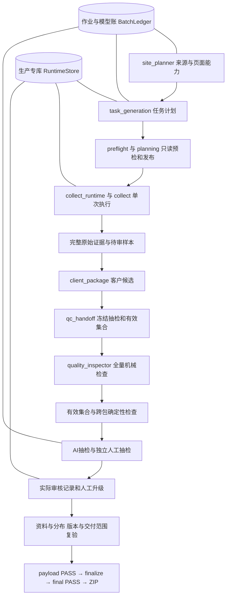
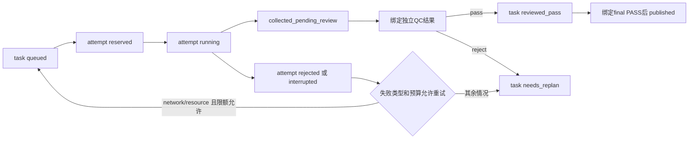

# WebCollect 设计说明

共享池的采集状态是生产专库的投影，不能自行签发QC结论。基本发现schema保持 `webcollect-site-pool-2`；显式绑定生产scope时增量增加 `collection_sources/tasks/events`，原表、历史证据及失败账不改写。投影绑定原registry绝对路径、scope、任务版本和生产事件序号，事件历史追加保存，旧序号不能覆盖新状态。生产事务提交后尽力同步，未成功留下pending；派发和开始执行前必须补写成功，读取发现投影落后或源库不可用也禁止派发。两个独立库无法合成一次事务，故中断时保守阻断而不重跑。

页面防重沿用应用归属和保守路径身份：query、fragment、尾斜杠和已证实别名不能绕过占用；整体应用的其他功能路径仍独立可用。逻辑任务ID也防止跨scope/registry换页重复派发。在途、已保存待审、审核通过与发布保持占用；失败保留每次尝试、原因和QC报告，重试/新版本仍由原生产预算、任务身份和整站止损决定。已有采集跟踪的应用合并须先明确核对投影，不允许合并隐藏占用。共享池不设置整站completed，也不替代当前链有效集合与发布门禁。

同站不同功能页保持原整体应用身份和应用名；原始来源锚点仍分别绑定。HTTP401/403的原请求及UNKNOWN费用保留，作业账在新模型预留前阻断后续请求；已成功缓存读取不受影响。仅有只读观察的20站规划是可恢复草案，不授予ready、任务可执行性或生产容量。实际状态见[本轮执行说明](同站双功能与20站最小执行-20261029.md)。

单条验证支路保持“来源、任务、采集、QC”分别结算：`single_record`只编排现有模块，`generate --max-tasks`在登记任务前限制计划数量，不裁剪已生成计划，不修改生产campaign预算。QC使用实际保存的候选和冻结交接，不把QC_NOT_RUN或发现ready记为合格。见[今日单条真实闭环计划](今日单条真实闭环计划-20261029.md)。

资料审核v3区分导出时状态与独立payload审核状态。显式提供的样本审核和抽检策略须成对传入，经现有engine按当前原图/树/标注和语义规则重验；两份输入摘要进入资料任务身份并在调用前后核验。资料模型检查声明与已验证覆盖是否一致，不替代原帧视觉、选中/升级人工或最终发布门禁；缺失仍为UNKNOWN或待审。语义规则未变时保留原样本审核，补资料只重验资料。

共享站点池将应用、别名、页面、发现、判断和既有能力引用分层；双来源追加溯源，类目冲突保持UNKNOWN，冻结基线用于本轮新增判断。发现线索、可读站点、确认应用和ready能力分别统计；程序2只读接口不触发任务生成或采集。详见[共享站点池与自主发现](共享站点池与自主发现.md)。

## 2026-10-29一致性修复补充

显式工作流提案与历史观察准入入口分开。提案绑定只读原始页面证据、5–10个必要动作、子目标和终态判据，再进入普通单次采集；证据标签不等于动作成功，采集后的独立QC继续判断必要性、可见结果与实质差异。无支持策略或显式提案时返回 `UNSUPPORTED_WORKFLOW`，不靠修改类别/任务族标签补能力。

注册策略是候选差异线索，不能凭策略相同拒绝所有实际路径。生成阶段仍拒绝相同必要动作角色下的参数替换；实际目标、路径、页面状态、结果判定的差异在后置QC判断。任务页面唯一归属、四路全局机械去重、第五项语义比较及当前链隔离继续独立执行。

新终态滚动在同次执行中证明必要性，不能用于凑步数；已完全可见、内容错误、隐藏或超出一次滚动范围的结果均拒绝。旧任务携带的准入字段不能删掉以切换到新分支。

真实首条准备发现一处机械就绪误判：DOM已解析、视口字体/图片均已加载、相邻原图与树稳定，但后台资源使document保持interactive。采集就绪接受interactive/complete，两者都必须满足字体/视口图片就绪、相关状态与原图一致及动作前重验；loading仍拒绝。此修复不改变视觉/语义审核规则，不改签旧结论，不把旧诊断图升级为正式帧。

派发前拒绝证明属于失败原件：同步保留原始PNG、复核PNG、原/live/final树与两次stability结果，供重算具体差异。较晚故障截图与当次拒绝证明分别留存；缺少当次比较帧的旧失败仍保留UNKNOWN原因，不通过放宽像素阈值或补写证明改签。

凭据与作业身份分离：模型配置/请求身份只含环境变量名或文件路径，token由运行时解析进入Authorization头。GLM默认使用已授权的项目 `request/token`；新凭据来源不清空原账、重发UNKNOWN请求或改变生产授权范围。

正式全量发行可在累计集合profile显式声明 `release={kind: formal, version: ...}`：要求200000个有效样本、20包每包10000、总体分布执行，拒绝重复或被替代副本。实验profile声明 `kind: experiment` 和版本；局部机械/语义PASS不能据此宣称20万条正式发行或客户验收。未声明release的旧profile维持其原局部检查含义，不补签正式发行。

本文描述源码 `34afaaa`（2026-10-28）中的实现与边界；环境及函数导航见[工程说明](工程说明.md)。需求语义以[当前澄清](../request/需求澄清记录.md)、原需求书和附件为准，技术能力、真实产量和客户验收分别判断。

## 1. 设计目标与分层

工程的核心是把一条真实网页操作轨迹保存为可重验的数据，而后对**实际交付字节**做独立审核。来源可访问、任务能执行、采集保存成功、审核通过、正式发布并不是同一个状态。

三个程序通过文件契约和 Python 调用协作。QC 独立读取客户目录和审核记录，不把采集侧的“成功”标签当作合格证明；部分流水线与账本代码可复用，因此“独立”指检查责任与证据来源，不代表完全没有代码依赖。

## 2. 领域对象与身份

| 对象 | 用途与边界 |
| --- | --- |
| 来源 source | 种子、目录或搜索模板配置及返回内容；配置身份 hash 与抓取内容 hash 分开，保留来源及失败分母 |
| 整体应用 application | 当前试点的站点管理与止损单位；不同路径或 query 不自动成为新应用 |
| 页面/task page | 实际承载任务的内容或功能页；共享入口/中间页有明确角色；当前每任务页最多一条有效轨迹 |
| capability | `webcollect-site-capability-1`；精确观察页、可用动作、库存、来源、证据、版本及有效期。`ready` 仅表示该能力范围可用于规划 |
| task | 稳定 task ID、task version、业务身份、必要操作与终态断言；参数替换不能自动创造独立任务 |
| publication | plan、能力、预检和源实现的冻结绑定；不分配样本号、不授予 QC PASS |
| campaign | 跨输出目录共享尝试、并发、待审、分布及资源预算 |
| scope | 一个输出路径对应的运行范围，由 `runtime_scope(output)` 派生；换 scope 不能刷新 campaign 预算 |
| attempt | 一次实际尝试、租约与 sample ID；预留、开始、结束分开，分母按实际执行计算 |
| sample | `Sxxxxxx_sample_xxxxxx` 和完整标注/图/树；分配后失败也不回收编号 |
| chain | manifest + 专库 + 允许结果根目录；限定本轮结果、审核和比较总体 |
| effective set | `qc-cumulative-set-1` 的显式包集合及内容摘要，可声明同 ID 版本替代关系；不依赖“最新目录”推断 |
| review / report | 审核记录给出证据绑定结论；QC报告重算格式、规则、总体与接受状态，两者不能互相伪造 |

旧编号表按 URI 存储站点，当前 `production_identity` 在其上增加整体应用、任务页与内容身份门禁，分片协议再固定 canonical 整站归属。因此不能简单把数据库 `sites` 行数当作有效站点产能。当前页面身份对 query 区分的内容、多 host 应用别名仍保守处理，不自动证明独立容量。

## 3. 当前链隔离与证据契约

[`current_chain.py`](../projects/code/webcollect/current_chain.py) 的 `initialize_chain()` 只为明确新建的空总体初始化：已有无标记 registry 或已有样本目录不能被静默接管、清空。manifest 冻结 chain ID、registry 和结果根目录；专库的 `current_chain_meta` 保存相同绑定。

`read_chain_history()` 从专库 `current_chain_results` 逐条核对 annotation 路径/摘要、sample ID 和真实 attempt，构造当前对照集合。它不回退历史正式包。`same_chain()` 只确认稳定归属，新增结果成员仍需实时核对，不能借稳定 chain ID 接纳任意文件。

通用证据引用为已有绝对路径和 SHA256，拒绝符号链接、消失文件、字节变更和越界来源。哈希证明绑定的文件未变，不证明截图内容正确、审核者真的看过图或请求真的得到厂商计费。

`qc_handoff.prepare_qc_inputs()` 另外要求每个候选对应专库中唯一 `collected_pending_review` attempt，保存收据、原始 evidence 与客户样本字节一致。观察 trace、手工样本或只同名的 sample ID 不能晋升。它冻结显式抽检计划、当前有效集合和待独立核实线索，不写生产账、不调用模型。

当前 handoff 对转换后标注的 lineage 仍采用严格字节一致限制；需要改标注、归一化或增量总体时，必须验证相应契约，不能仅凭同 ID 或来源路径推定可接纳。

## 4. 单次执行与图树同步

`task_generation.execute()` → `collect_m4()` → `collect_one()` 是普通任务的共享执行路径。只读预检采样页面、发布冻结计划后，每个计划动作在该 attempt 中执行一次；不再要求先执行完整演练再正式重放。旧准入路线仍会验证已经存在的收据。

每步围绕实际页面状态工作：观察可见控件与文字，捕获原始 PNG 和同步树，生成动作参数，在执行前重验状态、目标、坐标、焦点和命中条件，再记录实际动作与结果。叙述从已保存的可见事实生成，不能把规划目标或隐藏 DOM 文本写成已出现的终态。

`browser.stability_pair()` 同时核对加载完成、相关状态和完整原图像素。新稳态证明允许有证据支持的无关、非交互图片区域变化，但目标、标签、值、遮挡、结果及区域外像素必须满足约束；不裁剪、不修改保存原图。`full_dom_stable` 与 `related_dom_stable` 分开记录，不能把全状态变化伪称完整稳定。

完成步骤由 `capture_complete()` 重新获取完整证据并重验断言，不能拼接早期截图与新树。有效动作 5–10 步的门禁排除 `wait` / `complete`；准备动作若实际执行也记录，不能插入无关操作凑数。自然太短、没有可核验可见终态或不支持的任务保留失败。

采集保存前执行生产端结构校验、capture audit 和精确截图冲突检查。成功写入 `saved_sample.json`，同时绑定样本全部文件和原始采集文件；最终 outcome 仍为 `collected_pending_review`。精确去重只是生产端提前拦截，独立 QC 继续执行四路去重和业务差异审核。

## 5. 两套账本与恢复

| 持久对象 | 负责什么 | 不负责什么 |
| --- | --- | --- |
| `BatchLedger` | 冻结运行配置、job 身份/租约、访问计数、模型请求预留/结算、缓存、用量和事件 | 不分配生产 sample ID，不证明合格 |
| `RuntimeStore` / production registry | 编号、campaign/scope/task/attempt、域间隔、生产租约、原样保存、审核/发布引用 | 不调用模型，不直接签署人工或客户验收 |
| `SiteFailureStore` | 整体应用的 probe/observation/formal 真实失败与UNKNOWN事实，按 execution ID 幂等累计 | 不重试请求、不凭空增加失败、不清零原账 |
| `SiteProgress` | 原生产账的逻辑站点目标、位置、最终 QC 接受与发布视图 | 不自行分配编号、不扩预算、不把 pending 变合格 |

`RuntimeStore` 在同一 SQLite 事务中完成 claim、attempt 身份和编号预留，带 worker ID、lease token、到期时间进行 fencing。旧进程失去租约后不能继续提交；已终结 attempt 不能改写成另一结果。

图中 task 和 attempt 分属不同表：审核/发布推进任务状态，原采集 attempt 继续保留其保存结果。不能看到一条旧 attempt 为 pending 就忽略它已有关联审核，也不能只看 task 标签而跳过原证据核查。

resume 核对 bootstrap 的原路径、计划、发布与实现身份，并逐字节验证已保存样本及 raw 文件；已完成样本被跳过。中断只保留失败轨迹，新尝试另分配 ID，不能拼接跨会话片段。campaign 限额、整站三次失败和 UNKNOWN hold 在重新派发时继续生效；本地进度 JSON 不是重置权威账本的入口。

## 6. 全量机械、AI与人工三层质检

第一层由 `quality_inspector.engine.inspect()` 独立检查格式、路径、图树、校验清单、分布、资料和四路去重，覆盖实际输入总体。第二、三层由 `delivery_sampling` 的冻结策略分别控制 AI 和人工覆盖，抽样单位是完整轨迹 slot。

计划绑定原始分母、比例、seed、batch/site 分层及 annotation/图/树字节。正比例向上取整；AI、人工可重叠，同一样本的升级与随机人工任务合并。策略必须显式输入；无 sampling plan 的 `check` 仍要求完整语义审核。

| 状态/分支 | 行为 |
| --- | --- |
| AI 被选中但尚未实际审核 | `AI_REQUIRED`；不能以人工记录冒充已执行 AI |
| AI 已有失败、非法回复、UNKNOWN或未决 | 验证原账/失败收据后转人工；保留原请求与费用，不自动重发 |
| 独立人工抽中或强制升级 | 导入实际人工逐帧与五项结论，缺失保持待审 |
| 有效人工 PASS 裁决已有 AI 分歧 | 按现有策略接受裁决，原 AI 失败不覆盖 |
| 人工 FAIL | `REPLACE_REQUIRED`；新采集、新 ID，继承原 slot 选择并强制人工复检 |
| 未抽中 | `NOT_SELECTED` / 策略准入；不能写成逐帧语义 PASS |

五项语义检查为 `visual_alignment`、`terminal_semantics`、`language`、`privacy`、`substantive_difference`。资料审核另按包执行。导入 JSON 验证记录来源、逐帧覆盖和证据字节，但不从技术上认证审核者身份或实际阅读；agent 不得代签人工。

`delivery_pipeline.prepare()` 绑定外层 receipt、模型账、策略、profile、有效集合与跨包报告；`run()` 执行队列；`status()` 重算状态并可发行收据/同步进度；`import-human()` 导入实际记录；`finalize()` 核验最新发行状态后调用封包逻辑。过程锁防止同一 pipeline 并发修改。

## 7. 审核复用与用量设计

`semantic.py` 为五项检查分别定义规则版本，审核身份绑定 sample ID、annotation 和全部引用图/树字节。`contract.fingerprint()` 保留完整源码摘要作工程追溯，但不再把无关实现 hash 当作所有语义结果的失效条件。

`semantic_runtime.py` 在**同一模型作业账内**按 kind、实际样本/资料、比较集合、model/mode/prompt 和相关规则查找已绑定结果，并用锁覆盖查找及派发。新 pipeline 可引用原结果，不代表跨所有数据库存在全局缓存。

| 变化 | 审核影响 |
| --- | --- |
| 只搬目录或改变封包外壳，样本字节及相关规则相同 | 可复用有效语义结果；机械/交付检查仍重算 |
| annotation 或任一被引用图/树改变 | 对应样本不再是同一审核对象，需要适用审核 |
| 单项语义含义/版本改变 | 仅相应项转待审，原记录保持不变 |
| 差异比较总体或近邻改变 | 第五项绑定改变，不能用旧局部结论替代 |
| 资料或支持证据改变 | 按资料审核 subject/prompt 重新判断适用范围 |
| 原同对象请求 running/failed/review_required 或UNKNOWN | 阻断再次派发，回查原请求；不能新建 alias 绕过 |

`ModelGateway` 在发送前做预算预留，返回后校验严格 JSON、schema、usage、模型及图像能力。缺失 cached usage 等不能默认为零；网络/费用未知保持原预留与 UNKNOWN。费用来自显式费率和厂商返回 usage，实际厂商扣费缺证据仍为 UNKNOWN；reasoning 若已包含 output 不重复累加。

模型双链路以显式 provider、端点和版本区分：原 `glm` 连接智谱；`ark` 连接火山方舟，优先 `glm-5-3-flash-260828`，备选按用户指令改为 `deepseek-v4-1-flash-economy-261017`。标准版 `deepseek-v4-1-flash-261017` 继续兼容既有冻结账本，不再作为备选示例默认值。每个冻结模型账仍只绑定一条通道和一个版本，不在异常处理中隐式更换模型。旧请求 UNKNOWN、401/403和未决审核须按原账处理，不能新建 Ark 作业冒充同一请求的安全重试；新的独立联通验证只证明对应协议可用。

共享YAML凭据须按厂商选择账户：Ark使用 `ark1`，智谱使用 `glm1`；任一所选账户缺失、重复或无效均停止，不借另一厂商的key继续。用户更新文件格式后，Ark也兼容不能按严格YAML解析的旧标签文件，但只读取显式顶层、唯一且完整的 `ark1` 条目，不借解析失败猜测其他字段。配置与请求身份仍不包含key值，凭据选择修复也不改写此前失败和费用UNKNOWN。

Ark 用 `max_completion_tokens` 统一约束思考与回答，原 PNG 经 data URL 发送；两模型的输出继续经本地 Schema 验证，版本不匹配的响应保留为失败。Ark GLM 使用公开固定费率；DeepSeek 示例以高峰费率作保守上限，空闲时段折扣、缓存存储与账户实际扣费另行核对。示例的一次请求预算和联通 PASS 不折算为真实任务、逐帧审核或新增合格产量。

## 8. 四路去重、版本与最终封包

四路实现位于 `duplicates.py`：跨样本精确图像 SHA、精确动作/目标/页面序列、首尾图 dHash、任务指令 SimHash。参数及规则进入合同/profile。任一路命中继续按机械近重复处理，语义 DISTINCT 不能豁免；检查失败的数量为 UNKNOWN，不能当成零命中。

`version_compare.py` 在显式有效集合中处理同 ID：相同内容副本只计一次；不同版本必须有明确 `supersedes` 关系和原因，不按目录时间选“最新”。不同 ID 仍执行四路及实质差异检查。`check-set` 的累计机械 PASS 不表示语义完成，仍不能单独放行。

正式顺序为：

1. 从原始采集生成事实、导出候选客户包，保留样本与包外 lineage。
2. 冻结有效集合，执行跨包确定性检查，形成内容绑定的报告。
3. 对实际候选执行 payload 检查，使用显式抽检计划及真实 AI/人工/资料记录。
4. `finalize-client` 核验 payload PASS、有效集合及跨包 PASS，在新目录附入报告摘要。
5. 对完整包执行 final 只读复验；`archive-client` 再核对 final PASS 和相同交付范围，生成 ZIP 和校验文件。

`delivery_scope.verify_delivery_scope()` 被封包、归档和 pipeline 等入口共享使用，重新核对有效集合、跨包报告、profile、合同、版本选择与实际 payload。禁止变更内容后沿用旧 PASS，禁止将被替代或部分包直接密封。ZIP 路线验证解压内容与源文件字节一致，不再派发 AI。

`delivery_status=PASS`、`release_ready=true` 是本地规则通过；`customer_acceptance` 继续单列 UNKNOWN，只有客户实际证据才能改变外部验收结论。小规模实验 profile 即使通过，也不能证明正式数量/总体分布已满足。

## 9. 并发、分片与尚存边界

本机 `site_scheduler` 调度已发布计划，多个 worker 共用生产 registry、预算、域间隔和精确截图提交冲突守卫。它不发现新站、不扩大额度、不授予 QC。

静态多 worker 协议见 [`batch_protocol.py`](../projects/code/webcollect/batch_protocol.py) 和[协议文档](../projects/code/docs/static-batch-protocol.md)：全局站点 ID、固定 owner/shard、证据绑定容量、失败/UNKNOWN事实搬运、最终 QC 结果冻结和合并。容量未知不默认每站 20 条；同 shard 不允许两台活跃执行者。

合并保留原四项视觉审核，但局部比较范围合并后，第五项全局实质差异可能转待审；`mechanical_unique_count` 与 `globally_qualified_count` 分开。缺片或全局未决不能直接开始补采；协议测试不证明已部署多机。

当前已知边界还包括：任务策略覆盖有限，网站可达/能力 ready 不代表真实任务容量；公开页面动态、加载、遮挡仍可能阻断采集；审核者身份与实际阅读不由 JSON 自证；新克隆无本机证据不能接续原生产。当前生产停止、真实首条闭环与大规模吞吐未获此源码改造验证，不以工程 PASS 替代这些结果。
