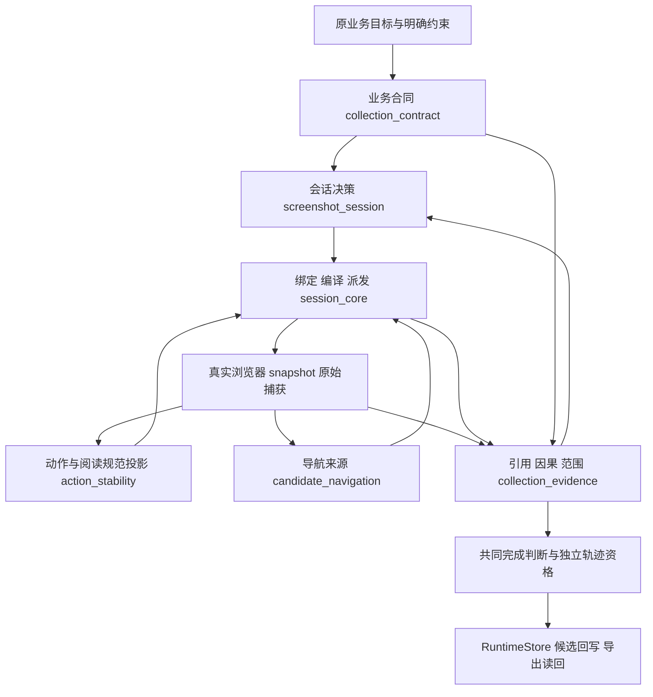

# 跨站采集事实与业务闭环收敛 SSD

2026-11-15 实采收口更新：固定100页、20进程已启动但仅领取20页即停止，80未领取；五站均4/20领取、正式attempt/模型请求/保存/导出0，不能评价站点规划成功率。w001入口连接关闭正常结算后下一循环被取消，引发全局停止；旧3 reserved被全局recover改UNKNOWN，controller最终摘要断言失败而缺正常终态。所有进程已退出、源码未变，独立统计明确完整性FAILED。详细事实、证据强度与后续最小研发验收见[实采总报告](../verify_results/cross-site-100-pages-20261115-r01/final-report.md)。下一步优先取消生命周期、历史恢复范围及异常收口，不再增加合同字段；站点模板只列后续规划层备选，本轮未实施或启动。原20 claim和历史行不改写、不自动重跑。

2026-11-15 实施更新：用户已授权结合新代码完成最后修复并启动20进程/100页。研发与独立走查已收口，见[最终研发回执](../verify_results/cross-site-final-repair-20261115-r01/report.md)及[独立复审](../verify_results/cross-site-final-repair-20261115-r01/review.md)。31个受影响核心节点最新通过，维护总量50；真实本地浏览器搜索阅读5步、POST计算7步，正常保存/回写/导出/封存两链17/17通过。实现增加 `business_role=process|outcome`（默认outcome），过程来源复用唯一 `acceptance.source_quote`；过程仍核验真实操作，所有最终outcome仍受真实末帧约束。`visible_text`区分实际显示正文与动作accessible label，并贯通保存树schema。正文闭合由实际捕获生成，首尾可见不要求同帧，标题引用真实性与聚合完整性分开。以下正文保留2026-11-14设计时状态；本次100页新授权替代§11.2先15页的建议，不增加额外试采。实采结果单列，不以离线成功代替。

日期：2026-11-14。状态：**设计与代码只读评估，尚未实施本 SSD，未启动新采集。**

本文修订下一步研发方向，不覆盖既有实采原件、账本或历史验证结论。直接修当前实现，不创建实现/协议代际版本、兼容执行分支、新执行器或新证据数据库；不执行版本控制操作。

## 1. 结论与目标

**可以统一解决已确认的宿主内部矛盾，但当前方案需要调整，不能原样再叠加校验。** 统一点是原始事实来源、业务成功含义、实际因果关联和模块判定职责，而非一个包办所有判断的总控层。

本轮暴露的问题有共同结构：不同模块把同一份事实解释成不同义务，模型再被要求满足这些互相矛盾的义务。把字段从模型搬给宿主，并未自动消除预测；把答案改成引用，也未自动消除输入上下文中的正文复制。下一步必须删除这些错误联系，并从事实的真实生产环节验收到正式交付。

研发目标：任一符合当前通用能力范围的候选，都能沿“业务目标 → 真实操作 → 可归属观察 → 原目标完成证明 → 轨迹资格 → 正常保存与导出”运行；宿主不得因无关历史、矛盾投影、虚构依赖、预测步号或局部登记失败而阻断。无法证明的结果保留不足，不能通过降低完整性、来源或 UNKNOWN 标准制造成功。

本 SSD 不承诺任意站点、任意目标均成功。网络不可达、目标不存在、未知分页范围、缺乏来源证明的脚本导航和模型判断错误仍可能失败。它们必须与宿主不变量错误分开，且有界、可解释、保留证据。

## 2. 证据基线与当前代码边界

### 2.1 实采已证明什么

依据：[全局分析](../verify_results/cross-site-20-workers-20261114-r01/analysis/summary.json)、[逐条账](../verify_results/cross-site-20-workers-20261114-r01/analysis/accounting.json)、[工程根因](../verify_results/cross-site-20-workers-20261114-r01/analysis/engineering.json)、[规划与证据根因](../verify_results/cross-site-20-workers-20261114-r01/analysis/model.json)。

| 本轮事实 | 正确解释 |
|---|---|
| 20 个唯一 claim，7 站，峰值并发 20；13:00:01—13:08:17，约 8 分 16 秒 | 已运行一轮，因程序故障停止；不是容量验证通过 |
| 3 条入口连接失败；17 个正式 attempt，其中 5 条被其他候选缺档阻断、零模型请求 | 历史归属错误有独立影响，不能归因模型不会规划 |
| 12 条进入模型；10 个接受计划有原账或独立原件佐证 | 不是全部候选连规划都无法执行；正式空值不回填 |
| 原目标完成证明、verified_saved、candidate_results、导出均为 0 | 跨站交付目标未达成 |
| 24 个归档捕获可复现两种投影失配 | 该阻断不依赖重新访问站点或 20 并发；一致投影可消除旧误拒，但仍须验证不会丢失保护目标事实 |
| 10 个已接受计划的 44 个事项全部默认末步观察 | 执行预测仍被冻结，只是默认值改由宿主填写 |
| 42 笔模型请求：29 succeeded、10 invalid_response、3 reserved | 3 笔未决保留、不重发；旧 40 笔 UNKNOWN 未变 |
| 已返回请求未见输出耗尽或零工具纠错回包 | 仅说明本批未出现，不证明截断恢复、40 请求上限或时间上限已实采验收 |

全局停止截断了其他任务，`runner_cancelled` 也不排除任务自身同时存在缺陷。不同批次目标、供给与终止方式不同，不能据此严谨计算“成功率越来越低”；但新增宿主回归和正式交付为零，足以说明原改造方向及验收方法需要调整。

### 2.2 不能把历史诊断直接当作当前待改清单

本轮实采期间 222 个源码摘要一致。**编写本 SSD 时，当前工作区有 5 个文件已不同于实采快照；本轮评估未修改这些源码。** 静态核查结果如下，尚未由本轮测试或实采验证：

| 当前文件（均在 `projects/code/webcollect/`） | 当前已有变化 | 剩余工作 |
|---|---|---|
| `action_stability.py` | 动作复核 before/after 已补动态投影 | 仍须收敛单一入口；保护目标语义不得被覆盖；阅读比较同源失配仍在 |
| `agent_feedback.py` | 归属判定已前移；其他候选缺档可返回 UNAVAILABLE | 验证所有入口及当前候选 UNKNOWN/必需证据仍严格，避免重复改回 |
| `collect_runtime.py` | `evidence_classification` 已映射为 program | 仍需区分缺档归属、页面不稳定、宿主不变量和取消结算 |
| `collection_contract.py` | 已删除“任意输入令所有 result 强制依赖输入” | 末步默认仍在；独立验算依赖并集覆盖全体 input/result 的规则仍在 |
| `collection_evidence.py` | 已删除 bare“列表/清单”的完整覆盖触发 | 仍用词法推导业务范围，可能误加或遗漏完整义务；尚未形成显式范围语义 |

后续实现者先对照当时当前源码与本 SSD 的不变量，不重复应用旧补丁。上述静态变化不改写原批次失败，也不等于本 SSD 完成。历史源码行号以分析回执为准，当前行号会随并行研发变化。

当前五文件核查摘要（仅标识本次读取的源码，非新增实现版本）：

| 文件 | SHA256 |
|---|---|
| `action_stability.py` | `c489c56cbe085a111b2c52abbc567759a00ed05759b8b92336d36f2427cad9c7` |
| `agent_feedback.py` | `b7bab0170c84da2c08a6cc700a6095f7053dffc85251f69f8b066ca35da0c15f` |
| `collect_runtime.py` | `b366c45b2f8b678f03e0a17445cb4dbfe0f4e57d2f9dacc66fcc951c5a54588f` |
| `collection_contract.py` | `aa088cc0ee7baaeaa6cced866df6df183927c86e5192bf27ec0283ec14428dc2` |
| `collection_evidence.py` | `2bc5b207a5616681a251a9ad19b4fa2dc3506b612579aff18f1110494e104ed9` |

当前源码另有两条需反例验证的风险，尚未执行复现：删除通用输入依赖后，不能让空 `depends_on` 绕过原目标要求的输入 A 与实际结果 B 的不一致；缩小覆盖正则后，不能漏检“读取全文”，也不能因“表格中显示指定值”又扩大为全表覆盖。这说明必须替换规则含义，不能只增加或删除几个关键词。

## 3. 为什么改造后仍可能更难成功

1. **上游预测换了填写者，却没有撤销。** `observation_steps=[final_step]` 不是实际轨迹，不能承担阶段证明、历史图选择和最终完成义务。
2. **错误归纳成为通用门禁。** “有输入，所以所有结果依赖输入”“出现列表，所以要完整列表”等规则扩大了任务。它们的存在会让正确业务动作也失败。
3. **局部结果越权。** 一张历史图不适用，应只表示本次登记无效，当前 `give_up` 却能关闭整项业务。
4. **事实有多套解释。** 动作基准和实时复核的投影不同；其他候选的缺档先被当成当前义务；普通表单却缺少只给弹窗生成的事实。
5. **离线验证跳过生产者。** 既有隔离检查可直接注入 `form_submission` 等事实，证明了下游消费能力，没有证明真实 `snapshot.js` 能产生它们。大量检查数不能替代这条接线。

因此既不应推倒浏览器与保存链，也不应只修正则、字段枚举和超时数值。需要收敛的是现有模块之间的合同及调用关系。

## 4. 统一架构与职责



原始 capture、真实操作、浏览器请求收据是事实来源。`observation_records / region_registries / trajectory / verified_answers / verified_checks` 继续承载现有会话数据。不同用途允许不同只读投影，但每种投影只有一个实现，必须指向原件。模型上下文是展示视图，不能反向成为执行依据。

Table1/Table2、生产者与消费者交接、候选身份、claim 独占领取和结果回写协议保持不变。本 SSD 的业务验收表达属于消费者内部合同，不复制生产者事实、不借改合同重新领取旧候选，也不增设另一份候选真相。

| 模块 | 唯一职责 | 不应承担的职责 |
|---|---|---|
| `snapshot.js`、`browser.py` | 捕获真实页面、控件、文档身份、表单及观察原件 | 预测业务完成、把隐藏 DOM 当成已展示证据 |
| `screenshot_native_observation.py` | 当前控件动作能力的共同谓词与模型展示 | 根据压缩文字批准执行 |
| `action_stability.py`、`dynamic_regions.py` | 动作/阅读基准与复核的确定性投影；保护相关事实 | 全页无关变化门禁、覆盖保护目标文字 |
| `candidate_navigation.py`、`navigation.py` | 有来源的目的地授权与实际请求/重定向收据 | 以同域自动扩权，或把获准导航当成业务成功 |
| `collection_contract.py` | 编译业务必须满足的事实及明确约束 | 未来取证步号、默认末帧、计划全局因果猜测 |
| `collection_evidence.py` | 引用解析、来源/对象/因果/时效/范围及共同完成谓词 | 修订目标、自行导航、因单条登记不足全局终止 |
| `screenshot_session.py`、`session_core.py` | 路线修订、实际操作证据索引、局部登记与有界恢复 | 再实现另一套覆盖、时效或完成标准 |
| `agent_feedback.py` | 先按归属筛选，再读取当前需要的历史 | 将其他候选缺档或 UNKNOWN 变成本任务的硬义务 |
| `screenshot_plan.py`、`postprocess.py`、`agent_audit.py` | wire、封存读回接线，消费共同判定与轨迹资格 | 重放时重新生成未来义务或另解业务目标 |
| `collect_runtime.py`、现有 RuntimeStore、候选回写、`client_package.py` | 原始终态归档、正式保存与导出收据、一致结算 | 用派生文件、模型声明、局部证据通过冒充保存 |

“只校验一次”指每种规则只有一个权威实现；派发前因状态可能变化而重验、封存后验证原件仍有必要。不能为了减少校验而取消这些时点。

## 5. 业务合同、路线与交付资格分离

### 5.1 冻结业务，不冻结工程预测

保留原始用户目标字节及来源。业务合同只包含所需对象、事实、明确范围、明确过程义务、明确结束状态和必要的业务依赖。模型自提目标接受后同样保留原成功口径。

路线是可证伪的执行假设。用户只要求获取文章时，“从搜索进入”不自动成为业务事项；搜索能力被证伪可改用真实可见文章入口。用户明确要求“通过搜索获得”时，搜索证明仍是业务义务，不能偷偷删除。

首轮 wire 及执行合同删除未来 `observation_steps`、`final_presentation_step` 和默认末帧集合；删除模型对 `source_type/result_kind` 的工程预测责任。运行内部确有消费者需要的来源/机制字段由实际观察和操作生成，无法确定保持不足，不默认 calculation，不重新默认末步。`contract_derivation` 保留真实来源引用，不把猜测包装成事实。

去掉通用 `evidence_scope=current/historical` 首轮猜测。普通已发生事实可由相应历史证据证明；只有目标明确要求“结束时保持”的业务状态才承担末态义务。输入转换或当前计算结果仍须匹配其真实输入与产生操作，不能因接受历史证据而使用已失效结果。

`depends_on` 仅表达业务确实需要的依赖；保留引用有效性、自依赖和传递环检查。删除全体 result 必须依赖输入、所有验算必须联合覆盖全部 input/result 的规则。过程输入即使不是独立交付事项，其实际值与操作仍须留账并参与因果核验。

### 5.2 最小成功语义

在现有 requirement 上以一处明确业务验收描述替代词法猜测，不再并存旧覆盖规则。建议语义形状如下，最终字段接线复用当前 schema 结构：

```json
{
  "id": "r1",
  "kind": "content",
  "description": "列表中出现方正字库入口",
  "acceptance": {"mode": "presence", "subject": "方正字库入口"}
}
```

| mode | 业务含义 | 例子 |
|---|---|---|
| `presence` | 指定对象/事实存在 | 列表中出现目标入口 |
| `specified` | 指定字段或枚举项目均取得 | 标题、作者、发布日期；指定三个项目 |
| `complete` | 完整覆盖明确对象的有限范围 | 指定文章完整正文、明确范围的全量清单 |

`specified` 保存业务指定项目及必要期望值；`complete` 保存原业务范围描述，实际容器/分母在观察后绑定。模型不能把原目标的“完整正文”改成 presence，也不能自行缩小对象范围。业务拆分遗漏或缩减原目标时，应在合同接受前指出具体冲突，不由宿主增加全局猜测义务。

`acceptance` 是原目标的派生表达，原目标仍是业务权威。宿主保留显式对象、字段、期望值、完整范围和过程约束的原文来源；不能用模型自选 mode 自证目标完成。只检查可确定的结构与明确冲突，不新增对任意自然语言逐句等价的硬校验器。含义无法确定时走已有有界修订或保留不足，不默认最弱的 presence；不声称规则能够完全判断自然语言语义。

三种 mode 只表达覆盖范围，不能替代过程与推导义务。“必须经搜索”由真实搜索操作及收据验证；明确要求独立验算时继续用现有 calculations 及来源事项引用验证，不能仅凭页面结果存在就通过，也不因出现数字自动增加验算要求。

首轮仍允许判断任务不适合当前交付资格；不通过先接受宽泛目标、再悄悄替换目标获得成功。本次不实施“已冻结自主目标自动换成新目标”；未来若另行决定支持，应分别保留原目标未完成与新目标结果，不能相互覆盖。

### 5.3 五步政策保持，完成状态分开

保留首轮自然至少五个必要业务动作、正式保存有效动作至少五步的既有资格；`wait/complete` 不计。业务已完成但实际动作不足五步，应结束并记短流程不合格，不能返回索引、重复搜索或开关页面补步数。

**客户末帧展示标准同样保留。** 依据[既有约定](策略2Wiki阅读与证据标注Token优化方案-20261112.md)，原目标的最终结果与完成判断须能对真实末帧核验，不能用“历史事实已齐＋当前任一相关正文”代替。全局完成走 fresh capture；只缺结束展示时允许有依据的必要定位，到位即结束，不重做历史阶段。删除首轮末步预测，不删除结束时的真实展示门槛。跨页比较无法由真实末帧支持时不计正式合格，不伪造汇总页或拼贴截图。

五步与末帧是产品资格，可能限制短任务、纯阅读页和跨页比较的可交付范围。修复宿主矛盾不能让所有网页自动适合这种样本形态；后续若希望扩大产品范围，应单独评估业务标准，本 SSD 不暗改标准。annotation、逐步图片、最终结果与实际动作、输入输出、当前/历史来源保持一致，派生和封存都需核对。

业务目标已证明、轨迹合格、正式保存、候选回写、导出、独立 QC、人工审核、发布、客户验收分别报告，复用现有状态和收据，不建立第二套事实账。本 SSD 不调整客户交付标准。

## 6. 事实生产、投影与导航

### 6.1 动作/阅读比较

让 `action_scoped_projection(raw, scope)` 成为动作基准生成、实时比较及封存复算的唯一入口，函数内完成必要规范化；阅读 `reading_projection` 同样收敛。删除调用方各自先处理动态区域的分支。

保护集合涵盖当前物理目标身份、业务标签、href、值、相关表单字段、必要焦点与命中几何。`ancestor_text_outside` 不得覆盖保护对象的语义；动态区域只排除已证明无关的内容。原始 `images_ready=false` 不改写；派发只检查影响本动作可见性/命中的相关资源，不让无关零尺寸坏图阻断动作。

必须同时成立：同一原件生成的基准可从该原件复算；无关动态变化可忽略；保护对象实质变化会拒绝旧绑定。仅把两边都裁剪成一样不算完成。

### 6.2 导航事实生产

`snapshot.js` 为已支持的 UTF-8、urlencoded 原生 GET/POST 表单产生通用 `form_submission`，不以 `_blank` 过滤普通同窗表单。保留 submitter 覆盖、空值、中文、隐藏成功字段、select/radio 和真实编码语义；弹窗额外验证 target/opener/实际新页，不复制另一套表单编码器。

通过现有 `native_form_encoding`、`exact_destination`、浏览器主文档请求监听与 `validate_http_chain` 接线，`candidate_navigation` 仍是唯一授权判定入口。真实链接、子控件父链接、原生表单、允许的重定向以同一来源链处理；显式排除页面约束仍有效。

“允许进入该 URL”与“本次提交产生该结果”分开：后者还需 operation 与真实请求/响应/观察绑定。合法跨域来自已授权页面的可信导航能力和真实链，不来自模型任意 `open_url`、同域猜测或最终落地反推授权。

无 href/原生表单来源的脚本弹窗仍是显式能力缺口。本次不做站点白名单。若要通用支持，应另补浏览器实际触发来源绑定能力并覆盖反例；已派发且效果未知的 w019 类路径保持 UNKNOWN，不能重发。

### 6.3 历史归属

先识别候选/attempt/原件归属，再决定是否需要读取与严格校验。同站其他候选的经验只作建议；缺档记 UNAVAILABLE，保留原引用，不阻断新候选。当前候选自己的未决执行、必要来源、claim 绑定继续严格；无明确归属且影响安全执行的记录不能默认为无关。

不重建已授权删除的旧证据、不删除历史行、不重新解释 UNKNOWN；不让“最近两条同站历史”挤走当前目标的相关证据。

## 7. 证据登记、覆盖与上下文

### 7.1 从实际事件关联阶段

不新增模型阶段号。复用 operation_id、before/after observation、document 身份、业务对象、实际输入值、导航及结果变化收据。阶段索引从这些事实生成，而非首轮步号：

1. 真实输入/提交后的结果关联其 producing operation；独立导航无需虚构输入依赖。
2. 文章证据关联实际文档和业务对象；同文异对象或跨文档重复文字不混合。
3. 新相关输入只使依赖它的当前结果失效；已完成历史阶段和无关导航事实保留。
4. 没有因果见证时返回具体不足，不因步骤相邻就认定因果。

一个结果事项的期望输入、实际输入、producing operation、输出观察必须在现有 verified_checks/操作记录中形成同一条可追溯证明。分别 VERIFIED 的输入 A 与输入 B 产生的输出不能拼成一个成功结果；历史证据有效不等于可以跨阶段混拼。缺省 depends_on 不豁免原目标中已明确的输入条件。

Checkpoint 由新增相关候选事实、覆盖增长、动作偏差或必要结束核验触发，不因“走到预测末步”制造义务。

### 7.2 引用制保留，完成范围显式

模型仍只提交 `requirement_id + observation + control/region` 等引用；宿主从不可变原件生成规范文本、区间与 `observed_result_source`。不再要求模型重复抄正文和 quote 才能证明同一事实。

完整覆盖分开判断：业务所需范围、可证明分母、实际可见证据覆盖。分母来自绑定目标对象的明确字段/枚举或有范围闭合证明的正文结构，不能由答案刚好引用的单节点反向定义。DOM 中存在但未实际展示的文本可用于理解候选范围，不能自动算已采证据。

`main/article` 只是候选边界；分页、懒加载、续页或结束条件尚不明时保持 `scope_unknown`。当前页可见部分、当前文档全文、跨页整篇内容必须按原业务要求区分。已证明有限范围按原件有序区间合并覆盖，重复节点不补缺段；明确完整要求缺内容仍拒绝。

证据单位可以增量积累，无须拆改冻结业务目标。反馈必须在模型可操作范围内：说明缺哪个对象、字段、范围见证或引用；不能要求“拆事项”却只允许改剩余动作。

### 7.3 局部登记不得关闭任务

在现有 `_decide/_checkpoint` 中设独立登记工具/分支，返回 `registered / insufficient / not_relevant` 及引用、简短原因。这里的 `registered` 仅表示提交登记，实际通过以宿主核验为准。不携带 remaining_plan、当前动作目标或全局 complete/give_up。

历史图按事项所需对象、文档、实际操作和已有观察选择；不再使用预测 `route_frames`。无匹配图就返回无候选，不把错误文档交给模型猜。登记不足保留 gap 并回到当前规划器；全局终止只在持有完整业务上下文的任务决策层发生。

同一事项、同一 gap、相同相关事实已被拒绝后，禁止再次无变化提交；新事实/修正引用可再登记。不同对象、不同输入状态即使文本相同也不是“无变化”。

### 7.4 一份正文，多处引用

每个请求内维护一份按原始 observation/block 可追溯的事实目录；candidate_results、historical_evidence 和进度只携摘要及引用，不嵌套复制全部 regions。相同来源正文只承载一次；相同文本的不同来源仍保留独立身份，可共享文本载荷但不得合并来源。

上下文优先提供当前可派发控件、未满足事项、下一动作需要的事实和必要历史图，其余由宿主按需选取已有引用。不得以裁掉未满足业务义务、因果输入或 UNKNOWN 来压缩。w003 的 33,201→129,962 输入 token 是审计基线，字符与 token 分开报告；验收结构性去重，不承诺未经测量的百分比。

## 8. 恢复、停止与持久化

恢复归现有会话动作管线统一调度。`collect.capture_before_action` 的外层轮次与 `browser._capture` 内层轮次共享既有动作 deadline 和恢复计数，消除最多 3×8 的独立重试叠加。

| 情况 | 唯一处理 |
|---|---|
| 基准无法从同一原件复算 | 明确宿主不变量错误；零次盲目重采 |
| 未派发、观察真实变化、同一物理控件仍唯一 | 最多一次确定性重新观察/绑定/编译；使用共享剩余时间 |
| 同一动作及同一相关事实重复失败 | 停止机械恢复，交回具体缺项 |
| 语义目标改变或消失 | 规划器修路线，不能按旧 selector 继续 |
| 页面持续不稳定或网络不可达 | 达既有时限后本候选有界结束，不自动认定共享程序损坏 |
| 已派发而效果 UNKNOWN | 保留原请求和收据，不重新派发、不换身份绕过 |
| 局部证据不足 | 保留已通过事实，必要时继续其它事项；不自动终止业务 |

保留现有 40 次实际 HTTP 请求上限、1800 秒软时限及 120 秒宽限、length 有界重提和 refused 不重发，不通过加预算掩盖矛盾。可确定规范化用宿主已有入口完成；必须模型修复的工具请求强制正确工具模式，不能文字自称调用即视为成功。

共享宿主不变量损坏可以停止新派发；单页问题应隔离。停止时各 worker 在宽限内保存原始终态/已知动作/未决请求，并使 registry 终态可引用其收据。进程被杀来不及收口时保持缺失/未决，不凭扫描补出正式成功。当前取消链有“独立原件存在但正式收据未关联”的现象；具体缺口须沿 `collect_runtime` 的结束出口定位后修复，不预设重写 RuntimeStore。

复用现有本地幂等结算与保存链；历史失败、空值、40 笔旧 UNKNOWN 和本轮 3 笔 reserved 不改写。新样本完成判断与封存重放调用同一业务谓词，保存、回写、导出失败各自留真实状态。历史原件作为数据保留，不新增旧执行协议分支。

## 9. 必须删除与必须保留的规则

| 删除/合并 | 保留 |
|---|---|
| 默认末步取证、按预测路线选历史证据 | 实际观察、对象、操作来源与必要末态 |
| 全局输入依赖、全局验算依赖集合 | 真实输入转换/独立验算因果、依赖环检查 |
| 裸“列表/表格”等词法升级完整义务 | 业务明确的完整范围和真实覆盖 |
| 局部 complete/give_up 关闭整任务 | 全局业务完成判断与明确放弃 |
| 每个候选携整份正文、相同规则多处实现 | 原文哈希、引用身份、关键时点复验 |
| 无关坏图、其他候选缺档成为硬门禁 | 当前物理目标、必要焦点/命中、当前候选必需证据 |
| 普通表单被弹窗过滤、同域猜测许可 | 真实导航来源、显式边界、弹窗及重定向收据 |
| 多层独立重试额度、变文件名冒充进展 | 派发状态、UNKNOWN 不重发、实际预算 |

## 10. 逐模块实施计划

按一轮集中改造完成全部代码、配置、依赖与入口接线，再更新/运行受影响检查，最后同步文档。不要每改一项就实采。默认不需要新增数据库表或依赖；若实现证明确需调整，说明消费者和迁移范围，不改历史业务事实。

| 工作包 | 文件/入口 | 产出与完成条件 |
|---|---|---|
| A 事实与执行 | `action_stability.py`、`dynamic_regions.py`、`screenshot_native_observation.py`、`browser.py`、`collect.py` | 动作/阅读同源投影，保护语义不丢失，共享恢复预算 |
| B 来源与隔离 | `snapshot.js`、`navigation.py`、`candidate_navigation.py`、`plan_evidence.py`、`agent_feedback.py` | 普通表单事实全链接通，历史归属先行，边界不扩权 |
| C 业务与证据 | `collection_contract.py`、`collection_evidence.py`、`screenshot_plan.py` | 删除预测默认/错误依赖，显式成功范围，共同完成谓词 |
| D 会话与交付接线 | `screenshot_session.py`、`session_core.py`、`collect_runtime.py`、`postprocess.py`、`agent_audit.py`；按需接现有保存/导出消费者 | 实际证据索引、独立登记、上下文去重、结束收据与重放一致 |

可以并行 A/B/C，但 `session_core` 与 `screenshot_session` 由一位集成负责人统一修改；先固定内部输入/输出含义再接 D。不得让多个 agent 各建一套规范化、恢复或证据账本。独立审查人只读走查后由实现者二次修复。

实施前先核对 §2.2 的已有改动，不回退外部工作；当前未验证变化只能列“已写入待验”，不能计作已关闭。实现清单逐项记录：删除旧路径、唯一调用点、受影响消费者、正反例、剩余能力边界。

## 11. 验收标准

### 11.1 工程验收：直接证明机制

全工程维护核心测试最多 50 个独立执行项，参数化展开计数。优先更新受影响既有用例，先列测试清单与额度；不将大量无关场景塞进巨型用例逃避上限，不自动删除旧用例。本次设计不运行测试。以下是验收要求，不是额外常驻测试数量配额。

| 机制 | 应通过 | 必须继续拒绝/保留不足 |
|---|---|---|
| 动作和阅读投影 | 归档 24 帧旧误拒可解释消除；同原件自洽 | 保护标签/href/值/物理目标/命中实质变化；不可通过抹除事实获得一致 |
| 历史隔离 | 其他候选缺档不阻断当前候选 | 当前必需证据缺档、当前 UNKNOWN 不能绕过 |
| 因果合同 | 输入前独立导航可满足其业务事项；明确过程/验算按各自收据证明 | 输入前观察冒充输入后的结果；输入 A 有历史证明、后改 B 并得结果 B 时，空依赖也不能满足要求 A 的原目标；页面结果存在不能代替强制搜索/独立验算 |
| 业务范围 | 条目存在、指定字段按各自范围验收；“表格中指定值”不扩大义务 | “读取全文”等明确完整语义不能漏检；未知分页全文、未展示内容、错对象同文不能完整通过 |
| 历史登记 | 正确图只登记；错图返回局部不足且会话继续 | 历史控件不能执行当前动作，局部拒绝不得全局关闭 |
| 真实表单生产 | 默认同窗 GET/POST、中文空值、submitter、弹窗及重定向均经实际捕获 | 伪造链、任意同域 URL、无来源脚本 popup 不得自动许可 |
| 上下文 | 同一来源正文一次承载、其他位置引用、身份可还原 | 以去重合并不同对象/文档/输入阶段，或删除未满足目标 |
| 有界恢复 | 一次真实漂移可恢复，确定矛盾零盲重采 | UNKNOWN 重发、嵌套独立预算、无新事实循环 |
| 终态与保存 | 原始终态→业务判定→资格/真实末帧/标注图片→RuntimeStore→回写→导出读回→封存一致 | 短流程、历史结果虽齐但末帧无关或不支持比较结论、保存失败、取消缺收据不得伪装正式成功 |

必须包含实际本地浏览器集成，至少贯通“搜索/导航后阅读”和“输入产生结果”两类业务，再检验相关失败出口：

> 本地受控页面 → 正式 snapshot → 规范投影 → 正式编译与派发 → 再捕获 → 引用登记 → 共同完成判断 → 正常 RuntimeStore → 候选回写 → 导出读回 → 封存重放。

可以替代外部模型与远程网站；**不能直接注入正在验收的 form_submission、动作证据、完成收据或保存结果**。本地内容事先已知，便于核对完整分母；业务流程自然满足交付资格，不为凑五步添加动作。所有离线夹具进入隔离验证工程，不计生产新增。

独立代码走查重点：有没有误放、是否还有隐藏默认末步/词法覆盖、哪些消费者仍用旧判定、模型视图是否回流执行、所有取消出口能否保存真实原件。只消除旧报错而放过反例，验收失败。

### 11.2 未来实采：功能与容量分开，须另行启动授权

本轮不执行，也不重用旧批次授权。建议工程验收及二次修复完成后，先固定 5 站×3 个全新候选，最多并发 5；覆盖原生搜索/导航、正文阅读、输入结果机制，提前公布目标、范围和资格，不在运行中换题、补位或改代码。

功能闸门建议：五站分别至少取得一条“原目标证明＋有效动作资格＋正式保存＋导出读回”的完整样本；全部 15 条分母、失败、未决和成本缺失如实统计；本 SSD 所列确定性宿主缺陷零复现，边界反例不得误放。只要一项不满足就不进入容量轮。此闸门只证明跨站能够工作，不代表稳定成功率已达客户目标。

之后再单独安排固定 20 个新候选、20 进程容量轮。记录实际并发、每项延迟、浏览器/进程资源、请求与 token、停止隔离和收据一致性，不以进程成功启动或零退出码宣称容量达标。任一轮需要补采、重试或换候选时单独确定范围，旧 UNKNOWN 不动。

容量轮启动前须固定目标吞吐、延迟/资源边界、允许的外部失败比例及未知请求处理口径；本 SSD 不虚构尚未确定的容量指标。未确定阈值时只能称容量测量，不能称容量验收通过。20 进程能力与跨站功能闸门各自判断，不互相替代。

统一漏斗：领取 → 首屏 → 模型可执行合同 → 真实派发 → 有效动作 → 原目标已证明 → 轨迹合格 → 已保存 → 已回写 → 已导出。各层都记录分母及原因；QC、人工、发布、客户验收另列，缺收据不推定通过。

## 12. 研发完成的定义与本轮交付

完成本 SSD 的研发，要求旧矛盾路径已删除、当前接线完成、受影响核心检查和真实本地浏览器链通过、独立走查必修项关闭、所有未覆盖能力与运行状态写明。**这仍不是跨站实采成功；实采成功必须有 §11.2 对应原目标及交付回执。**

本轮交付为此 SSD 和只读评估。未修改产品源码、生产数据库、原实采证据；未运行测试、外部模型、网页采集或新批次。观察到的外部源码变化独立列在 §2.2，不能归入本轮已实施结果。
