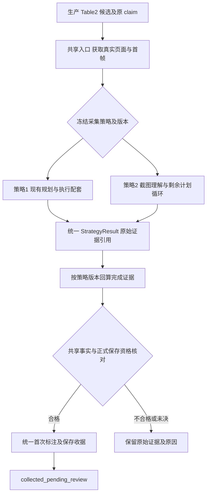

# 采集双策略设计

日期：2026-11-10。状态：设计阶段，尚未实施。配套任务拆分见[实施计划](采集双策略实施计划-20261110.md)。

保留现有采集方式为策略 1，新增以截图理解、目标进展和剩余计划修订为中心的策略 2。一个策略包含 Agent 协议及其工程配套：观察如何呈现、何时调用模型、怎样执行、怎样校验、怎样申请完成。两个策略输出同一种有证据引用的结果，再进入统一标注和保存接口。

核心改动是让原目标、最新动作事实、完成证据和保存资格形成一致的链路。策略 2 精简模型需要填写的工程字段；确定性事实仍由工程核对。本文不启动新采集，不改写历史轨迹、状态或费用。

## 1 需求与边界

| 项目 | 本次设计约定 |
| --- | --- |
| 策略选择 | 保留策略 1；显式选择策略 2。同一 attempt 冻结策略及版本，不在执行中切换后重放动作 |
| 原目标 | 有生产者指定目标就继承；没有目标时，Agent 根据入口页提出自然任务，首次接受后冻结目标与必要事项 |
| 初次规划 | 至少 5 个必要业务动作，优先 5–8 步，不设 8/10 步资格上限；没有自然路径就报告不适合，不补无用动作 |
| 剩余计划 | 只修订尚未执行的部分，可以少于 5 步；不得缩小原目标或追加无关目标凑数 |
| 正式保存 | 原目标完成、实际有效动作至少 5 步、来源证据可核对、无影响本条结论的未决外部效果 |
| 短流程和异常 | 保留原始执行、失败、用量与 UNKNOWN；不生成新的正式待审样本，不计入新交付 |
| 审核 | 保存最多到 `collected_pending_review`；独立 AI QC、人工审核、发布及客户验收另有证据 |
| 运行范围 | 本次只写设计与实施计划；旧批次授权不沿用，没有新的生产启动授权 |

动作数由实际执行事实产生。`wait`、截图、模型调用、完成申请不计有效业务动作；无效果点击不计步。不能拆出无用途的聚焦、重复提交或无关浏览来满足五步。

## 2 失败证据与另一份分析的合并

### 2.1 固定 40 条的正确分层

固定 40 条属于历史 V13 规划与 V5 收尾组合。原报告及原账支持以下事实，不能用它直接评价后续版本。

| 阶段 | 数量 | 正确解释 |
| --- | ---: | --- |
| 固定候选 | 40 | 运行范围 |
| 实际领取 | 38 | 另外 2 条未领取 |
| 本地生成规划任务 | 24 | `generation-result.json` 生成任务壳，不表示模型已经返回规划 |
| 正式 attempt | 22 | 进入正式尝试的候选 |
| 有模型请求记录的 attempt | 12 | 按原请求账的 `dispatch_attempt_id` 关联；另 10 条没有请求记录 |
| 最终接受首轮计划 | 10 | Muxtly 9、Wiki 1；其中有经过格式纠正才接受的计划，不是首个响应通过数 |
| 原目标检查标记 VERIFIED | 1 | 宿主检查结果，不等于独立语义 QC 通过 |
| 原目标成功且至少五步的正式保存 | 0 | 新要求下的正常保存 |
| 历史内部 controlled_exception 保存 | 6 | 历史策略的内部待审记录，不是新交付 |
| 客户导出 | 0 | 独立 QC、人工审核和发布也未运行 |

12 条有请求记录的尝试中，10 条最终接受首轮计划，2 条返回不适合。其余正式尝试包括 9 条 Wiki 的 `KeyError: 'items'` 和 1 条租约过期，均未进入模型请求。这不意味着模型首次成功率为 10/12：该比例混合了纠正后接受与合理拒绝，仍须拆分响应级指标。

因此，另一份分析中的 `10/24=41.7%`、Muxtly `9/13`、Wiki `1/11` 可以表示“本地任务生成后最终接受计划”的工程转化，但不能称为模型首轮规划质量；`KeyError` 数量应为 9，非 8。取消、锁冲突、租约问题按各自原始证据归因，不能把所有 `CancelledError` 都算成同一种工程错误。来源见附录 A。

### 2.2 方程求解案例

样本 `S000001_sample_000329` 的原目标为：把 `a=3、b=7、c=22` 改成 `a=4、b=7、c=11`，求解 `4x + 7 = 11`，查看解和逐步过程。

| 环节 | 已有真实记录 | 暴露的问题 |
| --- | --- | --- |
| 首轮 | 接受 7 步输入和提交计划；前两笔响应未通过，第三笔接受 | 协议兼容错误与业务路径应分别统计 |
| 输入 | 全选动作实际已核验，但计划谓词 `selected` 与输入文本选择语义不一致 | 工程谓词枚举让成功动作进入重规划 |
| 首次求解 | 提交后的 HTML 已有结果，但结果尚未进入当前视口 | 页面内部已有结果，不能直接当成模型已看见结果；应安排观察 |
| 后续 | 共 16 次业务动作派发，其中 9 次点击求解；滚动后结果才进入可见区域 | 已派发事实、最后有效动作和最新尝试混用，重复提交未被有效纠正 |
| 最后分支 | 模型看见 `x = 1.0000` 与过程，选择 `stop`，说明剩余点击和等待冗余 | 分支没有明确的完成申请选项 |
| 终态 | 8 个有效动作，`no_path`；原目标检查 PARTIAL，过程项缺区域和可见文本绑定 | 模型完成判断、证据绑定和工程收尾没有统一 |

该条原请求账有 15 笔请求，终态字段记录 14；保留差异，不修改原账。图像和实际输出支持“结果已经可见”，但旧工程没有形成完整完成凭据，不能直接把历史记录改标成功。

### 2.3 Wiki 案例补充

`S000002_sample_000344` 首轮规划查看特色列表与典范条目子门户并返回。执行中发生同名链接误落地，随后修订路线。最终 5 个有效动作，三项原检查均被宿主标为 VERIFIED；模型选择 `stop` 并说明目标完成，终态却为 `no_path/controlled_exception`。

这证明了完成状态接入存在矛盾。它不单独证明“查看最新内容”的语义已经充分满足：原检查中包含标题关键词，独立语义 QC 未运行。新设计既要消除 `stop → no_path` 的机械误判，也要避免把标题命中当作正文任务完成。

### 2.4 吸收与调整

| 另一份分析的观点 | 本方案处理 |
| --- | --- |
| 问题跨规划、执行、完成和保存，不能只怪模型 | 采纳，按阶段记录分母、失败与责任 |
| 目标级规划、原子执行、事件驱动重规划、证据驱动完成 | 采纳，并将正常业务检查点也纳入，不只在失败后调用 Agent |
| 完成与无路可走分开 | 采纳，策略 2 使用 `complete` 和 `give_up`，不使用多义 `stop` |
| 计划游标不能独立否决完成 | 采纳；真正必要的收尾义务应进入原目标事项 |
| 工程生成编号、步数、来源绑定等派生事实 | 采纳；显式冲突不能静默覆盖 |
| 至少五步只用于最终资格 | 调整：用户已确认首轮自然完整规划也至少五步，同时保留最终实际步数检查 |
| 全部 checks VERIFIED 就直接成功 | 收窄：须核对完整原事项、真实来源及语义对应；旧关键词 VERIFIED 不能直接升级为新完成凭据 |
| 旧 V13/V5 的失败说明当前实现仍完全相同 | 不采纳，分别记录历史证据、当前代码和未验证效果 |

当前工作树已经增加 `result_completion.py`，普通结果申请、在线收尾及封存回算已有复用基础。最新固定四条的只读诊断又发现首轮 `finish_when` 与实际结果协议仍有冲突，冗余 `target/value` 和缺字段仍会导致拒绝。策略 2 应复用已有证据能力，并把模型入口一起收口，不重新复制一套完成系统。[最新诊断](固定四条invalid_response根因与最小修复-20261110.md)

## 3 策略边界与整体结构



共享层保留候选领取、登录页排除、页面会话、浏览器原子执行、同步取证、模型账、原始证据存储及正式保存。策略决定这些能力的使用顺序及给 Agent 的契约。共享层不再替策略 2 检查策略 1 的 `band`、`finish_when` 或专属事件名称。

工程中已有 BMI、日期等 `*_strategy.py` 用于业务任务生成，本设计称为“采集策略”，选择范围是完整采集闭环，不能混成同一组策略。

### 3.1 策略 1

策略 1 将现有 `ReactSession + banded_plan.Controller` 接入适配器，保留现有规划方式和相应版本规则。适配器把真实终态与证据映射为统一结果，不伪造完成事件，不将旧 `no_path` 自动转成 success。

“保留策略 1”指保留实施时明确选定的源码与协议组合。当前工作树包含多轮改动，实施开始时须记录其版本；不能把名称“策略 1”视作固定的历史 V13/V5。旧任务按冻结版本解释；新策略 1 任务仍遵守当前正式保存资格。

### 3.2 策略 2

策略 2 的循环为：

1. Agent 看首屏，理解原目标；必要时提出目标和自然完整路径。
2. 工程补齐身份及引用，核对可执行参数，冻结原目标和事项。
3. 工程逐个执行动作、记录最新尝试及真实效果；确定性动作正常时继续。
4. 到业务检查点或发生偏离，给 Agent 当前截图与简洁的事实状态。
5. Agent 判断继续、替换剩余路径、申请完成或放弃。
6. 工程核对完成凭据，输出统一结果，由共享接口决定保存资格并保存。

只需两个实现、一个选择入口、一份结果契约与一条保存链，不增加动态插件系统、服务或通用工作流引擎。

### 3.3 方案取舍

| 方式 | 能解决的问题与不足 | 本次选择 |
| --- | --- | --- |
| 只修现有 schema 和 stop 映射 | 改动最少，能修局部兼容和收尾；观察输入、检查点与剩余计划机制仍保持现状 | 可作为策略 1 的独立版本修复，不代替策略 2 |
| 每一步都由 Agent 看图决定 | 局部反馈直接，但每次确定性输入也需要模型；仍需解决原目标、重复提交和保存一致性 | 暂不采用，真实调用成本和收益尚需比较 |
| 完整初始计划加业务检查点修订 | 保留全局任务和路径，工程执行确定动作；页面变化时由 Agent 及时调整 | 策略 2 的默认方式 |
| 规划与工程都去掉 DOM | 简化输入来源，但控件定位、输入核对和结果关联需重新实现 | 暂不采用；先精简模型输入并复用内部取证能力 |

## 4 Agent 与工程的分工

| 判断或数据 | Agent 负责 | 工程负责 |
| --- | --- | --- |
| 原目标 | 理解目标；无指定目标时提出合理目标 | 继承生产约束；接受后冻结，不让重规划删改 |
| 完成事项 | 说明需要看到什么业务结果，如“本次方程的解和过程” | 编号、保存版本、核对完整覆盖；不要求模型预猜答案字符串 |
| 完整路径 | 提出自然动作及用途、预期结果 | 校验动作参数，计算初次计划业务动作数 |
| 可见理解 | 从当前页面识别内容、目标控件及语义变化 | 提供当前截图，按需附当前可见控件标识 |
| 当前动作 | 选择目标与输入内容 | 绑定当前帧、确认焦点与参数、实际派发并记录 |
| 动作效果 | 判断语义上是否推进原目标 | 派发状态、URL、焦点、输入值、选择状态、滚动等可确定事实 |
| 剩余计划 | 看全局进度，删除冗余步骤，调整路径，补齐原目标所需观察 | 保留已执行历史，只替换未执行尾部；重新绑定当前控件 |
| 完成申请 | 逐项说明实际结果，引用看过的截图区域或可见证据 | 核对原事项覆盖、来源、时序、输入与提交关联，生成完成结论 |
| 保存资格 | 无需输出步数、short_flow 或最终保存状态 | 按有效动作、完成凭据、UNKNOWN 等统一判断 |
| 独立审核 | 采集 Agent 不授予 QC 通过 | 由后续独立 QC、人审等各自生成收据 |

初次计划保留简短的 `purpose` 和自然语言 `expected_result`，支持执行理解及首次标注；不再让模型为每步填写 `focused/selected/text_selected` 等工程枚举。缺少必要语义信息时可在原观察下补齐，不能用 `purpose` 冒充 Agent 对结果的预期。

工程“核对完成”不等于工程能独立理解全部页面。通用语义由 Agent 提出，工程验证证据绑定和可确定事实；复杂阅读质量由独立 QC 再检查。不能因减少工程规则就让 `complete=true` 直接落成样本。

## 5 截图输入与 DOM 的使用

### 5.1 默认输入

策略 2 默认向规划 Agent 提供当前原始截图，以及以下紧凑状态：

- 固定原目标、原事项和已确认进展。
- 最新一次动作尝试的输入、是否派发、结果与当前观察引用。
- 未完成事项、剩余步骤、当前调用原因。
- 对本次判断必要的历史结果截图或已确认可见证据摘要。
- 允许的决策和动作定义；按需附当前可见控件的短标识。

不默认发送完整 DOM 树、HTML、全部探测错误、无关页面注册表或全量历史对话。现有 DOM 输入本就包含可见投影，不能笼统把它描述成“完整隐藏网页”；真正要改的是模型输入的职责和信息量。

内部保留 DOM/可访问性与真实浏览器状态，用于当前控件定位、焦点及值核对、截图与页面同步、动作来源和结果因果绑定。DOM 中屏外或隐藏的答案不作为“Agent 已看见”或正式视觉完成证据。

### 5.2 控件定位

当前截图可附 `control_1` 等短编号或只包含可见控件的清单。模型选择编号或可见语义目标；工程映射到当前观察中的实际控件。标号图属于推理辅助图，原始 PNG 保持不变，并保存辅助图与原图的关系。

未来页面的步骤只写目标语义，不伪造未来节点 ID。执行前用当前帧重新定位；唯一且无冲突时绑定，有同名控件或页面已变时反馈给 Agent。不得凭模糊匹配点击另一个“求解”或同名链接。

这是“截图主导、工程内部保留 DOM”的方案。完全不向模型提供控件清单也可作为后续比较项，但当前 GLM 的定位精度和调用成本尚无该方案下的真实基线，不在本轮先承诺纯视觉更好。

### 5.3 取证与调用时机

| 时机 | 工程取证 | 是否调用 Agent |
| --- | --- | --- |
| 入口首屏 | 原图、当前状态、来源绑定 | 是，形成首轮目标与完整计划 |
| 普通聚焦、全选、输入 | 按原子执行链保存前后事实 | 值、焦点等正常时不必调用 |
| 提交、页面跳转、对话框或内容显著变化 | 更新截图及当前观察 | 是，判断结果、落地和剩余路径 |
| 目标未唯一定位、输入不符、已知无效果 | 保存本次真实尝试及反馈 | 是，禁止把上次成功动作冒充本次结果 |
| 计划内读取结果或完成检查点 | 保存可见结果及必要历史证据 | 是，申请完成或调整未完成部分 |
| 同帧引用或格式缺项 | 复用原观察；只补相关反馈 | 可局部纠正，不重新做业务动作 |

提交后页面尚在加载，工程先完成既有稳定观察；若当前证据仍不够，由 Agent 选择等待、滚动或其他必要观察。不因为计划里原先没有 `scroll/wait` 就禁止补充观察；也不因为页面没有立刻变化就再次提交。

## 6 剩余计划修订协议

### 6.1 模型每次看到的状态

`latest_attempt` 与 `last_effective_action` 必须分开。前者包括最新失败、无效果、未派发和 UNKNOWN；后者只是已建立效果的最近动作。分支的文字摘要、截图和动作引用必须对应同一次观察，不能从有效轨迹尾部拼出“最新结果”。

工程提供的进展分成“已有证据支持”和“尚待确认”。Agent 上轮说完成而工程尚未接纳的事项，也明确标为待确认并附具体缺口，避免模型误以为必须重新操作。

示例输入是拟议策略 2 契约，非历史原始回包。图片通过模型图像输入发送，JSON 中仅展示引用：

```json
{
  "goal": "求解4x + 7 = 11，并查看解和逐步过程",
  "requirements": [
    {"id": "r1", "description": "查看本次输入对应的解"},
    {"id": "r2", "description": "查看本次输入对应的逐步过程"}
  ],
  "current_observation": "o8",
  "screenshots": ["o8"],
  "latest_attempt": {
    "ref": "a7",
    "action": "click",
    "target": "求解",
    "dispatch": "confirmed",
    "inputs": {"a": "4", "b": "7", "c": "11"},
    "visible_result": "当前视口尚未确认结果",
    "repeat_requires_new_reason": true
  },
  "confirmed_progress": ["输入值已核对", "求解已派发"],
  "missing_requirements": ["r1", "r2"],
  "remaining_plan": [{"action": "scroll", "direction": "down", "purpose": "查看结果区"}],
  "reason": "提交后的业务检查点",
  "choices": ["continue", "revise", "complete", "give_up"]
}
```

### 6.2 四种决策

| 决策 | 含义 | 校验及后续 |
| --- | --- | --- |
| `continue` | 已有剩余路径仍适用 | 工程重新绑定下一步，执行到下个检查点；无剩余步骤时不能空转 |
| `revise` | 依据当前页面替换剩余计划 | 只提交新的未执行尾部和简短理由；原目标、事项及已执行历史不可改 |
| `complete` | 原目标各事项已完成 | 提交逐项实际结果与证据引用；工程核对后才进入完成状态 |
| `give_up` | 当前没有可行路径或候选不适合 | 记录未完成事项及原因，保留 raw；不等于完成 |

首轮专用 `submit_plan` 提交目标、事项及完整计划；自然不足五步可返回不适合。执行分支不再用完整首轮协议重写一遍目标，也不要求剩余计划补满五步。

例如，已经提交后，旧尾部仍计划再次点击求解，Agent 可以直接替换尾部：

```json
{
  "decision": "revise",
  "reason": "本次求解已派发，当前需要把结果区带入视口",
  "remaining_plan": [
    {
      "action": "scroll",
      "direction": "down",
      "purpose": "查看本次方程的结果和过程",
      "expected_result": "结果区进入当前视口"
    }
  ]
}
```

工程替换旧尾部，分配新计划版本；输入和提交记录保持原样。若原尾部已经是这一步，返回 `continue` 即可，无需重写计划。修订不需要复杂的步骤 diff 协议。

`complete` 在每个业务判断分支都可申请，不能因为单步预期未命中而从选项中消失。补看原图属于观察能力，不与 `complete/give_up` 争用终态语义。

### 6.3 如何减少重复点击

1. 每次真实派发由工程分配动作身份，并保存派发前观察、参数和派发结果；同一个动作身份不重复发送。
2. 同一输入、同一业务目标、同一页面状态下刚派发过的提交，不能仅因结果未进视口就再点击。反馈应先提供“已提交、结果待观察”。
3. 要重试，Agent 必须指出新的依据，例如修正了输入、重新定位了误点目标，或页面明确提示可重试。工程核对依据是否对应实际变化。
4. 已知无效果后仍返回完全相同方案，工程给出局部冲突反馈，不再重复派发；Agent 应观察、改路或放弃。
5. 同一观察、同一反馈、同一决策持续不变且没有新证据时，以本策略的无进展原因结束本条，不能靠无限的格式纠正继续循环。这里按事实相同判定，不恢复历史的全局调用次数或时长配额。
6. 派发结果 UNKNOWN 时，保留原请求和动作身份，不以新编号重试；先按既有原账规则处理，不推断“没成功所以可以再点”。

去重约束针对同一事实状态下的同一业务意图，不能一律禁止“返回后再次进入”或合法的后续不同输入提交。用原子动作收据和最近反馈即可实现，不引入新的分布式幂等服务。

页面明确显示处理中时，合理等待属于必要观察，不是重复提交。不能仅凭两帧像素相同就宣布无路可走；无进展结束针对已经得到具体反馈、仍无新依据地重复同一决策的循环。

## 7 方程案例在策略 2 中的完整交互

以下是拟议流程，用于解释接口与分工，未重新访问网页或调用模型。

### 7.1 首轮

工程发送入口截图，显示 `a=3、b=7、c=22`、求解按钮，以及候选用途、允许动作、首轮至少五个必要业务动作的要求。若生产候选已有指定目标则同时发送；本例沿用历史第一次接受的方程目标，后续不得改题。

Agent 提出两项完成事项：查看本次方程的解；查看相应逐步过程。无需预先输出 `x=1` 作为 `finish_when`。计划示例如下：

| 步骤 | 模型提出的动作 | 模型的业务预期 | 工程可确定的事实 |
| --- | --- | --- | --- |
| 1 | 点击 a 输入框 | 准备替换 a | 实际焦点属于 a |
| 2 | 全选当前输入 | 选中旧值 | 选择区间覆盖当前值 |
| 3 | 输入 4 | a 变成 4 | 当前值及输入派发 |
| 4 | 点击 c 输入框 | 准备替换 c | 实际焦点属于 c |
| 5 | 全选当前输入 | 选中旧值 | 选择区间覆盖当前值 |
| 6 | 输入 11 | c 变成 11，b 保持 7 | 当前表单值 |
| 7 | 点击求解 | 页面处理本次输入并给出结果 | 提交已派发，输入快照与新观察绑定 |
| 8 | 必要时向下滚动 | 将下方结果区带入视口 | 滚动和可见区域变化 |

第 8 步是已观察布局下的结果查看安排；如果结果已经可见，后续应删除它。不能为了保住初始计划长度而继续滚动。1–6 步的聚焦和全选仅在当前输入控件确有此操作需要时保留，不推广成所有表单强行拆步的模板。

### 7.2 输入与提交

Agent 的单步输出只需业务信息，例如：

```json
{
  "action": "type",
  "target": {"visible_label": "系数 a"},
  "value": "4",
  "purpose": "把系数改为本次方程要求的值",
  "expected_result": "系数 a 显示为 4"
}
```

工程生成动作身份和当前帧绑定，执行并记录结果。全选实效由工程结合当前焦点、按键和选择区间判断，不要求模型在 `selected` 与 `text_selected` 之间猜枚举。

步骤 7 后进入业务检查点。若结果在屏外，Agent 看当前截图和“已提交”的事实，可以 `continue` 执行结果查看，或 `revise` 为必要滚动。屏外 DOM 的结果可帮助工程诊断，但不能跳过可见观察直接宣布完成，也不能因此重复点击求解。

### 7.3 看见结果后申请完成

工程发送结果区截图，显示 `x = 1.0000` 和当前方程的逐步过程，并提供本观察的证据引用。本例用 `region_result`、`region_steps` 表示工程在当前截图上标识的两个可见区域，均已绑定原图。Agent 返回：

```json
{
  "decision": "complete",
  "answers": [
    {
      "requirement_id": "r1",
      "observed_result": "结果显示 x = 1.0000",
      "evidence": [{"observation": "o9", "region": "region_result"}]
    },
    {
      "requirement_id": "r2",
      "observed_result": "过程显示 4x + 7 = 11，减去7，再除以4",
      "evidence": [{"observation": "o9", "region": "region_steps"}]
    }
  ]
}
```

`region` 可由当前可见证据短编号或图中明确区域定位；工程必须能把它绑定到真实图像区域，不能仅保存“结果区”三个字作为证明。绑定不唯一时反馈缺口，要求在同帧补引用，保留已完成输入与提交。

工程核对：a/b/c 的本次输入、真实提交身份、提交后的同一页面结果、原图与引用、两项原义务是否均被覆盖。接受后原目标为 completed，剩余计划全部失效，不再点击。有效步数从真实执行轨迹计算，至少五步才进入正式标注和保存。

该流程不承诺固定调用次数；正常输入无需逐步问模型，业务检查点需要判断，缺少引用可以局部补充。验收看真实轨迹和保存收据，不以理论步骤数作为产出。

## 8 各策略独享校验与共享底线

### 8.1 校验所有权

| 校验内容 | 策略 1 | 策略 2 | 共享层 |
| --- | --- | --- | --- |
| 首轮与分支 prompt、tool schema | 按现有冻结版本 | 独立精简协议 | 只传输、记账，不套另一个策略的 schema |
| 已知格式等价整理 | 现有规则及显式版本修复 | 在本策略解析入口处理 | 保存原回包与整理记录 |
| band、finish_when、单步工程谓词 | 继续按策略 1 版本解释 | 不要求模型输出 | 不设全局门禁 |
| 自然语言用途与预期 | 保持原协议 | 业务动作保留简短用途和预期 | 首次标注引用原计划，不能事后伪造 |
| 剩余计划及调用检查点 | 现有控制逻辑 | 本文的业务检查点与尾部替换 | 真实执行与取证能力复用 |
| 完成申请语义 | 原有 finish_result、finish_reading 等 | 统一 complete 及逐项证据 | 按冻结版本回算后，接收同一种完成凭据 |
| 真实动作、来源、未知状态 | 必须保留 | 必须保留 | 统一核对，不因策略放宽而绕过 |
| 原目标和正式保存资格 | 遵守新任务的当前要求 | 同一要求 | 完成且有效步至少五步，才正式保存 |

### 8.2 可以放宽的内容

解析顺序为：原始回包留存 → 可确定等价整理 → 本策略必要结构校验 → 业务语义与当前证据校验。

- 工程补齐 attempt、observation、动作编号、页面绑定、计步等派生字段，减少模型重复输出。
- 可确定的 JSON 容器、字段别名、空的无意义字段可整理，记录原值及整理依据。
- `wait` 上无执行意义的按钮标签可移为上下文；特定容器滚动的 target 不能丢掉。
- `expected.value=750` 与控件标签分开，不能因字段不被旧 schema 认识就把真实值过滤掉。
- `hotkey` 的目标若有意义，作为焦点前提核对，不能直接删除后打到任意控件。
- 可选理由或说明缺失不阻止已有明确动作；必要 action/value、原义务、完成证据和首次标注所需语义缺失则局部补齐。

策略 2 可以删除自己不需要的旧字段。策略 1 的既有版本不能通过“全局关闭严格校验”悄悄改变含义。已知等价可兼容，业务歧义不可猜测。

### 8.3 不能放宽的内容

以下问题仍须拒绝相应派发、完成或保存：目标被替换；显式身份相互矛盾；当前控件不唯一或已过期；实际输入与目标不符；把输入值当答案；把旧页面结果当本次提交结果；引用未看见的隐藏内容；越过 UNKNOWN 尾部拼接；伪造有效步；异常或短流程进入正式保存。

“拒绝”应落在最小必要层次。引用缺失通常只阻止完成申请，不抹掉已完成动作；可纠正参数只暂停该动作；`KeyError`、数据库异常等工程错误直接分类，不向模型反复要求重写计划。

### 8.4 防止只改 Agent 忘改工程

每个策略版本共同拥有 `prompt / schema / normalizer / runtime validator / completion verifier`。实现可复用原模块，不要求物理上全部放进一个文件。模型看到的 schema 与宿主结构检查尽量来自同一份定义；增加字段或决策必须同时更新其使用方。

在线完成与封存后回算调用同一版本的确定性函数。共用函数不自动证明语义正确，仍需真实输入反例验证。字段错误要记录阶段、字段路径、原响应引用、可否局部纠正，避免只有笼统的 `invalid_response`。

## 9 完成状态与收尾优先级

### 9.1 分开记录四件事

| 维度 | 建议语义 | 示例 |
| --- | --- | --- |
| 原目标状态 | `unconfirmed / partial / completed` | 解已见，过程未绑定：partial |
| 执行结束原因 | `goal_completed / no_path / unsuitable / no_progress / user_stopped / engine_error / unknown` | 用户停止就是 user_stopped，即使迟到回包可解析 |
| 保存资格 | `eligible / ineligible / unresolved` 加具体原因 | 目标完成但只有四步：ineligible，原因 short_flow |
| 保存状态 | `not_saved / collected_pending_review / save_failed` | 文件写入失败不应反向改写目标是否完成 |

这是统一结果中的语义，不要求一次迁移所有旧数据库枚举；通过现有状态字段和结果记录映射，保留原值与版本。

### 9.2 判定顺序

1. 用户停止、未决派发或严重工程异常先约束后续执行：停止新动作和新调用，原账收口，不能凭迟到响应恢复任务。
2. 没有上述阻塞时，核对覆盖全部原事项的完成凭据。凭据成立，原目标完成，停止执行剩余动作。
3. 单步预测、路径游标、未执行的冗余计划不再另外否决完成。确实必须“返回入口”“关闭弹窗”等义务，应在冻结目标中明示。
4. Agent 申请完成但缺证时，反馈具体缺口，在当前或真实历史观察中补引用；确需新业务观察才继续执行。
5. 原目标未完成时，才按继续、修订或放弃处理。
6. 完成之后独立计算有效步数与正式保存资格；不为五步继续做没有必要的动作。

首次申请 `complete` 也可以比原计划提前。工程已经持有完整且有效的完成凭据时，不必再增加一次“请改成完成选项”的模型调用。反之，单凭旧 checks 的 VERIFIED 或一段“我完成了”不能自动成功。

策略 2 不提供多义 `stop`。如果收到未知旧字段或 `stop`，先反馈明确的决策选择；只有本次原始响应已经含有可核对的完整完成申请，才可按显式别名规则整理。既不能一律映射为 no_path，也不能仅凭自然语言“完成”改成成功。策略 1 旧历史继续按原版本解释。

### 9.3 唯一完成凭据

完成凭据包含：冻结目标与原事项、Agent 对每项的实际结果说明、观察和图像区域引用、必要动作与提交关联、工程核验结果及策略版本。在线收尾、首次 annotation、保存资格和离线回算共同消费它。

模型预测 `expected_result` 用来帮助执行，不能作为结果证据；计划游标表示路线进度，不能成为另一份隐藏任务；最终 annotation 描述已证实事实，不得自行重判或补写完成依据。

## 10 统一策略结果与保存接口

### 10.1 StrategyResult

下列是拟议的内部 Python 数据契约，不是要求模型返回的 JSON，也不是新建一份完整重复账本。大对象使用现有文件引用与哈希。

| 字段 | 所有者及内容 |
| --- | --- |
| `result_version` | 共享内部结果契约版本 |
| `strategy` | 策略 ID、协议版本、必要源码/提示/schema 身份 |
| `binding` | 工程及 manifest、candidate、claim、attempt、sample 的原身份 |
| `goal` | 冻结目标、原事项及首次接受记录引用 |
| `execution` | 有序动作尝试、有效轨迹、观察、派发及原始收据引用 |
| `completion` | 完成申请、逐项证据、版本化核验报告；未完成也保留缺项 |
| `end` | 执行结束原因、失败分类、未决信息、最终观察引用 |
| `usage_refs` | 原模型请求与用量账引用，不由模型估算或另建费用 |
| `raw_receipt` | 密封原始证据集合及其哈希引用 |

有效步数、原目标状态可以作为预览值存在，但共享保存须从原事实回算并核对，不能信任策略给出的布尔 `success` 或任意数字。策略返回失败也使用同一结果结构，原始保全与正式保存是不同动作。

### 10.2 最小接口

```python
# 设计伪代码，尚未实现。
strategy = select_collection_strategy(frozen_strategy_id, frozen_version)
result = await strategy.run(context)  # context 复用当前页面、原账、原子执行与取证
receipt = save_strategy_result(result, save_context)
```

策略内部的 `verify_completion` 接受封存事实，在线和保存阶段复用；它不访问新网页、不发起新模型调用。共享保存只选择已实现且版本匹配的核验器，不接受策略自带的任意“校验已通过”声明。

### 10.3 统一保存步骤

1. 保全并核对 raw 引用、身份和哈希。失败、UNKNOWN 和停止也保留原始结果。
2. 按冻结策略版本读取原事实，回算完成凭据；共享层核对真实执行、来源、有效步数及未知尾部。
3. 生成统一资格结论。完成且至少五个有效动作、证据可信且无相关未决外部效果，才允许生成正式投影。
4. 首次生成 annotation，复用相同完成凭据；复用既有动作标注、图像处理和交付格式工具。
5. 调用现有 RuntimeStore 提交及原子去重，产生保存收据，状态为待审。提交时复核同一资格函数，不另维护一组门槛。
6. 后续 QC handoff、客户格式导出按已有显式流程使用同一结果及资格；格式导出本身不授予 QC 或发布状态。

当前 `postprocess.session_record`、完成派生和 `closing_policy` 仍认识 React/conditional-plan 专属结构。实施时应增加真实的版本化读取适配，使两个策略产生相同的内部事实对象，再共用后续标注保存。不能让策略 2 伪造 `HOST_PLAN_ENDPOINT`、旧 plan-branch 或旧截图事件来骗过保存。

保存出错记录 `save_failed` 与实际原因。若已有原保存收据，按原身份核对并复用；不得重新启动业务动作，也不新分配样本号绕过去重。

## 11 版本与效果评价

任务首次执行前冻结策略及协议组合，恢复时读取原版本。策略 2 与策略 1 可在不同新 attempt 中选择；不自动迁移旧任务，不重派占用中的候选或 UNKNOWN 请求。新结果字段优先放已有任务元数据和证据文件；只有现有结构无法承载时才增加必要存储字段。

比较效果至少分别报告：本地任务生成数、实际发出首轮请求数、首次响应结构通过数、纠正后计划接受数、不适合数、开始业务动作数、错误落地恢复、重复派发及无进展、原目标完成数、完成但不合资格数、正式保存数、保存失败数、导出及各审核状态。模型费用以原账计，不用终态摘要代替。

模型规划质量只在真正进入模型的输入上评价；系统端到端表现仍以固定候选为分母，两者同时报告。不能用放宽校验后更多的“接受”替代真实完成和保存，也不能把工程启动故障计成模型不会规划。

真实策略对比只使用生产 Table2 的有效候选。相同历史原件可以用于隔离的输入/输出契约检查，不能冒充策略 2 的真实执行；有界真实对比须事先固定候选、目标、模型条件及不补位范围，并遵守原领取与去重规则，不重派历史已消费候选。

## 附录 A 证据与代码入口

- [固定 40 条报告](消费者固定40条真实验证-20261110.md)、[逐条结构化结果](../verify_results/consumer-success-fixed40-20261110-r01/analysis-final-20261110T1903/summary.json)。模型请求关联来自原 `results/candidate-project-baselines-deep-20261109-r01/state/consumer-jobs.sqlite3`，按 `model_requests.request_json.dispatch_attempt_id` 关联正式 attempt；本设计不复制原请求或凭据。
- [方程首轮计划](../results/candidate-project-baselines-deep-20261109-r01/collections/consumer/c340f35f-40b8-4c56-9135-6d328d4d8709/execution/capture/evidence/S000001_sample_000329/raw/0005-conditional-plan.json)、[最后分支](../results/candidate-project-baselines-deep-20261109-r01/collections/consumer/c340f35f-40b8-4c56-9135-6d328d4d8709/execution/capture/evidence/S000001_sample_000329/raw/0299-plan-branch.json)、[终态](../results/candidate-project-baselines-deep-20261109-r01/collections/consumer/c340f35f-40b8-4c56-9135-6d328d4d8709/execution/capture/evidence/S000001_sample_000329/raw/terminal.json)、[结果截图](../results/candidate-project-baselines-deep-20261109-r01/collections/consumer/c340f35f-40b8-4c56-9135-6d328d4d8709/execution/capture/evidence/S000001_sample_000329/raw/observation-063.png)。
- [Wiki 首轮计划](../results/candidate-project-baselines-deep-20261109-r01/collections/consumer/b09e1229-f80e-4aa7-9e5a-4a26f233ae0b/execution/capture/evidence/S000002_sample_000344/raw/0005-conditional-plan.json)、[最后分支](../results/candidate-project-baselines-deep-20261109-r01/collections/consumer/b09e1229-f80e-4aa7-9e5a-4a26f233ae0b/execution/capture/evidence/S000002_sample_000344/raw/0098-plan-branch.json)、[终态](../results/candidate-project-baselines-deep-20261109-r01/collections/consumer/b09e1229-f80e-4aa7-9e5a-4a26f233ae0b/execution/capture/evidence/S000002_sample_000344/raw/terminal.json)。
- [最新统一修复及四条结果](统一方案集中实施与固定四条验证-20261110.md)、[两笔 invalid_response 诊断](固定四条invalid_response根因与最小修复-20261110.md)。已有修复与集成不能替代策略 2 的未来真实验收。
- 入口与执行：[candidate_consumer.py](../projects/code/webcollect/candidate_consumer.py)、[collect_runtime.py](../projects/code/webcollect/collect_runtime.py)、[react_session.py](../projects/code/webcollect/react_session.py)、[banded_plan.py](../projects/code/webcollect/banded_plan.py)。
- 协议与保存：[model_gateway.py](../projects/code/webcollect/model_gateway.py)、[result_completion.py](../projects/code/webcollect/result_completion.py)、[postprocess.py](../projects/code/webcollect/postprocess.py)、[closing_policy.py](../projects/code/webcollect/closing_policy.py)、[runtime.py](../projects/code/webcollect/runtime.py)。

以上历史原件按本地路径引用，不改写或提交原始请求、数据库、截图及运行产物。代码入口用于实施定位，实际实现仍以开始实施时的源码为准。
