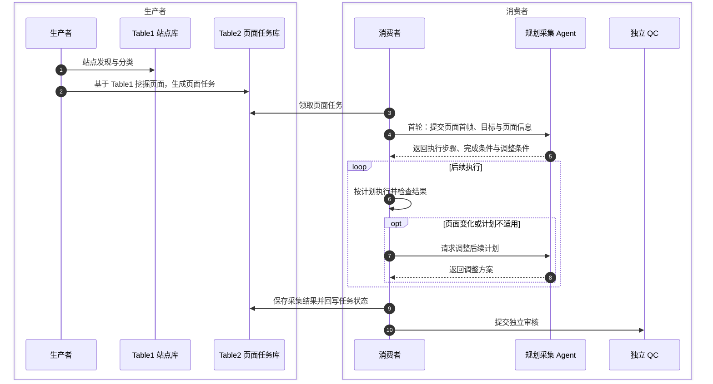
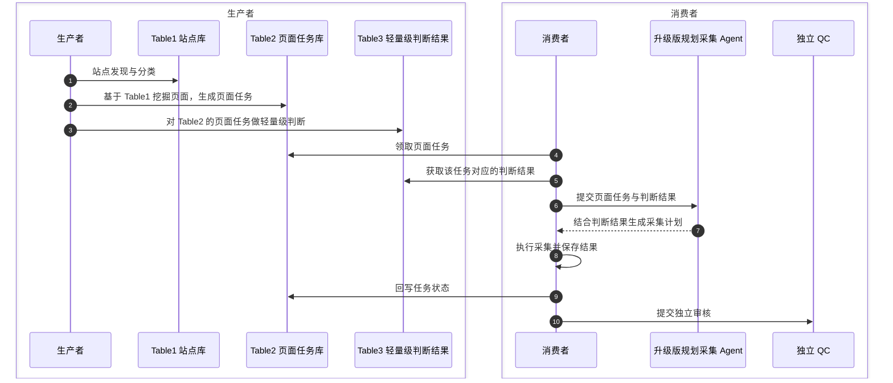

# WebCollect 方案数据流与时序示意图

> 面向架构方案沟通。图中步骤编号表示先后顺序，并明确生产者、消费者的职责边界。

## 表职责

- **Table1：站点库**，保存站点信息。
- **Table2：页面任务库**，保存供消费者执行的页面任务。
- **Table3：轻量级判断结果**，由生产者针对 Table2 的页面任务生成，**不是模板库**。
- **Table4：网站模板信息**，仅方案 B 新增，由生产者针对网站模板进行采集。

## 一、现状

**现状特点：** 生产者提供站点和页面任务；规划采集 Agent 首轮制定计划，消费者后续按计划执行，遇到变化再由 Agent 调整。

### 1. 当前规划采集 Agent 做什么

| 阶段 | 具体工作 | 职责边界 |
|---|---|---|
| **首轮：理解并规划** | 查看页面首帧、当前 URL、页面结构和采集目标；形成一份完整计划，包括执行步骤、完成条件，以及什么情况下需要调整计划 | 首轮只制定计划，不直接点击页面，也不代表采集已完成 |
| **正常后续：按计划推进** | 消费者逐步绑定页面元素、执行动作，并检查动作前后的页面变化；证据符合预期就继续下一步 | 不需要每一个固定步骤都重新调用 Agent 规划 |
| **异常后续：必要时再决策** | 遇到页面变化、目标不清楚、动作效果未证实或无法确认是否完成时，Agent 根据当前进度选择继续、调整剩余计划、查看原图或停止 | 调整的是尚未执行的步骤，不默认从头重做；停止也不等于采集成功 |
| **结束：保存与审核** | 完成条件得到证实后，由消费者保存采集结果并回写 Table2，再进入独立 QC | Agent 负责规划与必要的调整，消费者负责执行、保存和回写，QC 独立判断质量 |

### 2. 当前生产者提供的页面信息

| 信息分组 | 当前已有内容 | 对消费者的作用 |
|---|---|---|
| **页面入口** | 原始可导航 URL | 告诉消费者打开哪个页面 |
| **页面任务类型** | 入口页或目标页 | 区分需要自主探索的页面，和已经带有明确目标的页面 |
| **采集目标** | 入口页不预设目标；目标页可包含目标类型、实体和参数 | 告诉消费者需要完成什么，而不是只给一个网址 |
| **页面归属与来源** | 所属站点，以及分类、站点决定和证据引用等来源信息 | 便于追溯页面来自哪里、为什么进入任务库 |
| **任务管理信息** | 任务标识、去重标识、版本、状态和创建时间 | 用于领取、跟踪、回写和避免重复消费 |
| **可关联的站点信息** | 通过 Table1 获得站点分类、首页、语言、挖掘状态和范围等 | 帮助理解站点背景，但不是页面任务正文中的完整采集说明 |

### 3. 对后续优化最重要的当前缺口

当前 Table2 的页面任务主要回答“**打开哪里、完成什么、如何领取和追踪**”，还没有统一提供“**这个页面是什么结构、是否容易采集、应该采用什么采集方式**”。

- 生产者尚未在页面任务中统一提供页面结构摘要、可操作性判断、页面截图或网站模板信息。
- 因此消费者通常要先打开页面，再在首轮理解页面并规划，未知页面的规划成本较高。
- **方案 A 的 Table3** 用于补充生产者对 Table2 的轻量级判断；具体判断维度需要在方案 A 中继续明确。
- **方案 B 的 Table4** 进一步补充网站模板信息，让规划采集 Agent 同时获得页面任务、轻量级判断和网站模板背景。

## 二、方案 A：生产者增加 Table3，消费者升级规划采集 Agent

**核心变化：** Table3 由生产者生成，作为消费者规划采集的补充输入；Agent 不再只依据页面任务本身进行规划。

## 三、方案 B：增加 Table4，Table2 结合 Table4 和 Table3 后再消费

```mermaid
sequenceDiagram
    autonumber
    box 生产者
        participant P as 生产者
        participant T1 as Table1 站点库
        participant T4 as Table4 网站模板信息
        participant T2 as Table2 页面任务库
        participant T3 as Table3 轻量级判断结果
    end
    box 消费者
        participant C as 消费者
        participant A as 升级版规划采集 Agent
        participant Q as 独立 QC
    end

    P->>T1: 站点发现与分类
    P->>T4: 基于 Table1 针对网站模板进行采集
    P->>T2: 基于 Table1 生成初始页面任务
    P->>T3: 对 Table2 的页面任务做轻量级判断
    P->>T2: 结合 Table4 和 Table3，完善可供消费的页面任务
    C->>T2: 领取完善后的页面任务
    C->>A: 提交任务及其网站模板、判断信息
    A-->>C: 结合两类信息生成采集计划
    C->>C: 执行采集并保存结果
    C->>T2: 回写任务状态
    C->>Q: 提交独立审核
```

**核心变化：** 生产者先形成初始页面任务，再补充 Table4 的网站模板信息和 Table3 的轻量级判断结果，最后由 Table2 统一交给消费者。消费者仍通过 Table2 领取任务，不绕过 Table2。

## 方案对比

| 方案 | 生产者新增能力 | 消费者使用方式 |
|---|---|---|
| 现状 | Table1 提供站点，Table2 提供页面任务 | 领取 Table2，首轮规划，后续执行与调整 |
| 方案 A | 新增 Table3，对 Table2 做轻量级判断 | 将 Table2 任务与 Table3 判断结果一起交给升级版 Agent |
| 方案 B | 在方案 A 上新增 Table4，采集网站模板信息 | Table2 先结合 Table4 和 Table3，再由升级版 Agent 统一规划 |
